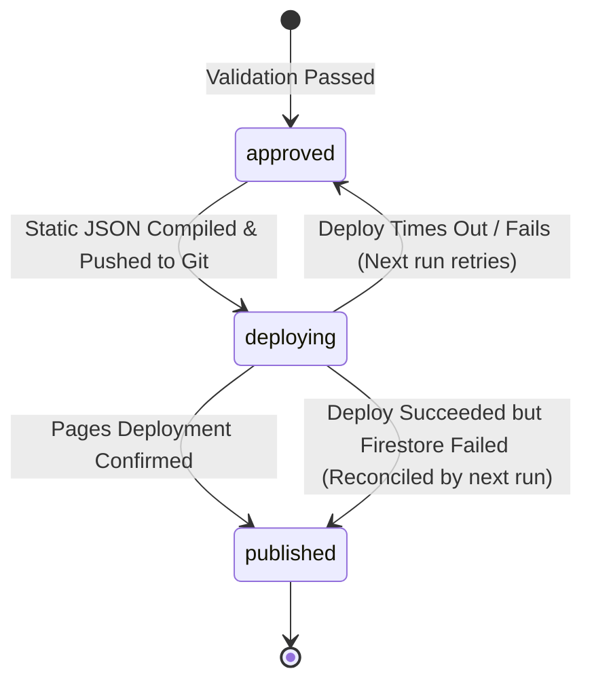

# GitStore — Architecture Specification

**Document Version:** 1.2.0  
**Phase:** Phase 0.1.1 — Critical Architecture Corrections & Hardening  
**Status:** Approved Architectural Baseline (Corrected)  

---

## 1. Architectural Philosophy and Invariants

The design of GitStore is governed by six non-negotiable architectural invariants:

1. **Strict Dual-Platform Confinement:** The entire lifecycle of GitStore—from development and source control to database transactions, background processing, and binary delivery—is confined strictly to **GitHub** and **Firebase**. No tertiary PaaS, serverless function providers (Vercel, AWS Lambda, Netlify), or external relational databases (Supabase, PlanetScale) are permitted. No Firebase Hosting or Cloud Functions are used.
2. **Binary Non-Execution & Non-Hosting:** GitStore is a catalog, discovery engine, and verification broker. GitStore never executes submitted executables, never runs sandboxed code evaluation, and never stores or caches binary payloads inside Git repositories or Firebase Storage.
3. **Static-First Read Architecture:** Storefront visitor traffic is 100% decoupled from the transactional database. 100% of anonymous catalog requests terminate at GitHub Pages' static file server (`data/catalog.json`), keeping Cloud Firestore operations reserved strictly for authenticated developer interactions, submission workflows, and background worker state transitions.
4. **Zero-Trust Client Boundary:** The client-side browser is treated as untrusted. No client-side code possesses the authority to grant permissions, verify developers, alter product publication statuses, claim processing leases, or bypass release validation.
5. **Decoupled Privileged Administration via Canonical Repository Collaborators:** Normal browser clients never receive Firebase Admin SDK credentials, and client JavaScript cannot mint custom claims. All privileged administrative operations execute via the privileged **GitHub Actions Batch Worker**, verified authoritatively against **GitStore's own canonical GitHub repository** (`Rohitpvt/GitStore`) collaborator permissions.
6. **Portability and Standards Compliance:** The client application uses standards-compliant HTML5, CSS3, and ES6 JavaScript Modules. No proprietary framework compilers (React, Next.js, Vue) or custom runtime dependencies exist.

---

## 2. Hardened System Architecture Diagram

```mermaid
graph TB
    subgraph ClientLayer["Client Layer (GitHub Pages Static Host)"]
        Visitor["Public Visitor Browser\n(Browse & Download)"]
        Developer["Software Developer Browser\n(Submit & Dashboard)"]
        AdminBrowser["Administrator Browser\n(Admin Dashboard)"]
        StaticCatalog["Pre-Compiled Static Storefront Data\n(data/catalog.json & products/*.json)"]
    end

    subgraph FirebasePlatform["Platform 2: Firebase Infrastructure (Spark Plan)"]
        FirebaseAuth["Firebase Authentication\n- GitHub OAuth (Popup)\n- Passwordless Magic Link\n(0 Password Fields on Pages)"]
        Firestore["Cloud Firestore Operational Database\n- users/{uid}\n- submissions/{id}\n- moderation_requests/{id}\n- products/{id}\n- categories/{id}\n- reports/{id}\n- admin_logs/{id}\n- system_config/global_settings"]
        SecurityRules["Firestore Security Rules\n- Strict RBAC & Immutability\n- Zero Client Self-Escalation\n- Immutable Lease Flags"]
        AppCheck["Firebase App Check\n- reCAPTCHA v3 Web Provider\n- Lazy-Loaded on Auth Pages Only"]
    end

    subgraph GitHubPlatform["Platform 1: GitHub Core Infrastructure"]
        GHPages["GitHub Pages\n- Vanilla HTML5/CSS3/ES6 Storefront\n- Direct Static Asset Serving"]
        GHIssues["GitHub Issue Forms\n- Ingestion Queue (.github/ISSUE_TEMPLATE)"]
        GHReleases["Public GitHub Releases\n- Direct External Binaries\n(EXE, MSI, APK, DMG, ZIP, TAR.GZ)"]
        GHREST["GitHub REST API v3\n- Canonical Repo Collaborator Check\n- Upstream Repo, Tag, & Asset Validation\n- Direct Personal Owner Validation"]
        GHWorker["GitHub Actions Batch Worker\n(Scheduled every 10 min + Manual Dispatch)\n- Concurrency Group Lock\n- 15-Min Atomic Leases\n- Privileged firebase-admin Execution\n- Two-Phase Compiler & Self-Healing Loop"]
    end

    %% Read Operations (Pure GitHub Pages - Zero DB Requests)
    Visitor -->|1. Fetch HTML/CSS/JS| GHPages
    Visitor -->|2. Fetch Static Catalog Index| StaticCatalog
    Visitor -->|3. Direct Download Binary| GHReleases

    %% Developer Operations
    Developer -->|4. Authenticate| FirebaseAuth
    Developer -->|5. Write Submission status: queued| Firestore
    Developer -.->|6. Open Issue Submission| GHIssues
    Firestore --- SecurityRules
    Firestore --- AppCheck

    %% Admin Operations (Decoupled Command Queue)
    AdminBrowser -->|7. Auth via GitHub OAuth| FirebaseAuth
    AdminBrowser -->|8. Enqueue Moderation Request status: pending| Firestore
    AdminBrowser -.->|9. Optional Immediate Dispatch| GHWorker

    %% Worker Automation & Privilege Execution
    GHWorker -->|10. Ingest & Verify Personal Repo Ownership| GHIssues
    GHWorker -->|11. Atomic Lease Claim Limit 3| Firestore
    GHWorker -->|12. Non-Execution Asset & Tag Verification| GHREST
    GHREST -.->|Validate Release Asset Existence| GHReleases
    GHWorker -->|13. Authorize Admin via Canonical GitStore Repo Check| GHREST
    GHWorker -->|14. Execute Privileged Updates & admin_logs| Firestore
    GHWorker -->|15. Two-Phase Static Catalog Compilation| StaticCatalog
    GHWorker -->|16. Commit & Deploy| GHPages
    GHWorker -->|17. Reconcile Deployed State & Finalize DB| Firestore
```



---

## 3. Platform Boundaries & Interface Contracts

### 3.1 Interface Contract: Administrator Browser <-> Privileged Actions Worker
- **The Canonical GitStore Repository:** Administrator authorization is verified strictly against **GitStore's own canonical GitHub repository** (`Rohitpvt/GitStore`), defined in the batch worker via `process.env.GITHUB_REPOSITORY`. It is **never** checked against the submitted application's repository.
- **The Decoupled Command Pattern:**
  1. The Administrator authenticates on `admin.html` via GitHub OAuth.
  2. The Admin Dashboard writes a request document to `/moderation_requests/{requestId}`:
     ```typescript
     {
       requestId: string;
       action: 'APPROVE_SUBMISSION' | 'REJECT_SUBMISSION' | 'VERIFY_DEVELOPER' | 'DELIST_PRODUCT';
       targetId: string;
       payload: { reason?: string; notes?: string };
       requestedByUid: string;              // auth.uid
       status: 'pending';                   // pending | processing | completed | rejected
       createdAt: serverTimestamp();
     }
     ```
  3. **Cryptographic Identity Extraction in Actions:**
     - The worker reads `/moderation_requests/{requestId}`.
     - The worker **never trusts client-supplied username strings**. Instead, the worker calls the Firebase Admin SDK:
       ```javascript
       const userRecord = await admin.auth().getUser(requestData.requestedByUid);
       const githubProvider = userRecord.providerData.find(p => p.providerId === 'github.com');
       if (!githubProvider) throw new Error("Caller has no linked GitHub provider");
       const verifiedGithubNumericId = githubProvider.uid;
       ```
     - The worker resolves the authenticated GitHub login from GitHub's API:
       `GET /user/{verifiedGithubNumericId}`
  4. **Canonical Permission Check:**
     - The worker calls the GitHub REST API using `GITHUB_TOKEN`:
       `GET /repos/{CANONICAL_OWNER}/{CANONICAL_REPO}/collaborators/{verifiedLogin}/permission`
     - The response `permission` must equal `'admin'` or `'maintain'`.
  5. **Revocation & Anti-Replay:**
     - Because permissions are checked in real-time on every execution, revoking a collaborator on GitHub immediately terminates their administrative capability in GitStore.
     - Request documents cannot be replayed; worker marks them `completed` or `rejected` inside a transaction.
  6. **Bootstrap Resolution:**
     - The repository owner (`Rohitpvt`, extracted from `process.env.GITHUB_REPOSITORY_OWNER`) is automatically the root administrator. Initial maintainers are established simply by adding them as repository collaborators on GitHub. Zero public users can assign themselves admin roles.

### 3.2 Interface Contract: GitHub Issues <-> Ingestion Engine
- **No Fake / Placeholder Accounts:**
  - Issue form submitters do **not** have a Firebase Auth account created for them.
  - Submissions ingested from issues are stored with:
    ```typescript
    developerUid: null;
    submitterGithubId: string;        // Numeric GitHub user ID (immutable)
    submitterGithubUsername: string;  // GitHub login handle
    claimStatus: 'unclaimed' | 'claimed';
    ```
  - The worker comments on the issue with the submission ID and claiming link.
  - When the developer visits GitStore and signs in with GitHub OAuth, Firebase Auth verifies their GitHub ID (`providerData[0].uid`). The client or worker reconciles and links `developerUid = currentUser.uid` and sets `claimStatus = 'claimed'`.
- **Strict Ownership Proof Tiers:**
  1. **Direct Personal Owner (`repo.owner.id == submitter.githubId`):** Proves complete administrative control of the personal repository. If developer is verified, qualifies for auto-publication.
  2. **Organization Member (`GET /orgs/{org}/public_members/{login}`):** Proves public association, but **does not** prove write or release permissions on the specific repo. **Forced to `needs_review`.**
  3. **Committer (`GET /repos/{owner}/{repo}/commits?author={login}`):** Proves code contribution history, but **does not** prove release authority. **Forced to `needs_review`.**
  4. **Community Nomination:** Third-party submitter with no ownership proof. **Forced to `needs_review`. Never eligible for auto-publication.**

### 3.3 Interface Contract: Entity Hierarchy & Multi-Product Repositories
To allow a single repository (e.g. monorepos or utility suites) to host multiple distinct products without collisions:
- **Repository Key:** `gh_repo_{repoOwner}_{repoName}` (e.g., `gh_repo_microsoft_sysinternals`).
- **Product Document Key:** `prod_{repoOwner}_{productSlug}` (e.g., `prod_microsoft_procexp`, `prod_microsoft_autoruns`).
- **Submission Document Key:** `sub_{timestamp}_{nanoid}` or `sub_issue_{issueNumber}`.
- **Release Tracking:** `releaseId = {repoOwner}/{repoName}@{releaseTag}`.
- **Asset Key:** `{releaseTag}:{assetName}` (e.g., `v2.4.0:ProcExp64.exe`).

### 3.4 Interface Contract: Two-Phase Publishing Failure Reconciliation
Because GitHub Pages and Cloud Firestore are independent distributed systems, atomic transactions across them are impossible. Consistency is achieved via a **Self-Healing Reconciliation State Machine**:



- **Reverse Failure Recovery:** If GitHub Pages deployment succeeds but the worker crashes before updating Firestore:
  - Every batch worker execution begins by running `reconcilePublishedState()`.
  - The worker parses the deployed `data/catalog.json` from the repository `main` branch.
  - Any Firestore submissions still in `approved` or `deploying` whose `productId` is already present in the live deployed catalog are immediately finalized to `published`.

---

## 4. Architectural Decision Records (ADRs)

### ADR-01: Exclusion of Third-Party Backend Hosts (Vercel, Supabase, Netlify)
- **Status:** Accepted (Phase 0)
- **Rationale:** Keeps architecture confined to GitHub and Firebase; eliminates third-party vendor sprawl.

### ADR-02: Static Pre-Rendered Catalog vs. Direct Firestore Queries
- **Status:** Accepted (Phase 0)
- **Rationale:** Storefront visitors read static JSON compiled by GitHub Actions; 100% of browsing traffic consumes 0 Firestore reads.

### ADR-03: Rejection of Binary Execution & Sandboxing
- **Status:** Accepted (Phase 0)
- **Rationale:** Running untrusted executables inside GitHub Actions violates TOS and risks hypervisor breakouts. Security relies on source provenance, release verification, and manual moderation.

### ADR-04: Passwordless Authentication over Traditional Passwords
- **Status:** Accepted (Phase 0)
- **Rationale:** Eliminates password fields on GitHub Pages, adhering strictly to GitHub’s sensitive transaction policy.

### ADR-05: Administrator Authorization via Canonical Repository Collaborator Checks
- **Status:** Accepted (Phase 0.1.1 Corrected)
- **Context:** An admin authorization check must verify permissions against GitStore's repository, not the submitted application's repository. Browser text cannot be trusted.
- **Decision:** Admin actions are enqueued in `/moderation_requests`. The Actions worker queries Firebase Admin SDK to get the caller's verified GitHub ID, resolves their GitHub login, and calls `GET /repos/{CANONICAL_OWNER}/{CANONICAL_REPO}/collaborators/{login}/permission`. Must equal `admin` or `maintain`. Initial admin is established via `process.env.GITHUB_REPOSITORY_OWNER`.
- **Rationale:** Cryptographically verified trust boundary; zero browser keys; instant revocation upon removing collaborator on GitHub.

### ADR-06: Elimination of Placeholder Accounts & Strict Ownership Tiers
- **Status:** Accepted (Phase 0.1.1 Corrected)
- **Context:** Creating fake Firebase Auth accounts for issue submitters pollutes authentication state and invites takeover. Treating committers or org members as authorized publishers is unsafe.
- **Decision:** Issue submissions record `submitterGithubId` with `developerUid: null` and `claimStatus: 'unclaimed'`. Account linking happens when the user authenticates with GitHub OAuth. Only Direct Personal Repository Owners qualify for auto-publication. Org members, committers, and community nominators are strictly held in `needs_review`.
- **Rationale:** Maintains clean Firebase Auth state; prevents unauthorized releases from open-source contributors.

### ADR-07: Self-Healing Two-Phase Publication State Machine
- **Status:** Accepted (Phase 0.1.1 Corrected)
- **Context:** If Pages deployment succeeds but Firestore update fails, catalog and database desynchronize.
- **Decision:** Implement `reconcilePublishedState()` at the start of every batch run to inspect the deployed catalog and finalize any unconfirmed Firestore records.
- **Rationale:** Guarantees eventual consistency between GitHub Pages and Cloud Firestore without distributed locks.

### ADR-08: GitHub Pages Policy Launch Gate & Clarification Contingency
- **Status:** Accepted (Phase 0.1)
- **Rationale:** Maintains engineering integrity by establishing formal written confirmation from GitHub Support as a Phase 4 Pre-Launch Gate.

### ADR-09: Multi-Product Repository Hierarchy & Deterministic Keys
- **Status:** Accepted (Phase 0.1.1 Corrected)
- **Context:** Binding product IDs to `gh_{owner}_{repo}` prevents a single repository from offering multiple tools.
- **Decision:** Decouple repositories (`gh_repo_{owner}_{repo}`) from products (`prod_{owner}_{productSlug}`). Multiple products can link to the same repository URL without collisions.
- **Rationale:** Supports monorepos, toolkits, and portable suites while preserving write idempotency.

### ADR-10: Removal of Fastly Assumption & reCAPTCHA v3 Lazy Loading
- **Status:** Accepted (Phase 0.1.1 Corrected)
- **Context:** Fastly CDN was mentioned without platform approval. App Check assessments could exhaust the 10,000 monthly free tier if loaded on all anonymous browsing sessions.
- **Decision:** Remove all Fastly references; rely strictly on GitHub Pages static file serving. Lazy-load App Check (reCAPTCHA v3) only on authenticated developer pages (`submit.html`, `dashboard.html`, `admin.html`). Anonymous browsing does not load App Check.
- **Rationale:** Strict two-platform compliance; keeps assessment consumption well under the 10,000/month free quota.
