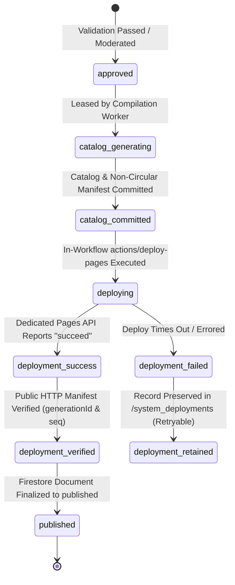

# GitStore — Architecture Specification

**Document Version:** 1.5.0  
**Phase:** Phase 0.1.4 — Evidence Alignment, Deployment Recovery & Governance Consistency  
**Status:** Approved Architectural Baseline (Hardened & Reconciled)  

---

## 1. Architectural Philosophy and Invariants

The design of GitStore is governed by six non-negotiable architectural invariants:

1. **Strict Dual-Platform Confinement:** The entire lifecycle of GitStore—from development and source control to database transactions, background processing, and binary delivery—is confined strictly to **GitHub** and **Firebase**. No tertiary PaaS, serverless function providers (Vercel, AWS Lambda, Netlify), or external relational databases (Supabase, PlanetScale) are permitted. No Firebase Hosting or Cloud Functions are used.
2. **Binary Non-Execution & Non-Hosting:** GitStore is a catalog, discovery engine, and verification broker. GitStore never executes submitted executables, never runs sandboxed code evaluation, and never stores or caches binary payloads inside Git repositories or Firebase Storage.
3. **Static-First Read Architecture:** Storefront visitor traffic is 100% decoupled from the transactional database. 100% of anonymous catalog requests terminate at GitHub Pages' static file server (`data/catalog.json`), keeping Cloud Firestore operations reserved strictly for authenticated developer interactions, submission workflows, and background worker state transitions.
4. **Zero-Trust Client Boundary:** The client-side browser is treated as untrusted. No client-side code possesses the authority to grant permissions, verify developers, alter product publication statuses, claim processing leases, or bypass release validation.
5. **Decoupled Privileged Administration via Canonical Repository Collaborators:** Normal browser clients never receive Firebase Admin SDK credentials, and client JavaScript cannot mint custom claims. All privileged administrative operations execute via the privileged **GitHub Actions Batch Worker**, verified authoritatively against **GitStore's own canonical GitHub repository** (`Rohitpvt/GitStore`) collaborator permissions (`role_name === 'admin'` or `'maintain'`).
6. **Portability and Standards Compliance:** The client application uses standards-compliant HTML5, CSS3, and ES6 JavaScript Modules. No proprietary framework compilers (React, Next.js, Vue) or custom runtime dependencies exist.

---

## 2. Hardened System Architecture Diagram

```mermaid
graph TB
    subgraph ClientLayer["Client Layer (GitHub Pages Static Host)"]
        Visitor["Public Visitor Browser\n(Browse & Download)"]
        Developer["Software Developer Browser\n(Submit & Dashboard)"]
        AdminBrowser["Administrator Browser\n(Admin Dashboard)"]
        StaticCatalog["Pre-Compiled Static Storefront Data\n(data/catalog.json & products/*.json)"]
    end

    subgraph FirebasePlatform["Platform 2: Firebase Infrastructure (Spark Plan)"]
        FirebaseAuth["Firebase Authentication\n- GitHub OAuth (Popup)\n- Passwordless Magic Link\n(0 Password Fields on Pages)"]
        Firestore["Cloud Firestore Operational Database\n- users/{uid}\n- submissions/{id}\n- claim_requests/{id}\n- moderation_requests/{id}\n- products/{id}\n- categories/{id}\n- reports/{id}\n- admin_logs/{id}\n- system_config/global_settings"]
        SecurityRules["Firestore Security Rules\n- Strict RBAC & Immutability\n- Zero Client Self-Escalation\n- Immutable Claim & Moderation Queues"]
        AppCheck["Firebase App Check\n- reCAPTCHA Enterprise Web Provider\n- Lazy-Loaded on Auth Pages Only"]
    end

    subgraph GitHubPlatform["Platform 1: GitHub Core Infrastructure"]
        GHPages["GitHub Pages\n- Vanilla HTML5/CSS3/ES6 Storefront\n- Direct Static Asset Serving"]
        GHIssues["GitHub Issue Forms\n- Ingestion Queue (.github/ISSUE_TEMPLATE)"]
        GHReleases["Public GitHub Releases\n- Direct External Binaries\n(EXE, MSI, APK, DMG, ZIP, TAR.GZ)"]
        GHREST["GitHub REST API v3\n- Canonical Repo Collaborator Check\n- Upstream Repo, Tag, & Asset Validation\n- Direct Personal Owner Validation"]
        GHWorker["GitHub Actions Batch Worker\n(Scheduled every 10 min + Manual Dispatch)\n- Concurrency Group Lock\n- 15-Min Atomic Leases\n- Privileged firebase-admin Execution\n- Two-Phase Compiler & Self-Healing Loop"]
    end

    %% Read Operations (Pure GitHub Pages - Zero DB Requests)
    Visitor -->|1. Fetch HTML/CSS/JS| GHPages
    Visitor -->|2. Fetch Static Catalog Index| StaticCatalog
    Visitor -->|3. Direct Download Binary| GHReleases

    %% Developer Operations
    Developer -->|4. Authenticate| FirebaseAuth
    Developer -->|5. Write Submission status: queued| Firestore
    Developer -.->|6. Open Issue Submission| GHIssues
    Firestore --- SecurityRules
    Firestore --- AppCheck

    %% Admin Operations (Decoupled Command Queue)
    AdminBrowser -->|7. Auth via GitHub OAuth| FirebaseAuth
    AdminBrowser -->|8. Enqueue Moderation Request status: pending| Firestore
    AdminBrowser -.->|9. Optional Immediate Dispatch| GHWorker

    %% Worker Automation & Privilege Execution
    GHWorker -->|10. Ingest & Verify Personal Repo Ownership| GHIssues
    GHWorker -->|11. Atomic Lease Claim Limit 3| Firestore
    GHWorker -->|12. Non-Execution Asset & Tag Verification| GHREST
    GHREST -.->|Validate Release Asset Existence| GHReleases
    GHWorker -->|13. Authorize Admin via Canonical GitStore Repo Check| GHREST
    GHWorker -->|14. Execute Privileged Updates & admin_logs| Firestore
    GHWorker -->|15. Two-Phase Static Catalog Compilation| StaticCatalog
    GHWorker -->|16. Commit & Deploy| GHPages
    GHWorker -->|17. Reconcile Deployed State & Finalize DB| Firestore
```



---

## 3. Platform Boundaries & Interface Contracts

### 3.1 Interface Contract: Administrator Browser <-> Privileged Actions Worker
- **Canonical Repository Boundary Check:** Administrator authorization is verified strictly against **GitStore's own canonical GitHub repository** (`Rohitpvt/GitStore`). The batch worker asserts:
  ```javascript
  if (process.env.GITHUB_REPOSITORY !== 'Rohitpvt/GitStore') {
    throw new Error(`SECURITY ALERT: Execution on non-canonical repository ${process.env.GITHUB_REPOSITORY} aborted.`);
  }
  ```
  However, environment string checks alone are insufficient against untrusted code injection. Privileged workflows are strictly isolated to trusted execution contexts (see Section 3.5).
- **The Decoupled Command Pattern:**
  1. The Administrator authenticates on `admin.html` via GitHub OAuth.
  2. The Admin Dashboard writes a request document to `/moderation_requests/{requestId}`:
     ```typescript
     {
       requestId: string;
       action: 'APPROVE_SUBMISSION' | 'REJECT_SUBMISSION' | 'VERIFY_DEVELOPER' | 'DELIST_PRODUCT';
       targetId: string;
       payload: { reason?: string; notes?: string };
       requestedByUid: string;              // auth.uid (enforced by Security Rules)
       status: 'pending';                   // pending | processing | completed | rejected
       createdAt: serverTimestamp();
     }
     ```
  3. **Cryptographic Identity Extraction & Token Validation in Actions Worker:**
     - The worker reads `/moderation_requests/{requestId}`.
     - The worker **never trusts client-supplied username strings, UIDs, or roles**. Instead, the worker validates the identity via the Firebase Admin SDK:
       ```javascript
       // Identity normalization function (fail-closed numeric validator)
       function normalizeGithubId(val) {
         if (val == null) return null;
         const str = String(val).trim();
         if (!/^\d+$/.test(str)) return null;
         return str;
       }

       // Fetch user record established by verified Firebase Auth UID
       const userRecord = await admin.auth().getUser(requestData.requestedByUid);
       const githubProvider = userRecord.providerData.find(p => p.providerId === 'github.com');
       if (!githubProvider || !githubProvider.uid) {
         throw new Error("UNAUTHORIZED: Caller has no verified linked GitHub provider");
       }
       const verifiedCallerGithubNumericId = normalizeGithubId(githubProvider.uid);
       if (!verifiedCallerGithubNumericId) {
         throw new Error("UNAUTHORIZED: Caller GitHub provider UID is non-numeric or malformed");
       }
       ```
     - **Identity Representation Details (String vs Integer):**
       - Firebase Authentication stores the GitHub user's numeric ID as a **string** in `userRecord.providerData[i].uid` (e.g., `"12345678"`).
       - The GitHub REST API returns `id` and `owner.id` as **numeric integers** (e.g., `12345678`).
       - To prevent type coercion flaws, whitespace injection, or non-numeric tampering, all GitHub identifiers from both sources MUST be processed through `normalizeGithubId()`. If normalization returns `null` for either operand, execution fails closed immediately.
     - **Account Linking / Unlinking Invariants:**
       - The worker must **never** assume that `userRecord.uid === githubId`. Firebase Auth UIDs are distinct internal identifiers.
       - If a user unlinks their GitHub provider in Firebase Auth, `userRecord.providerData.find(p => p.providerId === 'github.com')` returns `undefined`, immediately terminating all administrative authority.
     - For direct API calls (e.g., immediate workflow dispatch), the client provides an authenticated Firebase ID token in the Authorization header. The worker calls `admin.auth().verifyIdToken(idToken, true)` (`checkRevoked: true`) to resolve the trusted `decodedToken.uid` before resolving `providerData`. A client-submitted UID is never trusted in isolation. *(Evidence: DOCUMENTATION_VERIFIED via Firebase Admin SDK documentation; live worker execution is PENDING_INTEGRATION_TEST).*
  4. **Root Administrator Bootstrap & Identity Verification:**
     - **The Root Administrator Problem:** Repository ownership of `Rohitpvt/GitStore` alone does not authenticate the person making an administrative request. An attacker claiming to be `Rohitpvt` in the browser or submitting arbitrary claims must be decisively rejected.
     - **Immutable Account Identity Verification Flow:**
       1. The worker retrieves the canonical repository owner's immutable numeric GitHub account ID via the GitHub API:
          `GET https://api.github.com/repos/Rohitpvt/GitStore` -> `response.data.owner.id` (numeric integer, e.g. `12345678`), or verifies against the trusted environment configuration `BOOTSTRAP_ROOT_ADMIN_GITHUB_ID`.
       2. The canonical owner ID is normalized: `const canonicalOwnerNumericId = normalizeGithubId(response.data.owner.id);`.
       3. The worker extracts and normalizes the caller's linked GitHub account ID: `const verifiedCallerNumericId = normalizeGithubId(githubProvider.uid);`.
       4. The worker performs an exact string comparison of the normalized numeric IDs:
          ```javascript
          const isRootAdmin = (verifiedCallerNumericId === canonicalOwnerNumericId);
          ```
       5. If the comparison succeeds, root administrator privileges are authorized.
       6. If the comparison fails, the caller is NOT the root administrator. The worker falls back to checking whether the caller is an authorized collaborator (maintainer).
       7. The system fails closed: if GitHub provider identity is absent, ambiguous, unlinked, or malformed, all administrative operations are immediately aborted with `403 FORBIDDEN`. *(Evidence: DESIGNED and DOCUMENTATION_VERIFIED; live comparison is PENDING_INTEGRATION_TEST).*
  5. **Fail-Closed Collaborator Permission Check (Delegated Administrators):**
     - For non-root callers, the worker resolves the current GitHub login handle from GitHub's REST API using the caller's immutable numeric ID:
       `GET https://api.github.com/user/{verifiedCallerGithubNumericId}`
     - The worker queries GitHub's official collaborator permission endpoint:
       `GET https://api.github.com/repos/Rohitpvt/GitStore/collaborators/{verifiedLogin}/permission`
     - **Response Field Mapping (Officially Verified via GitHub REST API Docs):**
       The endpoint returns `{ permission: string, role_name: string, user: object }`.
       - `permission`: Legacy base permission (`admin`, `write`, `read`, `none`). Modern roles map `maintain` to `write` under legacy `permission`.
       - `role_name`: Explicit role name assigned (`admin`, `maintain`, `write`, `triage`, `read`, or custom role).
     - **Fail-Closed Authorization Policy:**
       ```javascript
       const { permission, role_name } = response.data;
       const isAuthorizedAdmin = (role_name === 'admin') || (role_name == null && permission === 'admin');
       const isAuthorizedMaintainer = (role_name === 'maintain');

       if (!isAuthorizedAdmin && !isAuthorizedMaintainer) {
         // Fail-closed: explicitly reject 'write' (without maintain), 'triage', 'read', 'none', custom roles, and unexpected responses
         throw new Error(`FORBIDDEN: User ${verifiedLogin} role '${role_name}' (permission '${permission}') is not authorized.`);
       }
       ```
     - **Inherited Permissions:** The endpoint evaluates and returns the effective permissions resulting from direct assignment, organization teams, or org-level administration without exposing the grant source.
     - **Token Permissions & Integration Status:** Querying `/repos/{owner}/{repo}/collaborators/{username}/permission` requires `Metadata: read` permissions. While documentation allows querying permissions with appropriate scopes, personal vs. organization repository behavior can differ in Actions runners. The worker implements a dual-token strategy: attempting `secrets.GITHUB_TOKEN` with `permissions: { contents: read, metadata: read }`, and falling back to a fine-grained PAT / GitHub App token (`secrets.ADMIN_VERIFY_TOKEN`). *(Evidence: DOCUMENTATION_VERIFIED for schema; live Actions collaborator token verification is PENDING_INTEGRATION_TEST).*
  6. **Revocation, Account Unlinking & Emergency Recovery:**
     - **Dynamic Revocation:** Real-time API verification on every worker batch cycle ensures immediate revocation upon removing a collaborator on GitHub; no stale claim or local cache survives.
     - **Account Unlinking / Provider Changes:** If a user unlinks their GitHub provider in Firebase Auth, `providerData.find(p => p.providerId === 'github.com')` returns `undefined`, instantly revoking all administrative authority.
     - **Compromised Account Emergency Revocation:**
       1. The root administrator removes the compromised GitHub account from repository collaborators on `Rohitpvt/GitStore`.
       2. The root administrator executes token revocation via Firebase Admin SDK: `await admin.auth().revokeRefreshTokens(compromisedUid)`.
       3. Any pending requests in `/moderation_requests` authored by the compromised UID are marked `rejected_revoked` by the worker during identity resolution.
     - **Anti-Replay Protection:** Worker transactions mark requests `completed` or `rejected` with execution timestamps and GitHub Actions run IDs, preventing replay attacks.

### 3.2 Interface Contract: Issue Ingestion & Secure Submission Claiming
- **Zero Fake / Placeholder Accounts:**
  - Submissions ingested from GitHub Issue Forms store the author's immutable numeric GitHub account ID (`context.payload.issue.user.id`) directly from the trusted event payload.
  - Submissions are created with:
    ```typescript
    developerUid: null;
    submitterGithubId: string;        // Immutable numeric string e.g. "583231"
    submitterGithubUsername: string;  // e.g. "monalisa"
    claimStatus: 'unclaimed';
    ```
- **Distinction of Ownership, Release Authority, and Verified Developer:**
  1. **Repository Ownership:** Proves control over the repository configuration (`repo.owner.id === submitterGithubId`).
  2. **Release Authority:** Proves authorization to publish release binaries. Direct personal owners possess inherent release authority. Org members and committers do **not** possess proven release authority and are held in `needs_review`.
  3. **Verified Developer Identity:** A platform trust credential granted by administrators via moderation requests. Repository ownership does **not** automatically award verified developer status.
- **Secure Asynchronous Claiming Workflow (`/claim_requests`):**
  1. The user authenticates with Firebase Auth (GitHub OAuth or Email Magic Link linked with GitHub).
  2. The user initiates a claim from the dashboard, writing to `/claim_requests/{requestId}`:
     ```typescript
     {
       requestId: string;
       requesterUid: string;              // Must equal request.auth.uid (enforced by Security Rules)
       targetSubmissionId: string;
       status: 'pending';
       createdAt: serverTimestamp();
     }
     ```
  3. **Strict Client-Creatable Field Whitelisting & Firestore Security Rules:**
     Clients must **never** be able to inject worker-managed or privileged fields. Firestore Security Rules enforce an exhaustive whitelist:
     ```javascript
     match /claim_requests/{requestId} {
       allow read: if request.auth != null && resource.data.requesterUid == request.auth.uid;
       allow create: if request.auth != null
         && request.resource.data.keys().hasOnly(['requestId', 'requesterUid', 'targetSubmissionId', 'status', 'createdAt'])
         && request.resource.data.requestId == requestId
         && request.resource.data.requesterUid == request.auth.uid
         && request.resource.data.targetSubmissionId is string
         && request.resource.data.targetSubmissionId.size() > 0
         && request.resource.data.targetSubmissionId.size() <= 128
         && request.resource.data.status == 'pending'
         && request.resource.data.createdAt == request.time;
       allow update, delete: if false; // Worker only via Admin SDK
     }
     ```
     **Explicitly Blocked Injection Fields:** Any request containing `developerUid`, `verifiedGithubId`, `claimStatus`, `isAdmin`, `processedAt`, `reviewedAt`, `reviewedBy`, `resolution`, `rejectionReason`, `workerLease`, or `workerId` violates `hasOnly()` and is immediately rejected by Firestore engine before writing.
  4. The trusted GitHub Actions worker reads pending claim requests:
     - Fetches `admin.auth().getUser(req.requesterUid)` via Firebase Admin SDK.
     - Locates `userRecord.providerData.find(p => p.providerId === 'github.com')`. Fail closed if absent.
     - Extracts `verifiedGithubId = provider.uid`.
     - Validates against target submission:
       `submission.submitterGithubId === verifiedGithubId && submission.claimStatus === 'unclaimed'`
     - Executes atomic Firestore transaction:
       - Checks that `submission.developerUid == null` (prevents competing claims).
       - Sets `submission.developerUid = req.requesterUid`
       - Sets `submission.claimStatus = 'claimed'`
       - Sets `submission.claimedAt = serverTimestamp()`
       - Sets `claimReq.status = 'completed'`
       - Appends audit entry to `/admin_logs`
     - If validation fails, marks request `rejected_mismatch` or `rejected_already_claimed`. Duplicate requests are handled idempotently.

### 3.3 Interface Contract: Entity Hierarchy & Globally Unique Deterministic IDs
To guarantee global uniqueness and prevent collisions when two distinct repositories share an identical product slug (e.g. `microsoft/toolkit-a -> viewer` vs `microsoft/toolkit-b -> viewer`):
- **1. Repository Identity (`gh_repo_{repoId}`):** Uses GitHub's immutable numeric repository ID (e.g., `gh_repo_892341901`). Resilient against repository renames and ownership transfers.
- **2. Product Identity (`prod_{repoId}_{productSlug}`):** Formed by compounding the immutable numeric repo ID with the product slug (e.g., `prod_892341901_viewer`). Guarantees cross-repository uniqueness.
- **3. Submission Identity:**
  - Issue Submissions: `sub_issue_{repoId}_{issueNumber}` (e.g., `sub_issue_892341901_42`). Globally unique.
  - Dashboard Submissions: `sub_dash_{nanoid}` (cryptographically random).
- **4. Release Identity (`rel_{repoId}_{releaseId}`):** Uses GitHub's immutable numeric release ID (`release.id`).
- **5. Release Asset Identity (`asset_{repoId}_{assetId}`):** Uses GitHub's immutable numeric asset ID (`asset.id`).

### 3.4 Interface Contract: Recoverable Publication State Machine & Deployment Verification
Because GitHub Pages and Cloud Firestore are independent distributed systems, atomic consistency across them is impossible. GitStore implements an **eventually consistent, recoverable publication workflow** with a non-circular manifest and monotonic sequencing:



- **Non-Circular Manifest Architecture & Generation Timestamping:**
  Previous iterations attempted to store the Git commit SHA inside `data/deployment-manifest.json`, creating a self-referential paradox (the commit contains the manifest, which cannot know its own SHA prior to commit creation). Furthermore, the manifest was previously timestamped as `deployedAt`, which is semantically inaccurate because the manifest is built and committed *before* GitHub Pages deployment executes.
  - **Corrected Design:** The deployed manifest contains **zero Git commit SHAs** and records `generatedAt`:
    ```json
    {
      "generationId": "gen_1730300400000_a1b2c3d4",
      "generationSequence": 104,
      "generatedAt": "2026-10-30T18:00:00.000Z",
      "productCount": 42,
      "schemaVersion": "1.5.0",
      "environment": "github-pages"
    }
    ```
  - **Semantic Timestamp Separation:**
    - `generatedAt` (in manifest): Captures the exact ISO 8601 UTC timestamp when the static catalog JSON and manifest files were generated by the Actions worker.
    - `verifiedAt` / `finalizedAt` / `lastPublishedAt` (in Firestore): Recorded exclusively post-deployment in `/system_deployments/{generationId}` and `/system_config/deployment_state` once the live Pages CDN has verified the manifest.
  - **External Commit SHA Pairing:**
    1. Worker assigns unique `generationId` and monotonic `generationSequence` (retrieved from `/system_config/deployment_state.latestSequence + 1`).
    2. Worker writes `data/catalog.json` and `data/deployment-manifest.json`.
    3. Worker commits and pushes to `main`.
    4. Worker obtains the resulting commit SHA via `git rev-parse HEAD`.
    5. The pair `(generationId, catalogCommitSha)` is recorded outside the Git commit, inside Firestore at `/system_deployments/{generationId}` and `/system_config/deployment_state`.

- **Deterministic Post-Commit Firestore Failure Recovery:**
  *Failure Scenario:* The Actions worker successfully compiles the catalog, writes `deployment-manifest.json`, commits, and pushes to `origin/main` via Git. However, before the worker can record `catalogCommitSha` in Firestore `/system_deployments/{generationId}`, the runner crashes, runs out of memory, or experiences a network disruption.
  *Deterministic Recovery Algorithm (Executed by Startup Reconciler):*
  1. **Candidate Commit Identification:** The reconciler queries recent commits on `origin/main` that touched the manifest:
     ```bash
     git log -n 10 --format="%H" origin/main -- data/deployment-manifest.json
     ```
  2. **Direct Blob Inspection (Zero Checkout Overhead):** For each candidate commit SHA, the worker inspects the manifest content directly from Git object storage without checking out branches:
     ```bash
     git show ${sha}:data/deployment-manifest.json
     ```
  3. **JSON Parsing & Identifier Matching:** The worker parses the JSON blob and asserts:
     ```javascript
     const candidateManifest = JSON.parse(manifestBlob);
     const isMatch = (candidateManifest.generationId === expectedGenerationId) &&
                     (candidateManifest.generationSequence === expectedGenerationSequence);
     ```
  4. **Disambiguation:** If multiple commits match the expected identifiers (e.g. repeated test commits), the reconciler selects the **latest commit on `origin/main`** (the first SHA returned by `git log -n 10`).
  5. **Push-Failure Resolution:** If no commit on `origin/main` contains the matching manifest, the reconciler concludes that the Git push never completed. The generation is marked `status: 'failed'`, `failureReason: 'commit_not_found_on_remote'`. The lease is released, and all pending approved submissions are cleanly coalesced into the next generation.
  6. **Atomic Firestore Persistence:** If a matching commit is confirmed, the reconciler executes an atomic Firestore update:
     ```javascript
     await db.collection('system_deployments').doc(expectedGenerationId).update({
       catalogCommitSha: matchedSha,
       reconciliationStatus: 'reconciled_from_git_log',
       updatedAt: new Date()
     });
     ```
     The worker then resumes Pages artifact packaging and deployment idempotently. *(Evidence: DESIGNED; live recovery is PENDING_INTEGRATION_TEST).*

- **Strengthened Generation Ordering & Idempotency (4-Case Matrix):**
  To handle concurrent workers, worker retries, and network delays deterministically, every generation must be handled according to this 4-case matrix against Firestore `/system_config/deployment_state.latestPublishedSequence`:

  | Case | Condition | State Assessment | Action & Invariants |
  |---|---|---|---|
  | **Case 1: Stale Generation** | `gen.generationSequence < state.latestPublishedSequence` | An older generation is attempting to deploy or finalize after a newer generation has already published. | **REJECT AS STALE.** Immediately abort Pages deployment and Firestore finalization. Mark generation `status: 'stale'`. Do not touch `latestPublishedSequence` or overwrite catalog state. |
  | **Case 2: Idempotent Retry** | `gen.generationSequence === state.latestPublishedSequence && gen.generationId === state.latestPublishedGenerationId` | Retry or self-healing pass for the currently published generation. | **IDEMPOTENT RETRY.** Proceed to verify Pages deployment and confirm submission status without re-generating catalog or creating new Git commits. |
  | **Case 3: Sequence Conflict** | `gen.generationSequence === state.latestPublishedSequence && gen.generationId !== state.latestPublishedGenerationId` | Two distinct generation IDs claim the exact same sequence number (split-brain condition). | **CRITICAL CONFLICT (FAIL-CLOSED).** Immediately halt deployment. Log high-severity security alarm in `/admin_logs`. Mark generation `status: 'failed'`, `failureReason: 'sequence_conflict_duplicate'`. Require manual operator review. |
  | **Case 4: Valid New Generation** | `gen.generationSequence > state.latestPublishedSequence` | Valid sequential progression. | **PROCEED WITH DEPLOYMENT.** Concurrency lease blocks conflicting operations. Worker proceeds to artifact packaging, Pages deployment, and sequence advance. |

- **GitHub Pages Deployment Concurrency Boundary:**
  - *Distributed Boundary Reality:* Firestore monotonic checks alone cannot prevent an Actions runner from deploying an older artifact to GitHub Pages if runners execute out-of-order.
  - *Actions-Level Enforcement:* GitHub Pages deployment requires GitHub Environment Concurrency:
    ```yaml
    environment:
      name: github-pages
      url: ${{ steps.deployment.outputs.page_url }}
    concurrency:
      group: 'github-pages'
      cancel-in-progress: false
    ```
  - *Pre-Deploy Assertion:* Immediately before executing `actions/deploy-pages@v4`, the workflow queries Firestore `/system_config/deployment_state.latestPublishedSequence`. If `currentRunningGenerationSequence < latestPublishedSequence`, the deployment step is aborted before Pages artifact deployment occurs.

- **Work Preservation Guarantee via Firestore Coalescing:**
  - Standard GitHub Actions queue semantics (`cancel-in-progress: false`) serialize runs, but intermediate queued runs can be replaced under high dispatch load.
  - GitStore ensures **zero work loss** via **Firestore Coalescing**:
    - When any worker enters catalog compilation, it executes `db.collection('submissions').where('status', '==', 'approved').get()`.
    - Every submission approved up to that exact moment is included in the new catalog generation.
    - Even if an intermediate Actions run was discarded, all approved submissions are durably captured in the active run.

- **Dedicated GitHub Pages Deployment API Verification:**
  The worker evaluates the dedicated GitHub Pages deployment endpoint rather than the generic Deployments API:
  `GET https://api.github.com/repos/Rohitpvt/GitStore/pages/deployments/{pages_deployment_id}`
  - **Officially Verified Status Values:** The GitHub Pages deployments API returns `{ "status": "succeed" }` upon successful deployment (distinct from the generic deployments API `state: "success"`). Other states include `"in_progress"`, `"failed"`, and `"queued"`.
  - The worker awaits the Pages-specific `"succeed"` status or polls with bounded exponential backoff. *(Evidence: DOCUMENTATION_VERIFIED via GitHub REST API Docs; live verification is PENDING_INTEGRATION_TEST).*

- **Public HTTP Manifest Propagation Check:**
  Following Pages status confirmation, the worker queries the live CDN endpoint:
  `GET https://rohitpvt.github.io/GitStore/data/deployment-manifest.json?t={Date.now()}`
  - The check asserts that `manifest.generationId === expectedGenerationId` and `manifest.generationSequence === expectedGenerationSequence`.
  - If the public CDN returns a stale generation due to edge cache propagation delay, the worker retries with exponential backoff (up to 5 minutes) before yielding to the startup reconciler.

- **Durable Failed Generation Preservation:**
  - If a deployment fails after a Git commit has been pushed, products are **NEVER prematurely reverted to `approved`**. Doing so would leave GitHub repository history and Firestore in inconsistent, diverging states.
  - The worker preserves the failure record in `/system_deployments/{generationId}` with:
    - `generationId` and `generationSequence`
    - `catalogCommitSha`
    - `expectedProductIds`
    - `attemptHistory` (timestamps, stage, Pages deployment ID, error details)
    - `lastObservedPagesStatus`
    - `reconciliationStatus: 'pending_retry'`
    - `failureReason`
    - `retryEligibility: true`
  - The reconciler retries deploying the *existing* `catalogCommitSha` rather than creating redundant, competing commits.

---

### 3.5 Interface Contract: GitHub Actions Event and Fork Security Matrix

The architecture strictly rejects relying solely on `process.env.GITHUB_REPOSITORY === 'Rohitpvt/GitStore'` as a security boundary. Forked repositories can execute workflows where that variable is evaluated differently or spoofed in untrusted execution contexts. Furthermore, pull requests opened from forks can execute arbitrary malicious code if dangerous workflow triggers are configured.

To guarantee complete execution integrity and prevent secret exfiltration or unauthorized database writes, GitStore establishes an **explicit event allowlist and restriction matrix** with formal evidence classifications:

| Workflow Trigger Event | Authorization Status | Secrets Access | Allowed Context & Ref Restrictions | Security Controls & Rationale | Evidence Classification |
|---|---|---|---|---|---|
| **`schedule`** | **ALLOWED** | Yes (`FIREBASE_SERVICE_ACCOUNT`, `GITHUB_TOKEN`) | Default branch (`refs/heads/main`) only | Runs the scheduled batch worker. Executes strictly on the canonical repository default branch. Completely isolated from external PR code. | `DOCUMENTATION_VERIFIED` (Syntax & event docs); live execution is `PENDING_INTEGRATION_TEST` |
| **`workflow_dispatch`** | **ALLOWED** | Yes (`FIREBASE_SERVICE_ACCOUNT`, `ADMIN_VERIFY_TOKEN`) | Canonical repo collaborators with `write`/`admin` | Allows on-demand batch runs or manual catalog re-compilation. Gated to verified repository collaborators by GitHub Actions permissions. | `DOCUMENTATION_VERIFIED` (GitHub API permissions); live check is `PENDING_INTEGRATION_TEST` |
| **`issues: opened, edited`** | **RESTRICTED INGEST** | Scoped / None | Ingestion workflow only | Ingests Issue Form submissions. Runs with minimal permissions (`issues: read`, `contents: read`). Runs parser in strict isolation; never executes user-supplied code or shell commands. | `DESIGNED` |
| **`pull_request`** | **RESTRICTED** | **NO SECRETS** | Pull requests targeting `main` | Read-only static linting and validation of docs/schema. GitHub Actions automatically withholds repository secrets from fork-originated PRs. | `DOCUMENTATION_VERIFIED` (Actions runner security model) |
| **`pull_request_target`** | ❌ **FORBIDDEN** | **NONE (BANNED)** | Not permitted in GitStore repository | **CRITICAL:** `pull_request_target` executes in the context of the base repository with full access to secrets, but can check out and run untrusted code from the fork PR. Strictly prohibited. | `DESIGNED` (Policy enforced in repository rules) |
| **`workflow_run`** | ❌ **FORBIDDEN** | **NONE (BANNED)** | Not permitted for untrusted triggers | Avoids untrusted artifact injection and cross-workflow privilege escalation. | `DESIGNED` |
| **`repository_dispatch`** | ❌ **RESTRICTED** | Restricted | Not used in MVP | Not needed under single-workflow Option A architecture. | `DESIGNED` |
| **`push`** | **RESTRICTED** | No Privileged Pipeline | Protected `main` branch only | Pushes to `main` are restricted by branch protection rules (require review/checks). Ordinary pushes do NOT trigger the privileged publisher to avoid push-suppression conflicts and deployment thrashing. | `DOCUMENTATION_VERIFIED` (Token push suppression behavior) |

#### Architectural Guardrails Against Fork Escalation:
1. **Zero Untrusted Pull Request Secrets:** No workflow responding to `pull_request` receives `FIREBASE_SERVICE_ACCOUNT` or write tokens.
2. **Execution Context Verification:** All privileged workflows assert three independent conditions at startup:
   ```javascript
   if (github.repository !== 'Rohitpvt/GitStore' || 
       !['schedule', 'workflow_dispatch'].includes(github.event_name) ||
       github.ref !== 'refs/heads/main') {
     throw new Error(`SECURITY VIOLATION: Execution in untrusted context (${github.repository}, ${github.event_name}, ${github.ref}) aborted.`);
   }
   ```
3. **Single Trusted Workflow Run (Option A):** Catalog generation, Git commit, Pages artifact upload, Pages deployment, and Firestore finalization run sequentially in a single trusted execution run, preventing cross-run race conditions or token handoff vulnerabilities.

---

### 3.6 Interface Contract: GitHub Pages Deployment Configuration Requirements

GitHub Pages deployment using custom GitHub Actions workflows requires precise configuration across permissions, environments, and action versions.

- **Workflow Permissions Specification:**
  Privileged batch workflows that publish the static catalog to GitHub Pages must declare least-privilege permissions at either the workflow or job level:
  ```yaml
  permissions:
    contents: write        # Required for git push of compiled static catalog and manifest
    pages: write           # Required for minting GitHub Pages deployment artifacts
    id-token: write        # Required for OpenID Connect (OIDC) token minting by actions/deploy-pages
    metadata: read         # Required for inspecting repository metadata and collaborator permissions
  ```
- **Deployment Environment Targeting:**
  The deployment job MUST explicitly target the `github-pages` environment:
  ```yaml
  environment:
    name: github-pages
    url: ${{ steps.deployment.outputs.page_url }}
  ```
  Targeting `github-pages` enables GitHub's built-in deployment timeline tracking, environment protection rules, and CDN cache invalidation hooks.
- **Default Branch & Ref Restrictions:**
  To prevent branch pollution and untrusted deploys, deployment steps are restricted to the default branch:
  ```yaml
  if: github.ref == 'refs/heads/main'
  ```
- **Action Versions (Verified from Official GitHub Actions Documentation):**
  - Repository Checkout: `actions/checkout@v4` (v4 is current node20-based checkout).
  - Runtime Setup: `actions/setup-node@v4` (v4 with Node.js 20 LTS).
  - Pages Artifact Packaging: `actions/upload-pages-artifact@v3` (v3 is official artifact packager).
  - Pages Deployment Dispatch: `actions/deploy-pages@v4` (v4 is official deployment handler).
- **Separation of Concerns & Job Dependencies:**
  To guarantee that an artifact is only deployed after catalog commit validation or recovery:
  ```mermaid
  flowchart LR
    Job1["Job: build-and-commit\n- Validate Submissions\n- Compile Catalog & Manifest\n- Push origin main\n- Recover SHA if crashed"] -->|needs: build-and-commit| Job2["Job: deploy-to-pages\n- environment: github-pages\n- upload-pages-artifact@v3\n- deploy-pages@v4\n- Finalize Firestore"]
  ```
  *(Evidence: Configuration syntax and actions versions are DOCUMENTATION_VERIFIED; live execution on `Rohitpvt/GitStore` is classified as PENDING_INTEGRATION_TEST).*

---

## 4. Architectural Decision Records (ADRs)

### ADR-01: Exclusion of Third-Party Backend Hosts (Vercel, Supabase, Netlify)
- **Status:** Accepted (Phase 0)
- **Rationale:** Keeps architecture confined to GitHub and Firebase; eliminates vendor sprawl and unapproved hosting dependencies.

### ADR-02: Static Pre-Rendered Catalog vs. Direct Firestore Queries
- **Status:** Accepted (Phase 0)
- **Rationale:** Storefront visitors read static JSON compiled by GitHub Actions; 100% of browsing traffic consumes 0 Firestore reads.

### ADR-03: Rejection of Binary Execution & Sandboxing
- **Status:** Accepted (Phase 0)
- **Rationale:** Running untrusted executables inside GitHub Actions violates TOS and risks hypervisor breakouts. Security relies on source provenance, release verification, and manual moderation.

### ADR-04: Passwordless Authentication over Traditional Passwords
- **Status:** Accepted (Phase 0)
- **Rationale:** Eliminates password fields on GitHub Pages, adhering strictly to GitHub’s sensitive transaction policy.

### ADR-05: Fail-Closed Administrator Authorization & Immutable Root Admin Bootstrap
- **Status:** Accepted (Phase 0.1.4 Reconciled)
- **Context:** Previous mapping checked `permission === 'admin' || permission === 'maintain'`, which fails because GitHub's endpoint maps `maintain` to `write` in legacy `permission`. Furthermore, repository ownership alone does not authenticate the person making an administrative request, and string vs integer representations differ between Firebase and GitHub.
- **Decision:** Administrator checks execute strictly against `Rohitpvt/GitStore`. For root administrator bootstrap, the caller's verified GitHub identity linked in Firebase Auth (`userRecord.providerData.find(p => p.providerId === 'github.com')?.uid`) is normalized via `normalizeGithubId()` and compared directly against the canonical repository owner's normalized immutable numeric GitHub account ID retrieved via `GET /repos/Rohitpvt/GitStore` (`owner.id`). For delegated maintainers, collaborator permissions from `GET /repos/Rohitpvt/GitStore/collaborators/{username}/permission` are checked fail-closed: `role_name === 'admin'` or `role_name === 'maintain'`. All others (`write`, `triage`, `read`, custom roles) are rejected. Identity is verified via `admin.auth().verifyIdToken()`; client-supplied usernames, UIDs, and roles are strictly ignored. Dual-token fallback is configured.
- **Evidence Status:** Design and documentation verified (`DOCUMENTATION_VERIFIED`); live Actions collaborator token verification is classified as `PENDING_INTEGRATION_TEST`.
- **Rationale:** Eliminates maintainer authorization bypass, secures root admin bootstrap against impersonation, enforces fail-closed role mapping, and normalizes numeric identity representations.

### ADR-06: Asynchronous Submission Claiming via Restricted `/claim_requests` Queue
- **Status:** Accepted (Phase 0.1.2 Corrected)
- **Context:** Previous design lacked a concrete, secure claiming flow without Cloud Functions and relied on brittle `providerData[0]` indexing.
- **Decision:** Eliminate fake accounts; ingest issue submissions as `unclaimed` with numeric `submitterGithubId`. Authenticated users write restricted claim requests to `/claim_requests`. Client-created documents are strictly whitelisted via `hasOnly(['requestId', 'requesterUid', 'targetSubmissionId', 'status', 'createdAt'])`, blocking all privileged and worker-managed fields. Batch workers validate caller's GitHub provider identity via Firebase Admin SDK and execute transactional ownership claims. Browser clients are forbidden from writing ownership fields.
- **Evidence Status:** Rules syntax and SDK methods `DOCUMENTATION_VERIFIED`; live claim execution is `PENDING_INTEGRATION_TEST`.
- **Rationale:** Zero fake account state; prevents account takeover; ensures complete auditability.

### ADR-07: Non-Circular Manifest Architecture & Dedicated Pages Deployment Verification
- **Status:** Accepted (Phase 0.1.4 Reconciled)
- **Context:** Placing a commit SHA inside `data/deployment-manifest.json` is circular because the manifest is committed inside that very commit. Furthermore, checking the generic Deployments API or assuming commit push guarantees Pages availability causes premature publication marking.
- **Decision:** Completely remove `commitSha` from `data/deployment-manifest.json`. The manifest contains `{ generationId, generationSequence, generatedAt, productCount, schemaVersion, environment }`. The resulting `catalogCommitSha` is captured via `git rev-parse HEAD` post-commit and recorded in Firestore `/system_deployments/{generationId}`. Verification evaluates the dedicated GitHub Pages deployment endpoint `GET /repos/Rohitpvt/GitStore/pages/deployments/{id}` checking for the Pages-specific status `"succeed"`, followed by cache-busting public HTTP manifest verification.
- **Evidence Status:** `DOCUMENTATION_VERIFIED`; live CDN edge propagation timing is `PENDING_INTEGRATION_TEST`.
- **Rationale:** Eliminates self-referential commit hashes, accurately timestamps manifest generation, verifies the exact Pages deployment outcome, and prevents phantom storefront listings.

### ADR-08: GitHub Pages Policy Launch Gate & Clarification Contingency
- **Status:** Accepted (Phase 0.1)
- **Rationale:** Maintains engineering integrity by establishing formal written confirmation from GitHub Support as a Phase 4 Pre-Launch Gate.

### ADR-09: Globally Unique Deterministic Entity Identities via Numeric Repository IDs
- **Status:** Accepted (Phase 0.1.2 Corrected)
- **Context:** `prod_{repoOwner}_{productSlug}` collides when two repositories under the same owner use identical slugs. GitHub issue numbers are only unique within a repository.
- **Decision:** Base all entity IDs on GitHub's immutable numeric repository ID: `gh_repo_{repoId}`, `prod_{repoId}_{productSlug}`, `sub_issue_{repoId}_{issueNumber}`, `rel_{repoId}_{releaseId}`, `asset_{repoId}_{assetId}`.
- **Rationale:** Mathematically prevents collisions across repositories and remains immune to repository renames and ownership transfers.

### ADR-10: reCAPTCHA Enterprise Specification, Organization Quota & Billing Conditions
- **Status:** Accepted (Phase 0.1.4 Reconciled)
- **Context:** Previous text conflated reCAPTCHA v3 with Google Cloud reCAPTCHA Enterprise's 10,000 monthly free assessments quota, failed to document token auto-refresh configuration, and claimed "zero surprise bills" without stating billing prerequisites.
- **Decision:** Formally specify **reCAPTCHA Enterprise** (`ReCaptchaEnterpriseProvider`) with explicit client configuration `isTokenAutoRefreshEnabled: true`. Document that the 10,000 free assessment allowance is an organization-level quota shared across Google Cloud. Clarify that "zero surprise bills" strictly holds ONLY when no billing account (Blaze plan) is attached to the Firebase project. If billing is attached, assessments beyond 10,000 automatically incur charges ($1 per 1,000). Decouple public storefront browsing completely (0 assessments, 0 Firestore reads). Label all consumption figures as unmeasured engineering projections with explicit assumptions.
- **Evidence Status:** `DOCUMENTATION_VERIFIED` via Firebase and Google Cloud official documentation; browser auto-refresh runtime behavior is `PENDING_INTEGRATION_TEST`.
- **Rationale:** Eliminates quota ambiguity, conforms to Google Cloud billing terms, and ensures predictable operational costs.

### ADR-11: Single-Workflow Catalog Publication & GitHub Pages Deployment (Option A)
- **Status:** Accepted (Phase 0.1.4 Reconciled)
- **Context:** GitHub Actions suppresses ordinary `push` event workflow triggers when commits are pushed using the default `GITHUB_TOKEN`. The architecture cannot depend on a secondary push workflow to deploy GitHub Pages after the catalog worker pushes a commit.
- **Decision:** Adopt **Option A**: Execute static catalog compilation, Git commit/push to `main`, GitHub Pages artifact packaging (`actions/upload-pages-artifact@v3`), Pages deployment (`actions/deploy-pages@v4`), and Firestore status finalization sequentially within the **same trusted workflow execution run** (`.github/workflows/batch-processor.yml`).
- **Evidence Status:** `DOCUMENTATION_VERIFIED` (GitHub Actions runner behavior and token push suppression); live single-run deployment is `PENDING_INTEGRATION_TEST`.
- **Rationale:** Eliminates dependency on push event chaining; avoids requiring administrative PATs or elevated GitHub App tokens for cross-workflow dispatch; provides immediate end-to-end failure visibility in a single execution log.

### ADR-12: Monotonic Generation Ordering & Durable Deployment Record Preservation
- **Status:** Accepted (Phase 0.1.4 Reconciled)
- **Context:** Standard GitHub Actions concurrency (`cancel-in-progress: false`) retains at most one running and one pending run, discarding intermediate pending runs. In addition, resetting failed deployments to `approved` desynchronizes Firestore from pushed Git commits.
- **Decision:** Implement a monotonic integer `generationSequence` stored in Firestore `/system_config/deployment_state`. A deployment generation is evaluated against the 4-case ordering matrix: stale runs (`seq < latestPublishedSequence`) are rejected; retries (`seq === latestPublishedSequence && id === latestPublishedGenerationId`) are handled idempotently; duplicate sequence conflicts (`seq === latestPublishedSequence && id !== latestPublishedGenerationId`) trigger critical fail-closed alarms; valid new generations (`seq > latestPublishedSequence`) proceed. Failed deployment generations are durably preserved in `/system_deployments/{generationId}` with attempt history, Pages status, and failure reasons. Zero work loss is guaranteed through Firestore coalescing.
- **Evidence Status:** `DOCUMENTATION_VERIFIED`; live multi-runner concurrency verification is `PENDING_INTEGRATION_TEST`.
- **Rationale:** Prevents out-of-order race conditions from overwriting newer catalogs and eliminates split-brain inconsistencies between Git and Firestore.

### ADR-13: Deterministic Post-Commit SHA Recovery & Manifest Generation Timestamping
- **Status:** Accepted (Phase 0.1.4)
- **Context:** If an Actions worker generates static catalogs, pushes a commit to `origin/main`, but crashes before persisting `catalogCommitSha` to Firestore, the commit exists in Git history while Firestore has no record of the SHA. Furthermore, timestamping the manifest as `deployedAt` before deployment creates semantic inaccuracy.
- **Decision:** Replace `deployedAt` with `generatedAt` in `data/deployment-manifest.json`. The actual deployment timestamp is recorded post-deployment in Firestore (`verifiedAt`, `finalizedAt`, `lastPublishedAt`). In reverse failure scenarios where `catalogCommitSha` was not persisted, the startup reconciler executes `git log -n 10 --format="%H" origin/main -- data/deployment-manifest.json`, reads blobs directly via `git show ${sha}:data/deployment-manifest.json`, parses JSON, and matches `generationId` and `generationSequence`. If multiple commits match, it disambiguates by choosing the latest commit on `origin/main`. If no remote commit matches, it concludes the push never completed, marks the generation `status: 'failed'`, and allows approved submissions to coalesce into the next batch run. If matched, it atomically writes `catalogCommitSha` to `/system_deployments/{generationId}` and resumes deployment idempotently.
- **Evidence Status:** `DESIGNED` & `DOCUMENTATION_VERIFIED`; live recovery simulation is `PENDING_INTEGRATION_TEST`.
- **Rationale:** Eliminates orphaned Git commits, establishes deterministic state recovery without branch checkouts, and guarantees semantic timestamp precision.
