# GitStore — Architecture Specification

**Document Version:** 1.1.0  
**Phase:** Phase 0.1 — Architecture Audit, Hardening & Final Validation  
**Status:** Approved Architectural Baseline (Hardened)  

---

## 1. Architectural Philosophy and Invariants

The design of GitStore is governed by six non-negotiable architectural invariants:

1. **Strict Dual-Platform Confinement:** The entire lifecycle of GitStore—from development and source control to database transactions, background processing, and binary delivery—is confined strictly to **GitHub** and **Firebase**. No tertiary PaaS, serverless function providers (Vercel, AWS Lambda, Netlify), or external relational databases (Supabase, PlanetScale) are permitted. No Firebase Hosting or Cloud Functions are used.
2. **Binary Non-Execution & Non-Hosting:** GitStore is a catalog, discovery engine, and verification broker. GitStore never executes submitted executables, never runs sandboxed code evaluation, and never stores or caches binary payloads inside Git repositories or Firebase Storage.
3. **Static-First Read Architecture:** Storefront visitor traffic is 100% decoupled from the transactional database. 99.9% of user requests terminate at GitHub Pages' global static CDN (`data/catalog.json`), keeping Cloud Firestore operations reserved strictly for authenticated developer interactions, submission workflows, and background worker state transitions.
4. **Zero-Trust Client Boundary:** The client-side browser is treated as untrusted. No client-side code possesses the authority to grant permissions, verify developers, alter product publication statuses, claim processing leases, or bypass release validation.
5. **Decoupled Privileged Administration:** Normal browser clients never receive Firebase Admin SDK credentials, and client JavaScript cannot mint custom claims. All privileged administrative operations (approval, rejection, developer verification, delisting) execute via the privileged **GitHub Actions Batch Worker** or GitHub-native `workflow_dispatch`, verified authoritatively against GitHub repository collaborator permissions.
6. **Portability and Standards Compliance:** The client application uses standards-compliant HTML5, CSS3, and ES6 JavaScript Modules. No proprietary framework compilers (React, Next.js, Vue) or custom runtime dependencies exist.

---

## 2. Hardened System Architecture Diagram

```mermaid
graph TB
    subgraph ClientLayer["Client Layer (GitHub Pages CDN)"]
        Visitor["Public Visitor Browser\n(Browse & Download)"]
        Developer["Software Developer Browser\n(Submit & Dashboard)"]
        AdminBrowser["Administrator Browser\n(Admin Dashboard)"]
        StaticCatalog["Pre-Compiled Static Storefront Data\n(data/catalog.json & products/*.json)"]
    end

    subgraph FirebasePlatform["Platform 2: Firebase Infrastructure (Spark Plan)"]
        FirebaseAuth["Firebase Authentication\n- GitHub OAuth (Popup)\n- Passwordless Magic Link\n(0 Password Fields on Pages)"]
        Firestore["Cloud Firestore Operational Database\n- users/{uid}\n- submissions/{id}\n- moderation_requests/{id}\n- products/{id}\n- categories/{id}\n- reports/{id}\n- admin_logs/{id}\n- system_config/global_settings"]
        SecurityRules["Firestore Security Rules\n- Strict RBAC & Immutability\n- Zero Client Self-Escalation\n- Immutable Lease Flags"]
        AppCheck["Firebase App Check\n- reCAPTCHA v3 Web Provider\n- Origin Verification"]
    end

    subgraph GitHubPlatform["Platform 1: GitHub Core Infrastructure"]
        GHPages["GitHub Pages\n- Vanilla HTML5/CSS3/ES6 Storefront\n- Fastly Global Edge CDN"]
        GHIssues["GitHub Issue Forms\n- Ingestion Queue (.github/ISSUE_TEMPLATE)"]
        GHReleases["Public GitHub Releases\n- Direct External Binaries\n(EXE, MSI, APK, DMG, ZIP, TAR.GZ)"]
        GHREST["GitHub REST API v3\n- Repository, Tag, & Asset Verification\n- Collaborator Permission Check\n- Repository Ownership Verification"]
        GHWorker["GitHub Actions Batch Worker\n(Scheduled every 10 min + Manual Dispatch)\n- Concurrency Group Lock\n- 15-Min Atomic Claim Leases\n- Privileged firebase-admin Execution\n- Two-Phase Static Catalog Compiler"]
    end

    %% Read Operations
    Visitor -->|1. Fetch HTML/CSS/JS| GHPages
    Visitor -->|2. Fetch Static Catalog Index| StaticCatalog
    Visitor -->|3. Direct Download Binary| GHReleases

    %% Developer Operations
    Developer -->|4. Authenticate| FirebaseAuth
    Developer -->|5. Write Submission status: queued| Firestore
    Developer -.->|6. Open Issue Submission| GHIssues
    Firestore --- SecurityRules
    Firestore --- AppCheck

    %% Admin Operations (Decoupled Command Queue)
    AdminBrowser -->|7. Auth via GitHub OAuth| FirebaseAuth
    AdminBrowser -->|8. Enqueue Moderation Request status: pending| Firestore
    AdminBrowser -.->|9. Optional Immediate Dispatch| GHWorker

    %% Worker Automation & Privilege Execution
    GHWorker -->|10. Ingest & Check Issue Ownership| GHIssues
    GHWorker -->|11. Atomic Lease Claim Limit 3| Firestore
    GHWorker -->|12. Non-Execution Verification| GHREST
    GHREST -.->|Validate Release Asset & Committers| GHReleases
    GHWorker -->|13. Authorize Admin via Collaborator Check| GHREST
    GHWorker -->|14. Execute Privileged Updates & admin_logs| Firestore
    GHWorker -->|15. Two-Phase Catalog Compilation| StaticCatalog
    GHWorker -->|16. Commit & Deploy| GHPages
```



---

## 3. Platform Boundaries & Interface Contracts

### 3.1 Interface Contract: GitHub Pages <-> Cloud Firestore
- **Communication Protocol:** HTTPS / WebSockets via Firebase Web SDK v10 (Modular).
- **Authentication:** Bearer token (Firebase ID token) passed automatically by the Firebase SDK.
- **Client Security Boundary:** Client code can only write documents satisfying strict Firestore Security Rules. Clients **cannot** alter `isAdmin`, `isVerifiedDeveloper`, `processingLease`, or transition submissions to `approved` or `published`.
- **App Check Verification:** Every browser request carries an App Check token verified by Google App Check (reCAPTCHA v3).

### 3.2 Interface Contract: Administrator Browser <-> Privileged Actions Worker
- **The Decoupled Command Pattern:**
  1. The Administrator authenticates on `admin.html` via GitHub OAuth.
  2. The Admin Dashboard writes a request document to `/moderation_requests/{requestId}`:
     ```typescript
     {
       requestId: string;
       action: 'APPROVE_SUBMISSION' | 'REJECT_SUBMISSION' | 'VERIFY_DEVELOPER' | 'DELIST_PRODUCT';
       targetId: string;
       payload: { reason?: string; notes?: string };
       requestedByUid: string;              // auth.uid
       requestedByGithubUsername: string;   // GitHub handle
       status: 'pending';                   // pending | processing | completed | rejected
       createdAt: serverTimestamp();
     }
     ```
  3. **Verification in Worker:** When GitHub Actions runs, it fetches pending requests. For each request, the worker calls the GitHub REST API:
     `GET /repos/{owner}/{repo}/collaborators/{requestedByGithubUsername}/permission`
     using `GITHUB_TOKEN`.
  4. **Authorization Enforcement:** If the user has `admin` or `maintain` repository permissions, the action is verified. If not, the worker rejects the request, logs an alert in `/admin_logs`, and aborts.
  5. **Execution:** The worker executes the state change via `firebase-admin` (Admin SDK), writes the audit trail in `/admin_logs`, marks the request `completed`, compiles the static catalog, and deploys to Pages.
  6. **Real-Time Client Feedback:** The Admin Dashboard listens to `/moderation_requests/{requestId}` via `onSnapshot` to display real-time completion status.

### 3.3 Interface Contract: GitHub Issues <-> Ingestion Engine
- **Source:** `.github/ISSUE_TEMPLATE/product-submission.yml`.
- **Author Identity:** Identified via `issue.user.login` and numeric `issue.user.id`.
- **Account Linking:**
  - If a user with `githubUid == issue.user.id` exists in Firestore, link to their existing `developerUid`.
  - If not, the worker uses `admin.auth().createUser({ uid: 'gh_' + issue.user.id, displayName: issue.user.login })` to create a placeholder user profile `/users/gh_{id}`. When the developer later logs into the dashboard via GitHub OAuth, Firebase Auth reconciles the GitHub provider identity.
- **Ownership Verification Contract:**
  1. **Direct Owner:** If `issue.user.login.toLowerCase() == repoOwner.toLowerCase()`, ownership is confirmed.
  2. **Organization Member:** If the repo is under an Org, call `GET /orgs/{org}/public_members/{issue.user.login}`. If 204 No Content, membership is confirmed.
  3. **Repository Committer:** Call `GET /repos/{owner}/{repo}/commits?author={issue.user.login}`. If merged commits exist, contributor status is confirmed.
  4. **Community Nomination:** If the submitter has zero affiliation with the repo, `ownershipVerified` is set to `false`. **Such submissions are strictly held in `needs_review` and can never auto-publish.**

### 3.4 Interface Contract: GitHub Actions <-> Static JSON Store
- **File System Target:** `data/catalog.json`, `data/categories.json`, `data/products/*.json`.
- **Deterministic Product Document IDs:** Products are stored with deterministic IDs: `gh_{repoOwner}_{repoName}`. This ensures idempotent retries cannot produce duplicate product listings.
- **Two-Phase Commit Protocol:**
  1. Worker validates assets and sets submission status to `approved`.
  2. Worker writes static JSON files, performs `git add`, `git commit`, `git pull --rebase origin main`, and `git push`.
  3. Worker triggers `actions/deploy-pages` and verifies successful deployment.
  4. Only after deployment succeeds does the worker transition Firestore status to `published`. If deployment fails, submissions remain in `approved` to be published on the next cycle.

---

## 4. Architectural Decision Records (ADRs)

### ADR-01: Exclusion of Third-Party Backend Hosts (Vercel, Supabase, Netlify)
- **Status:** Accepted (Phase 0)
- **Context:** Many modern JAMstack architectures use Vercel or Supabase to manage edge workers and serverless databases.
- **Decision:** GitStore strictly limits its architecture to GitHub and Firebase.
- **Rationale:** Simplifies operational surface area, eliminates billing fragmentation, guarantees compliance with user platform constraints, and keeps hosting costs permanently at $0.00 using GitHub Pages and Firebase Spark tier.

### ADR-02: Static Pre-Rendered Catalog vs. Direct Firestore Queries
- **Status:** Accepted (Phase 0)
- **Context:** Querying Firestore on every visitor page load would rapidly exhaust the 50,000 daily read quota.
- **Decision:** Storefront visitors read exclusively from static JSON files (`data/catalog.json`) compiled by GitHub Actions.
- **Rationale:** 99.9% of user traffic terminates at GitHub Pages CDN (Fastly backed) with 0 Firestore reads.

### ADR-03: Rejection of Binary Execution & Sandboxing
- **Status:** Accepted (Phase 0)
- **Context:** Automated malware scanning often requires executing binaries in a sandbox.
- **Decision:** GitStore strictly prohibits executing user binaries under any circumstance.
- **Rationale:** Running untrusted binaries inside GitHub Actions violates GitHub TOS and creates hypervisor escape risks. Security is enforced through source provenance, release tags, developer reputation, manual review of unverified creators, and explicit legal disclaimers.

### ADR-04: Passwordless Authentication over Traditional Passwords
- **Status:** Accepted (Phase 0)
- **Context:** GitHub Pages documentation specifies that Pages sites should not be used for sensitive transactions like sending passwords.
- **Decision:** Traditional email/password authentication is removed. Only GitHub OAuth and Passwordless Email Links (Magic Links) are implemented.
- **Rationale:** Eliminates raw password transmission from a static web page, preventing password sniffing and aligning with developer workflows.

### ADR-05: Asynchronous Admin Command Queue (`moderation_requests`) & GitHub-Native Admin Controls
- **Status:** Accepted (Phase 0.1 Hardening)
- **Context:** Without Cloud Functions, browser clients cannot securely execute privileged operations (e.g. `isVerifiedDeveloper: true`, product publishing) because the client must not hold the Firebase Admin SDK private key or mint custom claims.
- **Decision:** Implement an asynchronous command queue in Firestore (`/moderation_requests`) and a companion GitHub Actions `workflow_dispatch` interface. Privileged execution occurs strictly within GitHub Actions after authoritatively verifying the caller's repository collaborator permissions via the GitHub REST API (`GET /repos/{owner}/{repo}/collaborators/{username}/permission`).
- **Rationale:** Completely eliminates client-side credential exposure, enforces cryptographic RBAC, creates an immutable audit trail in `admin_logs`, and operates within the zero-cost GitHub + Firebase constraint.

### ADR-06: Deterministic Repository Ownership Verification & Provisioning for GitHub Issues
- **Status:** Accepted (Phase 0.1 Hardening)
- **Context:** Anyone on GitHub can open an issue submitting any public repository without owning it or having a Firebase Auth UID.
- **Decision:** The batch worker verifies ownership using a tiered GitHub API inspection: (1) Direct owner match, (2) Public org membership, (3) Merged commit history. Submissions failing all three are classified as `community_nomination` and strictly gated to manual administrator review. Missing accounts are provisioned deterministic placeholder UIDs (`gh_{githubUserId}`) reconciled upon subsequent OAuth login.
- **Rationale:** Prevents repository hijacking and spam while supporting Git-native submissions.

### ADR-07: Two-Phase Commit for Static Catalog Generation and Database Publishing
- **Status:** Accepted (Phase 0.1 Hardening)
- **Context:** If a batch worker marks a submission `published` in Firestore before static JSON compilation or GitHub Pages deployment succeeds, the database and live storefront fall out of sync.
- **Decision:** Enforce a two-phase publication protocol: (Phase 1) Submission transitions to `approved`; static JSON is compiled, committed, and deployed. (Phase 2) Only upon verified deployment success does Firestore update status to `published`.
- **Rationale:** Guarantees catalog-database consistency; failed deployments automatically recover on subsequent worker runs.

### ADR-08: GitHub Pages Policy Launch Gate & Clarification Contingency
- **Status:** Accepted (Phase 0.1 Hardening)
- **Context:** GitHub Pages prohibits online businesses, e-commerce, and commercial SaaS. While GitStore is non-commercial, free, and does not process payments, crowdsourced software discovery directories that accept third-party submissions could face ambiguous interpretations by automated platform scanners.
- **Decision:** Do not mark GitHub Pages compliance as "conclusively resolved." Designate formal policy confirmation from GitHub Support as a mandatory **Pre-Launch Gate** during Phase 4 before public launch.
- **Rationale:** Maintains engineering integrity, avoids premature legal assumptions, and establishes a clear path to production authorization.

### ADR-09: Deterministic Product Document IDs for Idempotent Batch Processing
- **Status:** Accepted (Phase 0.1 Hardening)
- **Context:** Non-deterministic auto-generated product IDs (e.g., `GS-001`, random UUIDs) can cause duplicate product records if a worker run retries or fails mid-execution.
- **Decision:** Product documents use deterministic keys: `/products/gh_{repoOwner}_{repoName}`.
- **Rationale:** Guarantees absolute write idempotency in Firestore. Retries safely update the existing document rather than creating orphaned duplicate records.

### ADR-10: Firebase App Check with reCAPTCHA v3 & Spark Quota Exhaustion Boundaries
- **Status:** Accepted (Phase 0.1 Hardening)
- **Context:** Phase 0 claimed permanent free-tier guarantees and proposed reCAPTCHA Enterprise, which has paid overages after 10,000 monthly assessments.
- **Decision:** Use reCAPTCHA v3 (free up to 1,000,000 calls/month). Explicitly document that Firebase Spark free tier is a quota-capped environment that hard-stops with `RESOURCE_EXHAUSTED` (HTTP 429) rather than billing, and eliminate all "guaranteed free forever" claims.
- **Rationale:** Ensures realistic financial risk modeling and protects against unexpected billing.
