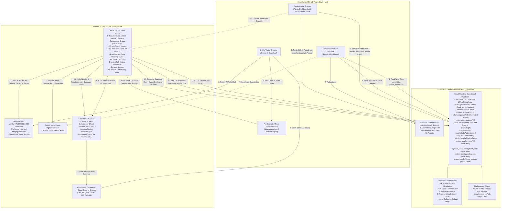
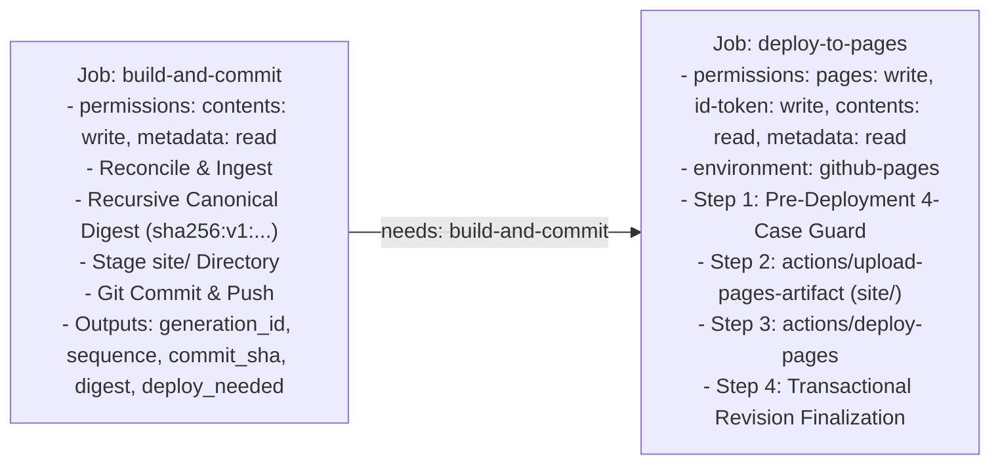

# GitStore — Architecture Specification

**Document Version:** 1.7.0  
**Phase:** Phase 0.1.6 — Step-Up Proof Integrity, Firestore Rules & Deployment Reconciliation  
**Status:** IN_REVIEW — Awaiting Explicit User Approval  

---

## 1. Architectural Philosophy and Invariants

The design of GitStore is governed by seven non-negotiable architectural invariants:

1. **Strict Dual-Platform Confinement:** The entire lifecycle of GitStore—from development and source control to database transactions, background processing, and binary delivery—is confined strictly to **GitHub** and **Firebase**. No tertiary PaaS, serverless function providers (Vercel, AWS Lambda, Netlify), or external relational databases (Supabase, PlanetScale) are permitted. No Firebase Hosting or Cloud Functions are used.
2. **Binary Non-Execution & Non-Hosting:** GitStore is a catalog, discovery engine, and verification broker. GitStore never executes submitted executables, never runs sandboxed code evaluation, and never stores or caches binary payloads inside Git repositories or Firebase Storage.
3. **Static-First Read Architecture & Targeted Free Quotas:** Storefront visitor traffic is 100% decoupled from the transactional database. 100% of anonymous catalog requests terminate at GitHub Pages' static file server (`data/catalog.json`), keeping Cloud Firestore operations reserved strictly for authenticated developer interactions, submission workflows, and background worker state transitions. Operating costs target $0.00/month by remaining strictly within the published free quotas of GitHub and Firebase (Spark Plan) without attached billing accounts.
4. **Zero-Trust Client Boundary & Exhaustive Schema Restrictions:** The client-side browser is treated as untrusted. No client-side code possesses the authority to grant permissions, verify developers, alter product publication statuses, claim processing leases, or bypass release validation. User profile documents (`/users/{uid}`) are strictly private; public developer metadata is isolated in an explicit public projection (`/public_profiles/{uid}`). Internal collections (`/system_deployments`, `/system_config/deployment_state`, `/system_config/catalog_state`, `/admin_logs`) default to deny for all client access. All client-creatable and client-updatable collections enforce exhaustive schema rules via `keys().hasOnly(...)` and `diff().affectedKeys().hasOnly(...)`.
5. **Decoupled Privileged Administration via Action-Bound Step-Up Proof (Option A):** Normal browser clients never receive Firebase Admin SDK credentials, and client JavaScript cannot mint custom claims. All privileged administrative and moderation operations execute via the privileged **GitHub Actions Batch Worker**, verified authoritatively against **GitStore's own canonical GitHub repository** (`Rohitpvt/GitStore`) collaborator permissions (`role_name === 'admin'` or `'maintain'`). To prevent session hijacking or unauthorized action by linked email accounts, privileged operations strictly require fresh, interactive GitHub reauthentication (`reauthenticateWithPopup`). **Zero raw OAuth access tokens are stored in Firestore.** The request stores an action-bound cryptographic proof binding the caller's verified Firebase UID, immutable numeric GitHub ID (`request.auth.token.firebase.identities['github.com'][0]`), `auth_time`, action, target document path, and a single-use action nonce. The Security Rules enforce a 5-minute authentication freshness window at creation time (`auth_time < 300s`), while the worker processes requests within a 30-minute queue TTL from `createdAt`.
6. **12-State Deployment Recovery State Machine & Deterministic Recursive Digest:** Deployments transition across a formal 12-state state machine. Catalog integrity is proven via a deterministic SHA-256 `catalogDigest` computed over canonicalized static files with recursive key sorting and length-prefixed, null-byte framed hashing (`sha256:v1:...`). Reverse failure reconciliation handles missing Pages deployment IDs across Cases A–D via official GitHub Pages API lookups (`GET /repos/{owner}/{repo}/pages/deployments/{catalogCommitSha}`). Pre-deployment generation ordering is enforced by a dedicated 4-case guard immediately prior to deployment dispatch.
7. **Durable Catalog Revisions & Work Preservation Invariant:** Every catalog-affecting status change advances a durable monotonic revision counter (`/system_config/catalog_state.latestRequestedRevision`). Inside an atomic Firestore transaction, the worker reads current catalog revisions, ensures monotonic advancement, and transactionally updates `isDirty = (currentRequested > newPublished)`, guaranteeing that changes arriving during compilation or deployment are never lost.

---

## 2. Hardened System Architecture Diagram



---

## 3. Platform Boundaries & Interface Contracts

### 3.1 Interface Contract: Administrator Browser <-> Privileged Actions Worker

- **Canonical Repository Boundary Check:** Administrator authorization is verified strictly against **GitStore's own canonical GitHub repository** (`Rohitpvt/GitStore`). The batch worker asserts:
  ```javascript
  if (process.env.GITHUB_REPOSITORY !== 'Rohitpvt/GitStore') {
    throw new Error(`SECURITY ALERT: Execution on non-canonical repository ${process.env.GITHUB_REPOSITORY} aborted.`);
  }
  ```
  Environment string checks alone are insufficient against untrusted code injection. Privileged workflows are strictly isolated to trusted execution contexts (see Section 3.5).

- **Action-Bound Step-Up Proof Integrity (Zero Raw OAuth Tokens in Firestore):**
  Privileged administrative operations (`APPROVE_SUBMISSION`, `REJECT_SUBMISSION`, `VERIFY_DEVELOPER`, `REVOKE_DEVELOPER`, `DELIST_PRODUCT`, `FEATURE_PRODUCT`) cannot be executed by client browsers directly. Nor can browser clients mint custom claims or hold Firebase Admin credentials.

  To prevent session hijacking, credential leakage, or unauthorized administrative actions by users authenticating via passwordless email accounts linked to an admin, GitStore enforces **Mandatory Fresh GitHub Step-Up Reauthentication with Action-Bound Proofs (Option A)**:

  1. **Behavior of Firebase Auth Tokens on Interactive Step-Up Reauthentication:**
     When an administrator triggers a privileged action on `admin.html`, the dashboard client initiates interactive step-up reauthentication:
     ```javascript
     import { getAuth, GithubAuthProvider, reauthenticateWithPopup } from 'firebase/auth';

     const auth = getAuth();
     const provider = new GithubAuthProvider();
     provider.addScope('read:user');

     // Interactive popup forces fresh authentication at GitHub (MFA/biometric)
     const result = await reauthenticateWithPopup(auth.currentUser, provider);
     const freshIdTokenResult = await auth.currentUser.getIdTokenResult(true);
     ```
     - **`auth_time`:** Firebase Auth updates the user's ID token claim `auth_time` (epoch seconds) to reflect the exact time of the interactive challenge.
     - **`sign_in_provider`:** The claim `request.auth.token.firebase.sign_in_provider` reflects `'github.com'`. (For accounts created via Email and linked with GitHub, re-authenticating with GitHub establishes the active session provider as GitHub OAuth).
     - **`identities`:** The claim `request.auth.token.firebase.identities['github.com']` contains an array containing the caller's immutable numeric GitHub user ID (e.g. `['12345678']`).

  2. **Elimination of Raw Token Storage & Construction of Action-Bound Proof:**
     **No OAuth access tokens are ever written to or stored in Cloud Firestore.** Storing raw access tokens in Firestore introduces severe token exfiltration risks, even if deleted later.
     Instead, the client constructs an **action-bound proof** cryptographically linking the action, target document, and authentication timestamp:
     ```javascript
     const actionNonce = crypto.randomUUID().replace(/-/g, '') + crypto.randomUUID().replace(/-/g, '');
     const authTime = freshIdTokenResult.claims.auth_time;
     const targetDocumentPath = `submissions/${targetSubmissionId}`;
     
     // SHA-256 hash over action, target path, nonce, and auth_time
     const proofString = `${action}:${targetDocumentPath}:${actionNonce}:${authTime}`;
     const actionHash = await crypto.subtle.digest('SHA-256', new TextEncoder().encode(proofString))
       .then(buf => Array.from(new Uint8Array(buf)).map(b => b.toString(16).padStart(2, '0')).join(''));

     const stepUpProof = {
       providerId: 'github.com',
       authTime: authTime,
       actionNonce: actionNonce,
       targetDocumentPath: targetDocumentPath,
       actionHash: actionHash
     };
     ```

  3. **Security Rules Freshness Gate & Schema Validation:**
     Firestore Security Rules enforce that any moderation request write must satisfy:
     - `request.auth.token.firebase.sign_in_provider == 'github.com'` (Session authenticated via GitHub OAuth).
     - `'github.com' in request.auth.token.firebase.identities` (Linked GitHub account exists).
     - `(request.time.toMillis() / 1000) - request.auth.token.auth_time < 300` (Reauthentication occurred within 5 minutes of document creation).
     - `request.auth.token.auth_time <= (request.time.toMillis() / 1000) + 5` (Reauthentication timestamp is not in the future).
     - `request.resource.data.requestedByUid == request.auth.uid`
     - `request.resource.data.githubUserId == request.auth.token.firebase.identities['github.com'][0]`
     - `request.resource.data.stepUpProof.authTime == request.auth.token.auth_time`
     - `request.resource.data.stepUpProof.targetDocumentPath == request.resource.data.targetDocumentPath`
     - `request.resource.data.status == 'pending'`
     - `request.resource.data.createdAt == request.time`
     - Client modification and deletion are completely forbidden: `allow update, delete: if false;`.

  4. **The 5-Minute Freshness Gate vs. 30-Minute Queue Execution Window:**
     - **Creation Gate (5 Minutes):** The rule `request.time - auth_time < 300` applies **strictly at the moment of document creation**. This guarantees that the user actively interacted with GitHub MFA/OAuth within 5 minutes when queuing the request.
     - **Queue Retention & Worker Execution (30 Minutes):** Once accepted by Firestore, the document is immutable (`createdAt = request.time`). The GitHub Actions worker runs every 10–15 minutes. When the worker leases a request, it asserts:
       ```javascript
       const ageMs = Date.now() - docData.createdAt.toMillis();
       if (ageMs > 30 * 60 * 1000) {
         // Expired in queue
         await docRef.update({ status: 'expired', rejectionReason: 'QUEUE_TTL_EXCEEDED' });
         return;
       }
       ```
       This completely resolves any scheduling conflict between the 5-minute authentication window and the 10-minute worker cron schedule.

  5. **Worker Verification of Administrator Identity & Permissions:**
     When the worker processes `/moderation_requests/{requestId}`:
     - The worker retrieves the caller's Firebase user record via Firebase Admin SDK: `const userRecord = await admin.auth().getUser(docData.requestedByUid);`.
     - Locates the linked GitHub provider: `const ghProvider = userRecord.providerData.find(p => p.providerId === 'github.com');`.
     - Asserts that `ghProvider.uid === docData.githubUserId`.
     - Verifies the action-bound proof:
       ```javascript
       const expectedProofString = `${docData.action}:${docData.targetDocumentPath}:${docData.stepUpProof.actionNonce}:${docData.stepUpProof.authTime}`;
       const expectedHash = crypto.createHash('sha256').update(expectedProofString).digest('hex');
       if (expectedHash !== docData.stepUpProof.actionHash) {
         throw new Error("SECURITY ALERT: Action hash mismatch; proof corrupted or forged.");
       }
       ```
     - Authorizes the administrator:
       * **Root Admin Bootstrap:** Matches `ghProvider.uid` against the canonical repository owner's immutable numeric GitHub account ID retrieved via `GET /repos/Rohitpvt/GitStore` (`owner.id`).
       * **Delegated Maintainers:** Resolves the current login handle via `GET /user/{ghProvider.uid}` and queries `GET /repos/Rohitpvt/GitStore/collaborators/{login}/permission`. Enforces fail-closed authorization: `role_name === 'admin'` or `role_name === 'maintain'`.
     - Executes the requested state transition in an atomic Firestore transaction and logs to `/admin_logs`.

---

### 3.2 Interface Contract: Exhaustive Schema Enforcement & Data Privacy

To guarantee complete data privacy, eliminate PII leaks, and prevent client self-escalation:

1. **Private User Documents (`/users/{userId}`):**
   - Strictly private (`allow read: if isOwner(userId);`).
   - Creation restricted via `keys().hasOnly(['uid', 'email', 'displayName', 'avatarUrl', 'bio', 'settings', 'createdAt', 'updatedAt'])`.
   - Update restricted via `request.resource.data.diff(resource.data).affectedKeys().hasOnly(['displayName', 'avatarUrl', 'bio', 'settings', 'updatedAt'])`.
   - Immutable fields (`uid`, `email`, `createdAt`) and privileged fields (`isAdmin`, `isVerifiedDeveloper`, `reputationScore`, `githubNumericId`) cannot be touched by clients.

2. **Public Developer Profiles (`/public_profiles/{userId}`):**
   - Publicly readable (`allow read: if true;`).
   - Creation restricted via `keys().hasOnly(['userId', 'displayName', 'githubUsername', 'avatarUrl', 'bio', 'isVerifiedDeveloper', 'publishedProductIds', 'createdAt', 'updatedAt'])`, with `isVerifiedDeveloper == false` and `publishedProductIds == []`.
   - Update restricted via `request.resource.data.diff(resource.data).affectedKeys().hasOnly(['displayName', 'avatarUrl', 'bio', 'updatedAt'])`.
   - Reputation badges `isVerifiedDeveloper` and `publishedProductIds` are worker-only via Admin SDK.

3. **Submissions (`/submissions/{submissionId}`):**
   - Creation restricted to exhaustive whitelist with `developerUid == request.auth.uid`, `status == 'queued'`, and `processingLease == null`.
   - Update restricted via `diff(resource.data).affectedKeys().hasOnly(['productData', 'status', 'updatedAt'])` and allowed ONLY when `status in ['queued', 'rejected']`.

4. **Claim Requests (`/claim_requests/{requestId}`):**
   - Client creation restricted to `keys().hasOnly(['requestId', 'requesterUid', 'targetSubmissionId', 'status', 'createdAt'])`.
   - Client update/delete forbidden: `allow update, delete: if false;`.

5. **Abuse Reports (`/reports/{reportId}`):**
   - Requires authenticated user (`request.auth != null`) to eliminate anonymous spam.
   - Creation restricted via `keys().hasOnly(['reportId', 'reporterUid', 'targetType', 'targetId', 'reason', 'details', 'status', 'createdAt'])`.
   - Size limit: `details.size() <= 2000`, `reason in ['malware', 'copyright', 'misleading', 'broken', 'other']`.
   - Client read, update, and delete forbidden: `allow read, update, delete: if false;`.

6. **Internal Collections Default-Deny:**
   - `/admin_logs`, `/system_deployments`, `/system_config/deployment_state`, `/system_config/catalog_state`: `allow read, write: if false;`.

---

### 3.3 Interface Contract: Globally Unique Deterministic Entity IDs

To guarantee global uniqueness and prevent collisions when two distinct repositories share an identical product slug:
- **Repository Identity (`gh_repo_{repoId}`):** GitHub's immutable numeric repository ID (e.g., `gh_repo_892341901`).
- **Product Identity (`prod_{repoId}_{productSlug}`):** Compounded numeric repo ID with product slug (e.g., `prod_892341901_viewer`).
- **Submission Identity:** `sub_issue_{repoId}_{issueNumber}` (issue submissions) or `sub_dash_{nanoid}` (dashboard).
- **Release & Asset Identity:** `rel_{repoId}_{releaseId}` and `asset_{repoId}_{assetId}`.

---

### 3.4 Interface Contract: 12-State Deployment Recovery State Machine & Reconciler

Consistency between GitHub Pages and Cloud Firestore is governed by a formal 12-state state machine:


- **Reconciler Query Bug Fix:**
  Previous queries searched only `reconciliationStatus == 'none'`, silently dropping generations in intermediate states. The reconciler now queries all non-terminal reconciliation states:
  ```javascript
  const pendingGenerations = await db.collection('system_deployments')
    .where('status', 'in', ['pending', 'built', 'dispatched', 'deploying', 'catalog_committed', 'deployment_retained'])
    .where('reconciliationStatus', 'in', ['none', 'sha_recovered', 'pages_dispatched', 'pending_retry'])
    .get();
  ```

- **Case B Recovery Path Implementation:**
  When a commit was pushed to `origin/main` (`catalogCommitSha` verified) but no GitHub Pages deployment exists (GitHub API returns 404):
  1. The runner restores the git tree at `gen.catalogCommitSha`: `git checkout ${gen.catalogCommitSha}`.
  2. The runner computes `computeCatalogDigest(process.cwd())` and asserts match against `gen.catalogDigest`. If mismatch, the generation transitions to `abandoned`.
  3. The runner reconstructs the staging directory `site/`.
  4. The runner sets workflow output `deploy_needed = true` and `pages_deployment_sha = gen.catalogCommitSha`.
  5. The runner updates Firestore: `reconciliationStatus = 'pages_dispatched'`.
  6. The downstream `deploy-to-pages` job uploads the artifact and dispatches Pages deployment.

- **Official GitHub Pages API Status Endpoint & Error Handling:**
  The reconciler eliminates the undocumented list endpoint and uses the official endpoint:
  `GET /repos/{owner}/{repo}/pages/deployments/{pages_deployment_id}`
  where `{pages_deployment_id}` accepts the deployment ID or the commit SHA (`catalogCommitSha`).
  - **200 OK + `status: "built"`:** Success. Proceed to CDN manifest verification and database finalization.
  - **200 OK + `status: "queued" | "in_progress"`:** Non-terminal. Update `reconciliationStatus = 'pages_dispatched'` and await next cycle.
  - **200 OK + `status: "errored"`:** Deployment failed. Update `reconciliationStatus = 'pending_retry'` (or transition to `deployment_retained` if retries exhausted).
  - **404 Not Found:** No Pages deployment exists for this commit SHA -> Triggers **Case B recovery path**.
  - **401 / 403 Forbidden:** Permissions error on Actions token -> Log fatal error and abort batch.
  - **5xx / Network:** Transient failure -> Retry next cycle.

- **Full-History Discovery & Ancestry Proof:**
  Unshallow fetch (`fetch-depth: 0`) ensures full commit history. For each candidate commit modifying `data/deployment-manifest.json`, the reconciler proves branch ancestry:
  `git merge-base --is-ancestor ${candidateSha} origin/main`
  Fallback to GitHub Commits API traverses the full pagination loop using `Link: rel="next"`.

---

### 3.5 Interface Contract: GitHub Actions Event and Fork Security Matrix

| Workflow Trigger Event | Authorization Status | Secrets Access | Allowed Context & Ref Restrictions | Security Controls & Rationale | Evidence Classification |
|---|---|---|---|---|---|
| **`schedule`** | **ALLOWED** | Yes (`FIREBASE_SERVICE_ACCOUNT`, `GITHUB_TOKEN`) | Default branch (`refs/heads/main`) only | Runs scheduled batch worker on canonical repository default branch. Completely isolated from external PR code. | `DOCUMENTATION_VERIFIED` (Syntax docs); live run is `PENDING_INTEGRATION_TEST` |
| **`workflow_dispatch`** | **ALLOWED** | Yes (`FIREBASE_SERVICE_ACCOUNT`, `ADMIN_VERIFY_TOKEN`) | Canonical repo collaborators with `write`/`admin` | Allows on-demand batch runs. Gated to verified repository collaborators by GitHub Actions permissions. | `DOCUMENTATION_VERIFIED` (GitHub API permissions); live check is `PENDING_INTEGRATION_TEST` |
| **`issues: opened, edited`** | **RESTRICTED INGEST** | Scoped / None | Ingestion workflow only | Ingests Issue Form submissions. Minimal permissions (`issues: read`, `contents: read`). Runs parser in strict isolation. | `DESIGNED` |
| **`pull_request`** | **RESTRICTED** | **NO SECRETS** | Pull requests targeting `main` | Read-only static linting of docs. GitHub Actions withholds secrets from fork-originated PRs. | `DOCUMENTATION_VERIFIED` (Runner boundary) |
| **`pull_request_target`** | ❌ **FORBIDDEN** | **NONE (BANNED)** | Prohibited in GitStore | Prohibited due to fork secret-exfiltration vulnerabilities. | `DESIGNED` (Repository policy ban) |
| **`workflow_run`** | ❌ **FORBIDDEN** | **NONE (BANNED)** | Prohibited in GitStore | Avoids untrusted artifact injection. | `DESIGNED` |
| **`push`** | **RESTRICTED** | No Privileged Pipeline | Protected `main` branch only | Push-suppression prevents cascade triggers. | `DOCUMENTATION_VERIFIED` |

---

### 3.6 Interface Contract: Split-Job Pages Configuration, Cross-Job Handoff & Pre-Deploy Guard

To enforce least privilege, `.github/workflows/batch-processor.yml` is split into two sequential jobs with explicit outputs:



- **Explicit Cross-Job Outputs:**
  In `build-and-commit`:
  ```yaml
  outputs:
    generation_id: ${{ steps.catalog.outputs.generation_id }}
    generation_sequence: ${{ steps.catalog.outputs.generation_sequence }}
    catalog_commit_sha: ${{ steps.commit.outputs.commit_sha }}
    catalog_digest: ${{ steps.catalog.outputs.catalog_digest }}
    deploy_needed: ${{ steps.catalog.outputs.deploy_needed }}
  ```
- **Pre-Deployment Generation Ordering Guard (4-Case Matrix):**
  Executed immediately before `actions/deploy-pages@v5` in `deploy-to-pages`:
  1. *Case 1: Stale Generation (`artifact.generationSequence < active.latestPublishedSequence`):*
     **ABORT DEPLOY.** Older generation attempting to deploy over newer catalog. Exit with error code 1.
  2. *Case 2: Idempotent Retry (`artifact.seq === active.latestSeq && artifact.id === active.latestId`):*
     **ALLOW DEPLOY.** Re-run / retry of currently published generation.
  3. *Case 3: Sequence Conflict (`artifact.seq === active.latestSeq && artifact.id !== active.latestId`):*
     **CRITICAL ALARM (FAIL-CLOSED).** Two different generation IDs claiming identical sequence number. Abort deployment immediately and log security incident.
  4. *Case 4: Valid Forward Progression (`artifact.generationSequence > active.latestPublishedSequence`):*
     **ALLOW DEPLOY.** Forward sequential progression.
- **Action Pinning Recommendation:**
  For maximum supply-chain security, action references should be pinned to full 40-character commit SHAs with semantic version tags (e.g. `actions/checkout@11bd71901bbe5b1630ceea73d27597364c9af683 # v4.2.2`).

---

### 3.7 Interface Contract: Deterministic Recursive Canonical Digest & Durable Revisions

#### 3.7.1 Recursive Canonical Catalog Digest Specification
The catalog digest algorithm guarantees mathematical collision resistance and cross-platform invariance:
1. **Recursive Canonicalization (`canonicalizeJson`):**
   - Object keys are recursively sorted in lexicographical Unicode order.
   - Array element ordering is strictly preserved.
   - Numbers are formatted stably; `NaN` and `Infinity` throw fatal errors.
   - Primitives are UTF-8 encoded with standard escapes.
2. **Length-Prefixed, Null-Byte Framed Boundaries:**
   Each file in `data/catalog.json`, `data/categories.json`, and `data/products/*.json` (excluding `data/deployment-manifest.json`) is processed:
   `hash.update(Buffer.from("FILE\0" + relPosixPath + "\0" + payloadBuffer.length + "\0", 'utf8'));`
   `hash.update(payloadBuffer);`
3. **Digest Version Prefix:** `sha256:v1:${hex}`.

#### 3.7.2 Test Vectors for the 6 Core Properties
| # | Property Tested | Test Vector Input | Expected Canonicalization / Digest Behavior |
|---|---|---|---|
| **1** | **Key Ordering Invariance** | `{ "b": 1, "a": { "y": 2, "x": 3 } }` vs `{ "a": { "x": 3, "y": 2 }, "b": 1 }` | Identical canonical string `{"a":{"x":3,"y":2},"b":1}` and identical SHA-256 digest. |
| **2** | **Array Order Sensitivity** | `[1, 2, 3]` vs `[3, 2, 1]` | Distinct canonical strings `[1,2,3]` vs `[3,2,1]` producing distinct digests. |
| **3** | **Type Distinction** | `{ "v": "123" }` vs `{ "v": 123 }` | Distinct representations `{"v":"123"}` vs `{"v":123}` producing distinct digests. |
| **4** | **Unicode Stability** | `{ "tag": "café", "emoji": "🚀" }` | Deterministic UTF-8 byte stream across Windows (CRLF) and Linux (LF). |
| **5** | **Path Framing Collision Resistance** | Path `a/b` with content `c` vs Path `a` with content `/bc` | Unambiguous framing `FILE\0a/b\01\0c` vs `FILE\0a\03\0/bc` prevents boundary collision. |
| **6** | **Manifest Exclusion** | Files in `data/` including `data/deployment-manifest.json` | Manifest is strictly omitted from file list, preventing circular hash dependency. |

#### 3.7.3 Durable Catalog Revision Transactions
Catalog revisions are managed inside `db.runTransaction`:
```javascript
await db.runTransaction(async (transaction) => {
  const catalogStateRef = db.collection('system_config').doc('catalog_state');
  const liveDoc = await transaction.get(catalogStateRef);
  const liveState = liveDoc.data() || { latestRequestedRevision: 0, latestPublishedRevision: 0 };

  const currentPublished = liveState.latestPublishedRevision || 0;
  const currentRequested = liveState.latestRequestedRevision || 0;

  if (capturedRevision <= currentPublished && currentPublished !== 0) {
    console.warn("Stale revision detected; aborting revision advance.");
    return;
  }

  const isDirty = (currentRequested > capturedRevision);
  transaction.set(catalogStateRef, {
    latestPublishedRevision: capturedRevision,
    isDirty: isDirty,
    lastPublishedAt: new Date(),
    updatedAt: new Date()
  }, { merge: true });
});
```

#### 3.7.4 Comprehensive 9-Race-Condition Audit & Mitigation Analysis
| # | Concurrency Race Condition | Vulnerability Scenario | GitStore Hardened Mitigation | Verification Status |
|---|---|---|---|---|
| **RC-1** | Simultaneous compilation workers | Concurrent runs create competing Git commits. | Firestore atomic lease lock (`leaseExpiresAt`) + Actions concurrency group `github-pages`. | `DOCUMENTATION_VERIFIED` |
| **RC-2** | Submission approved during compilation | Approval arrives after query snapshot but before commit. | Durable revision counter increments. Worker computes `isDirty = (currentRequested > capturedRevision)` transactionally, queuing follow-up compilation. | `DESIGNED` |
| **RC-3** | Crash post-push before commit SHA save | Commit exists in Git; Firestore has `null` SHA. | Full-history startup reconciler scans `origin/main`, matches `catalogDigest`, and recovers SHA idempotently. | `DESIGNED` |
| **RC-4** | Simultaneous duplicate `/claim_requests` | Rapid double-click generates competing claims. | Worker executes claims in atomic transaction asserting `submission.developerUid == null`. Second claim fails closed. | `DESIGNED` |
| **RC-5** | Step-Up proof replay attempt | Intercepted proof payload re-submitted. | Security Rules enforce `isFreshlyAuthenticated()` (< 300s) and action-bound proof. Single-use `actionNonce` recorded in worker run. Immutability blocks edits. | `DESIGNED` |
| **RC-6** | Competing claim vs admin delist | Developer claims submission as admin delists it. | Admin moderation sets status to `delisted`; worker asserts status `approved` before compiling catalog. | `DESIGNED` |
| **RC-7** | CDN edge cache serves stale manifest | Public CDN returns old manifest due to edge TTL. | Bounded exponential backoff with cache-busting query `?t=${Date.now()}` up to 5 minutes before deferring to startup reconciler. | `DESIGNED` |
| **RC-8** | Stale run deploys older catalog over newer | Delayed queued runner attempts to deploy old commit. | Pre-deploy 4-case ordering guard asserts `artifact.generationSequence > active.latestPublishedSequence` before dispatching Pages deploy. | `DOCUMENTATION_VERIFIED` |
| **RC-9** | Account unlinked before worker execution | Admin initiates request, then unlinks GitHub account. | Worker queries Firebase Admin SDK `getUser()` at execution time. If GitHub provider missing, request fails closed with `rejected_revoked`. | `DOCUMENTATION_VERIFIED` |

---

## 4. Architectural Decision Records (ADRs)

### ADR-01: Exclusion of Third-Party Backend Hosts
- **Status:** Accepted (Phase 0) | Confinement to GitHub and Firebase.

### ADR-02: Static Pre-Rendered Catalog vs Direct Firestore Queries
- **Status:** Accepted (Phase 0) | Zero Firestore reads for storefront visitors.

### ADR-03: Rejection of Binary Execution & Sandboxing
- **Status:** Accepted (Phase 0) | Downloads point directly to author GitHub Releases.

### ADR-04: Passwordless Authentication
- **Status:** Accepted (Phase 0) | GitHub OAuth & Email Magic Link eliminate password fields on Pages.

### ADR-05: Fail-Closed Administrator Authorization & Canonical Repository Boundary
- **Status:** Accepted (Phase 0.1.6 Reconciled)
- **Decision:** Administrator checks execute strictly against `Rohitpvt/GitStore`. Root admin is verified by matching caller's linked numeric GitHub ID against repo `owner.id`. Collaborators checked fail-closed for `role_name === 'admin'` or `'maintain'`.

### ADR-06: Asynchronous Submission Claiming via Restricted `/claim_requests` Queue
- **Status:** Accepted (Phase 0.1.2) | Eliminates fake accounts; client creation strictly whitelisted.

### ADR-07: Non-Circular Manifest Architecture & Dedicated Pages Deployment Verification
- **Status:** Accepted (Phase 0.1.6 Reconciled) | Manifest contains `generatedAt` and `catalogDigest`; omits circular commit SHA. Pages verification uses official endpoint `GET /repos/{owner}/{repo}/pages/deployments/{catalogCommitSha}`.

### ADR-08: GitHub Pages Policy Launch Gate & Clarification Contingency
- **Status:** Accepted (Phase 0.1) | Written confirmation from GitHub Support established as Phase 4 launch gate.

### ADR-09: Globally Unique Deterministic Entity Identities via Numeric Repository IDs
- **Status:** Accepted (Phase 0.1.2) | Repositories and products keyed by immutable numeric IDs (`gh_repo_{repoId}`, `prod_{repoId}_{productSlug}`).

### ADR-10: reCAPTCHA Enterprise Specification & Quotas
- **Status:** Accepted (Phase 0.1.5) | reCAPTCHA Enterprise with `isTokenAutoRefreshEnabled: true`, lazy-loaded on auth pages.

### ADR-11: Single-Workflow Catalog Publication (Option A)
- **Status:** Accepted (Phase 0.1.5) | Overcomes token push suppression by executing build, commit, artifact upload, and deployment within one trusted workflow.

### ADR-12: Monotonic Generation Ordering & Durable Record Preservation
- **Status:** Accepted (Phase 0.1.5) | Monotonic integer `generationSequence` evaluated against 4-case matrix. Failed records preserved in `/system_deployments`.

### ADR-13: Deterministic Post-Commit SHA Recovery
- **Status:** Accepted (Phase 0.1.5) | Full-history Git search, branch ancestry proof (`merge-base`), and catalog digest matching.

### ADR-14: Public Profile Separation & Private User Data Privacy
- **Status:** Accepted (Phase 0.1.5) | Separate `/users/{userId}` (private) and `/public_profiles/{userId}` (public read, worker badges).

### ADR-15: Action-Bound Step-Up Authentication Proof Integrity (Zero Raw Tokens)
- **Status:** Accepted (Phase 0.1.6 Reconciled)
- **Decision:** Eliminate all raw OAuth access token storage in Firestore. Admin step-up uses `reauthenticateWithPopup(auth.currentUser, new GithubAuthProvider())`. Security Rules enforce `sign_in_provider == 'github.com'` and `auth_time < 300s` at creation gate. Proof payload binds `{ providerId, authTime, actionNonce, targetDocumentPath, actionHash }`. Worker processes requests within a 30-minute queue TTL, validating admin collaborator rights on `Rohitpvt/GitStore`.

### ADR-16: 12-State Recovery State Machine & Recursive Canonical Digest
- **Status:** Accepted (Phase 0.1.6 Reconciled)
- **Decision:** Formalize 12-state recovery machine. Reconciler searches all non-terminal reconciliation states. Implements executable Case B recovery path. Replaces undocumented list endpoint with official `GET .../pages/deployments/{catalogCommitSha}` endpoint. Catalog digest uses recursive canonical JSON serialization (`canonicalizeJson`) and null-byte length-prefixed framing (`sha256:v1:...`).

### ADR-17: Durable Catalog Revisions & Transactional State Management
- **Status:** Accepted (Phase 0.1.6 Reconciled)
- **Decision:** Track monotonic `latestRequestedRevision` and `latestPublishedRevision`. Advance published revision monotonically inside atomic Firestore transaction, computing transactional `isDirty` to preserve all work.

### ADR-18: Least-Privilege Split-Job Pages Workflow & Pre-Deploy Ordering Guard
- **Status:** Accepted (Phase 0.1.6 Reconciled)
- **Decision:** Split into `build-and-commit` and `deploy-to-pages` with explicit cross-job outputs. Stage assets strictly into `site/`. Enforce pre-deployment 4-case generation ordering guard immediately prior to `actions/deploy-pages@v5`. Recommend 40-character commit SHA action pinning.
