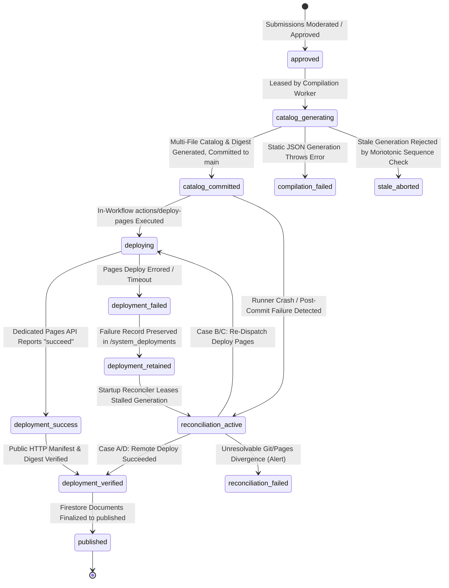

# GitStore — Architecture Specification

**Document Version:** 1.6.0  
**Phase:** Phase 0.1.5 — Final Security Rules, Administrator Step-Up Authentication & Deployment Recovery Audit  
**Status:** Approved Architectural Baseline (Hardened & Reconciled)  

---

## 1. Architectural Philosophy and Invariants

The design of GitStore is governed by seven non-negotiable architectural invariants:

1. **Strict Dual-Platform Confinement:** The entire lifecycle of GitStore—from development and source control to database transactions, background processing, and binary delivery—is confined strictly to **GitHub** and **Firebase**. No tertiary PaaS, serverless function providers (Vercel, AWS Lambda, Netlify), or external relational databases (Supabase, PlanetScale) are permitted. No Firebase Hosting or Cloud Functions are used.
2. **Binary Non-Execution & Non-Hosting:** GitStore is a catalog, discovery engine, and verification broker. GitStore never executes submitted executables, never runs sandboxed code evaluation, and never stores or caches binary payloads inside Git repositories or Firebase Storage.
3. **Static-First Read Architecture & Targeted Free Quotas:** Storefront visitor traffic is 100% decoupled from the transactional database. 100% of anonymous catalog requests terminate at GitHub Pages' static file server (`data/catalog.json`), keeping Cloud Firestore operations reserved strictly for authenticated developer interactions, submission workflows, and background worker state transitions. Operating costs target $0.00/month by remaining strictly within the published free quotas of GitHub and Firebase (Spark Plan) without attached billing accounts.
4. **Zero-Trust Client Boundary & Data Privacy:** The client-side browser is treated as untrusted. No client-side code possesses the authority to grant permissions, verify developers, alter product publication statuses, claim processing leases, or bypass release validation. User profile documents (`/users/{uid}`) are strictly private; public developer metadata is isolated in an explicit public projection (`/public_profiles/{uid}`). Internal collections (`/system_deployments`, `/system_config/deployment_state`, `/system_config/catalog_state`, `/admin_logs`) default to deny for all client access.
5. **Decoupled Privileged Administration via Mandatory Fresh GitHub Reauthentication (Option A):** Normal browser clients never receive Firebase Admin SDK credentials, and client JavaScript cannot mint custom claims. All privileged administrative and moderation operations execute via the privileged **GitHub Actions Batch Worker**, verified authoritatively against **GitStore's own canonical GitHub repository** (`Rohitpvt/GitStore`) collaborator permissions (`role_name === 'admin'` or `'maintain'`). To prevent session hijacking or unauthorized action by linked email accounts, privileged operations strictly require fresh, interactive GitHub reauthentication (`reauthenticateWithPopup`) generating an ephemeral, single-use, action-bound step-up authorization proof that is verified and immediately destroyed by the worker.
6. **Durable Catalog Revisions & Work Preservation Invariant:** Every catalog-affecting status change advances a durable monotonic revision counter (`/system_config/catalog_state.latestRequestedRevision`). A catalog compilation generation captures the active requested revision and guarantees that no approved submission or moderation change is silently lost due to Actions runner interruptions, concurrency queue replacements, or deployment retries.
7. **Portability and Standards Compliance:** The client application uses standards-compliant HTML5, CSS3, and ES6 JavaScript Modules. No proprietary framework compilers (React, Next.js, Vue) or custom runtime dependencies exist.

---

## 2. Hardened System Architecture Diagram

```mermaid
graph TB
    subgraph ClientLayer["Client Layer (GitHub Pages Static Host)"]
        Visitor["Public Visitor Browser\n(Browse & Download)"]
        Developer["Software Developer Browser\n(Submit & Dashboard)"]
        AdminBrowser["Administrator Browser\n(Admin Dashboard with Step-Up Reauth)"]
        StaticCatalog["Pre-Compiled Static Storefront Data\n(data/catalog.json & products/*.json)"]
    end

    subgraph FirebasePlatform["Platform 2: Firebase Infrastructure (Spark Plan)"]
        FirebaseAuth["Firebase Authentication\n- GitHub OAuth (Popup)\n- Passwordless Magic Link\n- Mandatory GitHub Step-Up Reauth"]
        Firestore["Cloud Firestore Operational Database\n- users/{uid} (Strictly Private)\n- public_profiles/{uid} (Public Read)\n- submissions/{id}\n- claim_requests/{id}\n- moderation_requests/{id} (With Ephemeral Step-Up Proof)\n- products/{id}\n- categories/{id}\n- reports/{id}\n- admin_logs/{id} (Worker Only: allow false)\n- system_deployments/{id} (Worker Only: allow false)\n- system_config/deployment_state (Worker Only: allow false)\n- system_config/catalog_state (Worker Only: allow false)\n- system_config/global_settings (Public Read)"]
        SecurityRules["Firestore Security Rules\n- Strict RBAC & Data Privacy\n- Zero Client Self-Escalation\n- Step-Up Freshness Enforcement (auth_time < 300s)\n- Internal Collection Default-Deny"]
        AppCheck["Firebase App Check\n- reCAPTCHA Enterprise Web Provider\n- Lazy-Loaded on Auth Pages Only"]
    end

    subgraph GitHubPlatform["Platform 1: GitHub Core Infrastructure"]
        GHPages["GitHub Pages\n- Vanilla HTML5/CSS3/ES6 Storefront\n- Packaged from site/ Staging Directory\n- Direct Static Asset Serving"]
        GHIssues["GitHub Issue Forms\n- Ingestion Queue (.github/ISSUE_TEMPLATE)"]
        GHReleases["Public GitHub Releases\n- Direct External Binaries\n(EXE, MSI, APK, DMG, ZIP, TAR.GZ)"]
        GHREST["GitHub REST API v3\n- Ephemeral Step-Up Token Verification\n- Canonical Repo Collaborator Check\n- Upstream Repo, Tag, & Asset Validation\n- Direct Personal Owner Validation"]
        GHWorker["GitHub Actions Batch Worker\n(Scheduled every 10 min + Manual Dispatch)\n- Concurrency Group: github-pages\n- 15-Min Atomic Leases\n- Split Jobs: build-and-commit & deploy-to-pages\n- Ephemeral Step-Up Proof Verification & Immediate Purge\n- Full-History Commit Recovery & Catalog Digest Match\n- Durable Revision Advance & Self-Healing Loop"]
    end

    %% Read Operations (Pure GitHub Pages - Zero DB Requests)
    Visitor -->|1. Fetch HTML/CSS/JS| GHPages
    Visitor -->|2. Fetch Static Catalog Index| StaticCatalog
    Visitor -->|3. Direct Download Binary| GHReleases

    %% Developer Operations
    Developer -->|4. Authenticate| FirebaseAuth
    Developer -->|5. Read/Write Own users/uid & public_profiles/uid| Firestore
    Developer -->|6. Write Submission status: queued| Firestore
    Developer -.->|7. Open Issue Submission| GHIssues
    Firestore --- SecurityRules
    Firestore --- AppCheck

    %% Admin Operations (Decoupled Command Queue with Step-Up Proof)
    AdminBrowser -->|8. Fresh GitHub Reauth via reauthenticateWithPopup| FirebaseAuth
    AdminBrowser -->|9. Enqueue Moderation Request with Ephemeral Step-Up Proof| Firestore
    AdminBrowser -.->|10. Optional Immediate Dispatch| GHWorker

    %% Worker Automation & Privilege Execution
    GHWorker -->|11. Ingest & Verify Personal Repo Ownership| GHIssues
    GHWorker -->|12. Atomic Lease Claim Limit 3| Firestore
    GHWorker -->|13. Non-Execution Asset & Tag Verification| GHREST
    GHREST -.->|Validate Release Asset Existence| GHReleases
    GHWorker -->|14. Verify Step-Up Proof via GitHub API & Purge Token| GHREST
    GHWorker -->|15. Authorize Admin via Canonical GitStore Repo Check| GHREST
    GHWorker -->|16. Execute Privileged Updates & admin_logs| Firestore
    GHWorker -->|17. Multi-File Static Catalog & Digest Compilation| StaticCatalog
    GHWorker -->|18. Commit origin main & Deploy site/ to Pages| GHPages
    GHWorker -->|19. Reconcile Deployed State, Digest & Advance Revision| Firestore
```



---

## 3. Platform Boundaries & Interface Contracts

### 3.1 Interface Contract: Administrator Browser <-> Privileged Actions Worker

- **Canonical Repository Boundary Check:** Administrator authorization is verified strictly against **GitStore's own canonical GitHub repository** (`Rohitpvt/GitStore`). The batch worker asserts:
  ```javascript
  if (process.env.GITHUB_REPOSITORY !== 'Rohitpvt/GitStore') {
    throw new Error(`SECURITY ALERT: Execution on non-canonical repository ${process.env.GITHUB_REPOSITORY} aborted.`);
  }
  ```
  Environment string checks alone are insufficient against untrusted code injection. Privileged workflows are strictly isolated to trusted execution contexts (see Section 3.5).

- **The Decoupled Command Pattern with Mandatory Fresh GitHub Step-Up Reauthentication (Option A):**
  Privileged administrative operations (`APPROVE_SUBMISSION`, `REJECT_SUBMISSION`, `VERIFY_DEVELOPER`, `DELIST_PRODUCT`, `FEATURE_PRODUCT`) cannot be executed by client browsers directly. Nor can browser clients mint custom claims or hold Firebase Admin credentials.
  
  To prevent session hijacking, stolen credential replay, or unauthorized administrative actions by users authenticating via passwordless email accounts linked to an admin, GitStore enforces **Mandatory Fresh GitHub Step-Up Reauthentication (Option A)**:
  
  1. **Interactive Step-Up Reauthentication on Admin Action:**
     When an administrator triggers a privileged action on `admin.html`, the dashboard client initiates interactive step-up reauthentication:
     ```javascript
     import { getAuth, GithubAuthProvider, reauthenticateWithPopup } from 'firebase/auth';

     const auth = getAuth();
     const provider = new GithubAuthProvider();
     // Request minimal read-only scope for identity verification
     provider.addScope('read:user');

     // Interactive popup forces fresh authentication at GitHub (biometric/MFA)
     const result = await reauthenticateWithPopup(auth.currentUser, provider);
     const credential = GithubAuthProvider.credentialFromResult(result);
     const ephemeralGithubToken = credential.accessToken;
     const issuedAt = new Date();
     const expiresAt = new Date(issuedAt.getTime() + 300 * 1000); // 300 seconds (5 min) validity
     const actionNonce = crypto.randomUUID().replace(/-/g, '') + crypto.randomUUID().replace(/-/g, '');
     ```
  2. **Security Rules Freshness Gate:**
     Upon fresh reauthentication, Firebase Auth updates the user's ID token claim `auth_time` (epoch seconds). Firestore Security Rules enforce that any write to `/moderation_requests` must have an `auth_time` within 300 seconds of `request.time`:
     ```javascript
     match /moderation_requests/{requestId} {
       allow create: if request.auth != null
         && (request.time.toMillis() / 1000) - request.auth.token.auth_time < 300
         && request.resource.data.keys().hasOnly(['requestId', 'action', 'targetId', 'payload', 'requestedByUid', 'stepUpProof', 'status', 'createdAt'])
         && request.resource.data.requestedByUid == request.auth.uid
         && request.resource.data.status == 'pending'
         && request.resource.data.createdAt == request.time;
     }
     ```
  3. **Ephemeral Step-Up Proof Structure:**
     The client writes the request to `/moderation_requests/{requestId}`:
     ```typescript
     {
       requestId: string;
       action: 'APPROVE_SUBMISSION' | 'REJECT_SUBMISSION' | 'VERIFY_DEVELOPER' | 'DELIST_PRODUCT' | 'FEATURE_PRODUCT';
       targetId: string;
       payload: { reason?: string; notes?: string };
       requestedByUid: string;              // auth.uid (enforced by Security Rules)
       stepUpProof: {
         providerId: 'github.com';
         ephemeralGithubToken: string;      // Ephemeral OAuth access token (destroyed upon verification)
         issuedAt: string;                  // ISO 8601 UTC timestamp
         expiresAt: string;                 // ISO 8601 UTC timestamp (issuedAt + 300s)
         actionNonce: string;               // Cryptographically random 64-char hex nonce
       };
       status: 'pending';                   // pending | processing | completed | rejected
       createdAt: serverTimestamp();
     }
     ```
  4. **Cryptographic Identity Extraction & Direct GitHub Validation in Actions Worker:**
     - The worker reads `/moderation_requests/{requestId}`.
     - The worker **never trusts client-supplied username strings, UIDs, or roles**.
     - The worker retrieves the caller's Firebase User Record via Firebase Admin SDK:
       ```javascript
       function normalizeGithubId(val) {
         if (val == null) return null;
         const str = String(val).trim();
         if (!/^\d+$/.test(str)) return null;
         return str;
       }

       const userRecord = await admin.auth().getUser(requestData.requestedByUid);
       const githubProvider = userRecord.providerData.find(p => p.providerId === 'github.com');
       if (!githubProvider || !githubProvider.uid) {
         throw new Error("UNAUTHORIZED: Caller has no verified linked GitHub provider");
       }
       const verifiedCallerGithubNumericId = normalizeGithubId(githubProvider.uid);
       if (!verifiedCallerGithubNumericId) {
         throw new Error("UNAUTHORIZED: Caller GitHub provider UID is non-numeric or malformed");
       }
       ```
     - **Direct GitHub Identity & Token Verification:**
       The worker validates the ephemeral token directly against GitHub's authoritative API:
       ```javascript
       // Check time freshness
       const now = Date.now();
       if (now > Date.parse(requestData.stepUpProof.expiresAt)) {
         throw new Error("FORBIDDEN: Step-up authentication proof has expired (> 300 seconds)");
       }

       // Query GitHub /user using the ephemeral token
       const ghUserResp = await octokitWithStepUp.rest.users.getAuthenticated();
       const tokenOwnerNumericId = normalizeGithubId(ghUserResp.data.id);
       if (tokenOwnerNumericId !== verifiedCallerGithubNumericId) {
         throw new Error("SECURITY ALERT: Step-up token identity does not match linked Firebase provider identity");
       }
       ```
     - **Immediate Destruction of Ephemeral Token:**
       To prevent token leakage, credential retention, or replay attacks, the worker **immediately deletes the raw token** in an atomic Firestore update before executing the action:
       ```javascript
       await db.collection('moderation_requests').doc(requestId).update({
         'stepUpProof.ephemeralGithubToken': admin.firestore.FieldValue.delete(),
         'stepUpProof.consumedAt': new Date().toISOString(),
         'stepUpProof.workerRunId': String(process.env.GITHUB_RUN_ID),
         status: 'processing'
       });
       ```
     - **Single-Use Anti-Replay Guarantee:** If a request document is missing `ephemeralGithubToken` or already has `consumedAt`, it is permanently rejected as a replay attempt.

  5. **Root Administrator Bootstrap & Identity Verification:**
     - The worker retrieves the canonical repository owner's immutable numeric GitHub account ID via the GitHub API:
       `GET https://api.github.com/repos/Rohitpvt/GitStore` -> `response.data.owner.id` (numeric integer, e.g. `12345678`), or verifies against the trusted environment configuration `BOOTSTRAP_ROOT_ADMIN_GITHUB_ID`.
     - The canonical owner ID is normalized: `const canonicalOwnerNumericId = normalizeGithubId(response.data.owner.id);`.
     - The worker extracts and normalizes the caller's linked GitHub account ID: `const verifiedCallerNumericId = normalizeGithubId(githubProvider.uid);`.
     - The worker performs an exact string comparison of the normalized numeric IDs:
       ```javascript
       const isRootAdmin = (verifiedCallerNumericId === canonicalOwnerNumericId);
       ```
     - If the comparison succeeds, root administrator privileges are authorized.
     - If the comparison fails, the caller is NOT the root administrator. The worker falls back to checking whether the caller is an authorized collaborator (maintainer).
     - The system fails closed: if GitHub provider identity is absent, ambiguous, unlinked, or malformed, all administrative operations are immediately aborted with `403 FORBIDDEN`. *(Evidence: DESIGNED and DOCUMENTATION_VERIFIED; live comparison is PENDING_INTEGRATION_TEST).*

  6. **Fail-Closed Collaborator Permission Check (Delegated Administrators):**
     - For non-root callers, the worker resolves the current GitHub login handle from GitHub's REST API using the caller's immutable numeric ID:
       `GET https://api.github.com/user/{verifiedCallerGithubNumericId}`
     - The worker queries GitHub's official collaborator permission endpoint:
       `GET https://api.github.com/repos/Rohitpvt/GitStore/collaborators/{verifiedLogin}/permission`
     - **Response Field Mapping (Officially Verified via GitHub REST API Docs):**
       The endpoint returns `{ permission: string, role_name: string, user: object }`.
       - `permission`: Legacy base permission (`admin`, `write`, `read`, `none`). Modern roles map `maintain` to `write` under legacy `permission`.
       - `role_name`: Explicit role name assigned (`admin`, `maintain`, `write`, `triage`, `read`, or custom role).
     - **Fail-Closed Authorization Policy:**
       ```javascript
       const { permission, role_name } = response.data;
       const isAuthorizedAdmin = (role_name === 'admin') || (role_name == null && permission === 'admin');
       const isAuthorizedMaintainer = (role_name === 'maintain');

       if (!isAuthorizedAdmin && !isAuthorizedMaintainer) {
         // Fail-closed: explicitly reject 'write' (without maintain), 'triage', 'read', 'none', custom roles, and unexpected responses
         throw new Error(`FORBIDDEN: User ${verifiedLogin} role '${role_name}' (permission '${permission}') is not authorized.`);
       }
       ```
     - **Dual-Token Permissions & Integration Status:** Querying `/repos/{owner}/{repo}/collaborators/{username}/permission` requires `Metadata: read` permissions. The worker implements a dual-token strategy: attempting `secrets.GITHUB_TOKEN` with `permissions: { contents: read, metadata: read }`, and falling back to a fine-grained PAT / GitHub App token (`secrets.ADMIN_VERIFY_TOKEN`). *(Evidence: DOCUMENTATION_VERIFIED for schema; live Actions collaborator token verification is PENDING_INTEGRATION_TEST).*

  7. **Revocation, Account Unlinking & Emergency Recovery:**
     - **Dynamic Revocation:** Real-time API verification on every worker batch cycle ensures immediate revocation upon removing a collaborator on GitHub; no stale claim or local cache survives.
     - **Account Unlinking / Provider Changes:** If a user unlinks their GitHub provider in Firebase Auth, `providerData.find(p => p.providerId === 'github.com')` returns `undefined`, instantly revoking all administrative authority.
     - **Compromised Account Emergency Revocation:**
       1. The root administrator removes the compromised GitHub account from repository collaborators on `Rohitpvt/GitStore`.
       2. The root administrator executes token revocation via Firebase Admin SDK: `await admin.auth().revokeRefreshTokens(compromisedUid)`.
       3. Any pending requests in `/moderation_requests` authored by the compromised UID are marked `rejected_revoked` by the worker during identity resolution.

  8. **Technical Boundaries & Limitations of Firebase Auth:**
     - Firebase Auth ID tokens carry Firebase's RSA/ECDSA signature asserting user claims, but do *not* contain arbitrary third-party cryptographic signatures from GitHub.
     - Client browsers cannot sign arbitrary payloads with GitHub credentials without an interactive OAuth flow.
     - Option A resolves this cleanly by combining Firebase Auth's built-in `auth_time` freshness claim (verified in Security Rules) with an ephemeral, single-use GitHub OAuth access token (verified directly via GitHub REST API by the worker and destroyed immediately upon consumption).

---

### 3.2 Interface Contract: Data Privacy, User Profiles & Secure Submission Claiming

- **Strict Data Privacy: Private User Documents vs. Public Profile Projections:**
  To guarantee user privacy and prevent data leakage, user metadata is strictly partitioned into two separate Firestore collections:
  1. **Private User Documents (`/users/{userId}`):**
     - Contains sensitive private data: `email`, `emailVerified`, `githubId` (numeric), `githubUsername`, `isAdmin`, `isVerifiedDeveloper`, `reputationScore`, `createdAt`, `updatedAt`, `settings`.
     - **Read Permission:** Restricted strictly to the authenticated owner (`request.auth.uid == userId`) and the privileged batch worker via Admin SDK. Zero public read access.
     - **Write Permission:** Authenticated owners may update personal settings and profile fields (`displayName`, `avatarUrl`, `bio`). Clients are strictly forbidden from modifying privileged fields (`isAdmin`, `isVerifiedDeveloper`, `reputationScore`, `githubId`, `email`, `emailVerified`). Any client attempt to write these fields is blocked by Firestore Security Rules.
  2. **Public Developer Profiles (`/public_profiles/{userId}`):**
     - Contains only safe, publicly projectable developer metadata:
       ```typescript
       {
         userId: string;
         displayName: string;
         githubUsername: string;
         avatarUrl: string;
         bio: string;
         isVerifiedDeveloper: boolean;      // Worker-managed via Admin SDK ONLY
         publishedProductIds: string[];    // Worker-managed via Admin SDK ONLY
         createdAt: timestamp;
         updatedAt: timestamp;
       }
       ```
     - **Read Permission:** Publicly readable (`allow read: if true;`) to power public developer profile views and product attribution.
     - **Write Permission:** Authenticated users may update their own `displayName`, `avatarUrl`, and `bio`. Fields `isVerifiedDeveloper` and `publishedProductIds` can only be updated by the Actions worker via Admin SDK.
  3. **Internal System Collections (Default-Deny for Clients):**
     - `/system_deployments/{generationId}`: `allow read, write: if false;` (Worker only via Admin SDK).
     - `/system_config/deployment_state`: `allow read, write: if false;` (Worker only via Admin SDK).
     - `/system_config/catalog_state`: `allow read, write: if false;` (Worker only via Admin SDK).
     - `/admin_logs/{logId}`: `allow read, write: if false;` (Worker only via Admin SDK).
     - `/system_config/global_settings`: `allow read: if true; allow write: if false;` (Publicly readable configuration, worker write only).

- **Zero Fake / Placeholder Accounts:**
  - Submissions ingested from GitHub Issue Forms store the author's immutable numeric GitHub account ID (`context.payload.issue.user.id`) directly from the trusted event payload.
  - Submissions are created with:
    ```typescript
    developerUid: null;
    submitterGithubId: string;        // Immutable numeric string e.g. "583231"
    submitterGithubUsername: string;  // e.g. "monalisa"
    claimStatus: 'unclaimed';
    ```

- **Distinction of Ownership, Release Authority, and Verified Developer:**
  1. **Repository Ownership:** Proves control over the repository configuration (`repo.owner.id === submitterGithubId`).
  2. **Release Authority:** Proves authorization to publish release binaries. Direct personal owners possess inherent release authority. Org members and committers do **not** possess proven release authority and are held in `needs_review`.
  3. **Verified Developer Identity:** A platform trust credential granted by administrators via moderation requests. Repository ownership does **not** automatically award verified developer status.

- **Secure Asynchronous Claiming Workflow (`/claim_requests`):**
  1. The user authenticates with Firebase Auth (GitHub OAuth or Email Magic Link linked with GitHub).
  2. The user initiates a claim from the dashboard, writing to `/claim_requests/{requestId}`:
     ```typescript
     {
       requestId: string;
       requesterUid: string;              // Must equal request.auth.uid (enforced by Security Rules)
       targetSubmissionId: string;
       status: 'pending';
       createdAt: serverTimestamp();
     }
     ```
  3. **Strict Client-Creatable Field Whitelisting & Firestore Security Rules:**
     Clients must **never** be able to inject worker-managed or privileged fields. Firestore Security Rules enforce an exhaustive whitelist:
     ```javascript
     match /claim_requests/{requestId} {
       allow read: if request.auth != null && resource.data.requesterUid == request.auth.uid;
       allow create: if request.auth != null
         && request.resource.data.keys().hasOnly(['requestId', 'requesterUid', 'targetSubmissionId', 'status', 'createdAt'])
         && request.resource.data.requestId == requestId
         && request.resource.data.requesterUid == request.auth.uid
         && request.resource.data.targetSubmissionId is string
         && request.resource.data.targetSubmissionId.size() > 0
         && request.resource.data.targetSubmissionId.size() <= 128
         && request.resource.data.status == 'pending'
         && request.resource.data.createdAt == request.time;
       allow update, delete: if false; // Worker only via Admin SDK
     }
     ```
     **Explicitly Blocked Injection Fields:** Any request containing `developerUid`, `verifiedGithubId`, `claimStatus`, `isAdmin`, `processedAt`, `reviewedAt`, `reviewedBy`, `resolution`, `rejectionReason`, `workerLease`, or `workerId` violates `hasOnly()` and is immediately rejected by Firestore engine before writing.
  4. The trusted GitHub Actions worker reads pending claim requests:
     - Fetches `admin.auth().getUser(req.requesterUid)` via Firebase Admin SDK.
     - Locates `userRecord.providerData.find(p => p.providerId === 'github.com')`. Fail closed if absent.
     - Extracts `verifiedGithubId = provider.uid`.
     - Validates against target submission:
       `submission.submitterGithubId === verifiedGithubId && submission.claimStatus === 'unclaimed'`
     - Executes atomic Firestore transaction:
       - Checks that `submission.developerUid == null` (prevents competing claims).
       - Sets `submission.developerUid = req.requesterUid`
       - Sets `submission.claimStatus = 'claimed'`
       - Sets `submission.claimedAt = serverTimestamp()`
       - Sets `claimReq.status = 'completed'`
       - Appends audit entry to `/admin_logs`
     - If validation fails, marks request `rejected_mismatch` or `rejected_already_claimed`. Duplicate requests are handled idempotently.

---

### 3.3 Interface Contract: Entity Hierarchy & Globally Unique Deterministic IDs
To guarantee global uniqueness and prevent collisions when two distinct repositories share an identical product slug (e.g. `microsoft/toolkit-a -> viewer` vs `microsoft/toolkit-b -> viewer`):
- **1. Repository Identity (`gh_repo_{repoId}`):** Uses GitHub's immutable numeric repository ID (e.g., `gh_repo_892341901`). Resilient against repository renames and ownership transfers.
- **2. Product Identity (`prod_{repoId}_{productSlug}`):** Formed by compounding the immutable numeric repo ID with the product slug (e.g., `prod_892341901_viewer`). Guarantees cross-repository uniqueness.
- **3. Submission Identity:**
  - Issue Submissions: `sub_issue_{repoId}_{issueNumber}` (e.g., `sub_issue_892341901_42`). Globally unique.
  - Dashboard Submissions: `sub_dash_{nanoid}` (cryptographically random).
- **4. Release Identity (`rel_{repoId}_{releaseId}`):** Uses GitHub's immutable numeric release ID (`release.id`).
- **5. Release Asset Identity (`asset_{repoId}_{assetId}`):** Uses GitHub's immutable numeric asset ID (`asset.id`).

---

### 3.4 Interface Contract: 12-State Deployment Recovery State Machine & Deterministic Digest Verification

Because GitHub Pages and Cloud Firestore are independent distributed systems, atomic consistency across them is impossible. GitStore implements an **eventually consistent, recoverable publication workflow** governed by a formal 12-state recovery state machine, a non-circular manifest, deterministic catalog digests, and full-history commit recovery:



- **The 12 Formal Deployment States:**
  1. `approved`: Submissions approved and ready for catalog inclusion.
  2. `catalog_generating`: Active worker compiling static catalog files (`catalog.json`, `categories.json`, `products/*.json`).
  3. `catalog_committed`: Static catalog files and manifest committed and pushed to `origin/main`.
  4. `deploying`: Artifact uploaded to Pages, deployment dispatched via GitHub Pages API.
  5. `deployment_success`: GitHub Pages deployment API returns `"succeed"`.
  6. `deployment_verified`: Live public CDN returns matching `generationId`, `generationSequence`, and `catalogDigest`.
  7. `published`: Firestore submission documents updated to `status: 'published'`; catalog revision advanced.
  8. `compilation_failed`: Catalog build script failed before committing to Git.
  9. `deployment_failed`: Pages deployment failed, timed out, or canceled.
  10. `deployment_retained`: Incomplete or failed generation durably preserved in `/system_deployments` (reconciliation eligible).
  11. `reconciliation_active`: Startup reconciler actively recovering state across Git, Pages, and Firestore.
  12. `stale_aborted`: Older generation superseded by a higher sequence number; aborted without side effects.

- **Non-Circular Manifest Architecture & Generation Timestamping:**
  The deployed manifest contains **zero Git commit SHAs** and records `generatedAt` and `catalogDigest`:
  ```json
  {
    "generationId": "gen_1730300400000_a1b2c3d4",
    "generationSequence": 104,
    "generatedAt": "2026-11-03T09:00:00.000Z",
    "catalogDigest": "sha256:e3b0c44298fc1c149afbf4c8996fb92427ae41e4649b934ca495991b7852b855",
    "productCount": 42,
    "schemaVersion": "1.6.0",
    "environment": "github-pages"
  }
  ```
  - **Deterministic `catalogDigest` Specification:**
    To mathematically prove that a deployed catalog matches a Git commit, the worker computes a deterministic SHA-256 digest:
    1. Collect all static catalog data files: `data/catalog.json`, `data/categories.json`, and all files matching `data/products/*.json`.
    2. Sort the file paths lexicographically.
    3. Serialize JSON with deterministic sorted keys.
    4. Compute SHA-256 hash over the concatenated canonical byte streams.
    5. The resulting digest string (`sha256:...`) is written into `data/deployment-manifest.json` and recorded in Firestore `/system_deployments/{generationId}`. The manifest itself is excluded from digest computation, preventing circular dependency.

- **Full-History Commit Discovery (Eliminating the 10-Commit Limitation):**
  Previous iterations searched only the last 10 commits (`git log -n 10`), creating a catastrophic failure mode if automated commits or multi-commit pushes pushed the deployment manifest beyond the 10-commit window.
  
  *Hardened Full-History Discovery Algorithm:*
  1. **Unshallow Fetch:** Workflows execute `actions/checkout@v7` with `fetch-depth: 0` (unshallow fetch) when running recovery.
  2. **Full-History Git Log Search:**
     ```bash
     git log --format="%H" origin/main -- data/deployment-manifest.json
     ```
     This streams all commits modifying `data/deployment-manifest.json` across the entire history of `origin/main`.
  3. **Paginated GitHub Commits API Fallback:**
     If the local Git repository is shallow or corrupted, the reconciler falls back to the paginated GitHub Commits API:
     `GET https://api.github.com/repos/Rohitpvt/GitStore/commits?path=data/deployment-manifest.json&sha=main&per_page=100`
  4. **Branch Ancestry Assertion:**
     Before any candidate commit is accepted, the reconciler cryptographically proves that the commit is part of the canonical `main` history:
     ```bash
     git merge-base --is-ancestor ${candidateSha} origin/main
     ```
     If the assertion fails (exit code != 0), the commit is rejected as orphaned or originating from an untrusted fork/branch.
  5. **Deterministic Disambiguation via Catalog Digest:**
     If multiple commits match the expected `generationId` and `generationSequence` (e.g. cherry-picks or test commits), the reconciler parses the commit tree, computes the `catalogDigest`, and selects the **latest commit on `origin/main` whose digest matches the expected `catalogDigest`**.

- **Handling Missing GitHub Pages Deployment IDs (Cases A, B, C, D):**
  When reconciling a retained generation where `pagesDeploymentId` is absent from Firestore:
  - **Case A: Remote Pages Deployment Exists and Succeeded:**
    The reconciler queries the Pages deployments API: `GET /repos/Rohitpvt/GitStore/pages/deployments?per_page=10`. If a deployment exists matching `catalogCommitSha` with `status === "succeed"`, the reconciler records `pagesDeploymentId`, verifies the live public CDN manifest and digest, and advances Firestore to `published`.
  - **Case B: No Remote Pages Deployment Exists:**
    The commit was pushed, but Pages artifact upload or deployment never started. The reconciler checks out `catalogCommitSha`, builds the Pages artifact into `site/`, dispatches `actions/deploy-pages@v5`, captures the new `pagesDeploymentId` in Firestore, and monitors for completion.
  - **Case C: Remote Pages Deployment Failed or Timed Out:**
    The Pages API reports `status === "failed"`. The reconciler increments `attemptCount` in `/system_deployments/{generationId}`. If `attemptCount < 3`, it re-dispatches deployment for the identical commit. If `attemptCount >= 3`, it transitions to `deployment_retained`, releases the worker lease, and alerts administrators via `/admin_logs`.
  - **Case D: Deployment Succeeded but Firestore Finalization Failed:**
    Public CDN inspection confirms that `https://rohitpvt.github.io/GitStore/data/deployment-manifest.json` matches `generationId`, `generationSequence`, and `catalogDigest`. The reconciler performs idempotent finalization: updates submissions to `published`, updates `/system_config/deployment_state`, and advances `/system_config/catalog_state.latestPublishedRevision`.

- **Generation Ordering & Concurrency Boundaries (4-Case Matrix):**
  Every generation is evaluated against Firestore `/system_config/deployment_state.latestPublishedSequence`:

  | Case | Condition | State Assessment | Action & Invariants |
  |---|---|---|---|
  | **Case 1: Stale Generation** | `gen.generationSequence < state.latestPublishedSequence` | An older generation is attempting to deploy or finalize after a newer generation has already published. | **REJECT AS STALE.** Immediately abort Pages deployment and Firestore finalization. Mark generation `status: 'stale_aborted'`. Do not touch `latestPublishedSequence` or overwrite catalog state. |
  | **Case 2: Idempotent Retry** | `gen.generationSequence === state.latestPublishedSequence && gen.generationId === state.latestPublishedGenerationId` | Retry or self-healing pass for the currently published generation. | **IDEMPOTENT RETRY.** Proceed to verify Pages deployment and confirm submission status without re-generating catalog or creating new Git commits. |
  | **Case 3: Sequence Conflict** | `gen.generationSequence === state.latestPublishedSequence && gen.generationId !== state.latestPublishedGenerationId` | Two distinct generation IDs claim the exact same sequence number (split-brain condition). | **CRITICAL CONFLICT (FAIL-CLOSED).** Immediately halt deployment. Log high-severity security alarm in `/admin_logs`. Mark generation `status: 'reconciliation_failed'`, `failureReason: 'sequence_conflict_duplicate'`. Require manual operator review. |
  | **Case 4: Valid New Generation** | `gen.generationSequence > state.latestPublishedSequence` | Valid sequential progression. | **PROCEED WITH DEPLOYMENT.** Concurrency lease blocks conflicting operations. Worker proceeds to artifact packaging, Pages deployment, and sequence advance. |

- **GitHub Pages Deployment Concurrency Boundary:**
  GitHub Pages deployments are bound to the repository-level concurrency group `github-pages` (`cancel-in-progress: false`). Immediately prior to executing `actions/deploy-pages@v5`, the workflow queries Firestore `/system_config/deployment_state.latestPublishedSequence`. If `currentRunningGenerationSequence < latestPublishedSequence`, the deployment step aborts before Pages deployment occurs.

---

### 3.5 Interface Contract: GitHub Actions Event and Fork Security Matrix

The architecture strictly rejects relying solely on `process.env.GITHUB_REPOSITORY === 'Rohitpvt/GitStore'` as a security boundary. Forked repositories can execute workflows where that variable is evaluated differently or spoofed in untrusted execution contexts. Furthermore, pull requests opened from forks can execute arbitrary malicious code if dangerous workflow triggers are configured.

To guarantee complete execution integrity and prevent secret exfiltration or unauthorized database writes, GitStore establishes an **explicit event allowlist and restriction matrix** with formal evidence classifications:

| Workflow Trigger Event | Authorization Status | Secrets Access | Allowed Context & Ref Restrictions | Security Controls & Rationale | Evidence Classification |
|---|---|---|---|---|---|
| **`schedule`** | **ALLOWED** | Yes (`FIREBASE_SERVICE_ACCOUNT`, `GITHUB_TOKEN`) | Default branch (`refs/heads/main`) only | Runs the scheduled batch worker. Executes strictly on the canonical repository default branch. Completely isolated from external PR code. | `DOCUMENTATION_VERIFIED` (Syntax & event docs); live execution is `PENDING_INTEGRATION_TEST` |
| **`workflow_dispatch`** | **ALLOWED** | Yes (`FIREBASE_SERVICE_ACCOUNT`, `ADMIN_VERIFY_TOKEN`) | Canonical repo collaborators with `write`/`admin` | Allows on-demand batch runs or manual catalog re-compilation. Gated to verified repository collaborators by GitHub Actions permissions. | `DOCUMENTATION_VERIFIED` (GitHub API permissions); live check is `PENDING_INTEGRATION_TEST` |
| **`issues: opened, edited`** | **RESTRICTED INGEST** | Scoped / None | Ingestion workflow only | Ingests Issue Form submissions. Runs with minimal permissions (`issues: read`, `contents: read`). Runs parser in strict isolation; never executes user-supplied code or shell commands. | `DESIGNED` |
| **`pull_request`** | **RESTRICTED** | **NO SECRETS** | Pull requests targeting `main` | Read-only static linting and validation of docs/schema. GitHub Actions automatically withholds repository secrets from fork-originated PRs. | `DOCUMENTATION_VERIFIED` (Actions runner security model) |
| **`pull_request_target`** | ❌ **FORBIDDEN** | **NONE (BANNED)** | Not permitted in GitStore repository | **CRITICAL:** `pull_request_target` executes in the context of the base repository with full access to secrets, but can check out and run untrusted code from the fork PR. Strictly prohibited. | `DESIGNED` (Policy enforced in repository rules) |
| **`workflow_run`** | ❌ **FORBIDDEN** | **NONE (BANNED)** | Not permitted for untrusted triggers | Avoids untrusted artifact injection and cross-workflow privilege escalation. | `DESIGNED` |
| **`repository_dispatch`** | ❌ **RESTRICTED** | Restricted | Not used in MVP | Not needed under single-workflow Option A architecture. | `DESIGNED` |
| **`push`** | **RESTRICTED** | No Privileged Pipeline | Protected `main` branch only | Pushes to `main` are restricted by branch protection rules (require review/checks). Ordinary pushes do NOT trigger the privileged publisher to avoid push-suppression conflicts and deployment thrashing. | `DOCUMENTATION_VERIFIED` (Token push suppression behavior) |

#### Architectural Guardrails Against Fork Escalation:
1. **Zero Untrusted Pull Request Secrets:** No workflow responding to `pull_request` receives `FIREBASE_SERVICE_ACCOUNT` or write tokens.
2. **Execution Context Verification:** All privileged workflows assert three independent conditions at startup:
   ```javascript
   if (github.repository !== 'Rohitpvt/GitStore' || 
       !['schedule', 'workflow_dispatch'].includes(github.event_name) ||
       github.ref !== 'refs/heads/main') {
     throw new Error(`SECURITY VIOLATION: Execution in untrusted context (${github.repository}, ${github.event_name}, ${github.ref}) aborted.`);
   }
   ```
3. **Single Trusted Workflow Run (Option A):** Catalog generation, Git commit, Pages artifact upload, Pages deployment, and Firestore finalization run sequentially in a single trusted execution run, preventing cross-run race conditions or token handoff vulnerabilities.

---

### 3.6 Interface Contract: Least-Privilege Split-Job Pages Configuration & Isolated Staging

GitHub Pages deployment using custom GitHub Actions workflows requires strict separation of privileges between building/committing static assets and deploying to GitHub Pages.

- **Split-Job Architecture (`.github/workflows/batch-processor.yml`):**
  To enforce least-privilege permissions, the workflow is split into two sequential jobs:
  ```mermaid
  flowchart LR
    Job1["Job: build-and-commit\n- permissions: contents: write, metadata: read\n- Ingest Submissions & Claims\n- Compile Catalog & Compute Digest\n- Stage Public Assets into site/\n- Commit & Push origin main\n- Recover SHA if needed"] -->|needs: build-and-commit| Job2["Job: deploy-to-pages\n- permissions: pages: write, id-token: write, contents: read, metadata: read\n- environment: github-pages\n- upload-pages-artifact@v5 (path: site/)\n- deploy-pages@v5\n- Reconcile & Advance Catalog Revision"]
  ```

- **Explicit Job Permissions:**
  - **Job 1 (`build-and-commit`):**
    ```yaml
    permissions:
      contents: write        # Required to push catalog files and manifest to origin/main
      metadata: read         # Required for repository metadata checks
    ```
    *Zero `pages: write` or `id-token: write` permissions granted.*
  - **Job 2 (`deploy-to-pages`):**
    ```yaml
    permissions:
      pages: write           # Required for minting GitHub Pages deployment artifacts
      id-token: write        # Required for OpenID Connect (OIDC) token minting by actions/deploy-pages
      contents: read         # Read-only access to repository files
      metadata: read         # Read repository metadata
    ```
    *Zero `contents: write` permissions granted. Deployment job cannot modify repository source.*

- **Isolated Staging Directory (`site/`):**
  To prevent leaking sensitive internal repository files (`.git/`, `.github/`, `docs/`, `scripts/`, internal tests) into the public GitHub Pages static distribution:
  1. The build script creates a clean staging directory `site/`.
  2. Public assets are copied into `site/`:
     - `index.html`, `admin.html`, `dashboard.html`, `submit.html`, `product.html`
     - `assets/` (CSS, client JS, images)
     - `data/` (`catalog.json`, `categories.json`, `products/*.json`, `deployment-manifest.json`)
  3. `actions/upload-pages-artifact@v5` is configured strictly with:
     ```yaml
     - name: Upload Pages Artifact
       uses: actions/upload-pages-artifact@v5
       with:
         path: site/
     ```
  4. The staging directory `site/` is included in `.gitignore` to prevent tracking build artifacts in Git.

- **Current Verified Action Versions (Official Releases):**
  - Repository Checkout: `actions/checkout@v7` (ESM runner credential isolation, Node 24 runtime).
  - Runtime Setup: `actions/setup-node@v7` (Node 24 LTS, automated package-manager caching).
  - Pages Artifact Packaging: `actions/upload-pages-artifact@v5` (latest stable Pages packaging action).
  - Pages Deployment Dispatch: `actions/deploy-pages@v5` (latest stable Pages deployment dispatch).

---

### 3.7 Interface Contract: Durable Catalog Revisions & Comprehensive Concurrency Audit

Because multiple submissions and moderation actions may arrive while an Actions batch worker is executing, GitStore maintains a durable monotonic revision counter to guarantee zero work loss.

- **Durable Catalog Revisions (`/system_config/catalog_state`):**
  ```typescript
  interface SystemCatalogState {
    latestRequestedRevision: number;    // Advanced on any approved submission, delisting, or moderation change
    latestPublishedRevision: number;    // Advanced when GitHub Pages deployment and CDN verification complete
    activeCapturedRevision: number;     // Revision snapshot captured by currently running compilation worker
    lastRevisionAdvancedAt: timestamp;  // Timestamp of last requested revision change
    lastPublishedAt: timestamp;         // Timestamp of last successful deployment finalization
    isDirty: boolean;                   // latestRequestedRevision > latestPublishedRevision
  }
  ```

- **Revision Lifecycle & Work Preservation:**
  1. Whenever an administrator approves a submission, delists a product, or edits categories, Firestore atomically increments `latestRequestedRevision = FieldValue.increment(1)` and sets `isDirty = true`.
  2. When the Actions worker starts catalog compilation, it snapshots `activeCapturedRevision = latestRequestedRevision`.
  3. The catalog is compiled incorporating all approved items up to `activeCapturedRevision`.
  4. Upon deployment verification, the worker sets `latestPublishedRevision = activeCapturedRevision` and `isDirty = (latestRequestedRevision > activeCapturedRevision)`.
  5. If `isDirty` is true (meaning new submissions arrived during compilation/deployment), the worker immediately schedules another compilation cycle or triggers a self-healing pass. Zero work is ever dropped.

- **Comprehensive 9-Race-Condition Audit & Mitigation Analysis:**

| # | Concurrency Race Condition | Vulnerability / Threat Scenario | GitStore Hardened Mitigation | Verification Status |
|---|---|---|---|---|
| **RC-1** | Two simultaneous compilation workers compile overlapping catalogs | Two batch workers run concurrently, creating competing Git commits with conflicting sequences. | **Monotonic Lease Lock & Concurrency Group:** Only 1 lease is granted via Firestore atomic transaction (`leaseExpiresAt`). GitHub Pages deployments are serialized via Actions concurrency group `github-pages` (`cancel-in-progress: false`). | `DOCUMENTATION_VERIFIED` |
| **RC-2** | Submission approved during static JSON generation | Administrator approves submission after query snapshot but before commit push. | **Durable Catalog Revisions (`catalog_state`):** Monotonic `latestRequestedRevision` increments. Worker detects `latestRequestedRevision > activeCapturedRevision` post-deployment and flags dirty state for immediate follow-up batch. | `DESIGNED` |
| **RC-3** | Runner crash after Git push but before Firestore commit SHA persistence | Commit exists on `origin/main`, but `/system_deployments/{genId}` has `catalogCommitSha: null`. | **Full-History Startup Reconciler:** Scans `origin/main` commit history via `git log` and GitHub Commits API, verifies `catalogDigest` and branch ancestry (`git merge-base --is-ancestor`), and records matched SHA idempotently. | `DESIGNED` |
| **RC-4** | Client submits duplicate `/claim_requests` simultaneously | Rapid double-click or replay creates competing claims for the same submission. | **Atomic Firestore Transaction:** Worker executes claim in atomic Firestore transaction asserting `submission.developerUid == null`. Second request fails closed with `rejected_already_claimed`. | `DESIGNED` |
| **RC-5** | Step-Up Reauthentication token replay | Attacker intercepts `ephemeralGithubToken` from network or Firestore and re-submits. | **Single-Use Action Nonce & Immediate Destruction:** The worker immediately calls `FieldValue.delete()` on `ephemeralGithubToken` upon read. Document records `consumedAt`. 300s expiration rejects stale tokens. | `DESIGNED` |
| **RC-6** | Competing claim vs administrator delist | Developer claims submission at the exact instant administrator delists or rejects it. | **Field Whitelisting & Admin Precedence:** Client claims can only modify `developerUid` via worker. Admin moderation overrides submission status to `rejected` or `delisted`; worker asserts status `approved` before compiling. | `DESIGNED` |
| **RC-7** | CDN edge cache serves stale manifest to verification step | Public CDN returns previous generation manifest due to edge propagation latency. | **Bounded Exponential Backoff with Query Cache-Busting:** Worker appends `?t=${Date.now()}` and polls up to 5 minutes before deferring to startup reconciler without failing the pipeline. | `DESIGNED` |
| **RC-8** | Stale Actions run deploys older catalog over newer published catalog | Delayed queued runner deploys older commit after newer commit was already published. | **4-Case Monotonic Matrix & Pre-Deploy Assertion:** Worker queries `latestPublishedSequence` immediately before executing `actions/deploy-pages@v5`. If `currentSeq < latestPublishedSequence`, run is aborted as `stale_aborted`. | `DOCUMENTATION_VERIFIED` |
| **RC-9** | Account unlinked between request creation and worker execution | Admin or developer initiates request, then unlinks GitHub account in Firebase Auth. | **Real-Time `getUser()` Verification:** Worker queries Firebase Admin SDK `getUser()` at execution time. If `providerData` no longer contains `github.com`, request is immediately aborted with `rejected_revoked`. | `DOCUMENTATION_VERIFIED` |

---

## 4. Architectural Decision Records (ADRs)

### ADR-01: Exclusion of Third-Party Backend Hosts (Vercel, Supabase, Netlify)
- **Status:** Accepted (Phase 0)
- **Rationale:** Keeps architecture confined to GitHub and Firebase; eliminates vendor sprawl and unapproved hosting dependencies.

### ADR-02: Static Pre-Rendered Catalog vs. Direct Firestore Queries
- **Status:** Accepted (Phase 0)
- **Rationale:** Storefront visitors read static JSON compiled by GitHub Actions; 100% of browsing traffic consumes 0 Firestore reads.

### ADR-03: Rejection of Binary Execution & Sandboxing
- **Status:** Accepted (Phase 0)
- **Rationale:** Running untrusted executables inside GitHub Actions violates TOS and risks hypervisor breakouts. Security relies on source provenance, release verification, and manual moderation.

### ADR-04: Passwordless Authentication over Traditional Passwords
- **Status:** Accepted (Phase 0)
- **Rationale:** Eliminates password fields on GitHub Pages, adhering strictly to GitHub’s sensitive transaction policy.

### ADR-05: Fail-Closed Administrator Authorization & Immutable Root Admin Bootstrap
- **Status:** Accepted (Phase 0.1.5 Reconciled)
- **Context:** Previous mapping checked `permission === 'admin' || permission === 'maintain'`, which fails because GitHub's endpoint maps `maintain` to `write` in legacy `permission`. Furthermore, repository ownership alone does not authenticate the person making an administrative request, and string vs integer representations differ between Firebase and GitHub.
- **Decision:** Administrator checks execute strictly against `Rohitpvt/GitStore`. For root administrator bootstrap, the caller's verified GitHub identity linked in Firebase Auth (`userRecord.providerData.find(p => p.providerId === 'github.com')?.uid`) is normalized via `normalizeGithubId()` and compared directly against the canonical repository owner's normalized immutable numeric GitHub account ID retrieved via `GET /repos/Rohitpvt/GitStore` (`owner.id`). For delegated maintainers, collaborator permissions from `GET /repos/Rohitpvt/GitStore/collaborators/{username}/permission` are checked fail-closed: `role_name === 'admin'` or `role_name === 'maintain'`. All others (`write`, `triage`, `read`, custom roles) are rejected. Identity is verified via `admin.auth().verifyIdToken()`; client-supplied usernames, UIDs, and roles are strictly ignored. Dual-token fallback is configured.
- **Evidence Status:** Design and documentation verified (`DOCUMENTATION_VERIFIED`); live Actions collaborator token verification is classified as `PENDING_INTEGRATION_TEST`.
- **Rationale:** Eliminates maintainer authorization bypass, secures root admin bootstrap against impersonation, enforces fail-closed role mapping, and normalizes numeric identity representations.

### ADR-06: Asynchronous Submission Claiming via Restricted `/claim_requests` Queue
- **Status:** Accepted (Phase 0.1.2 Corrected)
- **Context:** Previous design lacked a concrete, secure claiming flow without Cloud Functions and relied on brittle `providerData[0]` indexing.
- **Decision:** Eliminate fake accounts; ingest issue submissions as `unclaimed` with numeric `submitterGithubId`. Authenticated users write restricted claim requests to `/claim_requests`. Client-created documents are strictly whitelisted via `hasOnly(['requestId', 'requesterUid', 'targetSubmissionId', 'status', 'createdAt'])`, blocking all privileged and worker-managed fields. Batch workers validate caller's GitHub provider identity via Firebase Admin SDK and execute transactional ownership claims. Browser clients are forbidden from writing ownership fields.
- **Evidence Status:** Rules syntax and SDK methods `DOCUMENTATION_VERIFIED`; live claim execution is `PENDING_INTEGRATION_TEST`.
- **Rationale:** Zero fake account state; prevents account takeover; ensures complete auditability.

### ADR-07: Non-Circular Manifest Architecture & Dedicated Pages Deployment Verification
- **Status:** Accepted (Phase 0.1.5 Reconciled)
- **Context:** Placing a commit SHA inside `data/deployment-manifest.json` is circular because the manifest is committed inside that very commit. Furthermore, checking the generic Deployments API or assuming commit push guarantees Pages availability causes premature publication marking.
- **Decision:** Completely remove `commitSha` from `data/deployment-manifest.json`. The manifest contains `{ generationId, generationSequence, generatedAt, catalogDigest, productCount, schemaVersion, environment }`. The resulting `catalogCommitSha` is captured via `git rev-parse HEAD` post-commit and recorded in Firestore `/system_deployments/{generationId}`. Verification evaluates the dedicated GitHub Pages deployment endpoint `GET /repos/Rohitpvt/GitStore/pages/deployments/{id}` checking for the Pages-specific status `"succeed"`, followed by cache-busting public HTTP manifest and digest verification.
- **Evidence Status:** `DOCUMENTATION_VERIFIED`; live CDN edge propagation timing is `PENDING_INTEGRATION_TEST`.
- **Rationale:** Eliminates self-referential commit hashes, accurately timestamps manifest generation, verifies the exact Pages deployment outcome, and prevents phantom storefront listings.

### ADR-08: GitHub Pages Policy Launch Gate & Clarification Contingency
- **Status:** Accepted (Phase 0.1)
- **Rationale:** Maintains engineering integrity by establishing formal written confirmation from GitHub Support as a Phase 4 Pre-Launch Gate.

### ADR-09: Globally Unique Deterministic Entity Identities via Numeric Repository IDs
- **Status:** Accepted (Phase 0.1.2 Corrected)
- **Context:** `prod_{repoOwner}_{productSlug}` collides when two repositories under the same owner use identical slugs. GitHub issue numbers are only unique within a repository.
- **Decision:** Base all entity IDs on GitHub's immutable numeric repository ID: `gh_repo_{repoId}`, `prod_{repoId}_{productSlug}`, `sub_issue_{repoId}_{issueNumber}`, `rel_{repoId}_{releaseId}`, `asset_{repoId}_{assetId}`.
- **Rationale:** Mathematically prevents collisions across repositories and remains immune to repository renames and ownership transfers.

### ADR-10: reCAPTCHA Enterprise Specification, Organization Quota & Billing Conditions
- **Status:** Accepted (Phase 0.1.5 Reconciled)
- **Context:** Previous text conflated reCAPTCHA v3 with Google Cloud reCAPTCHA Enterprise's 10,000 monthly free assessments quota, failed to document token auto-refresh configuration, and made unconditional "$0.00/month" claims without stating billing prerequisites.
- **Decision:** Formally specify **reCAPTCHA Enterprise** (`ReCaptchaEnterpriseProvider`) with explicit client configuration `isTokenAutoRefreshEnabled: true`. Document that the 10,000 free assessment allowance is an organization-level quota shared across Google Cloud. Clarify that GitStore targets operation within published free limits under the Firebase Spark Plan without an attached billing account. If billing is attached, assessments beyond 10,000 automatically incur charges ($1 per 1,000). Decouple public storefront browsing completely (0 assessments, 0 Firestore reads). Label all consumption figures as unmeasured engineering projections with explicit assumptions.
- **Evidence Status:** `DOCUMENTATION_VERIFIED` via Firebase and Google Cloud official documentation; browser auto-refresh runtime behavior is `PENDING_INTEGRATION_TEST`.
- **Rationale:** Eliminates quota ambiguity, conforms to Google Cloud billing terms, and ensures predictable operational costs.

### ADR-11: Single-Workflow Catalog Publication & GitHub Pages Deployment (Option A)
- **Status:** Accepted (Phase 0.1.5 Reconciled)
- **Context:** GitHub Actions suppresses ordinary `push` event workflow triggers when commits are pushed using the default `GITHUB_TOKEN`. The architecture cannot depend on a secondary push workflow to deploy GitHub Pages after the catalog worker pushes a commit.
- **Decision:** Adopt **Option A**: Execute static catalog compilation, Git commit/push to `main`, GitHub Pages artifact packaging (`actions/upload-pages-artifact@v5`), Pages deployment (`actions/deploy-pages@v5`), and Firestore status finalization sequentially within the **same trusted workflow execution run** (`.github/workflows/batch-processor.yml`).
- **Evidence Status:** `DOCUMENTATION_VERIFIED` (GitHub Actions runner behavior and token push suppression); live single-run deployment is `PENDING_INTEGRATION_TEST`.
- **Rationale:** Eliminates dependency on push event chaining; avoids requiring administrative PATs or elevated GitHub App tokens for cross-workflow dispatch; provides immediate end-to-end failure visibility in a single execution log.

### ADR-12: Monotonic Generation Ordering & Durable Deployment Record Preservation
- **Status:** Accepted (Phase 0.1.5 Reconciled)
- **Context:** Standard GitHub Actions concurrency (`cancel-in-progress: false`) retains at most one running and one pending run, discarding intermediate pending runs. In addition, resetting failed deployments to `approved` desynchronizes Firestore from pushed Git commits.
- **Decision:** Implement a monotonic integer `generationSequence` stored in Firestore `/system_config/deployment_state`. A deployment generation is evaluated against the 4-case ordering matrix: stale runs (`seq < latestPublishedSequence`) are rejected; retries (`seq === latestPublishedSequence && id === latestPublishedGenerationId`) are handled idempotently; duplicate sequence conflicts (`seq === latestPublishedSequence && id !== latestPublishedGenerationId`) trigger critical fail-closed alarms; valid new generations (`seq > latestPublishedSequence`) proceed. Failed deployment generations are durably preserved in `/system_deployments/{generationId}` with attempt history, Pages status, and failure reasons. Zero work loss is guaranteed through Firestore coalescing.
- **Evidence Status:** `DOCUMENTATION_VERIFIED`; live multi-runner concurrency verification is `PENDING_INTEGRATION_TEST`.
- **Rationale:** Prevents out-of-order race conditions from overwriting newer catalogs and eliminates split-brain inconsistencies between Git and Firestore.

### ADR-13: Deterministic Post-Commit SHA Recovery & Manifest Generation Timestamping
- **Status:** Accepted (Phase 0.1.5 Reconciled)
- **Context:** If an Actions worker generates static catalogs, pushes a commit to `origin/main`, but crashes before persisting `catalogCommitSha` to Firestore, the commit exists in Git history while Firestore has no record of the SHA. Furthermore, timestamping the manifest as `deployedAt` before deployment creates semantic inaccuracy.
- **Decision:** Replace `deployedAt` with `generatedAt` in `data/deployment-manifest.json`. The actual deployment timestamp is recorded post-deployment in Firestore (`verifiedAt`, `finalizedAt`, `lastPublishedAt`). In reverse failure scenarios where `catalogCommitSha` was not persisted, the startup reconciler executes full-history Git discovery via `git log --format="%H" origin/main -- data/deployment-manifest.json`, reads blobs directly via `git show ${sha}:data/deployment-manifest.json`, parses JSON, matches `generationId` and `generationSequence`, and verifies `catalogDigest`. Disambiguation selects the latest commit on `origin/main` matching the digest. Branch ancestry is proven with `git merge-base --is-ancestor`.
- **Evidence Status:** `DESIGNED` & `DOCUMENTATION_VERIFIED`; live recovery simulation is `PENDING_INTEGRATION_TEST`.
- **Rationale:** Eliminates orphaned Git commits, establishes deterministic state recovery without branch checkouts, and guarantees semantic timestamp precision.

### ADR-14: Public Profile Separation & Private User Data Privacy
- **Status:** Accepted (Phase 0.1.5)
- **Context:** In previous designs, user profile data and private account metadata shared the same `/users/{userId}` collection. If read permissions are opened for developer profile views, sensitive PII (emails, GitHub provider UIDs, verification scores, internal flags) would be exposed to unauthenticated or unauthorized users.
- **Decision:** Completely partition user data into two collections: strictly private `/users/{userId}` (read/write restricted to authenticated owner and worker Admin SDK only; client forbidden from modifying privileged fields), and `/public_profiles/{userId}` (public read allowed; writes restricted to safe profile fields like `displayName`, `avatarUrl`, `bio`, while privileged badges `isVerifiedDeveloper` and `publishedProductIds` are written solely by the worker via Admin SDK). All internal system collections (`/system_deployments`, `/system_config/deployment_state`, `/system_config/catalog_state`, `/admin_logs`) default to deny for client access.
- **Evidence Status:** `DOCUMENTATION_VERIFIED` via Firestore Security Rules grammar; live access denial is `PENDING_INTEGRATION_TEST`.
- **Rationale:** Enforces least privilege, prevents PII leakage, and mathematically secures developer reputation badges against client spoofing.

### ADR-15: Mandatory Fresh GitHub Step-Up Reauthentication for Administrator Operations
- **Status:** Accepted (Phase 0.1.5)
- **Context:** Long-lived client sessions, browser token leakage, or accounts linked via passwordless email could allow unauthorized users to enqueue privileged moderation requests. Firebase Auth ID tokens carry Firebase signatures rather than GitHub cryptographic proofs, and client JavaScript cannot mint custom claims.
- **Decision:** Enforce Option A: Require interactive `reauthenticateWithPopup(auth.currentUser, new GithubAuthProvider())` before enqueuing any privileged moderation action. Security Rules verify freshness: `(request.time.toMillis() / 1000) - request.auth.token.auth_time < 300`. An ephemeral step-up proof with an OAuth access token and random action nonce is attached to `/moderation_requests`. The Actions worker directly queries `GET https://api.github.com/user` with the token, asserts identity match against the caller's linked numeric GitHub ID, verifies canonical repo permissions (`Rohitpvt/GitStore`), and **immediately purges** `ephemeralGithubToken` (`FieldValue.delete()`), recording `consumedAt` and worker run ID.
- **Evidence Status:** `DESIGNED` & `DOCUMENTATION_VERIFIED`; live popup and API verification is `PENDING_INTEGRATION_TEST`.
- **Rationale:** Guarantees fresh administrator presence, neutralizes session hijacking, ensures zero credential retention in persistent database records, and prevents replay attacks.

### ADR-16: 12-State Deployment Recovery State Machine, Full-History Search & Deterministic Catalog Digest
- **Status:** Accepted (Phase 0.1.5)
- **Context:** The previous 10-commit search window (`git log -n 10`) caused silent recovery failure if commits were buried. Furthermore, missing Pages deployment IDs and circular manifest hashes were insufficiently modeled.
- **Decision:** Formalize a 12-state deployment recovery state machine. Replace the 10-commit limit with full-history search on unshallow fetch (`git log origin/main -- data/deployment-manifest.json`) and paginated GitHub Commits API fallback. Enforce branch ancestry verification via `git merge-base --is-ancestor ${sha} origin/main`. Implement a deterministic SHA-256 `catalogDigest` computed over sorted, canonicalized catalog JSON files (excluding manifest). Formally handle missing Pages deployment IDs across Cases A, B, C, and D. Disambiguate duplicate candidate commits by selecting the latest commit on `origin/main` whose `catalogDigest` matches.
- **Evidence Status:** `DESIGNED` & `DOCUMENTATION_VERIFIED`; live recovery simulation is `PENDING_INTEGRATION_TEST`.
- **Rationale:** Guarantees comprehensive failure recovery across any commit depth, proves branch provenance, and eliminates ambiguous or divergent deployment states.

### ADR-17: Durable Catalog Revisions & Monotonic Work Preservation
- **Status:** Accepted (Phase 0.1.5)
- **Context:** If submissions are approved or products delisted while an Actions batch worker is compiling or deploying, those changes could be missed or overwritten, requiring manual intervention or risking data desynchronization.
- **Decision:** Introduce `/system_config/catalog_state` tracking monotonic integer counters `latestRequestedRevision` and `latestPublishedRevision`. Any approval or moderation change increments `latestRequestedRevision` and marks `isDirty = true`. When compiling, the worker snapshots `activeCapturedRevision = latestRequestedRevision`. Post-deployment, the worker advances `latestPublishedRevision = activeCapturedRevision` and checks whether `latestRequestedRevision > activeCapturedRevision`. If dirty, a follow-up batch cycle is automatically triggered.
- **Evidence Status:** `DESIGNED` & `DOCUMENTATION_VERIFIED`; live concurrency stress testing is `PENDING_INTEGRATION_TEST`.
- **Rationale:** Guarantees that every approved submission and moderation update is durably published without race condition loss.

### ADR-18: Least-Privilege Split-Job Pages Workflow & Isolated `site/` Staging Directory
- **Status:** Accepted (Phase 0.1.5)
- **Context:** Granting both `contents: write` and `pages: write`/`id-token: write` to a monolithic job violates the principle of least privilege. Furthermore, packaging the repository root risks deploying internal developer files (`.git`, `.github`, `docs/`, `scripts/`) to the public web.
- **Decision:** Split `.github/workflows/batch-processor.yml` into two sequential jobs: `build-and-commit` (granted `contents: write`, `metadata: read`; zero Pages permissions) and `deploy-to-pages` (granted `pages: write`, `id-token: write`, `contents: read`, `metadata: read`; zero repository write permissions). Public assets are staged into a clean `site/` directory, and `actions/upload-pages-artifact@v5` packages exclusively from `site/`. The workflow uses verified official releases: `actions/checkout@v7`, `actions/setup-node@v7`, `actions/upload-pages-artifact@v5`, `actions/deploy-pages@v5`.
- **Evidence Status:** `DOCUMENTATION_VERIFIED`; live Actions execution is `PENDING_INTEGRATION_TEST`.
- **Rationale:** Prevents repository tampering by the deployment step, guarantees least-privilege token scoping, and eliminates data leakage of internal repository files into public web hosting.

