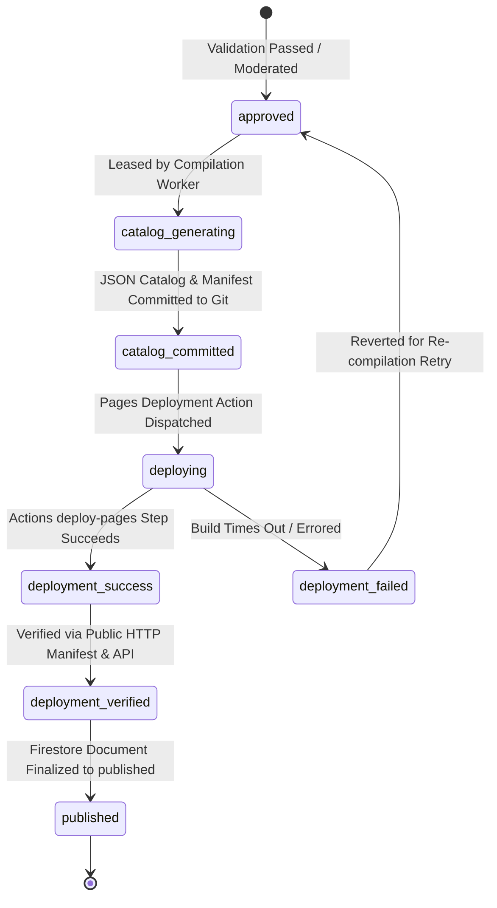

# GitStore — Architecture Specification

**Document Version:** 1.3.0  
**Phase:** Phase 0.1.2 — Final Security & Architecture Corrections  
**Status:** Approved Architectural Baseline (Hardened)  

---

## 1. Architectural Philosophy and Invariants

The design of GitStore is governed by six non-negotiable architectural invariants:

1. **Strict Dual-Platform Confinement:** The entire lifecycle of GitStore—from development and source control to database transactions, background processing, and binary delivery—is confined strictly to **GitHub** and **Firebase**. No tertiary PaaS, serverless function providers (Vercel, AWS Lambda, Netlify), or external relational databases (Supabase, PlanetScale) are permitted. No Firebase Hosting or Cloud Functions are used.
2. **Binary Non-Execution & Non-Hosting:** GitStore is a catalog, discovery engine, and verification broker. GitStore never executes submitted executables, never runs sandboxed code evaluation, and never stores or caches binary payloads inside Git repositories or Firebase Storage.
3. **Static-First Read Architecture:** Storefront visitor traffic is 100% decoupled from the transactional database. 100% of anonymous catalog requests terminate at GitHub Pages' static file server (`data/catalog.json`), keeping Cloud Firestore operations reserved strictly for authenticated developer interactions, submission workflows, and background worker state transitions.
4. **Zero-Trust Client Boundary:** The client-side browser is treated as untrusted. No client-side code possesses the authority to grant permissions, verify developers, alter product publication statuses, claim processing leases, or bypass release validation.
5. **Decoupled Privileged Administration via Canonical Repository Collaborators:** Normal browser clients never receive Firebase Admin SDK credentials, and client JavaScript cannot mint custom claims. All privileged administrative operations execute via the privileged **GitHub Actions Batch Worker**, verified authoritatively against **GitStore's own canonical GitHub repository** (`Rohitpvt/GitStore`) collaborator permissions (`role_name === 'admin'` or `'maintain'`).
6. **Portability and Standards Compliance:** The client application uses standards-compliant HTML5, CSS3, and ES6 JavaScript Modules. No proprietary framework compilers (React, Next.js, Vue) or custom runtime dependencies exist.

---

## 2. Hardened System Architecture Diagram

```mermaid
graph TB
    subgraph ClientLayer["Client Layer (GitHub Pages Static Host)"]
        Visitor["Public Visitor Browser\n(Browse & Download)"]
        Developer["Software Developer Browser\n(Submit & Dashboard)"]
        AdminBrowser["Administrator Browser\n(Admin Dashboard)"]
        StaticCatalog["Pre-Compiled Static Storefront Data\n(data/catalog.json & products/*.json)"]
    end

    subgraph FirebasePlatform["Platform 2: Firebase Infrastructure (Spark Plan)"]
        FirebaseAuth["Firebase Authentication\n- GitHub OAuth (Popup)\n- Passwordless Magic Link\n(0 Password Fields on Pages)"]
        Firestore["Cloud Firestore Operational Database\n- users/{uid}\n- submissions/{id}\n- claim_requests/{id}\n- moderation_requests/{id}\n- products/{id}\n- categories/{id}\n- reports/{id}\n- admin_logs/{id}\n- system_config/global_settings"]
        SecurityRules["Firestore Security Rules\n- Strict RBAC & Immutability\n- Zero Client Self-Escalation\n- Immutable Claim & Moderation Queues"]
        AppCheck["Firebase App Check\n- reCAPTCHA Enterprise Web Provider\n- Lazy-Loaded on Auth Pages Only"]
    end

    subgraph GitHubPlatform["Platform 1: GitHub Core Infrastructure"]
        GHPages["GitHub Pages\n- Vanilla HTML5/CSS3/ES6 Storefront\n- Direct Static Asset Serving"]
        GHIssues["GitHub Issue Forms\n- Ingestion Queue (.github/ISSUE_TEMPLATE)"]
        GHReleases["Public GitHub Releases\n- Direct External Binaries\n(EXE, MSI, APK, DMG, ZIP, TAR.GZ)"]
        GHREST["GitHub REST API v3\n- Canonical Repo Collaborator Check\n- Upstream Repo, Tag, & Asset Validation\n- Direct Personal Owner Validation"]
        GHWorker["GitHub Actions Batch Worker\n(Scheduled every 10 min + Manual Dispatch)\n- Concurrency Group Lock\n- 15-Min Atomic Leases\n- Privileged firebase-admin Execution\n- Two-Phase Compiler & Self-Healing Loop"]
    end

    %% Read Operations (Pure GitHub Pages - Zero DB Requests)
    Visitor -->|1. Fetch HTML/CSS/JS| GHPages
    Visitor -->|2. Fetch Static Catalog Index| StaticCatalog
    Visitor -->|3. Direct Download Binary| GHReleases

    %% Developer Operations
    Developer -->|4. Authenticate| FirebaseAuth
    Developer -->|5. Write Submission status: queued| Firestore
    Developer -.->|6. Open Issue Submission| GHIssues
    Firestore --- SecurityRules
    Firestore --- AppCheck

    %% Admin Operations (Decoupled Command Queue)
    AdminBrowser -->|7. Auth via GitHub OAuth| FirebaseAuth
    AdminBrowser -->|8. Enqueue Moderation Request status: pending| Firestore
    AdminBrowser -.->|9. Optional Immediate Dispatch| GHWorker

    %% Worker Automation & Privilege Execution
    GHWorker -->|10. Ingest & Verify Personal Repo Ownership| GHIssues
    GHWorker -->|11. Atomic Lease Claim Limit 3| Firestore
    GHWorker -->|12. Non-Execution Asset & Tag Verification| GHREST
    GHREST -.->|Validate Release Asset Existence| GHReleases
    GHWorker -->|13. Authorize Admin via Canonical GitStore Repo Check| GHREST
    GHWorker -->|14. Execute Privileged Updates & admin_logs| Firestore
    GHWorker -->|15. Two-Phase Static Catalog Compilation| StaticCatalog
    GHWorker -->|16. Commit & Deploy| GHPages
    GHWorker -->|17. Reconcile Deployed State & Finalize DB| Firestore
```



---

## 3. Platform Boundaries & Interface Contracts

### 3.1 Interface Contract: Administrator Browser <-> Privileged Actions Worker
- **Canonical Repository Boundary Check:** Administrator authorization is verified strictly against **GitStore's own canonical GitHub repository** (`Rohitpvt/GitStore`). The batch worker asserts:
  ```javascript
  if (process.env.GITHUB_REPOSITORY !== 'Rohitpvt/GitStore') {
    throw new Error(`SECURITY ALERT: Execution on non-canonical repository ${process.env.GITHUB_REPOSITORY} aborted.`);
  }
  ```
  This guarantees that fork-triggered workflows cannot claim authority over production Firestore databases.
- **The Decoupled Command Pattern:**
  1. The Administrator authenticates on `admin.html` via GitHub OAuth.
  2. The Admin Dashboard writes a request document to `/moderation_requests/{requestId}`:
     ```typescript
     {
       requestId: string;
       action: 'APPROVE_SUBMISSION' | 'REJECT_SUBMISSION' | 'VERIFY_DEVELOPER' | 'DELIST_PRODUCT';
       targetId: string;
       payload: { reason?: string; notes?: string };
       requestedByUid: string;              // auth.uid (enforced by Security Rules)
       status: 'pending';                   // pending | processing | completed | rejected
       createdAt: serverTimestamp();
     }
     ```
  3. **Cryptographic Identity Extraction in Actions Worker:**
     - The worker reads `/moderation_requests/{requestId}`.
     - The worker **never trusts client-supplied username strings**. Instead, the worker calls the Firebase Admin SDK:
       ```javascript
       const userRecord = await admin.auth().getUser(requestData.requestedByUid);
       const githubProvider = userRecord.providerData.find(p => p.providerId === 'github.com');
       if (!githubProvider || !githubProvider.uid) {
         throw new Error("UNAUTHORIZED: Caller has no verified linked GitHub provider");
       }
       const verifiedGithubNumericId = githubProvider.uid;
       ```
     - The worker resolves the current GitHub login handle from GitHub's REST API using the immutable numeric ID:
       `GET https://api.github.com/user/{verifiedGithubNumericId}`
  4. **Fail-Closed Collaborator Permission Check:**
     - The worker queries GitHub's official endpoint:
       `GET https://api.github.com/repos/Rohitpvt/GitStore/collaborators/{verifiedLogin}/permission`
     - **Response Field Mapping (Officially Verified):**
       The endpoint returns `{ permission: string, role_name: string, user: object }`.
       - `permission`: Legacy base permission (`admin`, `write`, `read`, `none`). Modern roles map `maintain` to `write` under legacy `permission`.
       - `role_name`: Explicit role name assigned (`admin`, `maintain`, `write`, `triage`, `read`, or custom role).
     - **Fail-Closed Authorization Policy:**
       ```javascript
       const { permission, role_name } = response.data;
       const isAuthorizedAdmin = (role_name === 'admin') || (role_name == null && permission === 'admin');
       const isAuthorizedMaintainer = (role_name === 'maintain');

       if (!isAuthorizedAdmin && !isAuthorizedMaintainer) {
         // Fail-closed: explicitly reject 'write' (without maintain), 'triage', 'read', 'none', custom roles, and unexpected responses
         throw new Error(`FORBIDDEN: User ${verifiedLogin} role '${role_name}' (permission '${permission}') is not authorized.`);
       }
       ```
     - **Inherited Permissions:** The endpoint evaluates and returns the effective permissions resulting from direct assignment, organization teams, or org-level administration without exposing the grant source.
     - **Token Permissions & Integration Status:** While documentation indicates `Metadata: read` allows querying collaborator permissions via fine-grained PAT or GitHub App tokens, the default GitHub Actions `GITHUB_TOKEN` frequently fails with `403 Resource not accessible by integration` on collaborator management endpoints. The worker implements a dual-token strategy: attempting `secrets.GITHUB_TOKEN`, and falling back to a dedicated fine-grained PAT / GitHub App token (`secrets.ADMIN_VERIFY_TOKEN`). *Classified as pending live integration verification.*
  5. **Revocation & Anti-Replay:**
     - Real-time API verification on every worker batch cycle ensures immediate revocation upon removing a collaborator on GitHub.
     - Worker transactions mark requests `completed` or `rejected` with execution timestamps and run IDs, preventing replay.
  6. **Bootstrap Resolution:**
     - The canonical repository owner (`Rohitpvt`) is inherently the root administrator. Maintainers are granted access simply by adding them to `Rohitpvt/GitStore` in GitHub repository settings. Zero client-side privilege self-escalation is possible.

### 3.2 Interface Contract: Issue Ingestion & Secure Submission Claiming
- **Zero Fake / Placeholder Accounts:**
  - Submissions ingested from GitHub Issue Forms store the author's immutable numeric GitHub account ID (`context.payload.issue.user.id`) directly from the trusted event payload.
  - Submissions are created with:
    ```typescript
    developerUid: null;
    submitterGithubId: string;        // Immutable numeric string e.g. "583231"
    submitterGithubUsername: string;  // e.g. "monalisa"
    claimStatus: 'unclaimed';
    ```
- **Distinction of Ownership, Release Authority, and Verified Developer:**
  1. **Repository Ownership:** Proves control over the repository configuration (`repo.owner.id === submitterGithubId`).
  2. **Release Authority:** Proves authorization to publish release binaries. Direct personal owners possess inherent release authority. Org members and committers do **not** possess proven release authority and are held in `needs_review`.
  3. **Verified Developer Identity:** A platform trust credential granted by administrators via moderation requests. Repository ownership does **not** automatically award verified developer status.
- **Secure Asynchronous Claiming Workflow (`/claim_requests`):**
  1. The user authenticates with Firebase Auth (GitHub OAuth or Email Magic Link linked with GitHub).
  2. The user initiates a claim from the dashboard, writing to `/claim_requests/{requestId}`:
     ```typescript
     {
       requestId: string;
       requesterUid: string;              // Must equal request.auth.uid (enforced by Security Rules)
       targetSubmissionId: string;
       status: 'pending';
       createdAt: serverTimestamp();
     }
     ```
  3. Firestore Security Rules enforce:
     - `allow create: if request.auth != null && request.resource.data.requesterUid == request.auth.uid && request.resource.data.status == 'pending' && request.resource.data.createdAt == request.time;`
     - `allow update, delete: if false;` (Clients can NEVER alter or delete claim requests).
     - Browser clients CANNOT update `developerUid`, `claimStatus`, or `ownershipTier` on `/submissions/{id}` directly.
  4. The trusted GitHub Actions worker reads pending claim requests:
     - Fetches `admin.auth().getUser(req.requesterUid)` via Firebase Admin SDK.
     - Locates `userRecord.providerData.find(p => p.providerId === 'github.com')`.
     - Extracts `verifiedGithubId = provider.uid`.
     - Validates against target submission:
       `submission.submitterGithubId === verifiedGithubId && submission.claimStatus === 'unclaimed'`
     - Executes atomic Firestore transaction:
       - Sets `submission.developerUid = req.requesterUid`
       - Sets `submission.claimStatus = 'claimed'`
       - Sets `submission.claimedAt = serverTimestamp()`
       - Sets `claimReq.status = 'completed'`
       - Appends audit entry to `/admin_logs`
     - If validation fails, marks request `rejected_mismatch` or `rejected_already_claimed`.

### 3.3 Interface Contract: Entity Hierarchy & Globally Unique Deterministic IDs
To guarantee global uniqueness and prevent collisions when two distinct repositories share an identical product slug (e.g. `microsoft/toolkit-a -> viewer` vs `microsoft/toolkit-b -> viewer`):
- **1. Repository Identity (`gh_repo_{repoId}`):** Uses GitHub's immutable numeric repository ID (e.g., `gh_repo_892341901`). Resilient against repository renames and ownership transfers.
- **2. Product Identity (`prod_{repoId}_{productSlug}`):** Formed by compounding the immutable numeric repo ID with the product slug (e.g., `prod_892341901_viewer`). Guarantees cross-repository uniqueness.
- **3. Submission Identity:**
  - Issue Submissions: `sub_issue_{repoId}_{issueNumber}` (e.g., `sub_issue_892341901_42`). Globally unique.
  - Dashboard Submissions: `sub_dash_{nanoid}` (cryptographically random).
- **4. Release Identity (`rel_{repoId}_{releaseId}`):** Uses GitHub's immutable numeric release ID (`release.id`).
- **5. Release Asset Identity (`asset_{repoId}_{assetId}`):** Uses GitHub's immutable numeric asset ID (`asset.id`).

### 3.4 Interface Contract: Recoverable Publication State Machine & Deployment Verification
Because GitHub Pages and Cloud Firestore are independent distributed systems, atomic consistency across them is impossible. GitStore implements an **eventually consistent, recoverable publication workflow**:



- **Two-Tier Deployment Verification:**
  A Git commit reaching `main` does **not** prove successful GitHub Pages publication. The worker verifies deployment using two independent signals before marking Firestore records as `published`:
  1. **GitHub Deployments API Check:** Worker queries `GET /repos/Rohitpvt/GitStore/deployments?environment=github-pages` and checks that the latest deployment for the catalog commit SHA has status `success`.
  2. **Public HTTP Manifest Verification:** Static deployment compiles a metadata file `data/deployment-manifest.json` containing `{ generationId, commitSha, deployedAt, productCount }`. The worker sends a public HTTP `GET https://rohitpvt.github.io/GitStore/data/deployment-manifest.json` with cache-busting headers to verify that the live CDN has propagated the current generation.
- **Self-Healing Reconciliation (`reconcilePublishedState`):**
  If deployment succeeds and is publicly verified, but the worker crashes before Firestore is finalized, the startup reconciler in the next batch execution detects the live manifest, matches `generationId`, and heals unconfirmed Firestore submissions to `published`.

---

## 4. Architectural Decision Records (ADRs)

### ADR-01: Exclusion of Third-Party Backend Hosts (Vercel, Supabase, Netlify)
- **Status:** Accepted (Phase 0)
- **Rationale:** Keeps architecture confined to GitHub and Firebase; eliminates vendor sprawl and unapproved hosting dependencies.

### ADR-02: Static Pre-Rendered Catalog vs. Direct Firestore Queries
- **Status:** Accepted (Phase 0)
- **Rationale:** Storefront visitors read static JSON compiled by GitHub Actions; 100% of browsing traffic consumes 0 Firestore reads.

### ADR-03: Rejection of Binary Execution & Sandboxing
- **Status:** Accepted (Phase 0)
- **Rationale:** Running untrusted executables inside GitHub Actions violates TOS and risks hypervisor breakouts. Security relies on source provenance, release verification, and manual moderation.

### ADR-04: Passwordless Authentication over Traditional Passwords
- **Status:** Accepted (Phase 0)
- **Rationale:** Eliminates password fields on GitHub Pages, adhering strictly to GitHub’s sensitive transaction policy.

### ADR-05: Fail-Closed Administrator Authorization via Canonical Collaborator Role Checks
- **Status:** Accepted (Phase 0.1.2 Corrected)
- **Context:** Previous mapping checked `permission === 'admin' || permission === 'maintain'`, which fails because GitHub's endpoint maps `maintain` to `write` in legacy `permission`.
- **Decision:** Administrator checks execute strictly against `Rohitpvt/GitStore`. Identity is extracted via Firebase Admin SDK (`providerData.find(p => p.providerId === 'github.com')?.uid`) and mapped to username via `GET /user/{id}`. Collaborator permissions from `GET /repos/Rohitpvt/GitStore/collaborators/{username}/permission` are checked fail-closed: `role_name === 'admin'` or `role_name === 'maintain'`. All others (`write`, `triage`, `read`, custom roles) are rejected. Token permissions are set to dual fallback (`GITHUB_TOKEN` / `ADMIN_VERIFY_TOKEN`).
- **Rationale:** Eliminates maintainer authorization bypass, enforces fail-closed role mapping, and secures trust boundary.

### ADR-06: Asynchronous Submission Claiming via Restricted `/claim_requests` Queue
- **Status:** Accepted (Phase 0.1.2 Corrected)
- **Context:** Previous design lacked a concrete, secure claiming flow without Cloud Functions and relied on brittle `providerData[0]` indexing.
- **Decision:** Eliminate fake accounts; ingest issue submissions as `unclaimed` with numeric `submitterGithubId`. Authenticated users write restricted claim requests to `/claim_requests`. Batch workers validate caller's GitHub provider identity via Firebase Admin SDK and execute transactional ownership claims. Browser clients are forbidden from writing ownership fields.
- **Rationale:** Zero fake account state; prevents account takeover; ensures complete auditability.

### ADR-07: Recoverable Publication State Machine with Two-Tier Deployment Verification
- **Status:** Accepted (Phase 0.1.2 Corrected)
- **Context:** A commit on `main` does not prove GitHub Pages successfully deployed. Reconciler reading `main` prematurely marks products `published`.
- **Decision:** Implement multi-state publication flow (`approved` -> `catalog_committed` -> `deploying` -> `deployment_verified` -> `published`). Verify deployment via GitHub Deployments API and public HTTP check of `data/deployment-manifest.json`. Eventual consistency is maintained via startup reconciler.
- **Rationale:** Prevents phantom listings on public storefront and guarantees recoverable eventual consistency.

### ADR-08: GitHub Pages Policy Launch Gate & Clarification Contingency
- **Status:** Accepted (Phase 0.1)
- **Rationale:** Maintains engineering integrity by establishing formal written confirmation from GitHub Support as a Phase 4 Pre-Launch Gate.

### ADR-09: Globally Unique Deterministic Entity Identities via Numeric Repository IDs
- **Status:** Accepted (Phase 0.1.2 Corrected)
- **Context:** `prod_{repoOwner}_{productSlug}` collides when two repositories under the same owner use identical slugs. GitHub issue numbers are only unique within a repository.
- **Decision:** Base all entity IDs on GitHub's immutable numeric repository ID: `gh_repo_{repoId}`, `prod_{repoId}_{productSlug}`, `sub_issue_{repoId}_{issueNumber}`, `rel_{repoId}_{releaseId}`, `asset_{repoId}_{assetId}`.
- **Rationale:** Mathematically prevents collisions across repositories and remains immune to repository renames and ownership transfers.

### ADR-10: reCAPTCHA Enterprise Specification, Token Caching & Quota Realities
- **Status:** Accepted (Phase 0.1.2 Corrected)
- **Context:** Previous text conflated reCAPTCHA v3 with Google Cloud reCAPTCHA Enterprise's 10,000 monthly free assessments quota.
- **Decision:** Formally specify **reCAPTCHA Enterprise** (`ReCaptchaEnterpriseProvider`) as the recommended provider for new web integrations, operating under Google Cloud's 10,000 free monthly assessments quota. Detail 1-hour token TTL caching (Firestore requests reuse tokens, consuming 0 extra assessments). Maintain strict lazy-loading boundary: public storefront has zero Firebase initialization, loading App Check strictly on authenticated developer/admin routes. All estimates are designated as architectural estimates.
- **Rationale:** Eliminates quota confusion, adheres to official Google Cloud terms, and preserves zero-cost operational margin.
