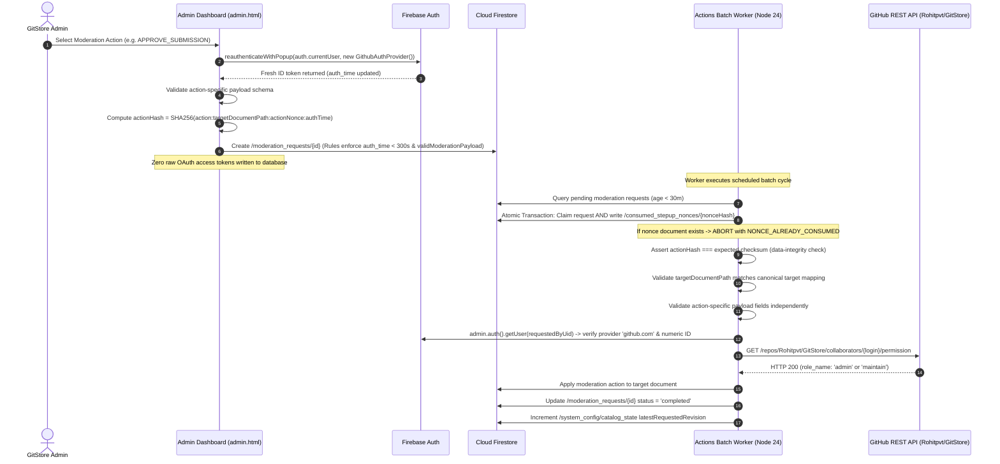

# GitStore — Architecture Specification

**Document Version:** 1.9.0  
**Phase:** Phase 0.1.9 — Workflow Validation, Recovery SHA Preservation & Durable Finalization Recovery  
**Status:** IN_REVIEW — Awaiting Explicit User Approval  

---

## 1. Architectural Philosophy and Invariants

The design of GitStore is governed by seven non-negotiable architectural invariants:

1. **Strict Dual-Platform Confinement:** The entire lifecycle of GitStore—from development and source control to database transactions, background processing, and binary delivery—is confined strictly to **GitHub** and **Firebase**. No tertiary PaaS, serverless function providers (Vercel, AWS Lambda, Netlify), or external relational databases (Supabase, PlanetScale) are permitted. No Firebase Hosting or Cloud Functions are used.
2. **Binary Non-Execution & Non-Hosting:** GitStore is a catalog, discovery engine, and verification broker. GitStore never executes submitted executables, never runs sandboxed code evaluation, and never stores or caches binary payloads inside Git repositories or Firebase Storage.
3. **Static-First Read Architecture & Targeted Free Quotas:** Storefront visitor traffic is 100% decoupled from the transactional database. 100% of anonymous catalog requests terminate at GitHub Pages' static file server (`data/catalog.json`), keeping Cloud Firestore operations reserved strictly for authenticated developer interactions, submission workflows, and background worker state transitions. Operating costs target $0.00/month by remaining strictly within the published free quotas of GitHub and Firebase (Spark Plan) without attached billing accounts.
4. **Zero-Trust Client Boundary & Complete Field Integrity:** The client-side browser is treated as untrusted. No client-side code possesses the authority to grant permissions, verify developers, alter product publication statuses, claim processing leases, or bypass release validation. User profile documents (`/users/{uid}`) are strictly private; public developer metadata is isolated in an explicit public projection (`/public_profiles/{uid}`). In `/submissions/{submissionId}`, client creation is strictly restricted to developer-owned payload fields; worker-managed fields (`validationResults`, `ownershipProof`, `processingLease`, `adminNotes`, `reviewedBy`, `reviewedAt`, `publishedProductId`) are excluded from client creation allowlists and initialized solely by trusted workers via the Firebase Admin SDK. In `/moderation_requests`, Firestore rules enforce action-specific nested payload schemas and derive target document paths directly from action types and target IDs. Internal collections (`/system_deployments`, `/system_config/deployment_state`, `/system_config/catalog_state`, `/admin_logs`, `/consumed_stepup_nonces`) default to deny for all client access.
5. **Decoupled Privileged Administration via Option A with Nonce Replay Protection:** Normal browser clients never receive Firebase Admin SDK credentials, and client JavaScript cannot mint custom claims. All privileged administrative and moderation operations execute via the privileged **GitHub Actions Batch Worker**, verified authoritatively against **GitStore's own canonical GitHub repository** (`Rohitpvt/GitStore`) collaborator permissions (`role_name === 'admin'` or `'maintain'`). Privileged operations strictly require fresh, interactive GitHub reauthentication (`reauthenticateWithPopup`). **Zero raw OAuth access tokens are stored in Firestore.** The request stores an action-bound payload containing caller UID (`requestedByUid`), immutable numeric GitHub ID (`identities['github.com'][0]`), `auth_time`, action, target document path, action nonce, action-specific payload, and a client-generated `actionHash` (which serves as a client data-integrity checksum, not a cryptographic signature). To prevent nonce reuse across different request documents, worker processing atomically claims the request and reserves the nonce in a dedicated collection `/consumed_stepup_nonces/{nonceHash}` within a single Firestore transaction. The Security Rules enforce a strict 5-minute authentication freshness gate at creation time (`auth_time < 300s`), while worker execution operates on a 30-minute queue TTL from `createdAt`.
6. **Node 24 GitHub Actions Pipeline, Clean Staging & Dedicated Pages Status (`succeed`):** Batch processing workflows execute on official GitHub Actions pinned to Node 24 runtimes (`actions/checkout@v5.0.0`, `actions/setup-node@v7.1.0`, `actions/upload-pages-artifact@v5.0.0`, `actions/deploy-pages@v5.0.1`). Artifact staging follows a single authoritative procedure: the `site/` staging directory is constructed exclusively from the verified source commit, its digest is recomputed and verified (`stagedDigest === catalogDigest`), and no subsequent workflow step copies from `main`. Step outputs are exported via direct append writes to `$GITHUB_OUTPUT`. GitHub Pages deployment status is verified using the dedicated official endpoint `GET /repos/{owner}/{repo}/pages/deployments/{pages_deployment_id}` checking for `"status": "succeed"`. Fallback commit recovery follows the full GitHub Commits API pagination loop without arbitrary page caps, distinguishes rate-limit or network errors (`INCOMPLETE_SEARCH`) from true missing commits (`EMPTY_SEARCH`), and validates commit SHA formats before shell execution.
7. **Transactional Generation Ordering & 2-Tier Finalization:** When finalizing deployment state, the worker executes an atomic transaction that reads current versions of `/system_config/catalog_state`, `/system_config/deployment_state`, and `/system_deployments/{generationId}` BEFORE any writes. Inside the transaction, it evaluates the shared ordering decision (`evaluateGenerationOrdering`) and catalog revision monotonicity (`capturedRevision >= latestPublishedRevision` and `capturedRevision <= latestRequestedRevision`). Stale generations abort immediately (`stale_aborted`) without modifying published sequence, published revision, commit SHA, or submission statuses. To strictly respect the Firestore 500-write limit, finalization uses a 2-tier architecture: the 3-write atomic transaction establishes the global canonical state, followed by idempotent batched writes (max 400 docs/batch) to fan out published statuses to submissions.

---

## 2. Hardened System Architecture Diagram

```mermaid
graph TB
    subgraph ClientLayer["Client Layer (GitHub Pages Static Host)"]
        Visitor["Public Visitor Browser\n(Browse & Download)"]
        Developer["Software Developer Browser\n(Submit & Dashboard)"]
        AdminBrowser["Administrator Browser\n(Admin Dashboard with Action-Bound Proof)"]
        StaticCatalog["Pre-Compiled Static Storefront Data\n(data/catalog.json & products/*.json)"]
    end

    subgraph FirebasePlatform["Platform 2: Firebase Infrastructure (Spark Plan)"]
        FirebaseAuth["Firebase Authentication\n- GitHub OAuth (Popup)\n- Passwordless Magic Link\n- Mandatory GitHub Step-Up Reauth"]
        Firestore["Cloud Firestore Operational Database\n- users/{uid} (Strictly Private; diff().affectedKeys)\n- public_profiles/{uid} (Public Read; worker badges)\n- submissions/{id} (Client Payload Only; No Worker Fields)\n- claim_requests/{id} (Whitelisted Creation)\n- moderation_requests/{id} (Action-Specific Payloads; requestedByUid)\n- consumed_stepup_nonces/{nonceHash} (Internal Replay Ledger; allow false)\n- products/{id}\n- categories/{id}\n- reports/{id} (Authenticated Only; Max 2000 chars)\n- admin_logs/{id} (allow false)\n- system_deployments/{id} (allow false)\n- system_config/deployment_state (allow false)\n- system_config/catalog_state (allow false)\n- system_config/global_settings (Public Read)"]
        SecurityRules["Firestore Security Rules\n- Action-Specific Payload Validation\n- Exhaustive Schema Allowlisting\n- Step-Up Freshness Enforcement (auth_time < 300s)\n- Target Path Pattern Enforcement\n- Internal Collection Default-Deny"]
        AppCheck["Firebase App Check\n- reCAPTCHA Enterprise Web Provider\n- Lazy-Loaded on Auth Pages Only"]
    end

    subgraph GitHubPlatform["Platform 1: GitHub Core Infrastructure"]
        GHPages["GitHub Pages\n- Vanilla HTML5/CSS3/ES6 Storefront\n- Packaged from site/ Staging Directory\n- Direct Static Asset Serving"]
        GHIssues["GitHub Issue Forms\n- Ingestion Queue (.github/ISSUE_TEMPLATE)"]
        GHReleases["Public GitHub Releases\n- Direct External Binaries\n(EXE, MSI, APK, DMG, ZIP, TAR.GZ)"]
        GHREST["GitHub REST API v3\n- Canonical Repo Collaborator Check\n- Upstream Repo, Tag, & Asset Validation\n- Dedicated Pages Deployment Status (status: 'succeed')\n- Commits API with Granular Error Classification"]
        GHWorker["GitHub Actions Batch Worker (Node 24)\n(Scheduled every 10 min + Manual Dispatch)\n- Concurrency Group: github-pages\n- 15-Min Atomic Leases\n- Split Jobs: build-and-commit & deploy-to-pages\n- Node 24 Action Pins: checkout@v5, setup-node@v7, upload-pages-artifact@v5, deploy-pages@v5\n- Single Authoritative Staging into site/\n- Staged Digest Verification\n- Explicit $GITHUB_OUTPUT Bridge\n- 2-Tier Finalization with Stale Abort"]
    end

    %% Read Operations (Pure GitHub Pages - Zero DB Requests)
    Visitor -->|1. Fetch HTML/CSS/JS| GHPages
    Visitor -->|2. Fetch data/catalog.json (CDN)| StaticCatalog
    Visitor -->|3. Click Download Link| GHReleases

    %% Developer Operations
    Developer -->|4. Authenticate| FirebaseAuth
    Developer -->|5. Manage Profile & View Submissions| Firestore
    Developer -->|6. Submit Product (Payload Only)| Firestore
    Developer -.->|7. Optional Issue Submission| GHIssues
    Developer -->|8. Claim Issue Submission| Firestore

    %% Administrator Operations
    AdminBrowser -->|9. Interactive Fresh Step-Up Reauth| FirebaseAuth
    AdminBrowser -->|10. Enqueue Moderation Request with Action-Specific Payload| Firestore

    %% Background Automation Engine (Batch Worker)
    GHWorker -->|11. Ingest Issues & Process Claims| Firestore
    GHWorker -->|12. Validate Submissions & Ownership| GHREST
    GHWorker -->|13. Atomically Claim Request & Reserve Nonce| Firestore
    GHWorker -->|14. Authorize Collaborator on Rohitpvt/GitStore| GHREST
    GHWorker -->|15. Compile Static Catalogs & Single Authoritative Staging| StaticCatalog
    GHWorker -->|16. Commit & Push Catalog to main| GHPages
    GHWorker -->|17. Output Bridge to $GITHUB_OUTPUT| GHWorker
    GHWorker -->|18. Upload Pages Artifact (site/)| GHPages
    GHWorker -->|19. Pre-Deploy Shared Ordering Guard| Firestore
    GHWorker -->|20. Deploy to Pages & Poll Dedicated Status (succeed)| GHREST
    GHWorker -->|21. 2-Tier Transactional Finalization & Stale Abort| Firestore
```

---

## 3. Core Subsystems and Interface Contracts

### 3.1 Interface Contract: Option A Administrator Step-Up Reauthentication & Nonce Ledger



#### Consistent Nonce Reservation Transaction (`scripts/processor/moderation-handler.js`)
```javascript
const req = requestDoc.data();
const nonceHash = crypto.createHash('sha256').update(req.stepUpProof.actionNonce).digest('hex');
const nonceRef = db.collection('consumed_stepup_nonces').doc(nonceHash);
const requestRef = db.collection('moderation_requests').doc(requestId);

await db.runTransaction(async (transaction) => {
  const nonceDoc = await transaction.get(nonceRef);
  if (nonceDoc.exists) {
    throw new Error('NONCE_ALREADY_CONSUMED: Step-up action nonce has already been consumed.');
  }

  const freshReqDoc = await transaction.get(requestRef);
  if (!freshReqDoc.exists || freshReqDoc.data().status !== 'pending') {
    throw new Error('REQUEST_UNAVAILABLE: Moderation request is missing or already leased.');
  }

  transaction.set(nonceRef, {
    nonceHash,
    requestId,
    requestedByUid: req.requestedByUid,
    action: req.action,
    targetDocumentPath: req.targetDocumentPath,
    workerRunId: String(process.env.GITHUB_RUN_ID),
    consumedAt: FieldValue.serverTimestamp()
  });

  transaction.update(requestRef, {
    status: 'processing',
    processedByWorkerRunId: String(process.env.GITHUB_RUN_ID),
    updatedAt: FieldValue.serverTimestamp()
  });
});
```

---

### 3.2 Interface Contract: Action-Specific Moderation Payload Schemas & Target Binding

To prevent injection of arbitrary nested parameters into privileged commands:

1. **`APPROVE_SUBMISSION`:**
   - Target: `submissions/${targetId}` (where `targetId` matches `^[a-zA-Z0-9_-]+$`)
   - Permitted payload keys: `['reviewNotes']`
   - `reviewNotes`: optional string, max 1000 characters.

2. **`REJECT_SUBMISSION`:**
   - Target: `submissions/${targetId}`
   - Permitted payload keys: `['rejectionReason', 'reviewNotes']`
   - `rejectionReason`: required string, min 10, max 1000 characters.
   - `reviewNotes`: optional string, max 1000 characters.

3. **`VERIFY_DEVELOPER`:**
   - Target: `public_profiles/${targetId}` or `users/${targetId}`
   - Permitted payload keys: `['verificationReason', 'evidenceUrl']`
   - `verificationReason`: required string, min 10, max 500 characters.
   - `evidenceUrl`: optional string, max 200 characters.

4. **`REVOKE_DEVELOPER`:**
   - Target: `public_profiles/${targetId}` or `users/${targetId}`
   - Permitted payload keys: `['revocationReason']`
   - `revocationReason`: required string, min 10, max 500 characters.

5. **`DELIST_PRODUCT`:**
   - Target: `products/${targetId}` (where `targetId` matches `^prod_[0-9]+_[a-z0-9-]+$`)
   - Permitted payload keys: `['delistReason', 'noticePeriodDays']`
   - `delistReason`: required string, min 10, max 1000 characters.
   - `noticePeriodDays`: optional number, min 0, max 30.

6. **`FEATURE_PRODUCT`:**
   - Target: `products/${targetId}`
   - Permitted payload keys: `['featuredRank', 'featureNotes']`
   - `featuredRank`: required number, min 1, max 100.
   - `featureNotes`: optional string, max 500 characters.

---

### 3.3 Interface Contract: Single Authoritative Staging & Case B Provenance

Artifact provenance guarantees that every deployed artifact corresponds exactly to the catalog files committed at `catalogCommitSha`:

1. **Clean Staging:** The worker purges any existing staging directory: `rm -rf site/ && mkdir -p site/data site/assets`.
2. **Exact Commit Extraction:** In Case B recovery, static storefront pages and catalog files are extracted directly from the verified commit using `git archive ${gen.catalogCommitSha} ... | tar -x -C site/`.
3. **Canonical Digest Verification:** The worker recomputes `stagedDigest = computeCatalogDigest('site/data')` and asserts `stagedDigest === gen.catalogDigest`. Any discrepancy immediately deletes `site/` and aborts.
4. **Canonical Digest Contract (`computeCatalogDigest`):** The catalog digest helper takes `catalogDataRoot` (e.g. `'data'` during normal compilation, or `'site/data'` during staging verification). It processes `catalog.json`, `categories.json`, and `products/*.json` (sorted lexicographically by relative path), and strictly excludes `deployment-manifest.json`, HTML, CSS, JS, images, and non-JSON assets.
5. **No Post-Staging Workspace Copies:** The workflow does **not** execute any copy commands from the workspace root into `site/` after staging. The verified staging directory is preserved untouched until upload.

---

### 3.4 Interface Contract: GitHub Actions Output Bridge & Cross-Job Handoff

```mermaid
flowchart LR
    subgraph Job1["Job 1: build-and-commit (Node 24)"]
        P1["reconcilePublishedState()"] -->|emitStepOutput()| GO["$GITHUB_OUTPUT"]
        GO --> O1["outputs:\n- commit_needed\n- deploy_needed\n- generation_id\n- generation_sequence\n- catalog_commit_sha (resolved)\n- catalog_digest\n- captured_revision"]
        O1 --> COND_COMMIT{"if: commit_needed == 'true'"}
        COND_COMMIT --> COMMIT["git commit data/ & git push origin main"]
        COMMIT --> RESOLVE["resolve-sha step"]
        O1 --> UP["actions/upload-pages-artifact@v5.0.0\n(path: site/)"]
    end

    subgraph Job2["Job 2: deploy-to-pages (Node 24)"]
        O1 -->|needs.build-and-commit.outputs| COND{"if: deploy_needed == 'true'"}
        COND --> GUARD["scripts/processor/pre-deploy-guard.js\n(evaluateGenerationOrdering)"]
        GUARD --> DP["actions/deploy-pages@v5.0.1\n(environment: github-pages)"]
        DP --> FIN["2-Tier Finalization & Fan-Out Recovery\n(with Stale Abort & Cursor Resumption)"]
    end
```

#### Decision Separation & SHA Preservation Contract

| Scenario | `commit_needed` | `deploy_needed` | Action in Job 1 | Authoritative `catalog_commit_sha` Exported |
|---|---|---|---|---|
| **New Catalog Generation** | `true` | `true` | Commits `data/` to `main`, captures `git rev-parse HEAD`. | Newly generated Git commit SHA from `commit` step. |
| **Case B Recovery** | `false` | `true` | **No commit created.** Staging built from recovered commit. | Recovered commit SHA preserved unchanged. |
| **Storefront Up-to-Date** | `false` | `false` | No commit or upload. Job 2 skipped. | N/A (`deploy_needed == 'false'`). |
| **Stale / Conflicted** | `false` | `false` | Aborted. Job 2 skipped. | N/A (`deploy_needed == 'false'`). |

#### Output Adapter Implementation
```javascript
import fs from 'node:fs';

export function emitStepOutput(name, value) {
  const outputPath = process.env.GITHUB_OUTPUT;
  if (!outputPath) {
    console.warn(`[WARN] GITHUB_OUTPUT not set. Step output '${name}' not exported.`);
    return;
  }
  const strValue = String(value);
  if (strValue.includes('\n') || strValue.includes('\r')) {
    throw new Error(`SECURITY_ERROR: Step output '${name}' contains newline characters`);
  }
  fs.appendFileSync(outputPath, `${name}=${strValue}\n`, 'utf8');
}
```

---

### 3.5 Interface Contract: Node 24 Action Runtime Compatibility & Permissions

#### Official GitHub Actions Permissions Configuration
All unsupported permission keys (including `metadata: read`) are purged from workflow YAML:

| Job | Declared Permissions | Purpose | Official Documentation Source |
|---|---|---|---|
| `build-and-commit` | `contents: write` | Pushes compiled catalog JSON and manifest to `main`. Repository metadata read is granted implicitly by default. | GitHub Docs: Automatic token authentication / Permissions for the GITHUB_TOKEN |
| `deploy-to-pages` | `pages: write`<br>`id-token: write`<br>`contents: read` | Creates Pages deployment via API, mints OIDC JWT for authentication, and reads repository files. | GitHub Docs: Using environments for deployment / Pages permissions |

*(Note: YAML permissions syntax conforms to GitHub Actions workflow schema documentation. No live validator was executed against a live runner since the workflow is currently a design specification).*

#### Verified Action Release Metadata & Version Justification

| Action Name | Target Release | Verified 40-Character Commit SHA | Runtime Type (`action.yml`) | Minimum Runner Version | Interoperability & Version Justification |
|---|---|---|---|---|---|
| `actions/checkout` | `v5.0.0` | `08c6903cd8c0fde910a37f88322edcfb5dd907a8` | `runs.using: 'node24'` | `v2.327.1` | **Retained v5 over v6:** `v6.x` altered `persist-credentials` storage from `.git/config` to `$RUNNER_TEMP`, required runner `>= v2.329.0`, and migrated to ESM. `v5.0.0` provides stable Node 24 execution while preserving `.git/config` credentials required by native git commands (`git push origin main`) without breaking changes. |
| `actions/setup-node` | `v7.1.0` | `949feb2413d6458794dcd2491c4babbbce0c15c1` | `runs.using: 'node24'` | `v2.327.1` | Executes on Node 24; configures project Node 24. |
| `actions/upload-pages-artifact` | `v5.0.0` | `fc324d3547104276b827a68afc52ff2a11cc49c9` | `runs.using: 'composite'` | `v2.327.1` | **Dependency Correction:** Delegates internally to `actions/upload-artifact@043fb46d1a93c77aae656e7c1c64a875d1fc6a0a # v7.0.1` (NOT `v4`). Packages `site/` into `artifact.tar`. |
| `actions/deploy-pages` | `v5.0.1` | `368f82528645a54fb793d4d04e342629a3f51346` | `runs.using: 'node24'` | `v2.327.1` | Native Node 24 deployment to GitHub Pages via OpenID Connect (OIDC). Fully compatible with upload artifact v5. |

*(Evidence Classification: Action metadata and SHAs are DOCUMENTATION_VERIFIED; live execution on `Rohitpvt/GitStore` is PENDING_INTEGRATION_TEST).*

---

### 3.6 Interface Contract: Transactional Generation Ordering, 2-Tier Finalization & Fan-Out Recovery

#### 3.6.1 Transactional Pre-Read & Ordering Verification (Tier 1)
Inside `db.runTransaction`:
1. Read `/system_config/catalog_state`
2. Read `/system_config/deployment_state`
3. Read `/system_deployments/{generationId}`
(All reads precede any writes).

Evaluate:
`evaluateGenerationOrdering(freshGen.generationSequence, freshGen.generationId, deployState.latestPublishedSequence, deployState.latestPublishedGenerationId)`

- If `REJECT_STALE`: Throws error. Finalization aborts immediately. Generation marked `stale_aborted`.
- If `HALT_CONFLICT`: Throws fatal sequence collision error.
- If `ALLOW_IDEMPOTENT` or `ALLOW_NEW`:
  - Assert `freshGen.capturedRevision >= catalogState.latestPublishedRevision` (stale revision check).
  - Assert `freshGen.capturedRevision <= catalogState.latestRequestedRevision` (future revision anomaly check).
  - Write 1: Update `/system_config/deployment_state`.
  - Write 2: Update `/system_config/catalog_state`.
  - Write 3: Update `/system_deployments/{generationId}` (`status: 'published'`, `reconciliationStatus: 'fanout_pending'`, `submissionFanoutStatus: 'pending'`, `submissionFanoutCursor: 0`, `completedSubmissionCount: 0`).

#### 3.6.2 Independently Recoverable Submission Status Fan-Out (Tier 2)
To respect Firestore's 500-write limit and prevent submissions from becoming permanently stuck if a worker stops midway:
- Submission fan-out is tracked independently on the generation document:
  ```typescript
  interface SubmissionFanoutState {
    submissionFanoutStatus: 'pending' | 'in_progress' | 'completed' | 'manual_review';
    expectedSubmissionIds: string[];   // Renamed from expectedProductIds; contains /submissions/{id} document IDs
    completedSubmissionCount: number;
    submissionFanoutCursor: number;
    fanoutAttempts: number;
    lastFanoutAttemptAt?: FirebaseFirestore.Timestamp | null;
    lastFanoutError?: string | null;
  }
  ```
- **Batching & Cursor Tracking:** The worker processes `expectedSubmissionIds` from `submissionFanoutCursor` in blocks of 400 documents (`db.batch()`). After each batch commits, `submissionFanoutCursor` is updated.
- **Idempotency:** Updating `/submissions/{id}` to `{ status: 'published', publishedGenerationId: gen.generationId }` is strictly idempotent. A crash before cursor recording re-runs the previous batch safely.
- **Completion & Finalization:** When all submissions are processed, the generation document is marked `submissionFanoutStatus: 'completed'`, `reconciliationStatus: 'reconciled'`, and `status: 'finalized'`.
- **Manual Review Fallback:** If fan-out fails 5 consecutive times, the generation transitions to `submissionFanoutStatus: 'manual_review'`, and an alert is recorded in `/admin_logs`.
- **Startup Discovery Queries:**
  - Incomplete fan-out: `where('status', '==', 'published').where('submissionFanoutStatus', 'in', ['pending', 'in_progress'])`
  - Manual review required: `where('submissionFanoutStatus', '==', 'manual_review')`

---

### 3.7 Interface Contract: Commit Recovery Granular Error Classification

During startup commit recovery, candidate commit inspections on the GitHub Commits API distinguish benign candidate mismatches from critical search interruptions:

| Event / Error | HTTP Status | Classification | Operational Behavior |
|---|---|---|---|
| Manifest file not in commit | `404 Not Found` | `CANDIDATE_NO_MANIFEST` | Normal for non-catalog commits. Continue inspecting next candidate. |
| Manifest blob unparseable | `200 OK` (bad JSON) | `CANDIDATE_MANIFEST_CORRUPT` | Log warning. Continue inspecting next candidate. |
| Manifest generation mismatch | `200 OK` (diff ID) | `CANDIDATE_GENERATION_MISMATCH` | Continue inspecting next candidate. |
| Secondary rate limit / abuse | `403 Forbidden` / `429` | `API_RATE_LIMIT` | **Search Incomplete.** Retain generation as `pending_retry`. Do not declare empty. |
| Upstream timeout / 5xx | `500` / `502` / `503` | `API_SERVER_ERROR` | **Search Incomplete.** Retain generation as `pending_retry`. Do not declare empty. |
| Authentication failure | `401 Unauthorized` | `API_AUTH_ERROR` | Fatal configuration error. Halt batch worker immediately. |
| All pages checked, 0 match | Complete pagination | `EMPTY_SEARCH` | Declared **ONLY** when search completes with zero interruptions. Mark `abandoned`. |

---

## 4. Architectural Decision Records (ADRs)

### ADR-01 to ADR-14: Preserved & Reconciled
- Core principles (Dual-platform confinement, zero binary execution, static-first catalog, passwordless authentication, canonical repository authorization, asynchronous claiming, deterministic entity IDs, reCAPTCHA Enterprise quotas, public profile privacy) remain invariant.

### ADR-15: Action-Bound Step-Up Proof, Action-Specific Payloads & Nonce Ledger
- **Status:** Accepted (Phase 0.1.8 Reconciled)
- **Decision:** Admin step-up authentication enforces fresh GitHub credentials (`auth_time < 300s`, `sign_in_provider == 'github.com'`). Zero raw tokens stored. Requests use `requestedByUid` consistently. Firestore Security Rules enforce action-specific payload schemas and target binding. Worker atomically leases requests and reserves nonces in `/consumed_stepup_nonces/{nonceHash}`. `actionHash` classified as client data-integrity checksum.

### ADR-16: 12-State Recovery Machine, Case B SHA Preservation & Unified Digest Scope
- **Status:** Accepted (Phase 0.1.9 Reconciled)
- **Decision:** Dedicated Pages status endpoint verified for `"status": "succeed"`. Case B staging is constructed cleanly from exact source commit and verified via `computeCatalogDigest('site/data') === gen.catalogDigest`. The catalog digest contract (`computeCatalogDigest(catalogDataRoot)`) evaluates `catalog.json`, `categories.json`, and `products/*.json` while strictly excluding `deployment-manifest.json` and static web assets. Commits API search implements granular error classification distinguishing `EMPTY_SEARCH` from `INCOMPLETE_SEARCH`.

### ADR-17: Transactional Generation Ordering, 2-Tier Finalization & Durable Fan-Out Recovery
- **Status:** Accepted (Phase 0.1.9 Reconciled)
- **Decision:** Database finalization transaction reads `catalog_state`, `deployment_state`, and generation record before any writes, evaluating `evaluateGenerationOrdering` and revision monotonicity. Stale generations abort immediately. 2-tier commitment separates 3-write global state anchor from 400-doc batched submission status fan-out. Submission fan-out is tracked independently (`submissionFanoutStatus`, `submissionFanoutCursor`, `expectedSubmissionIds`) with automatic resumption across crashes and a 5-attempt fallback to `manual_review`.

### ADR-18: Valid Actions Permissions, SHA Preservation, Action Metadata & $GITHUB_OUTPUT Bridge
- **Status:** Accepted (Phase 0.1.9 Reconciled)
- **Decision:** GitHub Actions workflow permissions strictly purged of unsupported keys (`metadata: read`). Decision flags `commit_needed` and `deploy_needed` are decoupled, preventing Case B recovery from overwriting its recovered commit SHA. Actions release metadata accurately verified: `upload-pages-artifact@v5.0.0` uses `actions/upload-artifact@v7.0.1` internally, and `checkout@v5.0.0` is retained over `v6.x` to preserve standard `.git/config` credential persistence. Outputs exported via direct append writes to `$GITHUB_OUTPUT`.
