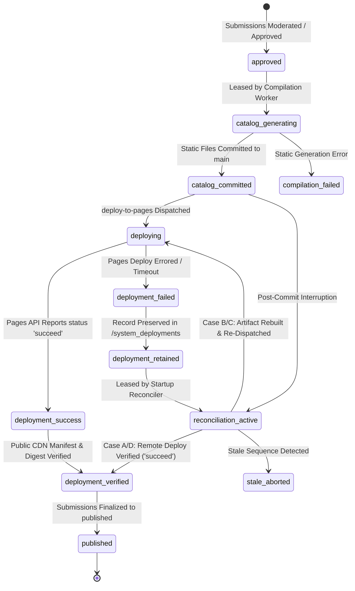
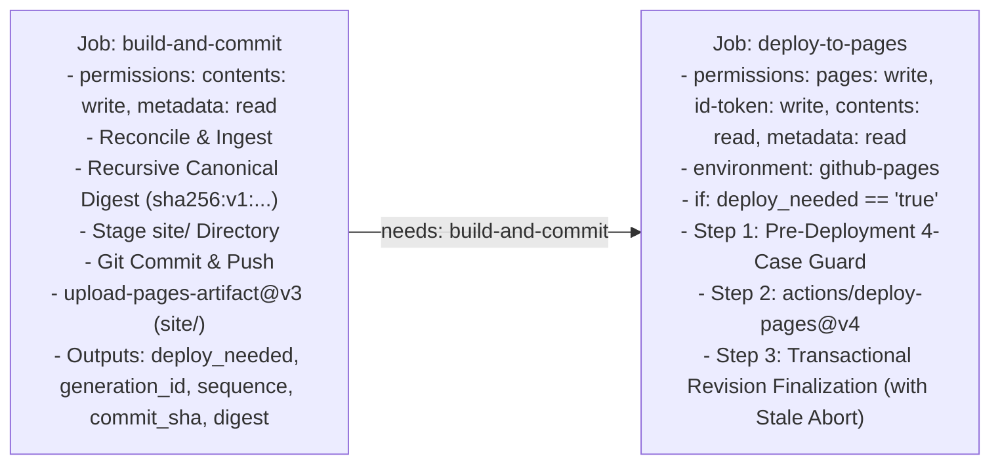

# GitStore — Architecture Specification

**Document Version:** 1.8.0  
**Phase:** Phase 0.1.7 — Replay Protection, Firestore Field Integrity & Deployment State Consistency  
**Status:** IN_REVIEW — Awaiting Explicit User Approval  

---

## 1. Architectural Philosophy and Invariants

The design of GitStore is governed by seven non-negotiable architectural invariants:

1. **Strict Dual-Platform Confinement:** The entire lifecycle of GitStore—from development and source control to database transactions, background processing, and binary delivery—is confined strictly to **GitHub** and **Firebase**. No tertiary PaaS, serverless function providers (Vercel, AWS Lambda, Netlify), or external relational databases (Supabase, PlanetScale) are permitted. No Firebase Hosting or Cloud Functions are used.
2. **Binary Non-Execution & Non-Hosting:** GitStore is a catalog, discovery engine, and verification broker. GitStore never executes submitted executables, never runs sandboxed code evaluation, and never stores or caches binary payloads inside Git repositories or Firebase Storage.
3. **Static-First Read Architecture & Targeted Free Quotas:** Storefront visitor traffic is 100% decoupled from the transactional database. 100% of anonymous catalog requests terminate at GitHub Pages' static file server (`data/catalog.json`), keeping Cloud Firestore operations reserved strictly for authenticated developer interactions, submission workflows, and background worker state transitions. Operating costs target $0.00/month by remaining strictly within the published free quotas of GitHub and Firebase (Spark Plan) without attached billing accounts.
4. **Zero-Trust Client Boundary & Complete Field Integrity:** The client-side browser is treated as untrusted. No client-side code possesses the authority to grant permissions, verify developers, alter product publication statuses, claim processing leases, or bypass release validation. User profile documents (`/users/{uid}`) are strictly private; public developer metadata is isolated in an explicit public projection (`/public_profiles/{uid}`). In `/submissions/{submissionId}`, client creation is strictly restricted to developer-owned payload fields; worker-managed fields (`validationResults`, `ownershipProof`, `processingLease`, `adminNotes`, `reviewedBy`, `reviewedAt`, `publishedProductId`) are excluded from client creation allowlists and initialized solely by trusted workers via the Firebase Admin SDK. Internal collections (`/system_deployments`, `/system_config/deployment_state`, `/system_config/catalog_state`, `/admin_logs`, `/consumed_stepup_nonces`) default to deny for all client access. All client-creatable and client-updatable collections enforce exhaustive schema rules via `keys().hasOnly(...)` and `diff().affectedKeys().hasOnly(...)`.
5. **Decoupled Privileged Administration via Option A with Nonce Replay Protection:** Normal browser clients never receive Firebase Admin SDK credentials, and client JavaScript cannot mint custom claims. All privileged administrative and moderation operations execute via the privileged **GitHub Actions Batch Worker**, verified authoritatively against **GitStore's own canonical GitHub repository** (`Rohitpvt/GitStore`) collaborator permissions (`role_name === 'admin'` or `'maintain'`). To prevent session hijacking or unauthorized action by linked email accounts, privileged operations strictly require fresh, interactive GitHub reauthentication (`reauthenticateWithPopup`). **Zero raw OAuth access tokens are stored in Firestore.** The request stores an action-bound payload containing caller UID, immutable numeric GitHub ID (`identities['github.com'][0]`), `auth_time`, action, target document path, action nonce, and a client-generated `actionHash` (which serves as a data-integrity checksum, not a cryptographic signature). To prevent nonce reuse across different request documents, worker processing atomically claims the request and reserves the nonce in a dedicated collection `/consumed_stepup_nonces/{nonceHash}` within a single Firestore transaction. The Security Rules enforce a strict 5-minute authentication freshness gate at creation time (`auth_time < 300s`), while worker execution operates on a 30-minute queue TTL from `createdAt`. The worker validates the target document path against an explicit action-to-collection mapping.
6. **12-State Deployment Recovery State Machine & Dedicated Pages Status (`succeed`):** Deployments transition across a formal 12-state state machine. Catalog integrity is proven via a deterministic SHA-256 `catalogDigest` computed recursively over canonicalized catalog files (length-prefixed, null-byte framed `sha256:v1:...`, excluding manifest). GitHub Pages deployment status is verified using the dedicated official endpoint `GET /repos/{owner}/{repo}/pages/deployments/{pages_deployment_id}` (where parameter accepts numeric deployment ID or commit SHA reference) checking for the documented success status `"status": "succeed"` (distinct from generic deployments and builds). In Case B recovery, the reconciler restores the Git tree, validates the digest, reconstructs `site/`, and explicitly exports `deployNeeded = true` to trigger artifact packaging and Pages deployment. Fallback commit recovery follows the full GitHub Commits API pagination loop without arbitrary page caps and validates commit SHA formats before shell execution.
7. **Durable Catalog Revisions, Shared Ordering Guard & Stale Abort:** Every catalog-affecting status change advances a durable monotonic revision counter (`/system_config/catalog_state.latestRequestedRevision`). Inside an atomic Firestore transaction, the worker reads current catalog revisions, ensures monotonic advancement, and transactionally updates `isDirty = (currentRequested > capturedRevision)`. If a generation is detected to be stale (`capturedRevision < currentPublishedRevision`), the transaction aborts the entire finalization path immediately without modifying published sequence, published revision, commit SHA, or submission statuses. A single shared decision function (`evaluateGenerationOrdering`) enforces the 4-case matrix across generation creation, recovery, pre-deployment guard (executed immediately before `actions/deploy-pages@v4`), and finalization.

---

## 2. Hardened System Architecture Diagram

```mermaid
graph TB
    subgraph ClientLayer["Client Layer (GitHub Pages Static Host)"]
        Visitor["Public Visitor Browser\n(Browse & Download)"]
        Developer["Software Developer Browser\n(Submit & Dashboard)"]
        AdminBrowser["Administrator Browser\n(Admin Dashboard with Action-Bound Proof)"]
        StaticCatalog["Pre-Compiled Static Storefront Data\n(data/catalog.json & products/*.json)"]
    end

    subgraph FirebasePlatform["Platform 2: Firebase Infrastructure (Spark Plan)"]
        FirebaseAuth["Firebase Authentication\n- GitHub OAuth (Popup)\n- Passwordless Magic Link\n- Mandatory GitHub Step-Up Reauth"]
        Firestore["Cloud Firestore Operational Database\n- users/{uid} (Strictly Private; diff().affectedKeys)\n- public_profiles/{uid} (Public Read; worker badges)\n- submissions/{id} (Client Payload Only; No Worker Fields)\n- claim_requests/{id} (Whitelisted Creation)\n- moderation_requests/{id} (Action-Bound Proof; Zero Raw Tokens)\n- consumed_stepup_nonces/{nonceHash} (Internal Replay Ledger; allow false)\n- products/{id}\n- categories/{id}\n- reports/{id} (Authenticated Only; Max 2000 chars)\n- admin_logs/{id} (allow false)\n- system_deployments/{id} (allow false)\n- system_config/deployment_state (allow false)\n- system_config/catalog_state (allow false)\n- system_config/global_settings (Public Read)"]
        SecurityRules["Firestore Security Rules\n- Exhaustive Schema Allowlisting\n- Zero Client Self-Escalation\n- Step-Up Freshness Enforcement (auth_time < 300s)\n- Target Path Pattern Enforcement\n- Internal Collection Default-Deny"]
        AppCheck["Firebase App Check\n- reCAPTCHA Enterprise Web Provider\n- Lazy-Loaded on Auth Pages Only"]
    end

    subgraph GitHubPlatform["Platform 1: GitHub Core Infrastructure"]
        GHPages["GitHub Pages\n- Vanilla HTML5/CSS3/ES6 Storefront\n- Packaged from site/ Staging Directory\n- Direct Static Asset Serving"]
        GHIssues["GitHub Issue Forms\n- Ingestion Queue (.github/ISSUE_TEMPLATE)"]
        GHReleases["Public GitHub Releases\n- Direct External Binaries\n(EXE, MSI, APK, DMG, ZIP, TAR.GZ)"]
        GHREST["GitHub REST API v3\n- Canonical Repo Collaborator Check\n- Upstream Repo, Tag, & Asset Validation\n- Dedicated Pages Deployment Status (status: 'succeed')"]
        GHWorker["GitHub Actions Batch Worker\n(Scheduled every 10 min + Manual Dispatch)\n- Concurrency Group: github-pages\n- 15-Min Atomic Leases\n- Split Jobs with Explicit Cross-Job Outputs\n- Pre-Deploy 4-Case Ordering Guard\n- Recursive Canonical Digest & Full-History Reconciler\n- Case B Artifact Handoff & Stale-Abort Finalization"]
    end

    %% Read Operations (Pure GitHub Pages - Zero DB Requests)
    Visitor -->|1. Fetch HTML/CSS/JS| GHPages
    Visitor -->|2. Fetch Static Catalog Index| StaticCatalog
    Visitor -->|3. Direct Download Binary| GHReleases

    %% Developer Operations
    Developer -->|4. Authenticate| FirebaseAuth
    Developer -->|5. Read/Write Own users/uid & public_profiles/uid| Firestore
    Developer -->|6. Write Submission (Payload only; status: queued)| Firestore
    Developer -.->|7. Open Issue Submission| GHIssues
    Firestore --- SecurityRules
    Firestore --- AppCheck

    %% Admin Operations (Decoupled Command Queue with Action-Bound Proof)
    AdminBrowser -->|8. Fresh GitHub Reauth via reauthenticateWithPopup| FirebaseAuth
    AdminBrowser -->|9. Enqueue Moderation Request with Action-Bound Proof| Firestore
    AdminBrowser -.->|10. Optional Immediate Dispatch| GHWorker

    %% Worker Automation & Privilege Execution
    GHWorker -->|11. Ingest & Verify Personal Repo Ownership| GHIssues
    GHWorker -->|12. Atomic Lease Claim Limit 3| Firestore
    GHWorker -->|13. Non-Execution Asset & Tag Verification| GHREST
    GHREST -.->|Validate Release Asset Existence| GHReleases
    GHWorker -->|14. Consume Nonce in consumed_stepup_nonces & Verify Identity| Firestore
    GHWorker -->|15. Authorize Admin on Canonical GitStore Repo| GHREST
    GHWorker -->|16. Execute Privileged Updates & admin_logs| Firestore
    GHWorker -->|17. Recursive Canonical Digest & site/ Staging| StaticCatalog
    GHWorker -->|18. Pre-Deploy 4-Case Guard & Deploy to Pages| GHPages
    GHWorker -->|19. Dedicated Pages Status Check ('succeed') & Reconcile| GHREST
    GHWorker -->|20. Transactional Revision Advance or Stale Abort| Firestore
```

---

## 3. Platform Boundaries & Interface Contracts

### 3.1 Interface Contract: Administrator Browser <-> Privileged Actions Worker

- **Canonical Repository Boundary Check:** Administrator authorization is verified strictly against **GitStore's own canonical GitHub repository** (`Rohitpvt/GitStore`). The batch worker asserts:
  ```javascript
  if (process.env.GITHUB_REPOSITORY !== 'Rohitpvt/GitStore') {
    throw new Error(`SECURITY ALERT: Execution on non-canonical repository ${process.env.GITHUB_REPOSITORY} aborted.`);
  }
  ```
  Environment string checks alone are insufficient against untrusted code injection. Privileged workflows are strictly isolated to trusted execution contexts (see Section 3.5).

- **Action-Bound Step-Up Proof Integrity & Nonce Replay Prevention (Option A):**
  Privileged administrative operations (`APPROVE_SUBMISSION`, `REJECT_SUBMISSION`, `VERIFY_DEVELOPER`, `REVOKE_DEVELOPER`, `DELIST_PRODUCT`, `FEATURE_PRODUCT`) cannot be executed by client browsers directly. Nor can browser clients mint custom claims or hold Firebase Admin credentials.

  To prevent session hijacking, credential leakage, or unauthorized administrative actions by users authenticating via passwordless email accounts linked to an admin, GitStore enforces **Mandatory Fresh GitHub Step-Up Reauthentication with Action-Bound Proofs and Nonce Replay Protection (Option A)**:

  1. **Behavior of Firebase Auth Tokens on Interactive Step-Up Reauthentication:**
     When an administrator triggers a privileged action on `admin.html`, the dashboard client initiates interactive step-up reauthentication:
     ```javascript
     import { getAuth, GithubAuthProvider, reauthenticateWithPopup } from 'firebase/auth';

     const auth = getAuth();
     const provider = new GithubAuthProvider();
     provider.addScope('read:user');

     // Interactive popup forces fresh authentication at GitHub (MFA/biometric)
     const result = await reauthenticateWithPopup(auth.currentUser, provider);
     const freshIdTokenResult = await auth.currentUser.getIdTokenResult(true);
     ```
     - **`auth_time`:** Firebase Auth updates the user's ID token claim `auth_time` (epoch seconds) to reflect the exact time of the interactive challenge.
     - **`sign_in_provider`:** The claim `request.auth.token.firebase.sign_in_provider` reflects `'github.com'` when the active session authenticated via GitHub OAuth.
     - **`identities`:** The claim `request.auth.token.firebase.identities['github.com']` contains an array containing the caller's immutable numeric GitHub user ID (e.g. `['12345678']`).

  2. **Elimination of Raw Token Storage & ActionHash Classification:**
     **No OAuth access tokens are ever written to or stored in Cloud Firestore.**
     The client constructs an action-bound proof:
     ```javascript
     const actionNonce = crypto.randomUUID().replace(/-/g, '') + crypto.randomUUID().replace(/-/g, '');
     const authTime = freshIdTokenResult.claims.auth_time;
     const targetDocumentPath = `submissions/${targetSubmissionId}`;
     
     // SHA-256 hash over action, target path, nonce, and auth_time
     const proofString = `${action}:${targetDocumentPath}:${actionNonce}:${authTime}`;
     const actionHash = await crypto.subtle.digest('SHA-256', new TextEncoder().encode(proofString))
       .then(buf => Array.from(new Uint8Array(buf)).map(b => b.toString(16).padStart(2, '0')).join(''));

     const stepUpProof = {
       providerId: 'github.com',
       authTime: authTime,
       actionNonce: actionNonce,
       targetDocumentPath: targetDocumentPath,
       actionHash: actionHash
     };
     ```
     > [!IMPORTANT]
     > **ActionHash Classification:** The client-generated SHA-256 `actionHash` contains no server secret or private cryptographic key. It is **not** an independent digital signature or authentication proof. It functions strictly as a **client data-integrity checksum** ensuring that the tuple `(action, targetDocumentPath, actionNonce, authTime)` was not corrupted or modified in transit. The true authorization foundation relies upon the verified Firebase token claims, GitHub identity matching, collaborator permissions on `Rohitpvt/GitStore`, and atomic worker-side nonce consumption.

  3. **Atomic Nonce Reservation in `/consumed_stepup_nonces`:**
     While transitioning a request document from `pending` to `processing` prevents re-processing the same document, an attacker could attempt to reuse an unexpired nonce across *different* request documents.
     To guarantee global single-use uniqueness, the batch worker consumes nonces in an atomic Firestore transaction:
     ```javascript
     const nonceHash = crypto.createHash('sha256').update(requestData.stepUpProof.actionNonce).digest('hex');
     const nonceRef = db.collection('consumed_stepup_nonces').doc(nonceHash);
     const requestRef = db.collection('moderation_requests').doc(requestId);

     await db.runTransaction(async (transaction) => {
       const nonceDoc = await transaction.get(nonceRef);
       if (nonceDoc.exists) {
         throw new Error("SECURITY ALERT: Step-up action nonce has already been consumed. Replay rejected.");
       }

       const reqDoc = await transaction.get(requestRef);
       if (!reqDoc.exists || reqDoc.data().status !== 'pending') {
         throw new Error("Moderation request is not in pending state.");
       }

       // Atomically consume nonce and transition request
       transaction.set(nonceRef, {
         nonceHash,
         requestId,
         requestedByUid: requestData.requestedByUid,
         action: requestData.action,
         targetDocumentPath: requestData.targetDocumentPath,
         workerRunId: String(process.env.GITHUB_RUN_ID),
         consumedAt: new Date()
       });

       transaction.update(requestRef, {
         status: 'processing',
         processedByWorkerRunId: String(process.env.GITHUB_RUN_ID),
         updatedAt: new Date()
       });
     });
     ```
     - **Failure Recovery Policy:** If worker processing fails *after* nonce consumption due to external transient issues (e.g. GitHub API 500), the nonce remains consumed (burned). It is never unconsumed. The administrator must initiate a fresh interactive reauthentication in the dashboard, generating a new nonce.
     - **Idempotency:** A worker re-running a job for the same request and worker run ID detects `status === 'processing'` with matching `processedByWorkerRunId` and resumes idempotently without re-consuming.
     - **Client Lockout:** Security Rules enforce `allow read, write: if false;` on `/consumed_stepup_nonces`.

  4. **Target Document Path Mapping & Validation:**
     The worker **never blindly trusts** `targetDocumentPath` submitted by the browser. It derives the canonical expected path from an explicit action-to-collection mapping:
     ```javascript
     function getCanonicalTargetPath(action, targetId) {
       switch (action) {
         case 'APPROVE_SUBMISSION':
         case 'REJECT_SUBMISSION':
           return `submissions/${targetId}`;
         case 'VERIFY_DEVELOPER':
         case 'REVOKE_DEVELOPER':
           return `users/${targetId}`; // or public_profiles/{targetId}
         case 'DELIST_PRODUCT':
         case 'FEATURE_PRODUCT':
           return `products/${targetId}`;
         default:
           throw new Error(`UNRECOGNIZED_ACTION: ${action}`);
       }
     }
     ```
     The worker asserts that `docData.targetDocumentPath === getCanonicalTargetPath(docData.action, docData.targetId)`. Any attempt to target unrelated collections or internal system collections (`system_deployments`, `system_config`, `admin_logs`, `consumed_stepup_nonces`) is rejected fail-closed.

  5. **Mixed-Provider Firebase Reauthentication Analysis:**
     - **Test Scenario:**
       1. Account created via Passwordless Email Magic Link.
       2. Developer links their GitHub provider in Firebase Auth (`linkWithPopup`).
       3. User signs out and logs back in via Email Magic Link (`sign_in_provider == 'password' | 'emailLink'`).
       4. Administrator triggers moderation action and performs `reauthenticateWithPopup(auth.currentUser, new GithubAuthProvider())`.
       5. Retrieve fresh ID token result and inspect claims: `auth_time`, `firebase.sign_in_provider`, `firebase.identities`.
     - **Behavior & Documentation Truthfulness:**
       Firebase Auth public documentation explicitly confirms that `auth_time` is updated upon reauthentication and `identities['github.com']` contains the linked numeric GitHub ID. However, Firebase documentation does not guarantee that `sign_in_provider` changes from `'emailLink'` to `'github.com'` without a full session sign-in using GitHub credentials.
     - **Classification:** Classified truthfully as **`DOCUMENTATION_VERIFIED`** for schema and claims; live runtime provider-switching behavior is classified as **`PENDING_INTEGRATION_TEST`**.
     - **Security Rules Formulation:**
       ```javascript
       function isFreshlyAuthenticated() {
         return isAuthenticated() 
           && request.auth.token.firebase.sign_in_provider == 'github.com'
           && ('github.com' in request.auth.token.firebase.identities)
           && request.auth.token.auth_time != null
           && ((request.time.toMillis() / 1000) - request.auth.token.auth_time < 300)
           && (request.auth.token.auth_time <= (request.time.toMillis() / 1000) + 5);
       }
       ```
       Under this rule, administrators executing privileged tasks must authenticate their active session via GitHub OAuth. If an account was originally created via email, they must sign in via GitHub to perform administrative actions.

---

### 3.2 Interface Contract: Complete Submission Field Integrity & Separation

To eliminate vulnerabilities where clients could fabricate review or validation states:

1. **Strict Partitioning of `/submissions/{submissionId}`:**
   - **Client-Creatable Fields (Creation Allowlist):**
     `id`, `developerUid`, `submissionSource`, `repoNumericId`, `repoId`, `targetProductId`, `productData`, `status`, `claimStatus`, `createdAt`, `updatedAt`.
   - **Worker-Managed Fields (Excluded from Client Allowlist):**
     `validationResults`, `ownershipProof`, `processingLease`, `adminNotes`, `reviewedBy`, `reviewedAt`, `publishedProductId`.
   - **Enforcement:**
     If a client includes any worker-managed field in a create request, `request.resource.data.keys().hasOnly(...)` evaluates to `false` and Firestore Security Rules reject the request before it touches the database.
   - **Worker Initialization:**
     When the GitHub Actions batch processor leases a submission, it adds `processingLease`, `validationResults`, and `ownershipProof` using the Firebase Admin SDK (`firebase-admin`). The Admin SDK communicates using Google Service Account credentials with IAM role `Cloud Datastore User`, which bypasses Security Rules by design.
   - **Client Updates:**
     Allowed only if `resource.data.developerUid == request.auth.uid` AND `resource.data.status in ['queued', 'rejected']`.
     Enforces `request.resource.data.diff(resource.data).affectedKeys().hasOnly(['productData', 'status', 'updatedAt'])` and forces `request.resource.data.status == 'queued'`.

2. **Strict Nested Map Validation for `productData`:**
   - Validates `productData.keys().hasOnly(['name', 'slug', 'repoUrl', 'repoOwner', 'repoName', 'releaseTag', 'selectedAsset', 'shortDescription', 'fullDescription', 'category', 'iconUrl', 'screenshots', 'supportedPlatforms', 'version', 'license', 'liveDemoUrl'])`.
   - String length bounds: `name` (3–60 chars), `shortDescription` (<= 200 chars), `fullDescription` (<= 10000 chars).
   - Array size bounds: `screenshots` (<= 6 items), `supportedPlatforms` (>= 1 item).
   - Selected asset map: `keys().hasOnly(['name', 'extension', 'sizeBytes', 'downloadUrl', 'assetId'])`, with `sizeBytes > 0`.

3. **Other Collections Audited:**
   - `/users/{userId}`: Client update diff restricted to `['displayName', 'avatarUrl', 'bio', 'settings', 'updatedAt']`.
   - `/public_profiles/{userId}`: Worker badges `isVerifiedDeveloper` and `publishedProductIds` protected from client writes.
   - `/claim_requests/{requestId}`: Whitelisted to `['requestId', 'requesterUid', 'targetSubmissionId', 'status', 'createdAt']`.
   - `/reports/{reportId}`: Authenticated only, 2000-char details limit, `status == 'open'`, client read/update/delete blocked.
   - Internal collections: `/system_deployments`, `/system_config/deployment_state`, `/system_config/catalog_state`, `/admin_logs`, `/consumed_stepup_nonces`: `allow read, write: if false;`.

---

### 3.3 Interface Contract: Globally Unique Deterministic Entity IDs

To guarantee global uniqueness and prevent collisions when two distinct repositories share an identical product slug:
- **Repository Identity (`gh_repo_{repoId}`):** GitHub's immutable numeric repository ID (e.g., `gh_repo_892341901`).
- **Product Identity (`prod_{repoId}_{productSlug}`):** Compounded numeric repo ID with product slug (e.g., `prod_892341901_viewer`).
- **Submission Identity:** `sub_issue_{repoId}_{issueNumber}` (issue submissions) or `sub_dash_{nanoid}` (dashboard).
- **Release & Asset Identity:** `rel_{repoId}_{releaseId}` and `asset_{repoId}_{assetId}`.

---

### 3.4 Interface Contract: 12-State Deployment Recovery State Machine & Reconciler

Consistency between GitHub Pages and Cloud Firestore is governed by a formal 12-state state machine:



- **Dedicated GitHub Pages Deployment Endpoint & Status `'succeed'`:**
  * Endpoint: `GET /repos/{owner}/{repo}/pages/deployments/{pages_deployment_id}`
  * Parameter: Accepts a numeric deployment ID or string commit SHA (`pagesDeploymentReference`).
  * **Documented Success Status:** The official Pages deployments API returns `"status": "succeed"` upon completion. (Generic Deployments API returns `state: "success"`; legacy Builds API returns `status: "built"`).
  * The response does **not** guarantee an `id` field. The schema records `pagesDeploymentReference: string | number | null`.
  * **Status & Error Handling:**
    - `succeed` (200 OK + `status: "succeed"`): Success; proceed to public CDN manifest check and finalization.
    - `queued` | `in_progress` (200 OK): Non-terminal; set `reconciliationStatus = 'pages_dispatched'` and wait for next cycle.
    - `errored` (200 OK + `status: "errored"`): Deployment failed; set `reconciliationStatus = 'pending_retry'`.
    - `404 Not Found`: No deployment exists for this commit SHA -> Triggers **Case B recovery path**.
    - `401 / 403 Forbidden`: Authentication / permissions failure -> Log fatal error and abort batch.
    - `5xx / Network`: Transient failure -> Retry next cycle.
    - `Unknown Status`: MUST NEVER count as success; log warning and treat as non-terminal.

- **Repaired Case B Recovery Path & Workflow Artifact Handoff:**
  When a commit was pushed to `origin/main` (`catalogCommitSha` verified) but no GitHub Pages deployment exists (Pages API returns 404):
  1. Re-checkout Git tree at exact `catalogCommitSha`: `git checkout ${gen.catalogCommitSha}`.
  2. Compute canonical catalog digest and assert match against `gen.catalogDigest`. If mismatch, transition to `abandoned`.
  3. Reconstruct `site/` staging directory.
  4. The reconciler function returns an explicit handoff object:
     `{ deployNeeded: true, generationId: gen.generationId, generationSequence: gen.generationSequence, catalogCommitSha: gen.catalogCommitSha, catalogDigest: gen.catalogDigest }`.
  5. The build step exports these parameters to `$GITHUB_OUTPUT`:
     `deploy_needed=true`, `generation_id=...`, `generation_sequence=...`, `catalog_commit_sha=...`, `catalog_digest=...`.
  6. The `upload-pages-artifact` step in Job 1 runs when `deploy_needed == 'true'`, packaging `site/`.
  7. Job 2 (`deploy-to-pages`) runs conditionally when `needs.build-and-commit.outputs.deploy_needed == 'true'`.
  8. Job 2 executes the pre-deployment 4-case guard, runs `actions/deploy-pages@v4`, verifies Pages deployment status (`status: "succeed"`), and finalizes Firestore.

- **Exhaustive Commit Recovery without 5-Page Cap:**
  * Unshallow fetch (`fetch-depth: 0`) provides complete local Git history.
  * Local Git search: `git log --format="%H" origin/main -- data/deployment-manifest.json`.
  * Fallback to GitHub Commits API traverses the complete pagination loop using `Link: rel="next"` headers until exhaustion.
  * Search result classification: Distinguishes empty search (no matching commit exists) from incomplete search (network/rate limit/error). Incomplete search is marked `pending_retry` (retryable); it is **never** marked `abandoned`.
  * Input validation: Commit SHAs are validated against `/^[0-9a-f]{40}$/i` before being passed to shell commands.
  * Disambiguation: Selects the latest commit on `origin/main` whose canonical digest matches `gen.catalogDigest`.

---

### 3.5 Interface Contract: GitHub Actions Event and Fork Security Matrix

| Workflow Trigger Event | Authorization Status | Secrets Access | Allowed Context & Ref Restrictions | Security Controls & Rationale | Evidence Classification |
|---|---|---|---|---|---|
| **`schedule`** | **ALLOWED** | Yes (`FIREBASE_SERVICE_ACCOUNT`, `GITHUB_TOKEN`) | Default branch (`refs/heads/main`) only | Runs scheduled batch worker on canonical repository default branch. Isolated from external PR code. | `DOCUMENTATION_VERIFIED` |
| **`workflow_dispatch`** | **ALLOWED** | Yes (`FIREBASE_SERVICE_ACCOUNT`, `ADMIN_VERIFY_TOKEN`) | Canonical repo collaborators with `write`/`admin` | Allows on-demand batch runs. Gated to verified repository collaborators by GitHub Actions permissions. | `DOCUMENTATION_VERIFIED` |
| **`issues: opened, edited`** | **RESTRICTED INGEST** | Scoped / None | Ingestion workflow only | Ingests Issue Form submissions. Minimal permissions (`issues: read`, `contents: read`). Isolated parser. | `DESIGNED` |
| **`pull_request`** | **RESTRICTED** | **NO SECRETS** | Pull requests targeting `main` | Read-only static linting. GitHub Actions automatically withholds secrets from fork PRs. | `DOCUMENTATION_VERIFIED` |
| **`pull_request_target`** | ❌ **FORBIDDEN** | **NONE (BANNED)** | Prohibited in GitStore | Prohibited due to fork secret-exfiltration vulnerabilities. | `DESIGNED` |
| **`workflow_run`** | ❌ **FORBIDDEN** | **NONE (BANNED)** | Prohibited in GitStore | Avoids untrusted artifact injection. | `DESIGNED` |
| **`push`** | **RESTRICTED** | No Privileged Pipeline | Protected `main` branch only | Push-suppression prevents cascade triggers. | `DOCUMENTATION_VERIFIED` |

---

### 3.6 Interface Contract: Split-Job Pages Configuration, Cross-Job Handoff & Pre-Deploy Guard

To enforce least privilege, `.github/workflows/batch-processor.yml` is split into two sequential jobs:



- **Explicit Cross-Job Outputs Handoff:**
  In `build-and-commit`:
  ```yaml
  outputs:
    generation_id: ${{ steps.catalog.outputs.generation_id }}
    generation_sequence: ${{ steps.catalog.outputs.generation_sequence }}
    catalog_commit_sha: ${{ steps.commit.outputs.commit_sha || steps.catalog.outputs.catalog_commit_sha }}
    catalog_digest: ${{ steps.catalog.outputs.catalog_digest }}
    deploy_needed: ${{ steps.catalog.outputs.deploy_needed }}
  ```
- **Single Shared Generation Ordering Decision Function (`evaluateGenerationOrdering`):**
  Applied in `scripts/processor/pre-deploy-guard.js` immediately before `actions/deploy-pages@v4`:
  1. *Case 1 (Stale Generation — `artifact.sequence < state.latestPublishedSequence`):*
     **REJECT_STALE.** Abort deployment with exit code 1.
  2. *Case 2 (Idempotent Retry — `artifact.seq === state.latestSeq && artifact.id === state.latestId`):*
     **ALLOW_IDEMPOTENT.** Allow deployment to proceed.
  3. *Case 3 (Sequence Conflict — `artifact.seq === state.latestSeq && artifact.id !== state.latestId`):*
     **HALT_CONFLICT.** Critical split-brain alarm. Abort deployment immediately and log security incident.
  4. *Case 4 (Forward Progression — `artifact.sequence > state.latestPublishedSequence`):*
     **ALLOW_NEW.** Allow deployment to proceed.
- **Action Pinning Recommendation:**
  Actions are pinned to official stable releases with 40-character commit SHAs:
  - `actions/checkout@11bd71901bbe5b1630ceea73d27597364c9af683 # v4.2.2`
  - `actions/setup-node@39370e3970a6d050c480ffad4ff0ed4d3fdee5a1 # v4.1.0`
  - `actions/upload-pages-artifact@56afc609e74202658d3ffba0e8f6dda462b719fa # v3.0.1`
  - `actions/deploy-pages@d6db90164ac5ed86f2b6aed7e0febac5b3c0c03e # v4.0.5`

---

### 3.7 Interface Contract: Durable Catalog Revisions & Stale-Generation Abort

#### 3.7.1 Explicit Captured Revision & Monotonic Advancement
- Catalog revision and deployment sequence are distinct counters. The system **never** substitutes `generationSequence` for `capturedRevision`.
- When finalizing a generation inside `db.runTransaction`:
  1. Read `/system_config/catalog_state` inside the transaction.
  2. If `gen.capturedRevision < currentPublishedRevision`:
     **ABORT TRANSACTION ENTIRELY.** The generation is stale.
     - Submissions are NOT marked `published`.
     - System deployment record is NOT marked `published`.
     - `latestPublishedSequence` is NOT touched.
     - Latest published generation ID, commit SHA, and digest are NOT overwritten.
     - Generation record is transitioned to `status: 'stale_aborted'` outside the transaction.
  3. If forward progression (`gen.capturedRevision >= currentPublishedRevision`):
     - Advance `latestPublishedRevision = gen.capturedRevision`.
     - Calculate `isDirty = (currentRequestedRevision > gen.capturedRevision)`.
     - Finalize submissions to `published`.
     - Finalize deployment record to `published`, `reconciliationStatus = 'reconciled'`.
     - Advance `deployment_state.latestPublishedSequence = gen.generationSequence`.

#### 3.7.2 Comprehensive 9-Race-Condition Audit & Mitigation Analysis
| # | Concurrency Race Condition | Vulnerability Scenario | GitStore Hardened Mitigation | Verification Status |
|---|---|---|---|---|
| **RC-1** | Simultaneous compilation workers | Concurrent runs create competing Git commits. | Firestore atomic lease lock (`leaseExpiresAt`) + Actions concurrency group `github-pages`. | `DOCUMENTATION_VERIFIED` |
| **RC-2** | Submissions approved during compilation | Approval arrives after query snapshot but before commit. | Durable revision counter increments. Worker computes `isDirty = (currentRequested > capturedRevision)` transactionally, queuing follow-up compilation. | `DESIGNED` |
| **RC-3** | Crash post-push before commit SHA save | Commit exists in Git; Firestore has `null` SHA. | Full-history startup reconciler scans `origin/main`, matches `catalogDigest`, and recovers SHA idempotently. | `DESIGNED` |
| **RC-4** | Simultaneous duplicate `/claim_requests` | Rapid double-click generates competing claims. | Worker executes claims in atomic transaction asserting `submission.developerUid == null`. Second claim fails closed. | `DESIGNED` |
| **RC-5** | Step-Up proof replay attempt | Attacker reuses nonce across different requests. | Atomic reservation in `/consumed_stepup_nonces/{nonceHash}` during request claiming. Second request rejected with `NONCE_ALREADY_CONSUMED`. | `DESIGNED` |
| **RC-6** | Competing claim vs admin delist | Developer claims submission as admin delists it. | Admin moderation sets status to `delisted`; compilation worker queries only `approved` items. | `DESIGNED` |
| **RC-7** | CDN edge cache serves stale manifest | Public CDN returns old manifest due to edge TTL. | Bounded exponential backoff with query cache-busting `?t=${Date.now()}` up to 5 minutes before deferring to startup reconciler. | `DESIGNED` |
| **RC-8** | Stale Actions deployment | Delayed queued runner attempts to deploy old commit. | Shared ordering function (`evaluateGenerationOrdering`) rejects stale run (`REJECT_STALE`) at pre-deploy guard and in finalization transaction. | `DOCUMENTATION_VERIFIED` |
| **RC-9** | Account unlinked before worker execution | Admin initiates request, then unlinks GitHub account. | Worker queries Firebase Admin SDK `getUser()` at execution time. If GitHub provider missing, request fails closed with `rejected_revoked`. | `DOCUMENTATION_VERIFIED` |

---

## 4. Architectural Decision Records (ADRs)

### ADR-01: Exclusion of Third-Party Backend Hosts
- **Status:** Accepted (Phase 0) | Confinement to GitHub and Firebase.

### ADR-02: Static Pre-Rendered Catalog vs Direct Firestore Queries
- **Status:** Accepted (Phase 0) | Zero Firestore reads for storefront visitors.

### ADR-03: Rejection of Binary Execution & Sandboxing
- **Status:** Accepted (Phase 0) | Downloads point directly to author GitHub Releases.

### ADR-04: Passwordless Authentication
- **Status:** Accepted (Phase 0) | GitHub OAuth & Email Magic Link eliminate password fields on Pages.

### ADR-05: Fail-Closed Administrator Authorization & Canonical Repository Boundary
- **Status:** Accepted (Phase 0.1.7 Reconciled)
- **Decision:** Administrator checks execute strictly against `Rohitpvt/GitStore`. Root admin is verified by matching caller's linked numeric GitHub ID against repo `owner.id`. Collaborators checked fail-closed for `role_name === 'admin'` or `'maintain'`.

### ADR-06: Asynchronous Submission Claiming via Restricted `/claim_requests` Queue
- **Status:** Accepted (Phase 0.1.2) | Eliminates fake accounts; client creation strictly whitelisted.

### ADR-07: Non-Circular Manifest Architecture & Dedicated Pages Deployment Verification
- **Status:** Accepted (Phase 0.1.7 Reconciled)
- **Decision:** Manifest contains `generatedAt` and `catalogDigest`; omits circular commit SHA. Pages verification uses official endpoint `GET /repos/{owner}/{repo}/pages/deployments/{pages_deployment_id}` for documented status `"status": "succeed"` (NOT `"built"`). Schema supports numeric ID or string commit SHA (`pagesDeploymentReference`).

### ADR-08: GitHub Pages Policy Launch Gate & Clarification Contingency
- **Status:** Accepted (Phase 0.1) | Written confirmation from GitHub Support established as Phase 4 launch gate.

### ADR-09: Globally Unique Deterministic Entity Identities via Numeric Repository IDs
- **Status:** Accepted (Phase 0.1.2) | Repositories and products keyed by immutable numeric IDs (`gh_repo_{repoId}`, `prod_{repoId}_{productSlug}`).

### ADR-10: reCAPTCHA Enterprise Specification & Quotas
- **Status:** Accepted (Phase 0.1.5) | reCAPTCHA Enterprise with `isTokenAutoRefreshEnabled: true`, lazy-loaded on auth pages.

### ADR-11: Single-Workflow Catalog Publication (Option A)
- **Status:** Accepted (Phase 0.1.5) | Overcomes token push suppression by executing build, commit, artifact upload, and deployment within one trusted workflow.

### ADR-12: Monotonic Generation Ordering & Durable Record Preservation
- **Status:** Accepted (Phase 0.1.7 Reconciled)
- **Decision:** Shared decision function (`evaluateGenerationOrdering`) enforces 4-case matrix across all deployment stages. Failed records preserved in `/system_deployments`.

### ADR-13: Deterministic Post-Commit SHA Recovery
- **Status:** Accepted (Phase 0.1.7 Reconciled)
- **Decision:** Full-history Git search, branch ancestry proof (`merge-base`), and catalog digest matching. Commits API fallback follows complete pagination loop without page caps. Commit SHAs validated against `/^[0-9a-f]{40}$/i`.

### ADR-14: Public Profile Separation & Private User Data Privacy
- **Status:** Accepted (Phase 0.1.7 Reconciled)
- **Decision:** Separate `/users/{userId}` (private) and `/public_profiles/{userId}` (public read, worker badges). In `/submissions`, worker-managed fields are excluded from client create allowlist.

### ADR-15: Action-Bound Step-Up Proof Integrity, ActionHash Classification & Nonce Consumption Ledger
- **Status:** Accepted (Phase 0.1.7 Reconciled)
- **Decision:** Eliminate all raw OAuth access token storage in Firestore. Admin step-up uses `reauthenticateWithPopup`. Security Rules enforce `auth_time < 300s` at creation gate. Proof payload binds caller UID, numeric GitHub ID, `auth_time`, action, target document, and action nonce. `actionHash` is classified as a client data-integrity checksum. Worker reserves nonce in `/consumed_stepup_nonces/{nonceHash}` in an atomic transaction with request claiming, preventing replay across different documents. Target document paths are validated against explicit action-to-collection mapping.

### ADR-16: 12-State Recovery State Machine, Dedicated Pages Status & Case B Artifact Handoff
- **Status:** Accepted (Phase 0.1.7 Reconciled)
- **Decision:** Formalize 12-state recovery machine. Pages deployment verified via official endpoint checking `"status": "succeed"`. Case B recovery rebuilds `site/` and explicitly exports `deployNeeded = true` to trigger artifact upload and Pages deploy. Catalog digest uses recursive canonical JSON serialization (`canonicalizeJson`) and null-byte length-prefixed framing (`sha256:v1:...`).

### ADR-17: Durable Catalog Revisions, Transactional State Management & Stale Abort
- **Status:** Accepted (Phase 0.1.7 Reconciled)
- **Decision:** Track monotonic `latestRequestedRevision` and `latestPublishedRevision`. Explicit `capturedRevision` required (never substituted with `generationSequence`). Advance published revision inside atomic Firestore transaction. Stale generations abort finalization entirely, preserving published state.

### ADR-18: Least-Privilege Split-Job Pages Workflow, Cross-Job Outputs & Pre-Deploy Ordering Guard
- **Status:** Accepted (Phase 0.1.7 Reconciled)
- **Decision:** Split into `build-and-commit` and `deploy-to-pages` with explicit cross-job outputs. Stage assets strictly into `site/`. Enforce pre-deployment 4-case ordering guard immediately prior to `actions/deploy-pages@v4`. Action pinned to official stable v4 release with commit SHA.
