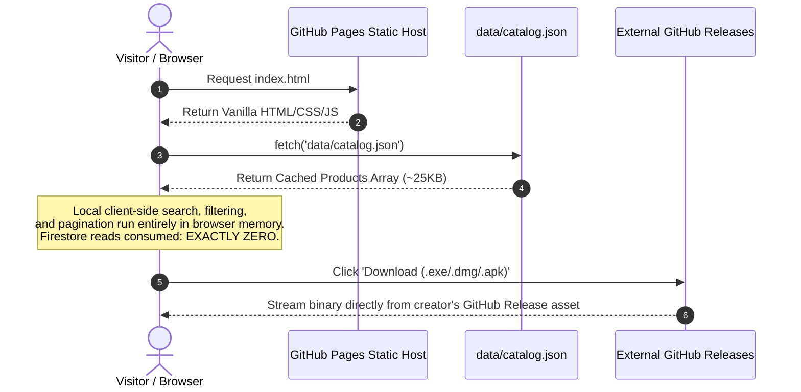
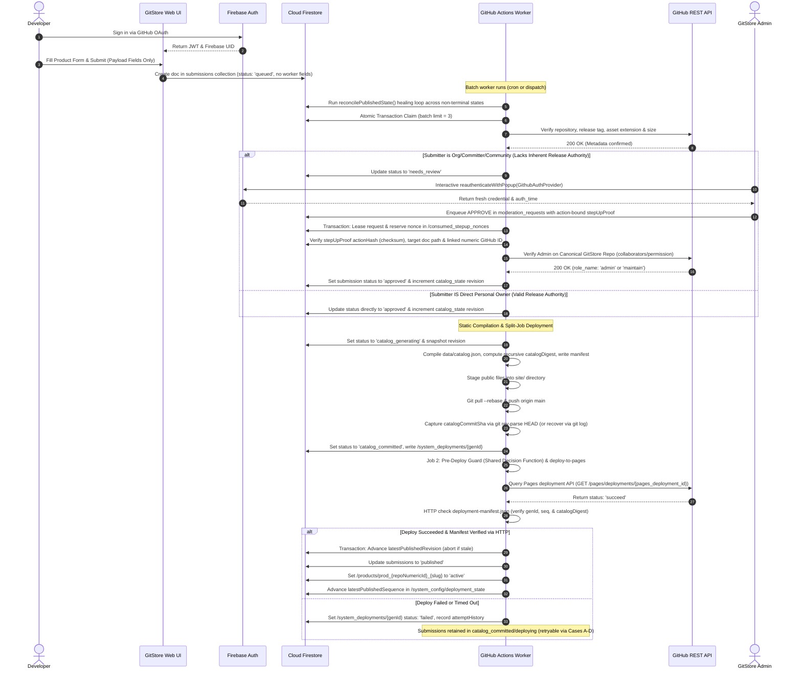
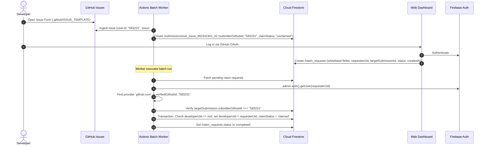
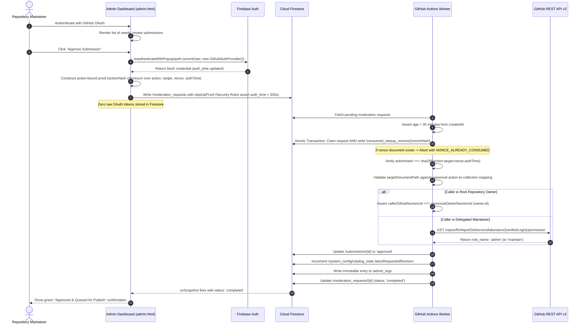

# GitStore — System Design Document (SDD)

**Document Version:** 1.8.0  
**Phase:** Phase 0.1.7 — Replay Protection, Firestore Field Integrity & Deployment State Consistency  
**Status:** IN_REVIEW — Awaiting Explicit User Approval  

---

## 1. High-Level Architecture Overview

GitStore is designed as a hybrid decoupled system utilizing **GitHub** as the static host, automation engine, issue tracker, and binary distribution channel, coupled with **Firebase** as the authoritative operational database, user identity service, and client-side security boundary.

```mermaid
flowchart TD
    subgraph ClientLayer["Client Layer (GitHub Pages Static Host)"]
        UserBrowser["Visitor / Consumer Browser"]
        DevBrowser["Developer Browser"]
        AdminBrowser["Admin Browser (Dashboard with Action-Bound Proof)"]
        StaticCatalog["Pre-Compiled Static JSON Catalogs\n(data/catalog.json, data/products/*.json)"]
    end

    subgraph FirebaseLayer["Platform 2: Firebase Managed Services (Spark Plan)"]
        FirebaseAuth["Firebase Authentication\n(GitHub OAuth + Magic Link + Mandatory Step-Up)"]
        Firestore["Cloud Firestore Operational Database\n- users (Strictly Private; diff().affectedKeys)\n- public_profiles (Public Read; worker badges)\n- submissions (Strict Client Allowlist; No Worker Fields)\n- claim_requests, moderation_requests\n- products, categories, reports\n- Internal Collections: system_deployments,\n  deployment_state, catalog_state, admin_logs,\n  consumed_stepup_nonces (Atomic Single-Use Ledger)"]
        AppCheck["Firebase App Check\n(reCAPTCHA Enterprise - Lazy Loaded on Auth Pages)"]
        SecurityRules["Firestore Security Rules\n(Granular RBAC, Privacy & Step-Up Freshness)"]
    end

    subgraph GitHubLayer["Platform 1: GitHub Core Services"]
        GHPages["GitHub Pages\n(Packaged from site/ Staging Directory)"]
        GHIssues["GitHub Issue Forms\n(.github/ISSUE_TEMPLATE)"]
        GHReleases["Public GitHub Releases\n(External User Repositories)"]
        GHREST["GitHub REST API v3\n(Canonical Repo Collaborator Check,\nUpstream Repo, Tag & Asset Validation,\nPages Deployment Status via Commit SHA: succeed)"]
        GHWorker["GitHub Actions Batch Worker\n(Scheduled every 10 min + Manual Dispatch)\n- Split Jobs: build-and-commit & deploy-to-pages\n- 15-Minute Leases\n- Complete-Pagination Reconciler & Recursive Catalog Digest\n- Pre-Deploy Shared Ordering Guard & Case B Real Handoff\n- Stale Abort Catalog Revision Advance"]
    end

    %% Client Interactions
    UserBrowser -->|Read Static Catalog| StaticCatalog
    DevBrowser -->|Authenticate| FirebaseAuth
    DevBrowser -->|Read/Write Own users/uid & public_profiles/uid| Firestore
    DevBrowser -->|Write Submission status: queued (Payload Only)| Firestore
    DevBrowser -.->|Submit via Issue Form| GHIssues
    DevBrowser -->|Submit Claim Request| Firestore
    AdminBrowser -->|Interactive Fresh GitHub Reauth| FirebaseAuth
    AdminBrowser -->|Enqueue Moderation Request with Action-Bound Proof| Firestore
    Firestore --- SecurityRules
    Firestore --- AppCheck

    %% Batch Worker Engine
    GHWorker -->|1. Run Startup Reconciler loop (Complete History & Digest)| Firestore
    GHWorker -->|2. Verify Action-Bound Proof, Nonce Ledger & Target Doc| Firestore
    GHWorker -->|3. Authorize Admin on Canonical GitStore Repo| GHREST
    GHWorker -->|4. Ingest Issues & Process Claim Requests| Firestore
    GHWorker -->|5. Claim Leased Submissions Limit 3| Firestore
    GHWorker -->|6. Verify Repos & Assets| GHREST
    GHWorker -->|7. Compile Static JSON Catalogs & Recursive Digest| StaticCatalog
    GHWorker -->|8. Stage Public Files to site/ & Commit origin main| GHPages
    GHWorker -->|9. Pre-Deploy Shared Ordering Guard & Dispatch deploy-to-pages| GHPages
    GHWorker -->|10. Verify Pages API status: succeed & HTTP Manifest| GHREST
    GHWorker -->|11. Finalize Submissions to published & Advance Catalog Revision (Stale Abort)| Firestore
```

---

## 2. Component Decomposition

### 2.1 Component 1: Static Web Frontend (`gh-pages`)
- **Technology:** HTML5, CSS3, Vanilla JavaScript (ES6 Modules). Zero frameworks or build dependencies.
- **Hosting:** GitHub Pages.
- **Key Responsibilities:**
  - High-performance, zero-latency catalog browsing using `fetch()` against pre-compiled `data/catalog.json`.
  - Client-side search, multi-faceted filtering (category, platform, license), and routing via URL hash or clean query parameters.
  - Interactive Developer Dashboard for managing submissions, displaying real-time submission status, and submitting applications.
  - Decoupled Admin Dashboard: Displays `needs_review` submissions and enqueues commands into `/moderation_requests` with mandatory fresh GitHub step-up reauthentication (`reauthenticateWithPopup`) generating an action-bound proof without raw OAuth tokens.
  - Lazy-loaded Firebase App Check (reCAPTCHA Enterprise) on authenticated developer pages only.

### 2.2 Component 2: Cloud Firestore (Authoritative Data Store)
- **Role:** The single source of truth for dynamic transactional state, user profiles, pending submissions, moderation requests, system configurations, and audit logs.
- **Access Model:**
  - `/users/{userId}`: Strictly private. Only authenticated owner and worker via Admin SDK may read/write. Client updates enforced via `diff().affectedKeys().hasOnly(['displayName', 'avatarUrl', 'bio', 'settings', 'updatedAt'])`. Privileged fields are blocked.
  - `/public_profiles/{userId}`: Publicly readable projection. Authenticated owners may update safe profile fields. Privileged reputation badges are written solely by the worker via Admin SDK.
  - `/submissions/{submissionId}`: Client creation restricted to safe payload fields (`keys().hasOnly(['id', 'developerUid', 'submissionSource', 'repoNumericId', 'repoId', 'targetProductId', 'productData', 'status', 'claimStatus', 'createdAt', 'updatedAt'])`). Any client attempt to inject worker-managed fields (`validationResults`, `ownershipProof`, `processingLease`, `adminNotes`, `reviewedBy`, `reviewedAt`, `publishedProductId`) is rejected by security rules.
  - `/consumed_stepup_nonces/{nonceHash}`: Internal worker collection. Default-deny for all client read/write (`allow read, write: if false;`). Worker atomically reserves single-use nonces to eliminate replay attacks.
  - Internal Collections (`/system_deployments`, `/system_config/deployment_state`, `/system_config/catalog_state`, `/admin_logs`): Default-deny for all client access (`allow read, write: if false;`).
  - Public anonymous access is restricted to read-only on active products and categories.
  - Authenticated developers can create new submission documents and edit their own pending submissions (`queued` or `needs_review`) on safe fields only.
  - Administrative commands write exclusively to `/moderation_requests` with fresh step-up authentication tokens (`auth_time < 300s`, `sign_in_provider == 'github.com'`) and action-bound proofs.
  - Batch worker operations execute via privileged `firebase-admin` Node.js SDK inside GitHub Actions using encrypted secrets.

### 2.3 Component 3: GitHub Actions Batch Worker Engine
- **Workflow:** `.github/workflows/batch-processor.yml`.
- **Trigger:** Scheduled cron (`*/10 * * * *`) and `workflow_dispatch` (manual trigger).
- **Runtime:** `ubuntu-latest` running a modular Node.js runner script (`scripts/processor/`).
- **Core Operations:**
  1. **Least-Privilege Split-Job Structure:**
     - `build-and-commit`: `contents: write`, `metadata: read`. Compiles static catalogs, generates deterministic recursive `catalogDigest` (`sha256:v1:...`), stages public files into `site/`, commits and pushes to `origin/main`. Outputs `generation_id`, `generation_sequence`, `catalog_commit_sha`, `catalog_digest`, and `deploy_needed` for Job 2.
     - `deploy-to-pages`: `pages: write`, `id-token: write`, `contents: read`, `metadata: read` targeting `environment: github-pages`. Runs conditionally when `deploy_needed == 'true'`. Evaluates pre-deploy shared ordering guard, packages `site/` staging directory, and deploys to Pages via `actions/deploy-pages@v4`.
  2. **Startup Reconciliation Loop (`reconcilePublishedState`):** Unshallow complete-pagination search on `origin/main` commits following `Link: rel="next"`, branch ancestry verification (`git merge-base --is-ancestor`), deterministic `catalogDigest` matching, and resolution of missing Pages deployment IDs across Cases A–D via official dedicated endpoint `GET /repos/{owner}/{repo}/pages/deployments/{pages_deployment_id}` checking for `status === "succeed"`. Case B performs real artifact handoff to `$GITHUB_OUTPUT`.
  3. **Action-Bound Proof & Nonce Verification:** Verifies client data-integrity checksum `actionHash`, validates `targetDocumentPath` against canonical action mapping, checks caller's linked numeric GitHub ID, confirms canonical repo permissions on `Rohitpvt/GitStore`, and claims request while atomically reserving `actionNonce` in `/consumed_stepup_nonces/{nonceHash}`.
  4. **Durable Catalog Revisions (`catalog_state`):** Snapshots `activeCapturedRevision` and advances `latestPublishedRevision` inside an atomic transaction. If `capturedRevision < currentPublishedRevision`, the transaction aborts with `stale_aborted` to prevent rollbacks. Automatically flags `isDirty` if newer items arrived during deployment.
  5. **Issue Form Ingestion:** Ingests newly opened GitHub Issues tagged `submission:pending`, verifies ownership (owner vs org/committer/community), assigns `claimStatus: 'unclaimed'`, and registers submission.
  6. **Lease Allocation:** Claims up to 3 `queued` or stale `processing` submissions by assigning a lease holder ID (`GITHUB_RUN_ID`) and 15-minute lease expiration.

---

## 3. Data Flow & Lifecycles

### 3.1 Storefront Visitor Data Flow


### 3.2 Submission to Publication Data Flow (12-State Protocol)


### 3.3 Secure Issue Form Submission Claiming Flow


### 3.4 Privileged Administrator Workflow with Action-Bound Proof


---

## 4. Modular Directory & Codebase Structure

```text
GitStore/
├── .github/
│   ├── workflows/
│   │   └── batch-processor.yml     # Least-privilege split-job worker (build-and-commit & deploy-to-pages)
│   └── ISSUE_TEMPLATE/
│       ├── product-submission.yml  # Structured issue form
│       ├── bug_report.yml          # Bug report form
│       └── feature_request.yml     # Feature request form
├── assets/
│   ├── css/
│   │   ├── variables.css           # Design tokens (obsidian, neons, tech-cuts)
│   │   ├── base.css                # Reset, utility classes, blueprint grid
│   │   ├── components/             # Reusable buttons, cards, badges
│   │   └── pages/                  # Page-specific layout styles
│   └── js/
│       ├── config/
│       │   └── firebase-config.js  # Public client keys & reCAPTCHA Enterprise init
│       ├── api/                    # Auth, Firestore, and Catalog fetch abstractions
│       ├── components/             # Navbar, product cards, filter bars
│       └── utils/                  # Sanitizers, formatters, semver helpers
├── data/
│   ├── deployment-manifest.json    # Deployed generationId, generationSequence, generatedAt & catalogDigest (no SHA)
│   ├── catalog.json                # Master searchable product index
│   ├── categories.json             # Category taxonomy and counts
│   └── products/                   # Granular product records
│       └── prod_{repoId}_{slug}.json
├── scripts/
│   └── processor/
│       ├── index.js                # Main Actions runner entrypoint
│       ├── reconciler.js           # Self-healing complete-history reconciler & Cases A-D handler
│       ├── lease-manager.js        # Atomic transaction lease claimer
│       ├── issue-parser.js         # Issue form ingest & ownership validator
│       ├── moderation-handler.js   # Action-bound proof verifier, nonce ledger & canonical repo authorizer
│       ├── github-verifier.js      # REST API repository & asset validator
│       ├── pre-deploy-guard.js     # Pre-deployment shared generation ordering assertion
│       └── catalog-compiler.js     # Static JSON generator & recursive canonical digest hasher
├── docs/                           # Complete 13 Architectural Documents
├── index.html                      # Homepage
├── explore.html                    # Product Discovery & Search
├── product.html                    # Dynamic Product Detail Viewer
├── submit.html                     # Product Submission Wizard
├── dashboard.html                  # Developer Management Dashboard
├── admin.html                      # Administrator Moderation Portal with Step-Up Reauth
└── login.html                      # Authentication Page (OAuth & Magic Link)
```
