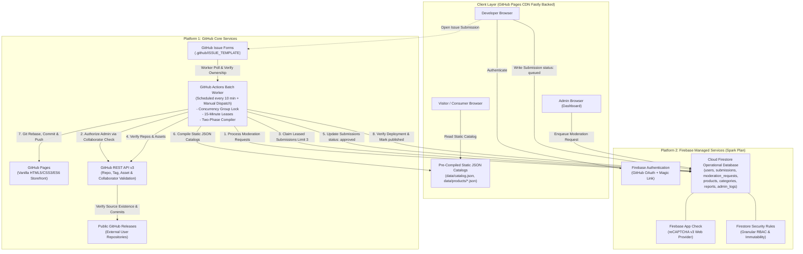
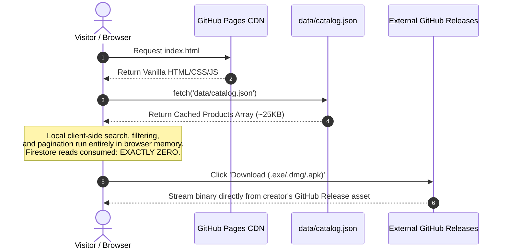
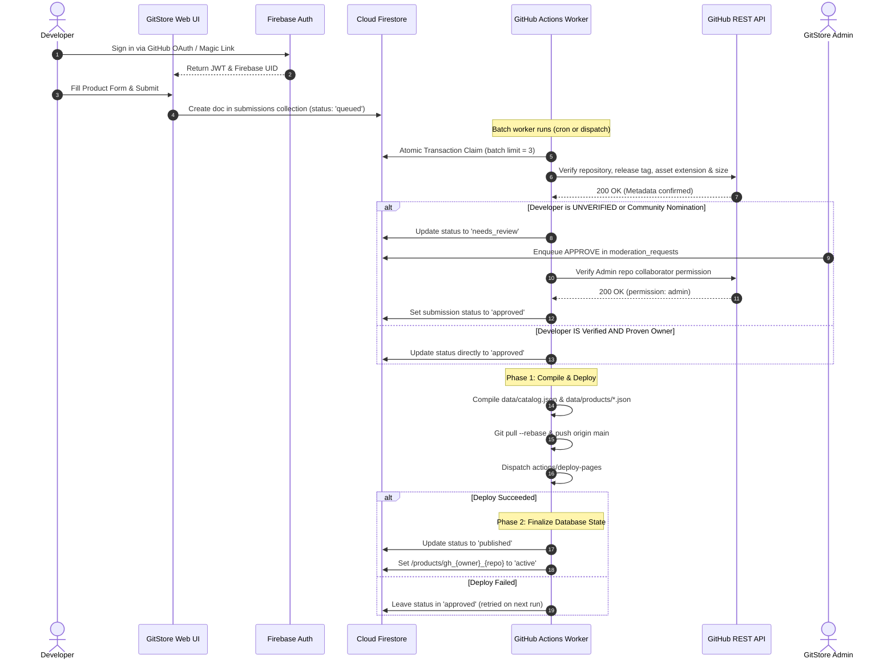
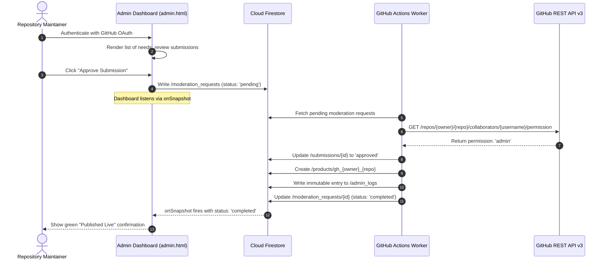

# GitStore — System Design Document (SDD)

**Document Version:** 1.1.0  
**Phase:** Phase 0.1 — Architecture Audit, Hardening & Final Validation  
**Status:** Approved Technical Architecture (Hardened)  

---

## 1. High-Level Architecture Overview

GitStore is designed as a hybrid decoupled system utilizing **GitHub** as the static host, automation engine, issue tracker, and binary distribution channel, coupled with **Firebase** as the authoritative operational database, user identity service, and client-side security boundary.



---

## 2. Component Decomposition

### 2.1 Component 1: Static Web Frontend (`gh-pages`)
- **Technology:** HTML5, CSS3, Vanilla JavaScript (ES6 Modules). Zero frameworks or build dependencies.
- **Hosting:** GitHub Pages (Fastly edge network).
- **Key Responsibilities:**
  - High-performance, zero-latency catalog browsing using `fetch()` against pre-compiled `data/catalog.json`.
  - Client-side search, multi-faceted filtering (category, platform, license), and routing via URL hash or clean query parameters.
  - Interactive Developer Dashboard for managing submissions, displaying real-time submission status, and submitting applications.
  - Decoupled Admin Dashboard: Displays `needs_review` submissions and enqueues commands into `/moderation_requests` with real-time `onSnapshot` status tracking.
  - Integration with Firebase JavaScript SDK (v10+ Modular) for Auth, Firestore, and App Check.

### 2.2 Component 2: Cloud Firestore (Authoritative Data Store)
- **Role:** The single source of truth for dynamic transactional state, user profiles, pending submissions, moderation requests, system configurations, and audit logs.
- **Access Model:**
  - Public anonymous access is restricted to read-only on active products and categories.
  - Authenticated developers can create new submission documents and edit their own pending submissions.
  - Privileged fields (`isVerifiedDeveloper`, `isAdmin`, `status: published`, `processingLease`) are protected against client writes by strict Firestore Security Rules.
  - Administrative commands write exclusively to `/moderation_requests` with `status: 'pending'`.
  - Batch worker operations execute via privileged `firebase-admin` Node.js SDK inside GitHub Actions using encrypted secrets.

### 2.3 Component 3: GitHub Actions Batch Worker Engine
- **Workflow:** `.github/workflows/batch-processor.yml`.
- **Trigger:** Scheduled cron (`*/10 * * * *`) and `workflow_dispatch` (manual trigger).
- **Runtime:** `ubuntu-latest` running a modular Node.js runner script (`scripts/processor/`).
- **Core Operations:**
  1. **Concurrency Enforcement:** Configured with `concurrency: group: gitstore-worker, cancel-in-progress: false` to ensure atomic, non-overlapping processing runs.
  2. **Moderation Queue Execution:** Processes `/moderation_requests`, verifies requester's repository collaborator permission via GitHub API, executes privileged mutations using Admin SDK, and logs to `admin_logs`.
  3. **Issue Form Ingestion & Ownership Verification:** Ingests newly opened GitHub Issues tagged `submission:pending`, verifies ownership (owner/org/committer), assigns or provisions a Firebase UID, and registers the submission.
  4. **Lease Allocation:** Claims up to 3 `queued` or stale `processing` submissions by assigning a lease holder ID (`GITHUB_RUN_ID`) and 15-minute lease expiration.
  5. **GitHub REST API Verification:** Validates public repository status, release existence, asset name matching, size verification, and download URL fidelity.
  6. **Two-Phase Publication Protocol:** Sets qualified submissions to `approved`, compiles static JSON catalogs, commits to Git, verifies `actions/deploy-pages` success, and then updates status to `published`.

---

## 3. Data Flow & Lifecycles

### 3.1 Storefront Visitor Data Flow


### 3.2 Submission to Publication Data Flow (Two-Phase Protocol)


### 3.3 Privileged Administrator Workflow


---

## 4. Modular Directory & Codebase Structure

```text
GitStore/
├── .github/
│   ├── workflows/
│   │   ├── batch-processor.yml     # Cron batch worker (every 10m)
│   │   └── pages-deploy.yml        # Pages deployment workflow
│   └── ISSUE_TEMPLATE/
│       └── product-submission.yml  # Structured issue form
├── assets/
│   ├── css/
│   │   ├── variables.css           # Design tokens (obsidian, neons, tech-cuts)
│   │   ├── base.css                # Reset, utility classes, blueprint grid
│   │   ├── components/
│   │   │   ├── buttons.css         # Chamfered buttons, hover states
│   │   │   ├── cards.css           # Product showcase cards, corner crosshairs
│   │   │   ├── navigation.css      # Fixed obsidian header, bracketed links
│   │   │   ├── badges.css          # Monospace status badges
│   │   │   └── forms.css           # Inputs, validation styling
│   │   └── pages/
│   │       ├── home.css            # Hero showcase, grid styling
│   │       ├── explore.css         # Filter drawer, search bar
│   │       ├── product-detail.css  # Detailed view, download action
│   │       ├── dashboard.css       # Submissions table & stats
│   │       └── admin.css           # Review queue & developer verification table
│   └── js/
│       ├── config/
│       │   └── firebase-config.js  # Public client keys & reCAPTCHA v3 init
│       ├── api/
│       │   ├── auth.js             # GitHub OAuth & Magic Link abstractions
│       │   ├── firestore.js        # Submissions submission, moderation enqueuer
│       │   └── catalog.js          # Fetching & caching static JSON catalogs
│       ├── components/
│       │   ├── navbar.js           # Responsive menu, user profile pill
│       │   ├── product-card.js     # Card rendering template
│       │   ├── filter-bar.js       # Category, platform, and license filters
│       │   └── toast.js            # Non-blocking terminal-style notifications
│       ├── utils/
│       │   ├── sanitizers.js       # Strict HTML & URL sanitization (DOMPurify)
│       │   ├── formatters.js       # Byte sizes, semver, dates
│       │   └── router.js           # Client-side hash/query parameter management
│       └── app.js                  # Global application bootstrapper
├── data/
│   ├── catalog.json                # Master searchable product index
│   ├── categories.json             # Category taxonomy and counts
│   └── products/                   # Granular product records
│       └── gh_{owner}_{repo}.json
├── scripts/
│   └── processor/
│       ├── index.js                # Main Actions runner entrypoint
│       ├── lease-manager.js        # Atomic transaction lease claimer
│       ├── issue-parser.js         # Issue form ingest & ownership validator
│       ├── moderation-handler.js   # Moderation request verifier & executor
│       ├── github-verifier.js      # REST API repository & asset validator
│       └── catalog-compiler.js     # Static JSON generator
├── docs/                           # Complete 13 Architectural Documents
├── index.html                      # Homepage
├── explore.html                    # Product Discovery & Search
├── product.html                    # Dynamic Product Detail Viewer
├── submit.html                     # Product Submission Wizard
├── dashboard.html                  # Developer Management Dashboard
├── admin.html                      # Administrator Moderation Portal
└── login.html                      # Authentication Page (OAuth & Magic Link)
```

---

## 5. Failure Recovery, Leases & Concurrency Protection

### 5.1 Concurrency Lock
GitHub Actions enforces concurrency at the workflow definition level:
```yaml
concurrency:
  group: gitstore-batch-worker
  cancel-in-progress: false
```
This guarantees that if an execution takes longer than 10 minutes, subsequent scheduled executions will queue rather than run concurrently, eliminating multi-runner race conditions.

### 5.2 Atomic Processing Leases & Recovery
- The batch processor queries for submissions where `status == 'queued' OR (status == 'processing' AND processingLease.leaseExpiresAt < NOW())`.
- It claims each item inside a Firestore transaction:
  ```javascript
  transaction.update(doc.ref, {
    status: 'processing',
    'processingLease.leaseHolder': process.env.GITHUB_RUN_ID,
    'processingLease.leaseExpiresAt': new Date(Date.now() + 15 * 60 * 1000)
  });
  ```
- If the runner crashes mid-execution, the lease expires after 15 minutes, allowing the subsequent worker run to reclaim and recover the submission safely.
- If deployment fails, submissions remain in `approved` and are re-compiled and re-deployed in the subsequent run.
