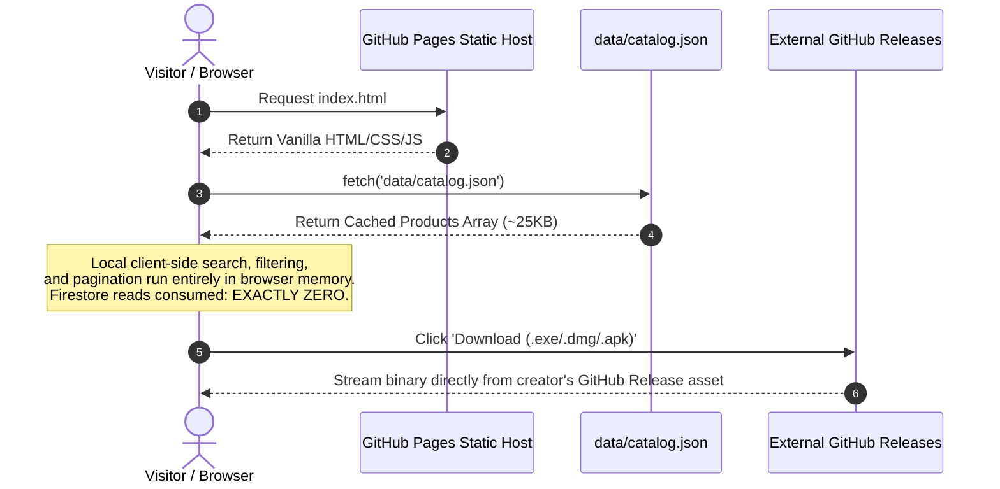
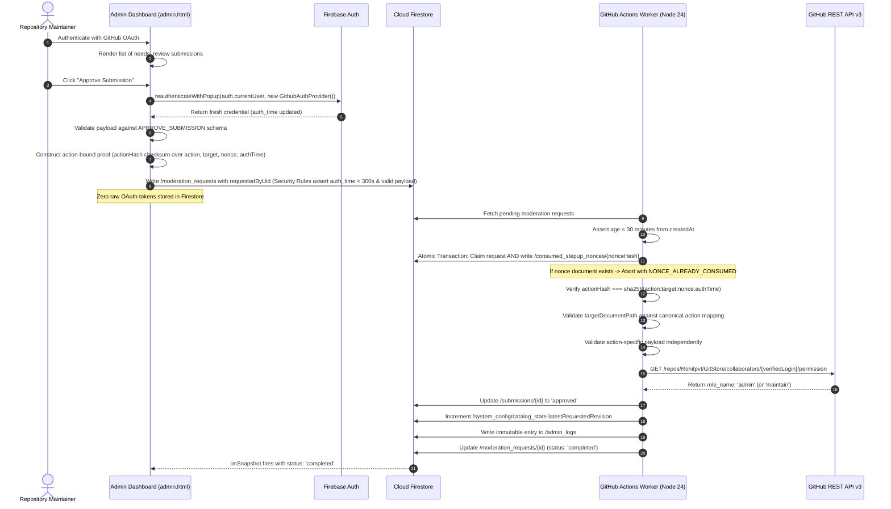

# GitStore — System Design Document (SDD)

**Document Version:** 1.12.0  
**Phase:** Phase 0.1.12 — Fan-Out Work-Plan Integrity, Lease Ownership & Fail-Closed Recovery  
**Status:** IN_REVIEW — Awaiting Explicit User Approval  
**Data Schema Version:** 1.12.0  

---

## 1. High-Level Architecture Overview

GitStore is designed as a hybrid decoupled system utilizing **GitHub** as the static host, automation engine, issue tracker, and binary distribution channel, coupled with **Firebase** as the authoritative operational database, user identity service, and client-side security boundary.

```mermaid
flowchart TD
    subgraph ClientLayer["Client Layer (GitHub Pages Static Host)"]
        UserBrowser["Visitor / Consumer Browser"]
        DevBrowser["Developer Browser"]
        AdminBrowser["Admin Dashboard (Action-Specific Payloads)"]
        StaticCatalog["Pre-Compiled Static JSON Catalogs\n(data/catalog.json, data/products/*.json)"]
    end

    subgraph FirebaseLayer["Platform 2: Firebase Managed Services (Spark Plan)"]
        FirebaseAuth["Firebase Authentication\n(GitHub OAuth + Magic Link + Step-Up Reauth)"]
        Firestore["Cloud Firestore Operational Database\n- users (Strictly Private; diff().affectedKeys)\n- public_profiles (Public Read; worker badges)\n- submissions (Payload Only; No Worker Fields)\n- claim_requests, moderation_requests (requestedByUid)\n- products, categories, reports\n- Internal Collections: system_deployments,\n  deployment_state, catalog_state, admin_logs,\n  consumed_stepup_nonces (Internal Nonce Ledger)"]
        AppCheck["Firebase App Check\n(reCAPTCHA Enterprise - Lazy Loaded on Auth Pages)"]
        SecurityRules["Firestore Security Rules\n(Granular RBAC, Action-Specific Payloads & Freshness)"]
    end

    subgraph GitHubLayer["Platform 1: GitHub Core Services"]
        GHPages["GitHub Pages\n(Packaged from site/ Staging Directory)"]
        GHIssues["GitHub Issue Forms\n(.github/ISSUE_TEMPLATE)"]
        GHReleases["Public GitHub Releases\n(External User Repositories)"]
        GHREST["GitHub REST API v3\n(Canonical Repo Collaborator Check,\nUpstream Repo, Tag & Asset Validation,\nPages Deployment Status via Commit SHA: succeed)"]
        GHWorker["GitHub Actions Batch Worker (Node 24)\n(Scheduled every 10 min + Manual Dispatch)\n- Actions: checkout@v7.0.1, setup-node@v7, upload@v5, deploy@v5\n- Single Authoritative Staging (stagedDigest check)\n- Explicit $GITHUB_OUTPUT Bridge\n- Work-Plan Digest & Transactional Lease Fan-Out"]
    end

    %% Client Interactions
    UserBrowser -->|Read Static Catalog| StaticCatalog
    DevBrowser -->|Authenticate| FirebaseAuth
    DevBrowser -->|Read/Write Own users/uid & public_profiles/uid| Firestore
    DevBrowser -->|Write Submission status: queued (Payload Only)| Firestore
    DevBrowser -.->|Submit via Issue Form| GHIssues
    DevBrowser -->|Submit Claim Request| Firestore
    AdminBrowser -->|Interactive Fresh GitHub Reauth| FirebaseAuth
    AdminBrowser -->|Enqueue Moderation Request with Action-Specific Payload| Firestore
    Firestore --- SecurityRules
    Firestore --- AppCheck

    %% Batch Worker Engine
    GHWorker -->|1. Run Startup Reconciler (Granular Error Classification)| Firestore
    GHWorker -->|2. Verify Action-Bound Proof, Nonce Ledger & Target Doc| Firestore
    GHWorker -->|3. Authorize Admin on Canonical GitStore Repo| GHREST
    GHWorker -->|4. Ingest Issues & Process Claim Requests| Firestore
    GHWorker -->|5. Claim Leased Submissions Limit 3| Firestore
    GHWorker -->|6. Verify Repos & Assets| GHREST
    GHWorker -->|7. Compile Static Catalogs & Single Authoritative Staging| StaticCatalog
    GHWorker -->|8. Commit & Push origin main, Output Bridge to $GITHUB_OUTPUT| GHPages
    GHWorker -->|9. Pre-Deploy Shared Ordering Guard & Dispatch deploy-to-pages| GHPages
    GHWorker -->|10. Verify Dedicated Pages API status: succeed & HTTP Manifest| GHREST
    GHWorker -->|11. 2-Tier Transactional Finalization & Stale Abort| Firestore
```

---

## 2. Component Decomposition

### 2.1 Component 1: Static Web Frontend (`gh-pages`)
- **Technology:** HTML5, CSS3, Vanilla JavaScript (ES6 Modules). Zero frameworks or build dependencies.
- **Hosting:** GitHub Pages.
- **Key Responsibilities:**
  - High-performance, zero-latency catalog browsing using `fetch()` against pre-compiled `data/catalog.json`.
  - Client-side search, multi-faceted filtering (category, platform, license), and routing via URL hash or clean query parameters.
  - Interactive Developer Dashboard for managing submissions, displaying real-time submission status, and submitting applications.
  - Decoupled Admin Dashboard: Displays `needs_review` submissions and enqueues commands into `/moderation_requests` with mandatory fresh GitHub step-up reauthentication (`reauthenticateWithPopup`), generating an action-bound proof and action-specific validated payload.
  - Lazy-loaded Firebase App Check (reCAPTCHA Enterprise) on authenticated developer pages only.

### 2.2 Component 2: Cloud Firestore (Authoritative Data Store)
- **Role:** The single source of truth for dynamic transactional state, user profiles, pending submissions, moderation requests, system configurations, and audit logs.
- **Access Model:**
  - `/users/{userId}`: Strictly private. Only authenticated owner and worker via Admin SDK may read/write. Client updates enforced via `diff().affectedKeys().hasOnly(['displayName', 'avatarUrl', 'bio', 'settings', 'updatedAt'])`. Privileged fields are blocked.
  - `/public_profiles/{userId}`: Publicly readable projection. Authenticated owners may update safe profile fields. Privileged reputation badges are written solely by the worker via Admin SDK.
  - `/submissions/{submissionId}`: Client creation restricted to safe payload fields (`keys().hasOnly(['id', 'developerUid', 'submissionSource', 'repoNumericId', 'repoId', 'targetProductId', 'productData', 'status', 'claimStatus', 'createdAt', 'updatedAt'])`). Any client attempt to inject worker-managed fields is rejected by security rules.
  - `/moderation_requests/{requestId}`: Client creation requires fresh step-up authentication (`auth_time < 300s`, `sign_in_provider == 'github.com'`), target path binding, and action-specific nested payload schema validation. Client updates and deletes are blocked.
  - `/consumed_stepup_nonces/{nonceHash}`: Internal worker collection. Default-deny for all client read/write (`allow read, write: if false;`). Worker atomically reserves single-use nonces using `requestedByUid` to eliminate replay attacks.
  - Internal Collections (`/system_deployments`, `/system_config/deployment_state`, `/system_config/catalog_state`, `/admin_logs`): Default-deny for all client access.

### 2.3 Component 3: GitHub Actions Batch Worker Engine (Node 24)
- **Workflow:** `.github/workflows/batch-processor.yml`.
- **Runtime:** `ubuntu-latest` running on official Node 24 actions pinned to verified 40-character commit SHAs:
  - `actions/checkout@3d3c42e5aac5ba805825da76410c181273ba90b1 # v7.0.1` (`runs.using: 'node24'`, requires runner `>= v2.327.1`)
  - `actions/setup-node@0a44ba7841725637a54e280ec667c276c6cc814e # v7.1.0` (`runs.using: 'node24'`, requires runner `>= v2.327.1`)
  - `actions/upload-pages-artifact@56afc609e74202658d3ffba0e8f6dda462b719fa # v5.0.0` (`runs.using: 'composite'`, packages gzip/tar)
  - `actions/deploy-pages@d6db90164ac5ed86f2b6aed7e0febac5b3c0c03e # v5.0.1` (`runs.using: 'node24'`, requires runner `>= v2.327.1`)
- **Native Git CLI Credential Behavior:** Official documentation confirms that `actions/checkout` v7.0.1 stores credentials in `$RUNNER_TEMP` (preventing workspace leaks) while configuring the Git credential helper so native Git operations (`git push origin main`) succeed automatically with default `persist-credentials: true`.
- **Core Operations:**
  1. **Split-Job Architecture & Output Bridge:** `build-and-commit` constructs `site/`, verifies `stagedDigest === catalogDigest`, commits to `main`, writes step outputs to `$GITHUB_OUTPUT`, and uploads Pages staging artifact. `deploy-to-pages` runs conditionally when `needs.build-and-commit.outputs.deploy_needed == 'true'`, executes the pre-deploy guard, and deploys via `actions/deploy-pages@v5.0.1`.
  2. **Startup Reconciler with Granular Error Classification:** Searches Git history via unshallow fetch and Commits API pagination loop. Distinguishes benign missing blobs (`CANDIDATE_NO_MANIFEST`, HTTP 404) from rate limits/timeouts (`INCOMPLETE_SEARCH`), 401 auth failures (`API_AUTH_ERROR`), and corrupt manifest blobs (`CANDIDATE_CORRUPT_MANIFEST`). Declares `EMPTY_SEARCH` only on complete, uninterrupted scans with zero errors.
  3. **Case B Clean Staging:** Extracts assets from the target commit directly into `site/`, recomputes and validates `stagedDigest`, and prohibits any post-staging workspace copies.
  4. **2-Tier Finalization & Bounded Subcollections:** Reads `catalog_state`, `deployment_state`, and generation record before writes. Evaluates `evaluateGenerationOrdering` and revision monotonicity inside the transaction. Commits global state in 3 writes. Submission fan-out work is stored in bounded subcollections (`fanout_batches`, max 400 IDs each), and executed via conditional transactions that enforce status eligibility (`approved` only) and monotonic sequence advancement (`publishedGenerationSequence`), preventing stale fan-out overwrites across all concurrency interleavings.

---

## 3. Data Flow & Lifecycles

### 3.1 Storefront Visitor Data Flow


### 3.2 Submission to Publication Data Flow (Node 24 Split-Job Protocol)
```mermaid
sequenceDiagram
    autonumber
    actor Dev as Developer
    participant Client as GitStore Web UI
    participant Auth as Firebase Auth
    participant DB as Cloud Firestore
    participant Worker as Actions Batch Worker (Node 24)
    participant GHAPI as GitHub REST API
    actor Admin as GitStore Admin

    Dev->>Auth: Sign in via GitHub OAuth
    Auth-->>Client: Return JWT & Firebase UID
    Dev->>Client: Fill Product Form & Submit (Payload Fields Only)
    Client->>DB: Create doc in submissions collection (status: 'queued', no worker fields)
    Note over Worker: Batch worker runs (cron or dispatch)
    Worker->>DB: Run reconcilePublishedState() healing loop across non-terminal states
    Worker->>DB: Atomic Transaction Claim (batch limit = 3)
    Worker->>GHAPI: Verify repository, release tag, asset extension & size
    GHAPI-->>Worker: 200 OK (Metadata confirmed)
    alt Submitter is Org/Committer/Community (Lacks Inherent Release Authority)
        Worker->>DB: Update status to 'needs_review'
        Admin->>Auth: Interactive reauthenticateWithPopup(GithubAuthProvider)
        Auth-->>Admin: Return fresh credential & auth_time
        Admin->>DB: Enqueue APPROVE in moderation_requests with action-specific payload
        Worker->>DB: Transaction: Lease request & reserve nonce in /consumed_stepup_nonces
        Worker->>DB: Verify stepUpProof actionHash (checksum), target doc path & payload
        Worker->>GHAPI: Verify Admin on Canonical GitStore Repo (collaborators/permission)
        GHAPI-->>Worker: 200 OK (role_name: 'admin' or 'maintain')
        Worker->>DB: Set submission status to 'approved' & increment catalog_state revision
    else Submitter IS Direct Personal Owner (Valid Release Authority)
        Worker->>DB: Update status directly to 'approved' & increment catalog_state revision
    end
    Note over Worker: Static Compilation & Single Authoritative Staging
    Worker->>DB: Set status to 'catalog_generating' & snapshot revision
    Worker->>Worker: Compile data/catalog.json, construct site/, verify stagedDigest = computeCatalogDigest('site/data')
    Worker->>Worker: If commit_needed: Git commit data/ & git push origin main; resolve deploy commit SHA
    Worker->>Worker: Export outputs to $GITHUB_OUTPUT (commit_needed, deploy_needed, generation_id, catalog_commit_sha, etc.)
    Worker->>Worker: actions/upload-pages-artifact@v5.0.0 (path: site/)
    Note over Worker: Job 2: deploy-to-pages (Node 24)
    Worker->>Worker: Pre-Deploy Guard: evaluateGenerationOrdering()
    Worker->>Worker: actions/deploy-pages@v5.0.1
    Worker->>GHAPI: Query Pages deployment API (GET /pages/deployments/{pages_deployment_id})
    GHAPI-->>Worker: Return status: 'succeed'
    Worker->>Worker: HTTP check deployment-manifest.json (verify genId, seq, & catalogDigest)
    alt Deploy Succeeded & Manifest Verified via HTTP
        Worker->>DB: Tier 1: Transaction advances deployment_state & catalog_state, sets fanout pending (3 writes)
        Worker->>DB: Tier 2: Conditional transactions process bounded fanout_batches (<=400 docs) enforcing sequence monotonicity
    else Deploy Failed or Stale Sequence
        Worker->>DB: Set /system_deployments/{genId} status: 'stale_aborted' or 'failed'
    end
```

### 3.3 Privileged Administrator Workflow with Action-Bound Proof


---

## 4. Modular Directory & Codebase Structure

```text
GitStore/
├── .github/
│   ├── workflows/
│   │   └── batch-processor.yml     # Node 24 least-privilege split-job worker (build-and-commit & deploy-to-pages)
│   └── ISSUE_TEMPLATE/
│       ├── product-submission.yml  # Structured issue form
│       ├── bug_report.yml          # Bug report form
│       └── feature_request.yml     # Feature request form
├── assets/
│   ├── css/
│   │   ├── variables.css           # Design tokens (obsidian, neons, tech-cuts)
│   │   ├── base.css                # Reset, utility classes, blueprint grid
│   │   ├── components/             # Reusable buttons, cards, badges
│   │   └── pages/                  # Page-specific layout styles
│   └── js/
│       ├── config/
│       │   └── firebase-config.js  # Public client keys & reCAPTCHA Enterprise init
│       ├── api/                    # Auth, Firestore, and Catalog fetch abstractions
│       ├── components/             # Navbar, product cards, filter bars
│       └── utils/                  # Sanitizers, formatters, semver helpers
├── data/
│   ├── deployment-manifest.json    # Deployed generationId, generationSequence, generatedAt & catalogDigest (no SHA)
│   ├── catalog.json                # Master searchable product index
│   ├── categories.json             # Category taxonomy and counts
│   └── products/                   # Granular product records
│       └── prod_{repoId}_{slug}.json
├── scripts/
│   └── processor/
│       ├── index.js                # Main Actions runner entrypoint
│       ├── reconciler.js           # Full-history reconciler & Cases A-D recovery
│       ├── output-bridge.js        # Direct append adapter for $GITHUB_OUTPUT
│       ├── lease-manager.js        # Atomic transaction lease claimer
│       ├── issue-parser.js         # Issue form ingest & ownership validator
│       ├── moderation-handler.js   # Action-bound proof verifier, nonce ledger & canonical repo authorizer
│       ├── github-verifier.js      # REST API repository & asset validator
│       ├── pre-deploy-guard.js     # Pre-deployment shared generation ordering assertion
│       ├── finalize-publishing.js  # 2-tier finalization transaction & stale abort
│       └── catalog-compiler.js     # Static JSON generator, single staging & digest hasher
├── docs/                           # Complete 13 Architectural Documents (v1.12.0)
├── index.html                      # Homepage
├── explore.html                    # Product Discovery & Search
├── product.html                    # Dynamic Product Detail Viewer
├── submit.html                     # Product Submission Wizard
├── dashboard.html                  # Developer Management Dashboard
├── admin.html                      # Administrator Moderation Portal with Step-Up Reauth
└── login.html                      # Authentication Page (OAuth & Magic Link)
```
