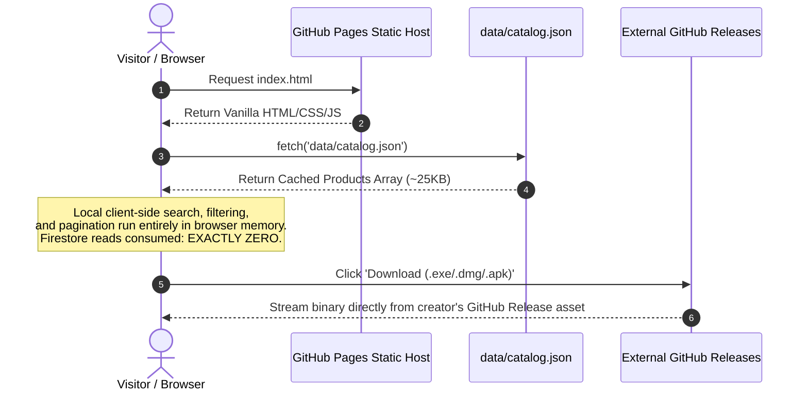
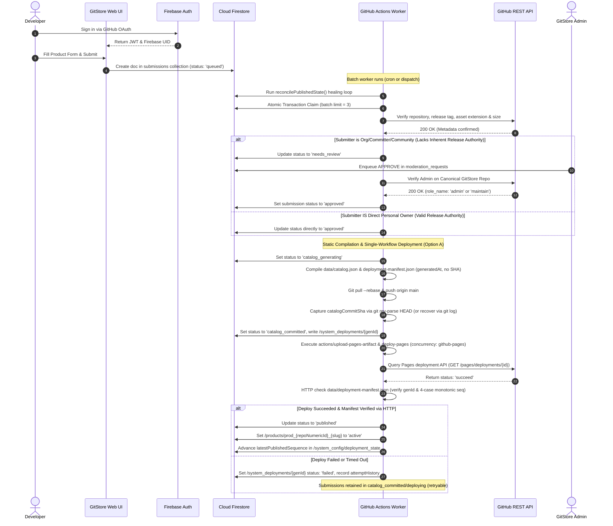
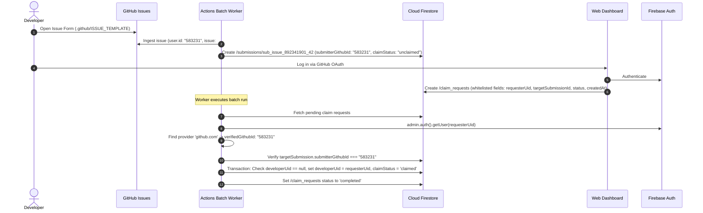
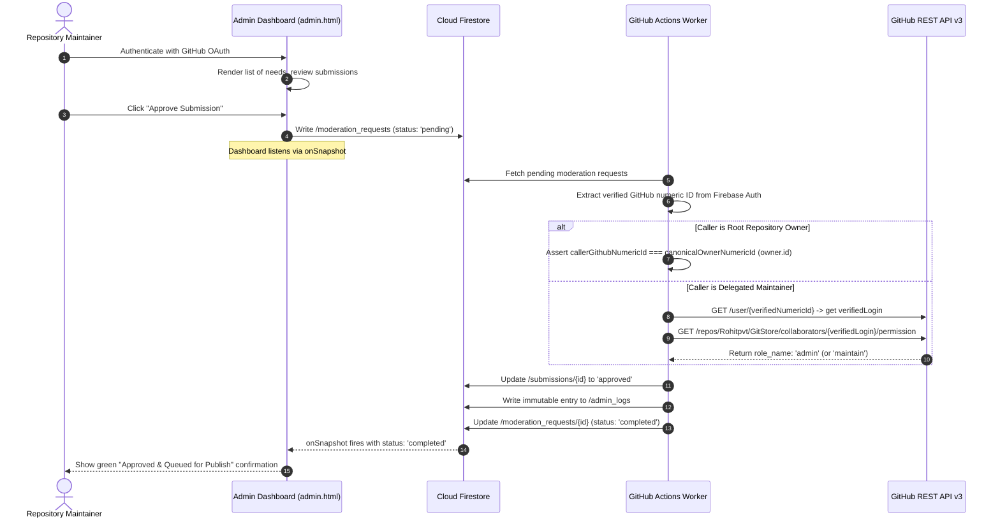

# GitStore — System Design Document (SDD)

**Document Version:** 1.5.0  
**Phase:** Phase 0.1.4 — Evidence Alignment, Deployment Recovery & Governance Consistency  
**Status:** Approved Technical Architecture (Hardened & Reconciled)  

---

## 1. High-Level Architecture Overview

GitStore is designed as a hybrid decoupled system utilizing **GitHub** as the static host, automation engine, issue tracker, and binary distribution channel, coupled with **Firebase** as the authoritative operational database, user identity service, and client-side security boundary.

```mermaid
flowchart TD
    subgraph ClientLayer["Client Layer (GitHub Pages Static Host)"]
        UserBrowser["Visitor / Consumer Browser"]
        DevBrowser["Developer Browser"]
        AdminBrowser["Admin Browser (Dashboard)"]
        StaticCatalog["Pre-Compiled Static JSON Catalogs\n(data/catalog.json, data/products/*.json)"]
    end

    subgraph FirebaseLayer["Platform 2: Firebase Managed Services (Spark Plan)"]
        FirebaseAuth["Firebase Authentication\n(GitHub OAuth + Magic Link)"]
        Firestore["Cloud Firestore Operational Database\n(users, submissions, claim_requests,\nmoderation_requests, products, categories)"]
        AppCheck["Firebase App Check\n(reCAPTCHA Enterprise - Lazy Loaded on Auth Pages)"]
        SecurityRules["Firestore Security Rules\n(Granular RBAC & Immutability)"]
    end

    subgraph GitHubLayer["Platform 1: GitHub Core Services"]
        GHPages["GitHub Pages\n(Vanilla HTML5/CSS3/ES6 Storefront)"]
        GHIssues["GitHub Issue Forms\n(.github/ISSUE_TEMPLATE)"]
        GHReleases["Public GitHub Releases\n(External User Repositories)"]
        GHREST["GitHub REST API v3\n(Canonical Repo Collaborator Check,\nUpstream Repo, Tag & Asset Validation)"]
        GHWorker["GitHub Actions Batch Worker\n(Scheduled every 10 min + Manual Dispatch)\n- Concurrency Group Lock\n- 15-Minute Leases\n- Two-Tier Publication & Reconciler"]
    end

    %% Client Interactions
    UserBrowser -->|Read Static Catalog| StaticCatalog
    DevBrowser -->|Authenticate| FirebaseAuth
    DevBrowser -->|Write Submission status: queued| Firestore
    DevBrowser -.->|Submit via Issue Form| GHIssues
    DevBrowser -->|Submit Claim Request| Firestore
    AdminBrowser -->|Enqueue Moderation Request| Firestore

    %% Batch Worker Engine
    GHWorker -->|1. Run Startup Reconciler loop| Firestore
    GHWorker -->|2. Process Claim & Moderation Requests| Firestore
    GHWorker -->|3. Query Ingested Issues| GHIssues
    GHWorker -->|4. Claim Queued Submissions Limit 3| Firestore
    GHWorker -->|5. Verify Upstream Metadata| GHREST
    GHWorker -->|6. Verify Collaborator Rights| GHREST
    GHWorker -->|7. Push Compiled JSON & Manifest| StaticCatalog
    GHWorker -->|8. Dispatch Pages Deployment| GHPages
    GHWorker -->|9. Verify Deployments API & HTTP Manifest| GHREST
    GHWorker -->|10. Finalize Submissions to published| Firestore
```


    AdminBrowser -->|Enqueue Moderation Request| Firestore
    Firestore --- SecurityRules
    Firestore --- AppCheck

    %% Alternative Ingestion
    DevBrowser -.->|Open Issue Submission| GHIssues
    GHIssues -->|Worker Poll & Verify Ownership| GHWorker

    %% Batch Worker Engine
    GHWorker -->|1. Run Startup Reconciler loop| Firestore
    GHWorker -->|2. Process Moderation Requests| Firestore
    GHWorker -->|3. Authorize Admin on Canonical GitStore Repo| GHREST
    GHWorker -->|4. Claim Leased Submissions Limit 3| Firestore
    GHWorker -->|5. Verify Repos & Assets| GHREST
    GHREST -->|Verify Source Existence| GHReleases
    GHWorker -->|6. Update Submissions status: approved| Firestore
    GHWorker -->|7. Compile Static JSON Catalogs| StaticCatalog
    GHWorker -->|8. Git Pull --rebase & Push| GHPages
    GHWorker -->|9. Verify Deployment & Mark published| Firestore
```

---

## 2. Component Decomposition

### 2.1 Component 1: Static Web Frontend (`gh-pages`)
- **Technology:** HTML5, CSS3, Vanilla JavaScript (ES6 Modules). Zero frameworks or build dependencies.
- **Hosting:** GitHub Pages.
- **Key Responsibilities:**
  - High-performance, zero-latency catalog browsing using `fetch()` against pre-compiled `data/catalog.json`.
  - Client-side search, multi-faceted filtering (category, platform, license), and routing via URL hash or clean query parameters.
  - Interactive Developer Dashboard for managing submissions, displaying real-time submission status, and submitting applications.
  - Decoupled Admin Dashboard: Displays `needs_review` submissions and enqueues commands into `/moderation_requests` with real-time `onSnapshot` status tracking.
  - Lazy-loaded Firebase App Check (reCAPTCHA v3) on authenticated developer pages only.

### 2.2 Component 2: Cloud Firestore (Authoritative Data Store)
- **Role:** The single source of truth for dynamic transactional state, user profiles, pending submissions, moderation requests, system configurations, and audit logs.
- **Access Model:**
  - Public anonymous access is restricted to read-only on active products and categories.
  - Authenticated developers can create new submission documents and edit their own pending submissions.
  - Privileged fields (`isVerifiedDeveloper`, `isAdmin`, `status: published`, `processingLease`) are protected against client writes by strict Firestore Security Rules.
  - Administrative commands write exclusively to `/moderation_requests` with `status: 'pending'`.
  - Batch worker operations execute via privileged `firebase-admin` Node.js SDK inside GitHub Actions using encrypted secrets.

### 2.3 Component 3: GitHub Actions Batch Worker Engine
- **Workflow:** `.github/workflows/batch-processor.yml`.
- **Trigger:** Scheduled cron (`*/10 * * * *`) and `workflow_dispatch` (manual trigger).
- **Runtime:** `ubuntu-latest` running a modular Node.js runner script (`scripts/processor/`).
- **Core Operations:**
  1. **Concurrency Enforcement:** Configured with `concurrency: group: gitstore-worker, cancel-in-progress: false` to ensure atomic, non-overlapping processing runs.
  2. **Startup Reconciliation Loop (`reconcilePublishedState`):** Checks deployed `data/catalog.json` and heals any unconfirmed Firestore documents.
  3. **Canonical Collaborator Authorization:** Authorizes moderation requests by checking permissions on `Rohitpvt/GitStore`.
  4. **Issue Form Ingestion:** Ingests newly opened GitHub Issues tagged `submission:pending`, verifies ownership (owner vs org/committer/community), assigns `claimStatus: 'unclaimed'`, and registers submission.
  5. **Lease Allocation:** Claims up to 3 `queued` or stale `processing` submissions by assigning a lease holder ID (`GITHUB_RUN_ID`) and 15-minute lease expiration.
  6. **Two-Phase Publication Protocol:** Sets qualified submissions to `approved`, compiles static JSON catalogs, commits to Git, verifies `actions/deploy-pages` success, and then updates status to `published`.

---

## 3. Data Flow & Lifecycles

### 3.1 Storefront Visitor Data Flow


### 3.2 Submission to Publication Data Flow (Recoverable Two-Tier Protocol)


### 3.3 Secure Issue Form Submission Claiming Flow


### 3.4 Privileged Administrator Workflow (Canonical GitStore Repository)


---

## 4. Modular Directory & Codebase Structure

```text
GitStore/
├── .github/
│   ├── workflows/
│   │   └── batch-processor.yml     # Cron batch worker + Pages deployment (Option A)
│   └── ISSUE_TEMPLATE/
│       ├── product-submission.yml  # Structured issue form
│       ├── bug_report.yml          # Bug report form
│       └── feature_request.yml     # Feature request form
├── assets/
│   ├── css/
│   │   ├── variables.css           # Design tokens (obsidian, neons, tech-cuts)
│   │   ├── base.css                # Reset, utility classes, blueprint grid
│   │   ├── components/             # Reusable buttons, cards, badges
│   │   └── pages/                  # Page-specific layout styles
│   └── js/
│       ├── config/
│       │   └── firebase-config.js  # Public client keys & reCAPTCHA Enterprise init
│       ├── api/                    # Auth, Firestore, and Catalog fetch abstractions
│       ├── components/             # Navbar, product cards, filter bars
│       └── utils/                  # Sanitizers, formatters, semver helpers
├── data/
│   ├── deployment-manifest.json    # Deployed generationId, generationSequence & generatedAt manifest (no SHA)
│   ├── catalog.json                # Master searchable product index
│   ├── categories.json             # Category taxonomy and counts
│   └── products/                   # Granular product records
│       └── prod_{repoId}_{slug}.json
├── scripts/
│   └── processor/
│       ├── index.js                # Main Actions runner entrypoint
│       ├── reconciler.js           # Self-healing publication reconciler
│       ├── lease-manager.js        # Atomic transaction lease claimer
│       ├── issue-parser.js         # Issue form ingest & ownership validator
│       ├── moderation-handler.js   # Canonical repo collaborator & root admin verifier
│       ├── github-verifier.js      # REST API repository & asset validator
│       └── catalog-compiler.js     # Static JSON generator
├── docs/                           # Complete 13 Architectural Documents
├── index.html                      # Homepage
├── explore.html                    # Product Discovery & Search
├── product.html                    # Dynamic Product Detail Viewer
├── submit.html                     # Product Submission Wizard
├── dashboard.html                  # Developer Management Dashboard
├── admin.html                      # Administrator Moderation Portal
└── login.html                      # Authentication Page (OAuth & Magic Link)
```
