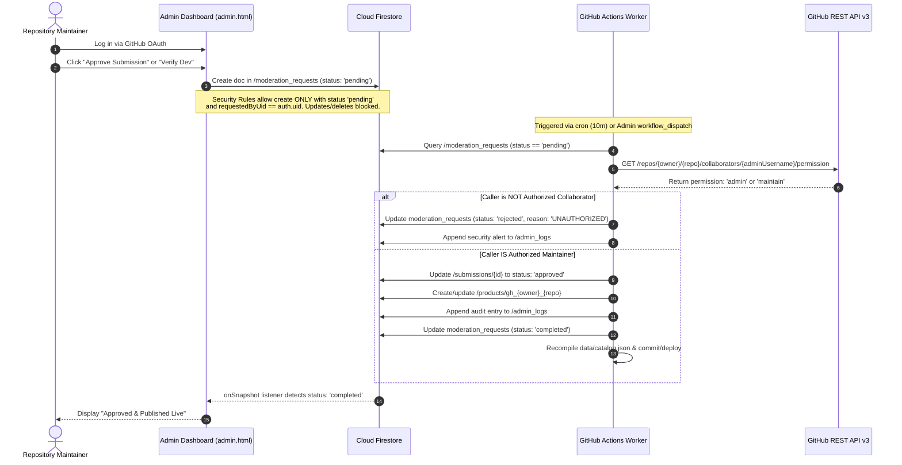

# GitStore — Security Architecture & Threat Model

**Document Version:** 1.1.0  
**Phase:** Phase 0.1 — Architecture Audit, Hardening & Final Validation  
**Status:** Approved Security Specification (Hardened)  

---

## 1. Security Principles & Architecture Boundary

GitStore operates under a zero-trust model regarding client browsers. Because the application frontend is hosted statically on GitHub Pages and runs entirely on the client side, **the client runtime is treated as potentially adversarial.**

All authorization gates, role escalations, state transitions, and file verifications are enforced either cryptographically at the database layer (Cloud Firestore Security Rules) or within an authenticated, isolated server environment (GitHub Actions Runners).

---

## 2. Separation of Operational Actors & Privilege Matrix

To guarantee strict least-privilege separation without introducing third-party servers:

| Operation | Public Visitors | Authenticated Developers | Administrators | GitHub Actions Worker (`firebase-admin`) |
|---|---|---|---|---|
| **Browse Static Storefront** | Read `data/catalog.json` | Read `data/catalog.json` | Read `data/catalog.json` | Generates & deploys static files |
| **Read Active Products** | Public read (Firestore) | Public read (Firestore) | Public read (Firestore) | Superuser Read/Write |
| **Submit New Application** | ❌ Forbidden | ✅ Create `/submissions` (`status: queued`) | ✅ Create `/submissions` | Superuser Ingestion from Issues |
| **Edit Existing Submission** | ❌ Forbidden | ✅ Own submissions only (if `queued`/`rejected`) | ❌ Enqueues via `moderation_requests` | Superuser Read/Write |
| **Claim Processing Lease** | ❌ Forbidden | ❌ Forbidden | ❌ Forbidden | ✅ Transactional superuser claim |
| **Verify Repository & Asset**| ❌ Forbidden | ❌ Client assertion only | ❌ Client assertion only | ✅ Authoritative GitHub REST API checks |
| **Approve / Publish Product** | ❌ Forbidden | ❌ Forbidden | ❌ Enqueues via `moderation_requests` | ✅ Authoritative state transition |
| **Grant Developer Verification** | ❌ Forbidden | ❌ Forbidden | ❌ Enqueues via `moderation_requests` | ✅ Sets `isVerifiedDeveloper: true` |
| **Write to `admin_logs`** | ❌ Forbidden | ❌ Forbidden | ❌ Forbidden | ✅ Immutable append-only write |
| **Delist Live Product** | ❌ Forbidden | ❌ Forbidden | ❌ Enqueues via `moderation_requests` | ✅ Transitions product to `delisted` |

---

## 3. Audited Administrator Security Workflow

Without Cloud Functions or custom backend servers, browser clients must **never** receive Firebase Admin SDK credentials, and frontend JavaScript must **never** assign custom claims or directly update privileged fields.

### Steps in the Privileged Flow:
1. **Initiation:** The admin initiates an action in the Admin Dashboard (`admin.html`).
2. **Authentication & Ingestion:** The client writes to `/moderation_requests/{requestId}` with `requestedByUid: auth.uid`, `requestedByGithubUsername: profile.githubUsername`, and `status: 'pending'`.
3. **Receipt in Actions:** The GitHub Actions worker queries `/moderation_requests` for pending actions.
4. **Authoritative Authorization Check:** The worker uses `GITHUB_TOKEN` to call GitHub REST API:
   `GET /repos/{owner}/{repo}/collaborators/{requestedByGithubUsername}/permission`
   The caller must have `admin` or `maintain` repository permission.
5. **Privileged Mutation:** Using `firebase-admin`, the worker updates the target document (`submissions`, `users`, or `products`).
6. **Immutable Audit Logging:** The worker writes an immutable record to `/admin_logs` capturing the admin’s GitHub username, UID, action, target ID, and timestamp.
7. **Client Feedback:** The dashboard listens via `onSnapshot` and updates in real-time when the request transitions to `completed`.

---

## 4. Threat Modeling & Hardened Defenses

### 4.1 Privilege Escalation (Self-Admin / Self-Verification)
- **Threat:** An authenticated developer uses browser DevTools to patch their user document: `{ isVerifiedDeveloper: true, isAdmin: true }`.
- **Hardened Defense:**
  - Client-side Firestore Security Rules strictly forbid modifying these fields on `update` and enforce `false` on `create`.
  - The worker only assigns verification status after verifying administrator permission via GitHub's API.

### 4.2 Repository Hijacking via Issue Forms
- **Threat:** An attacker opens a GitHub issue claiming ownership of a popular repository (`https://github.com/facebook/react`) to deploy modified malicious download links.
- **Hardened Defense:**
  - The worker cross-references the issue author (`issue.user.login`) against the target repository:
    1. Direct repository owner match.
    2. Public organization membership check via `GET /orgs/{org}/public_members/{user}`.
    3. Merged commit history check via `GET /repos/{owner}/{repo}/commits?author={user}`.
  - If all three checks fail, the submission is categorized as `community_nomination` and **cannot auto-publish under any circumstances**. It is permanently held for manual admin review.

### 4.3 Malicious Binary Distribution & Legal Non-Execution
- **Threat:** An attacker uploads malware to their own GitHub repository and lists it on GitStore.
- **Hardened Defense:**
  - **Non-Execution:** GitStore never executes or runs sandboxed binaries. Automated validation checks HTTP headers, file extensions, and sizes only.
  - **Mandatory Review Gate:** Unverified developers cannot auto-publish. An administrator must inspect their public repository and release notes.
  - **Legal Disclaimer:** Every download card and detail page displays an explicit disclaimer:
    > "GitStore provides discovery and metadata verification only. GitStore does NOT execute, sandbox, or certify compiled binaries. Downloads are served directly from the author's public GitHub repository. Verify software source and run appropriate local anti-malware tools prior to running executables."

---

## 5. Firebase App Check Reality & Limitations

GitStore configures **Firebase App Check** with **reCAPTCHA v3** to enforce origin validation on web traffic:

1. **Attestation:** The web client acquires a reCAPTCHA v3 token and passes it to Cloud Firestore via the `X-Firebase-AppCheck` header.
2. **Quota Advantage:** Standard reCAPTCHA v3 provides up to **1,000,000 verifications/month for free**, avoiding the billing overages of reCAPTCHA Enterprise on the Spark plan.
3. **Realistic Security Boundaries:**
   > [!WARNING]
   > App Check verifies the origin of browser requests; it does **not** authenticate user intent. A malicious user who has authenticated with GitHub can open browser DevTools and execute arbitrary permitted Firestore queries. Therefore, **Firestore Security Rules remain the primary security enforcement boundary.**
