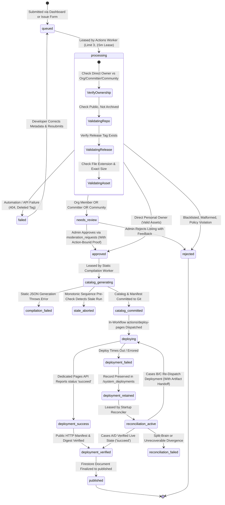
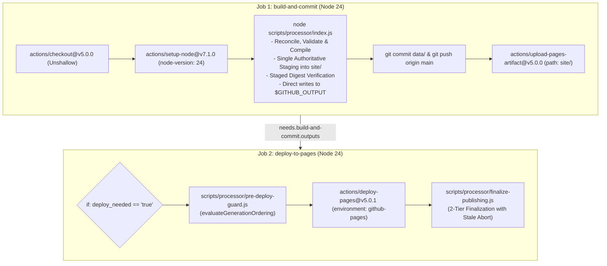

# GitStore — Submission Pipeline & Batch Processing Engine

**Document Version:** 1.9.0  
**Phase:** Phase 0.1.8 — Node 24 Workflow Compatibility, Artifact Provenance & Transactional Deployment Integrity  
**Status:** IN_REVIEW — Awaiting Explicit User Approval  
**Execution Engine:** GitHub Actions (`.github/workflows/batch-processor.yml`)

---

## 1. Overview & Core Invariants

The GitStore Submission Pipeline is the ingestion, verification, and static publishing engine of the platform. It bridges developer submissions with storefront delivery under strict security, eventual consistency, and zero-cost constraints.

### Guiding Pipeline Invariants
1. **Globally Unique Entity Decoupling:** Multiple independent software products can originate from a single GitHub repository. Products are identified by `prod_{repoNumericId}_{productSlug}` and repositories by `gh_repo_{repoNumericId}`. Collisions across repositories with identical product slugs are mathematically impossible.
2. **Unified Ingestion Without Fake Accounts & Complete Field Integrity:** Submissions from the Developer Dashboard and GitHub Issue Forms feed the same queue. Issue form submitters do **not** receive placeholder Firebase accounts; their submissions are stored with `submitterGithubId` and `claimStatus: 'unclaimed'`. On the dashboard, client creation is strictly whitelisted to developer payload fields; worker-managed fields (`validationResults`, `ownershipProof`, `processingLease`, `adminNotes`, `reviewedBy`, `reviewedAt`, `publishedProductId`) are excluded from client create allowlists and initialized solely by trusted workers via Admin SDK.
3. **Rigorous Ownership & Authority Tiers:** Only Direct Personal Repository Owners (`repo.owner.id == submitter.githubId`) possess inherent release authority to qualify for automated publication. Organization members, committers, and community nominators lack proven release authority and are strictly gated to manual administrator review (`needs_review`).
4. **Distinction of Verified Developer Status:** Personal repository ownership does **not** automatically award the platform "Verified Developer" badge. Auto-published products from unverified personal owners carry standard community attribution.
5. **Formal 12-State Recoverable Deployment State Machine & Dedicated Pages Status (`succeed`):** Consistency between GitHub Pages and Cloud Firestore is governed by a formal 12-state state machine. The publication manifest (`data/deployment-manifest.json`) records `generatedAt` and a deterministic SHA-256 `catalogDigest` (computed over canonicalized catalog files, excluding manifest), strictly omitting circular commit SHAs. Pages deployment status is verified using the dedicated official endpoint `GET /repos/{owner}/{repo}/pages/deployments/{pages_deployment_id}` checking for the documented success status `"status": "succeed"`.
6. **Node 24 Workflow Compatibility & Single Authoritative Staging:** All Actions in the batch pipeline execute on Node 24-compatible runtimes (`actions/checkout@v5.0.0`, `actions/setup-node@v7.1.0`, `actions/upload-pages-artifact@v5.0.0`, `actions/deploy-pages@v5.0.1`) pinned to 40-character commit SHAs. Staging into `site/` is single and authoritative: assets are constructed strictly from the target commit, verified via `stagedDigest === catalogDigest`, and protected from subsequent workspace copies.
7. **Explicit `$GITHUB_OUTPUT` Bridge:** Step outputs are exported via direct append writes to `$GITHUB_OUTPUT` with newline injection defenses. All 6 parameters (`deploy_needed`, `generation_id`, `generation_sequence`, `catalog_commit_sha`, `catalog_digest`, `captured_revision`) are transferred explicitly across jobs via `needs.build-and-commit.outputs`.
8. **Transactional Generation Ordering & 2-Tier Finalization:** When finalizing deployment state, the worker executes an atomic transaction reading current `/system_config/catalog_state`, `/system_config/deployment_state`, and `/system_deployments/{generationId}` BEFORE any writes. Inside the transaction, it evaluates `evaluateGenerationOrdering` and revision monotonicity. Stale generations abort immediately (`stale_aborted`). To respect the 500-write Firestore limit, finalization uses a 2-tier architecture: the 3-write atomic transaction establishes the global publication anchor, followed by idempotent batched writes (max 400 docs/batch) to fan out published statuses to submissions.
9. **Granular Commit Recovery Error Classification:** The fallback commit recovery loop on the GitHub Commits API traverses all pages via `Link: rel="next"`, validates commit SHA formats (`/^[0-9a-f]{40}$/i`), and classifies candidate lookups: distinguishing benign missing manifests (`CANDIDATE_NO_MANIFEST`) from rate limits/timeouts (`INCOMPLETE_SEARCH`). An `EMPTY_SEARCH` is declared only when all commits are exhaustively checked with zero interruptions.

---

## 2. Recoverable 12-State Submission & Deployment State Machine



---

## 3. Ingestion Channels & Complete Field Integrity

### Channel A: Developer Web Dashboard
- Authenticated via GitHub OAuth (`auth.uid` + verified numeric GitHub ID in `providerData`).
- Document created directly in `/submissions/{submissionId}` with `claimStatus: 'claimed'` and `developerUid: auth.uid`.
- **Field Whitelisting:** Client can ONLY provide `id`, `developerUid`, `submissionSource`, `repoNumericId`, `repoId`, `targetProductId`, `productData`, `status`, `claimStatus`, `createdAt`, `updatedAt`.
- **Worker-Managed Exclusion:** Client create requests attempting to supply `validationResults`, `ownershipProof`, `processingLease`, `adminNotes`, `reviewedBy`, `reviewedAt`, or `publishedProductId` are rejected by Security Rules. Trusted workers initialize these fields via Admin SDK.

### Channel B: GitHub Issue Forms
- Author identity: `issue.user.id` (numeric string) and `issue.user.login` from trusted GitHub webhook payload.
- **Zero Fake Accounts:** Worker registers submission with `developerUid: null`, `submitterGithubId: issue.user.id`, and `claimStatus: 'unclaimed'`.
- Document ID: `sub_issue_{repoNumericId}_{issueNumber}`.

### 3.1 Secure Asynchronous Claiming Flow (`/claim_requests`)
1. Developer authenticates on GitStore via GitHub OAuth.
2. Developer initiates claim on `dashboard.html`.
3. Client writes to `/claim_requests/{requestId}`:
   ```typescript
   {
     requestId: string;
     requesterUid: string;          // request.auth.uid
     targetSubmissionId: string;
     status: 'pending';
     createdAt: serverTimestamp();
   }
   ```
4. Worker verifies ownership matching author GitHub numeric ID and updates submission atomically.

---

## 4. Single Authoritative Staging & Case B Provenance

In both normal catalog compilation and Case B recovery:
1. `site/` is completely purged: `rm -rf site/ && mkdir -p site/data site/assets`.
2. Static storefront pages (`index.html`, `admin.html`, `dashboard.html`, `product.html`, `explore.html`, `submit.html`), `assets/`, and compiled `data/` are staged directly into `site/`. In Case B recovery, assets are extracted directly from the verified source commit via `git archive ${catalogCommitSha} ... | tar -x -C site/`.
3. The catalog digest is computed directly over the staged directory: `stagedDigest = computeCatalogDigest('site')`.
4. Staged digest is asserted: `stagedDigest === gen.catalogDigest`. Mismatch triggers immediate deletion of `site/` and workflow abort.
5. Zero subsequent workflow steps copy files from the workspace root into `site/`, preserving artifact provenance intact.

---

## 5. Least-Privilege Split-Job Pages Workflow (Node 24)



### 5.1 Output Bridge Specification
The processor writes outputs to `$GITHUB_OUTPUT`:
- `deploy_needed`: `'true'` or `'false'`
- `generation_id`: string e.g. `gen_1730635200000_a1b2c3d4`
- `generation_sequence`: integer string e.g. `42`
- `catalog_commit_sha`: 40-character hex string
- `catalog_digest`: string format `sha256:v1:...`
- `captured_revision`: integer string e.g. `15`

### 5.2 2-Tier Finalization Architecture
1. **Tier 1 (Atomic Global State Anchor):** `db.runTransaction` reads `/system_config/catalog_state`, `/system_config/deployment_state`, and `/system_deployments/{generationId}`. Evaluates `evaluateGenerationOrdering` and revision monotonicity. Performs exactly 3 writes, establishing the canonical publication state atomically.
2. **Tier 2 (Idempotent Status Fan-Out):** Batched writes (`db.batch()`, max 400 documents per batch) update associated submission records to `status: 'published'`. If interrupted, the startup reconciler safely resumes status updates without modifying the global publication sequence.

---

## 6. Commit Recovery Granular Error Classification

During startup commit recovery, candidate commit inspections on the GitHub Commits API distinguish benign candidate mismatches from critical search interruptions:

| Event / Error | HTTP Status | Classification | Operational Behavior |
|---|---|---|---|
| Manifest file not in commit | `404 Not Found` | `CANDIDATE_NO_MANIFEST` | Normal for non-catalog commits. Continue inspecting next candidate. |
| Manifest blob unparseable | `200 OK` (bad JSON) | `CANDIDATE_MANIFEST_CORRUPT` | Log warning. Continue inspecting next candidate. |
| Manifest generation mismatch | `200 OK` (diff ID) | `CANDIDATE_GENERATION_MISMATCH` | Continue inspecting next candidate. |
| Secondary rate limit / abuse | `403 Forbidden` / `429` | `API_RATE_LIMIT` | **Search Incomplete.** Retain generation as `pending_retry`. Do not declare empty. |
| Upstream timeout / 5xx | `500` / `502` / `503` | `API_SERVER_ERROR` | **Search Incomplete.** Retain generation as `pending_retry`. Do not declare empty. |
| Authentication failure | `401 Unauthorized` | `API_AUTH_ERROR` | Fatal configuration error. Halt batch worker immediately. |
| All pages checked, 0 match | Complete pagination | `EMPTY_SEARCH` | Declared **ONLY** when search completes with zero interruptions. Mark `abandoned`. |

---

## 7. Operational Failure Scenarios & Self-Healing Behaviors

The pipeline handles 11 distinct operational failure scenarios:

1. **GitHub API Outage During Release Asset Inspection:** Processing lease times out after 15 minutes; submission returned to `queued` for retry.
2. **Commit Succeeded but Runner Crashed Before Firestore Save:** Startup reconciler searches Git history via unshallow fetch and Commits API pagination loop, matches `catalogDigest`, and recovers commit SHA.
3. **Commit Pushed to Remote but Pages Deployment Never Dispatched (Case B):** Reconciler executes clean staging into `site/` from target commit, verifies `stagedDigest`, exports `deploy_needed=true` to `$GITHUB_OUTPUT`, Job 1 uploads artifact, and Job 2 deploys to Pages.
4. **Remote Pages Deployment Fails (`errored`):** Reconciler retries deployment up to 3 times before preserving in `/system_deployments` for administrator review.
5. **CDN Serves Stale Manifest:** Bounded polling loop with cache-busting queries (`?t=${Date.now()}`) verifies CDN state before finalization.
6. **Concurrent Admin Approvals During Compilation:** Monotonic revision counter increments in `/system_config/catalog_state`. Transaction detects `isDirty = true` and triggers follow-up compilation.
7. **Stale Deployment Attempting to Overwrite Newer State:** Shared ordering function (`evaluateGenerationOrdering`) evaluates candidate sequence against `latestPublishedSequence` and rejects stale runs (`REJECT_STALE`) at pre-deploy guard and in finalization transaction (`stale_aborted`).
8. **Compromised Client Attempting Privilege Escalation on Submission:** Security Rules reject any create request containing worker-managed fields (`keys().hasOnly(...)`).
9. **Step-Up Nonce Replay Across Different Moderation Requests:** Transaction atomically checks `/consumed_stepup_nonces/{nonceHash}` and rejects duplicate nonces with `NONCE_ALREADY_CONSUMED`.
10. **Secondary Rate Limit During Commit Discovery:** Reconciler classifies search as `INCOMPLETE_SEARCH` and retains generation in `pending_retry` rather than erroneously abandoning it.
11. **Large Generation Exceeding Firestore 500-Write Limit:** 2-tier finalization commits global publication anchor in 3 writes, fanning out submission statuses in batches of 400.
