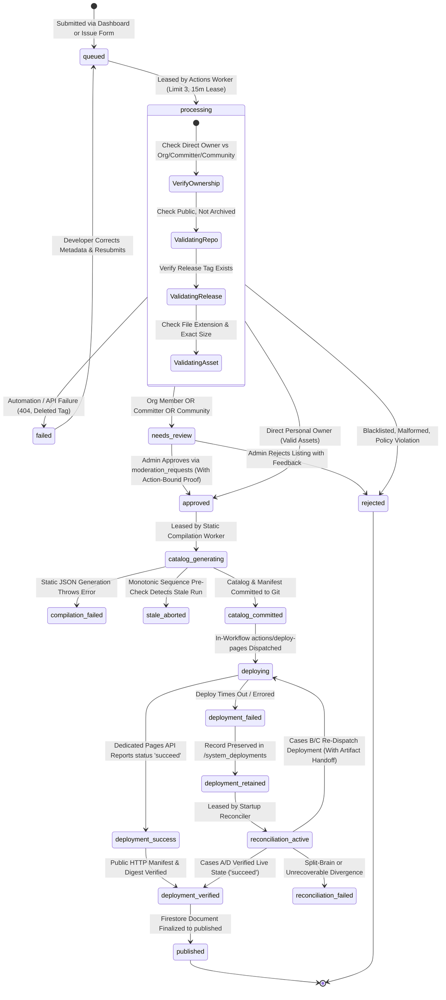
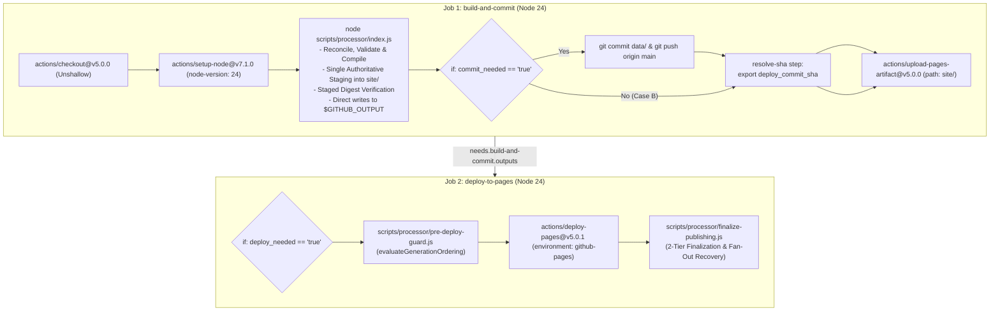

# GitStore — Submission Pipeline & Batch Processing Engine

**Document Version:** 1.9.0  
**Phase:** Phase 0.1.9 — Workflow Validation, Recovery SHA Preservation & Durable Finalization Recovery  
**Status:** IN_REVIEW — Awaiting Explicit User Approval  
**Execution Engine:** GitHub Actions (`.github/workflows/batch-processor.yml`)

---

## 1. Overview & Core Invariants

The GitStore Submission Pipeline is the ingestion, verification, and static publishing engine of the platform. It bridges developer submissions with storefront delivery under strict security, eventual consistency, and zero-cost constraints.

### Guiding Pipeline Invariants
1. **Globally Unique Entity Decoupling:** Multiple independent software products can originate from a single GitHub repository. Products are identified by `prod_{repoNumericId}_{productSlug}` and repositories by `gh_repo_{repoNumericId}`. Collisions across repositories with identical product slugs are mathematically impossible.
2. **Unified Ingestion Without Fake Accounts & Complete Field Integrity:** Submissions from the Developer Dashboard and GitHub Issue Forms feed the same queue. Issue form submitters do **not** receive placeholder Firebase accounts; their submissions are stored with `submitterGithubId` and `claimStatus: 'unclaimed'`. On the dashboard, client creation is strictly whitelisted to developer payload fields; worker-managed fields (`validationResults`, `ownershipProof`, `processingLease`, `adminNotes`, `reviewedBy`, `reviewedAt`, `publishedProductId`) are excluded from client create allowlists and initialized solely by trusted workers via Admin SDK.
3. **Rigorous Ownership & Authority Tiers:** Only Direct Personal Repository Owners (`repo.owner.id == submitter.githubId`) possess inherent release authority to qualify for automated publication. Organization members, committers, and community nominators lack proven release authority and are strictly gated to manual administrator review (`needs_review`).
4. **Distinction of Verified Developer Status:** Personal repository ownership does **not** automatically award the platform "Verified Developer" badge. Auto-published products from unverified personal owners carry standard community attribution.
5. **Formal 12-State Recoverable Deployment State Machine & Dedicated Pages Status (`succeed`):** Consistency between GitHub Pages and Cloud Firestore is governed by a formal 12-state state machine. The publication manifest (`data/deployment-manifest.json`) records `generatedAt` and a deterministic SHA-256 `catalogDigest` (computed over canonicalized catalog files, excluding manifest), strictly omitting circular commit SHAs. Pages deployment status is verified using the dedicated official endpoint `GET /repos/{owner}/{repo}/pages/deployments/{pages_deployment_id}` checking for the documented success status `"status": "succeed"`.
6. **Node 24 Workflow Compatibility & Single Authoritative Staging:** All Actions in the batch pipeline execute on Node 24-compatible runtimes (`actions/checkout@v5.0.0`, `actions/setup-node@v7.1.0`, `actions/upload-pages-artifact@v5.0.0`, `actions/deploy-pages@v5.0.1`) pinned to 40-character commit SHAs. Staging into `site/` is single and authoritative: assets are constructed strictly from the target commit, verified via `stagedDigest === catalogDigest`, and protected from subsequent workspace copies.
7. **Explicit `$GITHUB_OUTPUT` Bridge:** Step outputs are exported via direct append writes to `$GITHUB_OUTPUT` with newline injection defenses. All 6 parameters (`deploy_needed`, `generation_id`, `generation_sequence`, `catalog_commit_sha`, `catalog_digest`, `captured_revision`) are transferred explicitly across jobs via `needs.build-and-commit.outputs`.
8. **Transactional Generation Ordering, Bounded Subcollections & Conditional Monotonic Fan-Out:** When finalizing deployment state, the worker executes an atomic transaction reading current `/system_config/catalog_state`, `/system_config/deployment_state`, and `/system_deployments/{generationId}` BEFORE any writes. Inside the transaction, it evaluates `evaluateGenerationOrdering` and revision monotonicity. Stale generations abort immediately (`stale_aborted`). To strictly respect Firestore's 1 MiB document limit and 500-write limits, finalization uses a 2-tier architecture: the 3-write atomic transaction establishes the global publication anchor, while submission fan-out work is stored in bounded deterministic subcollections (`/system_deployments/{generationId}/fanout_batches/{batchId}`) capped at 400 IDs each (~13 KB << 1 MiB). Parent documents store only $O(1)$ scalar summary counters. Submission status fan-out executes conditional transactional updates verifying status eligibility (`approved` only; never resurrecting `rejected`, `delisted`, or `withdrawn` submissions) and strictly monotonic generation advancement (`publishedGenerationSequence`), preventing stale fan-out overwrites across all concurrency interleavings.
9. **Granular Commit Recovery Error Classification & Corrupt Manifest Quarantine:** The fallback commit recovery loop on the GitHub Commits & Contents API traverses all pages via `Link: rel="next"`, validates commit SHA formats (`/^[0-9a-f]{40}$/i`), and explicitly classifies errors: strictly treating confirmed HTTP 404 as benign missing manifests (`CANDIDATE_NO_MANIFEST`). All 401 auth failures, 403/429 rate limits, 5xx server errors, network timeouts, and connection resets are classified as incomplete/fatal search interruptions, preserving the generation in `pending_retry`. Malformed JSON is quarantined as `CANDIDATE_CORRUPT_MANIFEST` (`hasCorruptCandidates = true`). An `EMPTY_SEARCH` is declared ONLY when all commits are exhaustively checked with zero errors, zero network interruptions, and zero corrupt manifests.

---

## 2. Recoverable 12-State Submission & Deployment State Machine



---

## 3. Ingestion Channels & Complete Field Integrity

### Channel A: Developer Web Dashboard
- Authenticated via GitHub OAuth (`auth.uid` + verified numeric GitHub ID in `providerData`).
- Document created directly in `/submissions/{submissionId}` with `claimStatus: 'claimed'` and `developerUid: auth.uid`.
- **Field Whitelisting:** Client can ONLY provide `id`, `developerUid`, `submissionSource`, `repoNumericId`, `repoId`, `targetProductId`, `productData`, `status`, `claimStatus`, `createdAt`, `updatedAt`.
- **Worker-Managed Exclusion:** Client create requests attempting to supply `validationResults`, `ownershipProof`, `processingLease`, `adminNotes`, `reviewedBy`, `reviewedAt`, or `publishedProductId` are rejected by Security Rules. Trusted workers initialize these fields via Admin SDK.

### Channel B: GitHub Issue Forms
- Author identity: `issue.user.id` (numeric string) and `issue.user.login` from trusted GitHub webhook payload.
- **Zero Fake Accounts:** Worker registers submission with `developerUid: null`, `submitterGithubId: issue.user.id`, and `claimStatus: 'unclaimed'`.
- Document ID: `sub_issue_{repoNumericId}_{issueNumber}`.

### 3.1 Secure Asynchronous Claiming Flow (`/claim_requests`)
1. Developer authenticates on GitStore via GitHub OAuth.
2. Developer initiates claim on `dashboard.html`.
3. Client writes to `/claim_requests/{requestId}`:
   ```typescript
   {
     requestId: string;
     requesterUid: string;          // request.auth.uid
     targetSubmissionId: string;
     status: 'pending';
     createdAt: serverTimestamp();
   }
   ```
4. Worker verifies ownership matching author GitHub numeric ID and updates submission atomically.

---

## 4. Single Authoritative Staging & Case B Provenance

In both normal catalog compilation and Case B recovery:
1. `site/` is completely purged: `rm -rf site/ && mkdir -p site/data site/assets`.
2. Static storefront pages (`index.html`, `admin.html`, `dashboard.html`, `product.html`, `explore.html`, `submit.html`), `assets/`, and compiled `data/` are staged directly into `site/`. In Case B recovery, assets are extracted directly from the verified source commit via `git archive ${catalogCommitSha} ... | tar -x -C site/`.
3. The catalog digest is computed directly over the staged directory: `stagedDigest = computeCatalogDigest('site/data')`.
4. Staged digest is asserted: `stagedDigest === gen.catalogDigest`. Mismatch triggers immediate deletion of `site/` and workflow abort.
5. Zero subsequent workflow steps copy files from the workspace root into `site/`, preserving artifact provenance intact.

---

## 5. Least-Privilege Split-Job Pages Workflow (Node 24)



### 5.1 Output Bridge Specification
The processor writes outputs to `$GITHUB_OUTPUT`:
- `commit_needed`: `'true'` if fresh catalog files need committing; `'false'` for Case B recovery or clean state
- `deploy_needed`: `'true'` if a fresh Pages deployment is required; `'false'` otherwise
- `generation_id`: string e.g. `gen_1730635200000_a1b2c3d4`
- `generation_sequence`: integer string e.g. `42`
- `catalog_commit_sha`: 40-character hex string (new commit SHA or preserved Case B recovered SHA)
- `catalog_digest`: string format `sha256:v1:...`
- `captured_revision`: integer string e.g. `15`

### 5.2 2-Tier Finalization, Bounded Subcollections & Conditional Monotonic Fan-Out Architecture
1. **Tier 1 (Atomic Global State Anchor):** `db.runTransaction` reads `/system_config/catalog_state`, `/system_config/deployment_state`, and `/system_deployments/{generationId}`. Evaluates `evaluateGenerationOrdering` and revision monotonicity. Performs exactly 3 writes: advances `deployment_state`, advances `catalog_state`, and marks `system_deployments` record `status: 'published'`, `reconciliationStatus: 'fanout_pending'`, `submissionFanoutStatus: 'pending'`, `completedSubmissionCount: 0`, `completedFanoutBatches: 0`.
2. **Tier 2 (Bounded Subcollections & Conditional Monotonic Fan-Out):**
   - **Bounded Storage Schema:** Work is partitioned into subcollection `/system_deployments/{generationId}/fanout_batches/{batchId}` capped at 400 IDs each (~13 KB << 1 MiB limit). Parent document stores only $O(1)$ scalar summary counters (`expectedSubmissionCount`, `completedSubmissionCount`, `submissionFanoutStatus`, `totalFanoutBatches`, `completedFanoutBatches`, `fanoutAttempts`, `lastFanoutError`).
   - **Conditional Transactional Mini-Chunks:** Within each batch, submissions are processed in transactional mini-chunks of 50 documents (`db.runTransaction()`).
   - **Status Eligibility Guard:** The transaction inspects `sub.status`. Only submissions in `approved` or `published` status are updated. If a submission was rejected, delisted, or withdrawn by an admin or developer, the update is skipped (`skipped_status_ineligible`), preventing resurrection of inactive records.
   - **Monotonic Generation Sequence Advance:** The transaction evaluates `genData.generationSequence > (currentSub.publishedGenerationSequence || 0)`. If a newer generation already published the submission, the update is skipped (`skipped_stale_generation`), preserving newer state. If sequences match, it is treated as an idempotent replay (`already_completed`).
   - **Audit Provenance:** On valid updates, writes `status: 'published'`, `publishedGenerationId: genData.generationId`, `publishedGenerationSequence: genData.generationSequence`, `publishedProductId: prodId`, and clears `processingLease.leaseHolder`.
   - **Resumption & Manual Review:** If interrupted by a crash, the reconciler discovers the generation via `status == 'published' && submissionFanoutStatus in ['pending', 'in_progress', 'partial']` and resumes remaining batches. After 5 failed attempts on any batch, transitions to `manual_review` and writes an alert to `/admin_logs`.

#### 5.2.1 Concurrency Resolution Invariants (9 Concurrency Scenarios)
1. **A and B fan-out simultaneously:** Optimistic transactions serialize document writes. If B (sequence 11) commits first, A (sequence 10) retries, detects sequence 11 > 10, and aborts update. If A commits first, B reads sequence 10, detects 11 > 10, and commits sequence 11. B always wins monotonically.
2. **A resumes after B has completed:** A reads `publishedGenerationSequence == 11` > 10, skips all touched documents as stale. B's state is preserved.
3. **A resumes after B published but before B completes fan-out:** For submissions B touched, A skips ($10 < 11$). For submissions B has not touched yet, A updates to 10; when B reaches them later, B updates $11 > 10$. B ultimately wins.
4. **Admin rejects a submission after A captured its revision:** In Firestore, `sub.status` is `'rejected'`. A's fan-out transaction reads status, fails status eligibility guard, and skips the submission. Rejection is preserved.
5. **Admin delists a product during A's deployment:** `sub.status` is `'delisted'`. A's fan-out transaction fails status eligibility guard, skipping update. Product remains delisted.
6. **Worker crashes after a batch commits:** Batches commit atomically. Upon restart, reconciler resumes batch; submissions already updated evaluate `already_completed` (no-op), and remaining records commit cleanly.
7. **Worker crashes before cursor / batch completion write:** Re-running the batch evaluates each document idempotently. Zero duplicate increments.
8. **Duplicate fan-out worker execution:** Multiple runners process batches concurrently. Idempotent transactions ensure exact state convergence with zero conflicting writes.
9. **Submission already associated with newer published generation:** Monotonic guard detects $S_{current} > S_{incoming}$ and rejects stale update.

---

## 6. Commit Recovery Granular Error Classification

During startup commit recovery, candidate commit inspections on the GitHub Commits & Contents API distinguish benign candidate mismatches from critical search interruptions and manifest corruptions:

| Event / Error | HTTP Status / Exception | Classification | Operational Behavior |
|---|---|---|---|
| Manifest file not in candidate commit | `404 Not Found` | `CANDIDATE_NO_MANIFEST` | **Benign candidate skip.** Normal for non-catalog commits. Continue inspecting next candidate. |
| Authentication failure / invalid token | `401 Unauthorized` | `API_AUTH_ERROR` | **Fatal error.** Abort commit scan immediately. Retain generation in `pending_retry`. Alert admin. |
| Permissions error or abuse rate limit | `403 Forbidden` | `API_PERMISSION_OR_RATE_LIMIT` | **Search Incomplete.** Retain generation in `pending_retry`. Do not declare empty. |
| Primary API rate limit reached | `429 Too Many Requests` | `API_RATE_LIMIT` | **Search Incomplete.** Retain generation in `pending_retry`. Do not declare empty. |
| Upstream gateway / server error | `500` / `502` / `503` / `504` | `API_SERVER_ERROR` | **Search Incomplete.** Retain generation in `pending_retry`. Do not declare empty. |
| Network timeout / connection reset | `ETIMEDOUT` / `ECONNRESET` | `NETWORK_ERROR` | **Search Incomplete.** Retain generation in `pending_retry`. Do not declare empty. |
| Malformed JSON / parsing failure | `SyntaxError` (invalid JSON) | `CANDIDATE_CORRUPT_MANIFEST` | **Corrupt candidate.** Set `hasCorruptCandidates = true`. Route to `manual_review` if no match. |
| Missing payload content | `fileContentRes.data.content == null` | `API_MALFORMED_RESPONSE` | **Search Incomplete.** Retain generation in `pending_retry` or route to `manual_review`. |
| Complete scan with 0 matches & 0 errors | All pages inspected cleanly | `EMPTY_SEARCH` | Declared **ONLY** when search completes with zero network/API interruptions and zero corrupt candidates. Mark `abandoned`. |

---

## 7. Operational Failure Scenarios & Self-Healing Behaviors

The pipeline handles 12 distinct operational failure scenarios:

1. **GitHub API Outage During Release Asset Inspection:** Processing lease times out after 15 minutes; submission returned to `queued` for retry.
2. **Commit Succeeded but Runner Crashed Before Firestore Save:** Startup reconciler searches Git history via unshallow fetch and Commits API pagination loop, matches `catalogDigest`, and recovers commit SHA.
3. **Commit Pushed to Remote but Pages Deployment Never Dispatched (Case B):** Reconciler executes clean staging into `site/` from target commit, verifies `stagedDigest`, exports `deploy_needed=true` to `$GITHUB_OUTPUT`, Job 1 uploads artifact, and Job 2 deploys to Pages.
4. **Remote Pages Deployment Fails (`errored`):** Reconciler retries deployment up to 3 times before preserving in `/system_deployments` for administrator review.
5. **CDN Serves Stale Manifest:** Bounded polling loop with cache-busting queries (`?t=${Date.now()}`) verifies CDN state before finalization.
6. **Concurrent Admin Approvals During Compilation:** Monotonic revision counter increments in `/system_config/catalog_state`. Transaction detects `isDirty = true` and triggers follow-up compilation.
7. **Stale Deployment Attempting to Overwrite Newer State:** Shared ordering function (`evaluateGenerationOrdering`) evaluates candidate sequence against `latestPublishedSequence` and rejects stale runs (`REJECT_STALE`) at pre-deploy guard and in finalization transaction (`stale_aborted`).
8. **Stale Submission Fan-Out Attempting to Overwrite Newer Publication State:** Conditional transaction checks `publishedGenerationSequence` and skips stale updates, preserving newer generation state and admin moderation decisions.
9. **Compromised Client Attempting Privilege Escalation on Submission:** Security Rules reject any create request containing worker-managed fields (`keys().hasOnly(...)`) and enforce deep structural validation on `productData`.
10. **Step-Up Nonce Replay Across Different Moderation Requests:** Transaction atomically checks `/consumed_stepup_nonces/{nonceHash}` and rejects duplicate nonces with `NONCE_ALREADY_CONSUMED`.
11. **Secondary Rate Limit During Commit Discovery:** Reconciler classifies search as `INCOMPLETE_SEARCH` and retains generation in `pending_retry` rather than erroneously abandoning it.
12. **Large Generation Exceeding Firestore 500-Write Limit:** 2-tier finalization commits global publication anchor in 3 writes, partitioning submission fan-out work into bounded subcollections of 400 documents processed in transactional mini-chunks of 50.
