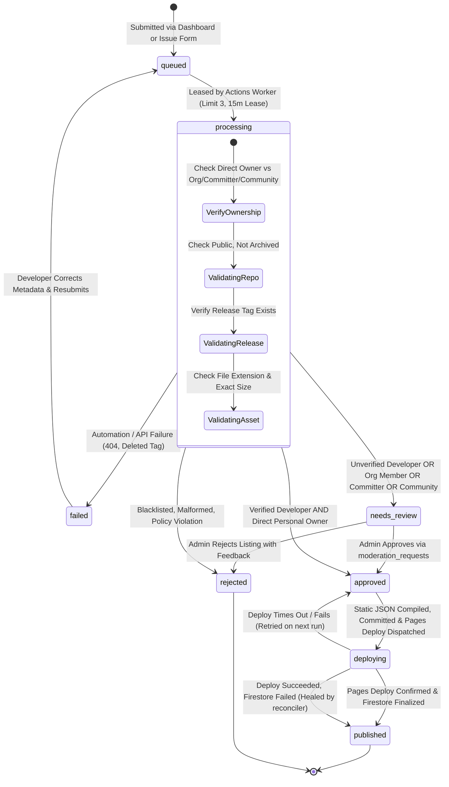
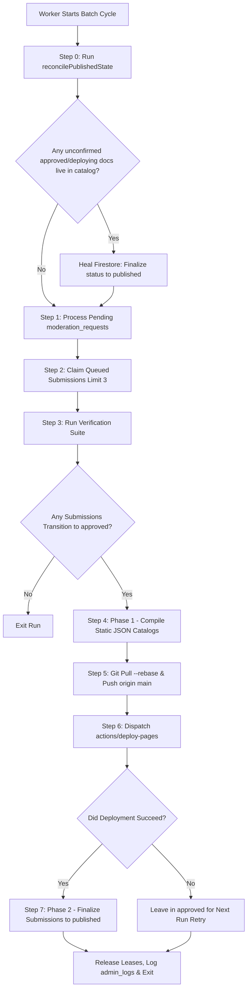

# GitStore — Submission Pipeline & Batch Processing Engine

**Document Version:** 1.2.0  
**Phase:** Phase 0.1.1 — Critical Architecture Corrections & Hardening  
**Status:** Approved Pipeline Architecture (Corrected)  
**Execution Engine:** GitHub Actions (`.github/workflows/batch-processor.yml`)

---

## 1. Overview & Core Invariants

The GitStore Submission Pipeline is the ingestion, verification, and static publishing engine of the platform. It bridges developer submissions with storefront delivery under strict security and zero-cost constraints.

### Guiding Pipeline Invariants
1. **Multi-Product Repository Decoupling:** Multiple independent software products can originate from a single GitHub repository. Products are identified by `prod_{repoOwner}_{productSlug}` and repositories by `gh_repo_{repoOwner}_{repoName}`.
2. **Unified Ingestion Without Fake Accounts:** Submissions from the Developer Dashboard and GitHub Issue Forms feed the same queue. Issue form submitters do **not** receive placeholder Firebase accounts; their submissions are stored with `submitterGithubId` and `claimStatus: 'unclaimed'`, claimed when they log in via GitHub OAuth.
3. **Rigorous Ownership Tiers:** Only Direct Personal Repository Owners (`repo.owner.id == submitter.githubId`) qualify for automated publication (if marked verified). Org members, committers, and community nominators are strictly gated to manual administrator review (`needs_review`).
4. **Self-Healing Two-Phase Publication:** Consistency between GitHub Pages and Cloud Firestore is guaranteed via an idempotent two-phase publish sequence paired with a startup reconciliation loop (`reconcilePublishedState`).
5. **Realistic Cron Expectations:** Scheduled cron triggers on GitHub Actions are best-effort (5–30 minute delays during platform peak load). Exact 10-minute turnaround is neither promised nor required.

---

## 2. Hardened Submission State Machine



---

## 3. Ingestion Channels & Identity Linking

### Channel A: Developer Web Dashboard
- Authenticated via GitHub OAuth (`auth.uid` + verified numeric GitHub ID in `providerData`).
- Document created directly in `/submissions/{submissionId}` with `claimStatus: 'claimed'`.

### Channel B: GitHub Issue Forms
- Author identity: `issue.user.id` (numeric string) and `issue.user.login`.
- **Zero Fake Accounts:** Worker registers submission with `developerUid: null`, `submitterGithubId: issue.user.id`, and `claimStatus: 'unclaimed'`.
- **Claiming Flow:** Issue comment provides a link: `https://rohitpvt.github.io/GitStore/login.html`. When the developer logs in via GitHub OAuth, Firebase Auth matches `providerData[0].uid == submitterGithubId`, updating `developerUid` to the real Firebase UID and setting `claimStatus: 'claimed'`.

### 3.1 Ownership Verification Proof Matrix
1. **Tier 1 (Direct Personal Owner):** `repo.owner.id == submitter.githubId`. Eligible for auto-publication if developer is verified.
2. **Tier 2 (Organization Member):** `GET /orgs/{org}/public_members/{login}` returns 204. Forced to `needs_review`.
3. **Tier 3 (Committer):** `GET /repos/{owner}/{repo}/commits?author={login}` returns merged commits. Forced to `needs_review`.
4. **Tier 4 (Community Nomination):** Submitter has no commits or ownership. Forced to `needs_review`. Never eligible for auto-publication.

---

## 4. Multi-Product Entity Hierarchy

To support repositories containing multiple distributable tools:

```text
GitHub Repository: https://github.com/microsoft/sysinternals
  ├── Product 1: Process Explorer
  │     ├── Product ID: prod_microsoft_procexp
  │     ├── Slug: procexp
  │     └── Download Asset: ProcExp64.exe
  └── Product 2: Autoruns
        ├── Product ID: prod_microsoft_autoruns
        ├── Slug: autoruns
        └── Download Asset: Autoruns64.exe
```

- Submissions define `targetProductId: "prod_" + repoOwner + "_" + productSlug`.
- Re-submitting an update to an existing product updates the same document, preserving stars, view counts, and URLs.
- Different products from the same repository do not collide or overwrite each other.

---

## 5. Self-Healing Two-Phase Publication Protocol



### Full Failure Reconciliation Matrix
1. **Catalog Generation Fails:** Submission remains in `approved`; no git commit created; retried next run.
2. **Git Push Fails:** `git pull --rebase` fails; workspace reset via `git reset --hard origin/main`; retried next run.
3. **Pages Deploy Fails / Times Out:** Static files pushed, but deploy failed; submission remains in `approved`; next run re-triggers deployment.
4. **Reverse Failure (Deploy Succeeded, Firestore Failed):** Deployed catalog is live on GitHub Pages, but Firestore was not updated. **Resolved by `reconcilePublishedState()`** at the start of the next run, which inspects the live catalog and finalizes unconfirmed Firestore documents.
5. **Worker Crashes Mid-Run:** 15-minute lease expires; subsequent worker reclaims expired lease.
6. **Concurrent Workers:** Blocked by `concurrency: group: gitstore-batch-worker, cancel-in-progress: false`.
