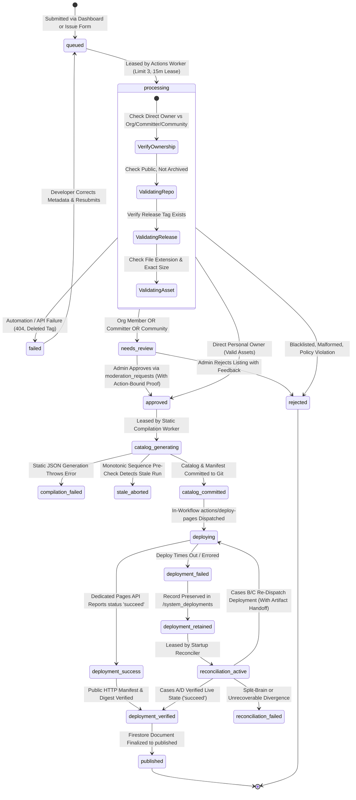
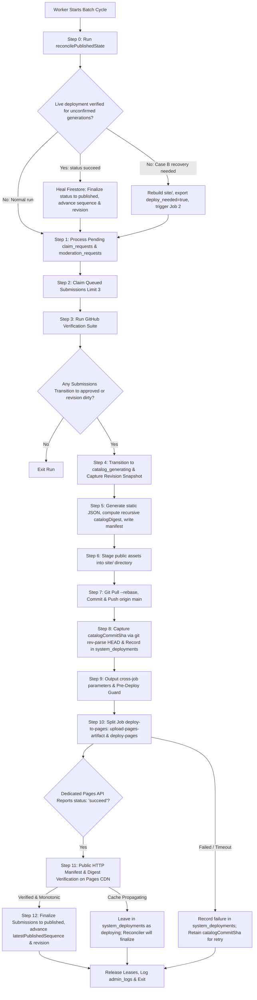

# GitStore — Submission Pipeline & Batch Processing Engine

**Document Version:** 1.8.0  
**Phase:** Phase 0.1.7 — Replay Protection, Firestore Field Integrity & Deployment State Consistency  
**Status:** IN_REVIEW — Awaiting Explicit User Approval  
**Execution Engine:** GitHub Actions (`.github/workflows/batch-processor.yml`)

---

## 1. Overview & Core Invariants

The GitStore Submission Pipeline is the ingestion, verification, and static publishing engine of the platform. It bridges developer submissions with storefront delivery under strict security, eventual consistency, and zero-cost constraints.

### Guiding Pipeline Invariants
1. **Globally Unique Entity Decoupling:** Multiple independent software products can originate from a single GitHub repository. Products are identified by `prod_{repoNumericId}_{productSlug}` and repositories by `gh_repo_{repoNumericId}`. Collisions across repositories with identical product slugs are mathematically impossible.
2. **Unified Ingestion Without Fake Accounts & Complete Field Integrity:** Submissions from the Developer Dashboard and GitHub Issue Forms feed the same queue. Issue form submitters do **not** receive placeholder Firebase accounts; their submissions are stored with `submitterGithubId` and `claimStatus: 'unclaimed'`. On the dashboard, client creation is strictly whitelisted to developer payload fields; worker-managed fields (`validationResults`, `ownershipProof`, `processingLease`, `adminNotes`, `reviewedBy`, `reviewedAt`, `publishedProductId`) are excluded from client create allowlists and initialized solely by trusted workers via Admin SDK.
3. **Rigorous Ownership & Authority Tiers:** Only Direct Personal Repository Owners (`repo.owner.id == submitter.githubId`) possess inherent release authority to qualify for automated publication. Organization members, committers, and community nominators lack proven release authority and are strictly gated to manual administrator review (`needs_review`).
4. **Distinction of Verified Developer Status:** Personal repository ownership does **not** automatically award the platform "Verified Developer" badge. Auto-published products from unverified personal owners carry standard community attribution.
5. **Formal 12-State Recoverable Deployment State Machine & Pages Status (`succeed`):** Consistency between GitHub Pages and Cloud Firestore is governed by a formal 12-state state machine. The publication manifest (`data/deployment-manifest.json`) records `generatedAt` and a deterministic SHA-256 `catalogDigest` (computed over canonicalized catalog files, excluding manifest), strictly omitting circular commit SHAs. Full-history commit discovery on unshallow fetch (`git log origin/main`) with branch ancestry verification (`git merge-base --is-ancestor`) and complete GitHub Commits API pagination loop resolves post-commit failures. Pages deployment status is verified using the dedicated official endpoint `GET /repos/{owner}/{repo}/pages/deployments/{pages_deployment_id}` checking for the documented success status `"status": "succeed"`.
6. **Repaired Case B Recovery & Explicit Artifact Handoff:** In Case B recovery (commit pushed to remote, but no Pages deployment exists), the reconciler restores the Git tree, validates the digest, reconstructs `site/`, and explicitly exports `deployNeeded = true` to step outputs (`$GITHUB_OUTPUT`), which propagate to the workflow job output and trigger artifact packaging and Pages deployment.
7. **Single Shared Generation Ordering Function:** The shared decision function `evaluateGenerationOrdering` governs generation creation, recovery, pre-deployment guard (executed immediately before `actions/deploy-pages@v4`), and finalization, preventing stale regressions and split-brain sequence collisions.
8. **Durable Catalog Revisions, Transactional State & Stale Abort:** A durable revision counter in `/system_config/catalog_state` guarantees work preservation. Revision advancement is managed inside an atomic Firestore transaction reading `capturedRevision` explicitly (never substituted with `generationSequence`). If a generation is detected to be stale (`capturedRevision < currentPublishedRevision`), the transaction aborts the entire finalization path immediately.

---

## 2. Recoverable 12-State Submission & Deployment State Machine



---

## 3. Ingestion Channels & Complete Field Integrity

### Channel A: Developer Web Dashboard
- Authenticated via GitHub OAuth (`auth.uid` + verified numeric GitHub ID in `providerData`).
- Document created directly in `/submissions/{submissionId}` with `claimStatus: 'claimed'` and `developerUid: auth.uid`.
- **Field Whitelisting:** Client can ONLY provide `id`, `developerUid`, `submissionSource`, `repoNumericId`, `repoId`, `targetProductId`, `productData`, `status`, `claimStatus`, `createdAt`, `updatedAt`.
- **Worker-Managed Exclusion:** Client create requests attempting to supply `validationResults`, `ownershipProof`, `processingLease`, `adminNotes`, `reviewedBy`, `reviewedAt`, or `publishedProductId` are rejected by Security Rules. Trusted workers initialize these fields via Admin SDK.

### Channel B: GitHub Issue Forms
- Author identity: `issue.user.id` (numeric string) and `issue.user.login` from trusted GitHub webhook payload.
- **Zero Fake Accounts:** Worker registers submission with `developerUid: null`, `submitterGithubId: issue.user.id`, and `claimStatus: 'unclaimed'`.
- Document ID: `sub_issue_{repoNumericId}_{issueNumber}`.

### 3.1 Secure Asynchronous Claiming Flow (`/claim_requests`)
1. Developer authenticates on GitStore via GitHub OAuth (or Email Magic Link + GitHub Link).
2. Developer initiates claim on `dashboard.html`.
3. Client writes to `/claim_requests/{requestId}`:
   ```typescript
   {
     requestId: string;
     requesterUid: string;          // request.auth.uid
     targetSubmissionId: string;
     status: 'pending';
     createdAt: serverTimestamp();
   }
   ```
4. **Strict Client Whitelist & Security Rules Guardrails:**
   Clients must **never** be able to inject worker-managed or privileged fields. Security Rules enforce:
   ```javascript
   match /claim_requests/{requestId} {
     allow read: if request.auth != null && resource.data.requesterUid == request.auth.uid;
     allow create: if request.auth != null
       && request.resource.data.keys().hasOnly(['requestId', 'requesterUid', 'targetSubmissionId', 'status', 'createdAt'])
       && request.resource.data.requestId == requestId
       && request.resource.data.requesterUid == request.auth.uid
       && request.resource.data.targetSubmissionId is string
       && request.resource.data.targetSubmissionId.size() > 0
       && request.resource.data.targetSubmissionId.size() <= 128
       && request.resource.data.status == 'pending'
       && request.resource.data.createdAt == request.time;
     allow update, delete: if false; // Privileged worker only
   }
   ```
5. Worker reads pending claim requests during batch run:
   - Queries Firebase Admin SDK: `admin.auth().getUser(req.requesterUid)`.
   - Finds `userRecord.providerData.find(p => p.providerId === 'github.com')`. Fail closed if absent.
   - Extracts `verifiedGithubId = provider.uid`.
   - Checks target submission: `submission.submitterGithubId === verifiedGithubId`.
   - Executes atomic Firestore transaction:
     - Checks `submission.developerUid == null` (prevents competing claims).
     - Sets `submission.developerUid = req.requesterUid`
     - Sets `submission.claimStatus = 'claimed'`
     - Sets `submission.claimedAt = serverTimestamp()`
     - Sets `claimReq.status = 'completed'`
     - Appends log to `/admin_logs`
   - Rejects with `rejected_mismatch` if IDs do not match, or `rejected_already_claimed` if claimed. Handles duplicates idempotently.

### 3.2 Ownership Verification Proof Matrix
1. **Tier 1 (Direct Personal Owner):** `repo.owner.id == submitter.githubId`. Possesses inherent release authority. Auto-publishes on valid asset checks.
2. **Tier 2 (Organization Member):** `GET /orgs/{org}/public_members/{login}` returns 204. Proves organization association, but not repo release authority. Forced to `needs_review`.
3. **Tier 3 (Committer):** `GET /repos/{owner}/{repo}/commits?author={login}` returns merged commits. Proves contribution, but not release authority. Forced to `needs_review`.
4. **Tier 4 (Community Nomination):** Submitter has no commits or ownership. Forced to `needs_review`. Never eligible for auto-publication.

---

## 4. Globally Unique Multi-Product Entity Hierarchy

To support repositories containing multiple distributable applications without cross-repository slug collisions:

```text
GitHub Repository: https://github.com/microsoft/sysinternals (Repo ID: 892341901)
  ├── Repository Doc ID: gh_repo_892341901
  ├── Product 1: Process Explorer
  │     ├── Product ID: prod_892341901_procexp
  │     ├── Slug: procexp
  │     └── Download Asset: ProcExp64.exe (Asset ID: 9812401)
  └── Product 2: Autoruns
        ├── Product ID: prod_892341901_autoruns
        ├── Slug: autoruns
        └── Download Asset: Autoruns64.exe (Asset ID: 9812402)
```

- **Cross-Repository Safety:** If repository `945112002` also creates a product with slug `viewer`, its product ID is `prod_945112002_viewer`, preventing any collision with `prod_892341901_viewer`.
- **Repository Rename & Transfer Resiliency:** Because GitHub's numeric repository ID never changes upon rename (`user/repo` -> `user/renamed-repo` or transfer to another owner), document keys remain permanently immutable. Upstream metadata (`repoOwner`, `repoName`) is updated dynamically.

---

## 5. Recoverable Publication Protocol & Verification



### 5.1 Deployment Verification, Concurrency & Monotonic Ordering Details

#### 1. Non-Circular Manifest Architecture & Recursive Canonical `catalogDigest`
The static catalog publication creates `data/deployment-manifest.json` containing:
```json
{
  "generationId": "gen_1730300400000_a1b2c3d4",
  "generationSequence": 104,
  "generatedAt": "2026-11-03T09:00:00.000Z",
  "catalogDigest": "sha256:v1:e3b0c44298fc1c149afbf4c8996fb92427ae41e4649b934ca495991b7852b855",
  "productCount": 42,
  "schemaVersion": "1.8.0",
  "environment": "github-pages"
}
```
- **Recursive Canonical Digest Calculation:** Computed over static files (`data/catalog.json`, `data/categories.json`, and all `data/products/*.json`) with recursive Unicode key sorting, array preservation, and length-prefixed null-byte framed boundaries (`FILE\0${relPath}\0${byteLength}\0`). The manifest is excluded from computation.
- **Strict Invariant:** The manifest does **not** contain the SHA of the Git commit that contains it. It records `generatedAt` rather than `deployedAt`. Actual deployment timestamp is recorded post-deployment in Firestore (`verifiedAt`, `finalizedAt`, `lastPublishedAt`).

#### 2. Dedicated GitHub Pages Deployment Endpoint Check
Deployments are verified via the official GitHub Pages deployments API:
`GET https://api.github.com/repos/Rohitpvt/GitStore/pages/deployments/{pages_deployment_id}`
- Parameter accepts numeric deployment ID or string commit SHA reference (`pagesDeploymentReference`).
- Returns `{ "status": "succeed" }` upon verified completion. (Distinct from generic Deployments API `state: "success"`; legacy Builds API `status: "built"`).
- Non-terminal statuses include `"in_progress"` and `"queued"`.
- Error status is `"errored"`.

#### 3. Least-Privilege Split-Job Pages Configuration & Isolated Staging
- **Job 1 (`build-and-commit`):** `contents: write`, `metadata: read`. Compiles catalog, verifies digest, stages files into `site/`, commits and pushes to `origin/main`. Outputs parameters for Job 2. Packages `site/` with `actions/upload-pages-artifact@v3`.
- **Job 2 (`deploy-to-pages`):** `pages: write`, `id-token: write`, `contents: read`, `metadata: read`. Runs pre-deploy guard, executes deployment to `environment: github-pages` with `actions/deploy-pages@v4`.
- **Verified Action Releases (Pinned Commit SHAs):** `actions/checkout@11bd71901bbe5b1630ceea73d27597364c9af683 # v4.2.2`, `actions/setup-node@39370e3970a6d050c480ffad4ff0ed4d3fdee5a1 # v4.1.0`, `actions/upload-pages-artifact@56afc609e74202658d3ffba0e8f6dda462b719fa # v3.0.1`, `actions/deploy-pages@d6db90164ac5ed86f2b6aed7e0febac5b3c0c03e # v4.0.5`.

#### 4. GitHub Actions Concurrency & Durable Coalescing
- **Actions Runner Queue & Environment Concurrency Boundary:**
  Pages deployment is bound to the repository concurrency group:
  ```yaml
  concurrency:
    group: 'github-pages'
    cancel-in-progress: false
  ```
- **Durable Coalescing (Work Preservation Guarantee):**
  When compiling, the batch processor queries all approved submissions:
  `db.collection('submissions').where('status', '==', 'approved').get()`
  All approved items are included in the new generation, preventing work loss even if intermediate runner jobs were discarded.

#### 5. Four-Case Generation Ordering Matrix (Single Shared Function):
Evaluated via `evaluateGenerationOrdering(artifactSeq, artifactGenId, activeSeq, activeGenId)`:
1. *Case 1: Stale Generation (`seq < activeSeq`):* `REJECT_STALE`. Abort deployment and finalization to prevent rollback.
2. *Case 2: Idempotent Retry (`seq === activeSeq && id === activeId`):* `ALLOW_IDEMPOTENT`. Safe retry of currently published generation.
3. *Case 3: Duplicate Sequence Conflict (`seq === activeSeq && id !== activeId`):* `HALT_CONFLICT`. Critical fail-closed condition. Halt deployment; log high-severity audit alarm; require operator review.
4. *Case 4: Valid New Generation (`seq > activeSeq`):* `ALLOW_NEW`. Valid progression. Proceed to Pages deploy and sequence advance.

---

### 5.2 Comprehensive 11 Failure Scenarios & Idempotent Recovery Matrix

| # | Failure Scenario | Detection Mechanism | Idempotent Recovery & Consistency Resolution |
|---|---|---|---|
| **1** | **Catalog generation failure** | Node.js process throws syntax error or JSON compilation exception prior to commit. | Process aborts. Zero Git commits created. Submissions remain in `approved`. A failed generation record is logged with `stage: 'generation'`. Submissions are cleanly picked up on next batch cycle. |
| **2** | **Catalog commit failure** | Git push rejected due to concurrent push or branch protection conflict. | Process executes `git reset --hard origin/main`. Submissions remain in `approved`. Zero invalid generation records persisted. Re-compiled on next cycle with updated `origin/main`. |
| **3** | **Post-commit Firestore failure (Missing commit SHA)** | Git push to `origin/main` succeeds, but runner terminates or network fails *before* worker can persist `catalogCommitSha` in Firestore `/system_deployments/{generationId}`. | **Full-History Discovery & Digest Match:** Reconciler executes unshallow full-history search: `git log --format="%H" origin/main -- data/deployment-manifest.json` and complete GitHub Commits API pagination loop. Validates commit SHA syntax `/^[0-9a-f]{40}$/i`. For each candidate SHA, reconciler cryptographically asserts branch ancestry (`git merge-base --is-ancestor ${sha} origin/main`), reads blob directly via `git show ${sha}:data/deployment-manifest.json`, parses JSON, and matches `generationId`, `generationSequence`, and deterministic `catalogDigest`. Disambiguates by selecting latest commit on `origin/main` whose digest matches. Atomically saves recovered SHA in `/system_deployments/{generationId}` and resumes Pages deployment. Incomplete searches are marked `pending_retry`, never `abandoned`. |
| **4** | **Deployment workflow not triggered** | Artifact upload step fails or runner runs out of disk space before Pages deployment starts. | `catalogCommitSha` already exists in Git and is recorded in `/system_deployments/{generationId}` with `status: 'deploying'`. Submissions remain in `catalog_committed` (NOT reverted to `approved`). Reconciler re-executes `actions/upload-pages-artifact@v3` from `site/` for that exact commit SHA. |
| **5** | **Deployment queued but never started** | GitHub Pages deployment infrastructure queued or suspended. | Worker 15-minute lease timer expires. Reconciler checks Pages deployment API. If deployment remains queued or unstarted beyond threshold (30m), reconciler cancels stale deployment and re-dispatches deployment for existing `catalogCommitSha`. |
| **6** | **Pages deployment failure or missing deployment ID** | Dedicated Pages API returns `{ "status": "errored" }`, deployment times out, or `pagesDeploymentReference` was unrecorded. | **Cases A-D Handling:** Reconciler queries official Pages deployments API (`GET /repos/Rohitpvt/GitStore/pages/deployments/{reference}`). **Case A:** Remote deployment exists and `status === 'succeed'` -> capture reference, verify CDN, finalize. **Case B:** Remote API returns 404 (no Pages deployment exists) -> worker restores tree at `catalogCommitSha`, validates digest against `gen.catalogDigest`, rebuilds artifact into `site/`, returns `deployNeeded = true` exporting to `$GITHUB_OUTPUT`, which triggers artifact packaging and Pages deployment. **Case C:** Remote deployment failed (`errored`) -> retry same commit up to 3 times before preserving in `deployment_retained`. **Case D:** Remote deploy succeeded, DB finalization interrupted -> idempotent finalization. |
| **7** | **Pages deploy success, public manifest not yet updated** | Dedicated Pages API reports `status: "succeed"`, but public HTTP fetch returns HTTP 404 or older manifest due to edge CDN propagation delay. | Worker polls public manifest with exponential backoff (5s, 10s, 20s, up to 5m). If still unpropagated, worker leaves generation in `/system_deployments` with `status: 'deploying'`. The startup reconciler in subsequent batch run verifies propagated manifest and finalizes Firestore. |
| **8** | **Manifest generation mismatch** | Public manifest returns `generationId` different from expected generation. | Evaluated against the shared 4-case matrix. If `generationSequence < latestPublishedSequence`, wait for CDN edge cache TTL. If `generationSequence > expectedSequence`, newer generation deployed; this generation marked `status: 'stale_aborted'`. If duplicate sequence conflict (`seq === latest && id !== latest`), fail closed. |
| **9** | **Firestore finalization failure** | Network drop or Firestore rate limit while updating submission documents to `status: 'published'`. | Pages is already live! Generation record exists in `/system_deployments` with `catalogCommitSha` and `expectedProductIds`. Startup reconciler verifies live manifest & digest and finishes updating unfinalized submissions to `published`, advancing `catalog_state`. Operation is fully idempotent. |
| **10** | **Worker interruption during finalization** | GitHub Actions runner preempted or terminated midway through batch writes. | 15-minute lease expires. Next batch run detects active generation with unfinalized submissions in `expectedProductIds`. Reconciler completes remaining updates and sets `/system_deployments/{generationId}.status = 'published'`. |
| **11** | **Newer generation appearing while older generation is deploying** | Mutex lease expired and second worker started, or manual dispatch triggered. | Concurrency lease prevents simultaneous runs. If an older run attempts finalization after a newer generation has already published (`capturedRevision < currentPublishedRevision`), monotonic transaction aborts the entire finalization path, marking the older generation `stale_aborted` without overwriting published state. |

### 5.3 Consistency Guarantee
GitStore provides **guaranteed eventual consistency**: if a deployment succeeds, Firestore will heal to match; if a deployment fails, Firestore will not prematurely expose the product on the storefront or create divergent Git-database states.
