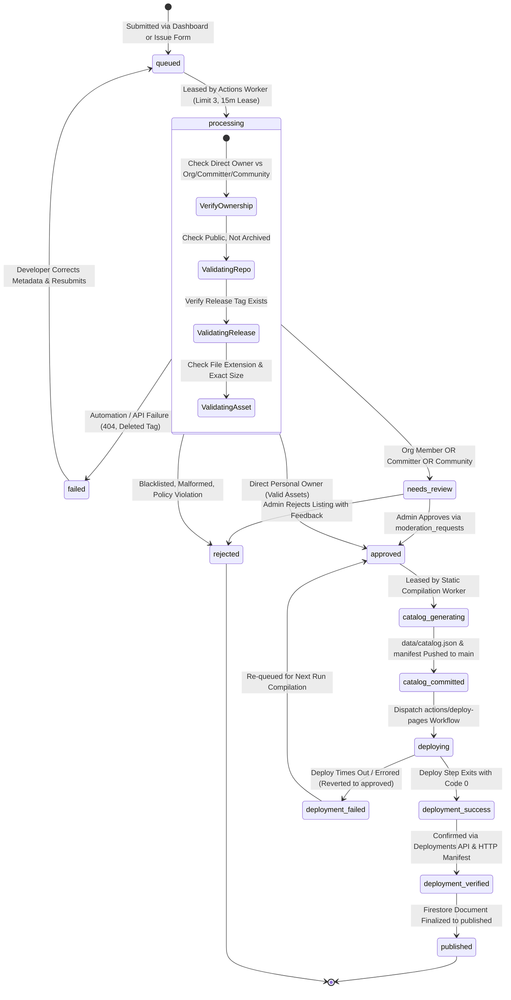
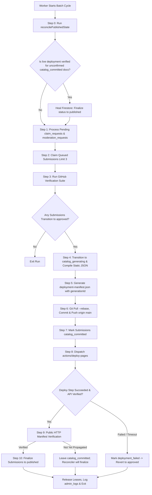

# GitStore — Submission Pipeline & Batch Processing Engine

**Document Version:** 1.3.0  
**Phase:** Phase 0.1.2 — Final Security & Architecture Corrections  
**Status:** Approved Pipeline Architecture (Hardened)  
**Execution Engine:** GitHub Actions (`.github/workflows/batch-processor.yml`)

---

## 1. Overview & Core Invariants

The GitStore Submission Pipeline is the ingestion, verification, and static publishing engine of the platform. It bridges developer submissions with storefront delivery under strict security, eventual consistency, and zero-cost constraints.

### Guiding Pipeline Invariants
1. **Globally Unique Entity Decoupling:** Multiple independent software products can originate from a single GitHub repository. Products are identified by `prod_{repoNumericId}_{productSlug}` and repositories by `gh_repo_{repoNumericId}`. Collisions across repositories with identical product slugs are mathematically impossible.
2. **Unified Ingestion Without Fake Accounts:** Submissions from the Developer Dashboard and GitHub Issue Forms feed the same queue. Issue form submitters do **not** receive placeholder Firebase accounts; their submissions are stored with `submitterGithubId` and `claimStatus: 'unclaimed'`, claimed securely via an asynchronous `/claim_requests` queue when they log in.
3. **Rigorous Ownership & Authority Tiers:** Only Direct Personal Repository Owners (`repo.owner.id == submitter.githubId`) possess inherent release authority to qualify for automated publication. Organization members, committers, and community nominators lack proven release authority and are strictly gated to manual administrator review (`needs_review`).
4. **Distinction of Verified Developer Status:** Personal repository ownership does **not** automatically award the platform "Verified Developer" badge. Auto-published products from unverified personal owners carry standard community attribution.
5. **Recoverable Two-Tier Publication State Machine:** Consistency between GitHub Pages and Cloud Firestore is guaranteed via an eventually consistent state machine requiring both GitHub Deployments API confirmation and public HTTP deployment-manifest verification before marking records `published`.
6. **Realistic Cron Expectations:** Scheduled cron triggers on GitHub Actions are best-effort (5–30 minute delays during platform peak load). Exact 10-minute turnaround is neither promised nor required.

---

## 2. Recoverable Submission State Machine



---

## 3. Ingestion Channels & Identity Linking

### Channel A: Developer Web Dashboard
- Authenticated via GitHub OAuth (`auth.uid` + verified numeric GitHub ID in `providerData`).
- Document created directly in `/submissions/{submissionId}` with `claimStatus: 'claimed'` and `developerUid: auth.uid`.

### Channel B: GitHub Issue Forms
- Author identity: `issue.user.id` (numeric string) and `issue.user.login` from trusted GitHub webhook payload.
- **Zero Fake Accounts:** Worker registers submission with `developerUid: null`, `submitterGithubId: issue.user.id`, and `claimStatus: 'unclaimed'`.
- Document ID: `sub_issue_{repoNumericId}_{issueNumber}`.

### 3.1 Secure Asynchronous Claiming Flow (`/claim_requests`)
1. Developer authenticates on GitStore via GitHub OAuth (or Email Magic Link + GitHub Link).
2. Developer initiates claim on `dashboard.html`.
3. Client writes to `/claim_requests/{requestId}`:
   ```typescript
   {
     requestId: string;
     requesterUid: string;          // request.auth.uid
     targetSubmissionId: string;
     status: 'pending';
     createdAt: serverTimestamp();
   }
   ```
4. **Security Rules Guardrails:**
   - Client can only create requests with `requesterUid == request.auth.uid`.
   - Client cannot update or delete claim requests.
   - Client cannot directly update ownership fields (`developerUid`, `claimStatus`) on `submissions`.
5. Worker reads pending claim requests during batch run:
   - Queries Firebase Admin SDK: `admin.auth().getUser(req.requesterUid)`.
   - Finds `userRecord.providerData.find(p => p.providerId === 'github.com')`.
   - Extracts `verifiedGithubId = provider.uid`.
   - Checks target submission: `submission.submitterGithubId === verifiedGithubId && submission.claimStatus === 'unclaimed'`.
   - Executes atomic Firestore transaction:
     - `submission.developerUid = req.requesterUid`
     - `submission.claimStatus = 'claimed'`
     - `submission.claimedAt = serverTimestamp()`
     - `claimReq.status = 'completed'`
     - Appends log to `/admin_logs`
   - Rejects with `rejected_mismatch` if IDs do not match, or `rejected_already_claimed` if claimed.

### 3.2 Ownership Verification Proof Matrix
1. **Tier 1 (Direct Personal Owner):** `repo.owner.id == submitter.githubId`. Possesses inherent release authority. Auto-publishes on valid asset checks.
2. **Tier 2 (Organization Member):** `GET /orgs/{org}/public_members/{login}` returns 204. Proves organization association, but not repo release authority. Forced to `needs_review`.
3. **Tier 3 (Committer):** `GET /repos/{owner}/{repo}/commits?author={login}` returns merged commits. Proves contribution, but not release authority. Forced to `needs_review`.
4. **Tier 4 (Community Nomination):** Submitter has no commits or ownership. Forced to `needs_review`. Never eligible for auto-publication.

---

## 4. Globally Unique Multi-Product Entity Hierarchy

To support repositories containing multiple distributable applications without cross-repository slug collisions:

```text
GitHub Repository: https://github.com/microsoft/sysinternals (Repo ID: 892341901)
  ├── Repository Doc ID: gh_repo_892341901
  ├── Product 1: Process Explorer
  │     ├── Product ID: prod_892341901_procexp
  │     ├── Slug: procexp
  │     └── Download Asset: ProcExp64.exe (Asset ID: 9812401)
  └── Product 2: Autoruns
        ├── Product ID: prod_892341901_autoruns
        ├── Slug: autoruns
        └── Download Asset: Autoruns64.exe (Asset ID: 9812402)
```

- **Cross-Repository Safety:** If repository `945112002` also creates a product with slug `viewer`, its product ID is `prod_945112002_viewer`, preventing any collision with `prod_892341901_viewer`.
- **Repository Rename & Transfer Resiliency:** Because GitHub's numeric repository ID never changes upon rename (`user/repo` -> `user/renamed-repo` or transfer to another owner), document keys remain permanently immutable. Upstream metadata (`repoOwner`, `repoName`) is updated dynamically.

---

## 5. Recoverable Publication Protocol & Verification



### 5.1 Deployment Verification Details
A Git commit on `main` does **not** prove successful publication. The worker performs two checks:
1. **GitHub Deployments API Check:**
   `GET /repos/Rohitpvt/GitStore/deployments?environment=github-pages`
   Checks that the latest deployment matching the catalog commit SHA has reached status `state: "success"`.
2. **Public HTTP Manifest Check:**
   `GET https://rohitpvt.github.io/GitStore/data/deployment-manifest.json?t={Date.now()}`
   Confirms that `manifest.commitSha === catalogCommitSha` and `manifest.generationId === expectedGenerationId`.

### 5.2 Comprehensive 10 Failure Scenarios & Recovery Matrix

| Failure Scenario | Description | Detection Mechanism | Recovery & Eventual Consistency Resolution |
|---|---|---|---|
| **1. Catalog Generation Failure** | Worker encounters invalid JSON metadata or disk error during static compilation. | Node.js process throws compilation exception. | Batch aborted; submissions remain in `approved`. Zero Git commits created. Retried automatically next batch run. |
| **2. Git Commit Failure** | Local Git lock or disk error prevents committing static files. | `git commit` exits with non-zero code. | Workspace reset via `git reset --hard origin/main`; submissions remain in `approved`. |
| **3. Git Push / Rebase Conflict** | Concurrent push to `main` causes push rejection. | `git push` fails with rejected non-fast-forward. | Worker executes `git pull --rebase origin main`. If conflict occurs, resets to origin and re-compiles next run. |
| **4. Deployment Workflow Failure** | `pages-deploy.yml` or `actions/deploy-pages` fails during artifact extraction or deploy. | Deployments API reports `state: "failure"` or `"error"`. | Submissions transition from `deploying` to `deployment_failed`, which resets them to `approved`. Recompiled in next run. |
| **5. Deployment Timeout** | Pages deployment takes longer than worker execution wait window. | Worker timeout reached before deployment API reports success. | Worker leaves submissions in `catalog_committed` without marking `published`. Next batch reconciler checks status. |
| **6. Reverse Failure (Deploy Succeeded, Firestore Failed)** | GitHub Pages deploy succeeds and propagates, but worker crashes or network drops before updating Firestore. | Startup reconciler runs `reconcilePublishedState()`. | Reconciler fetches public `deployment-manifest.json` and Deployments API; detects matching SHA; **finalizes Firestore to `published`**. |
| **7. Worker Crashes Mid-Run** | GitHub Actions runner aborted (SIGKILL / runner preemption). | 15-minute lease timer expires. | Subsequent batch worker identifies expired lease (`leaseExpiresAt < now`) and reclaims submission cleanly. |
| **8. Multiple Reconciliation Runs** | Reconciler executes repeatedly on consecutive cron triggers. | Idempotency guard (`status == 'published'` check). | Safe no-op; already finalized products are skipped. |
| **9. Concurrent Worker Races** | Scheduled cron overlaps with manual workflow dispatch. | GitHub Actions concurrency group `gitstore-batch-worker`. | Second job is queued (`cancel-in-progress: false`), preventing overlapping runs. |
| **10. Out-of-Order Deployments** | An older queued deployment completes after a newer generation was pushed. | Serialized deployment concurrency and generation timestamps. | Concurrency locks ensure only one deployment is in flight. Reconciler only advances forward (`generationTimestamp >= currentDeployed`). |

### 5.3 Consistency Guarantee
GitStore does not claim distributed ACID transactions across GitHub and Firebase. It provides **guaranteed eventual consistency**: if a deployment succeeds, Firestore will heal to match; if a deployment fails, Firestore will not prematurely expose the product on the storefront.
