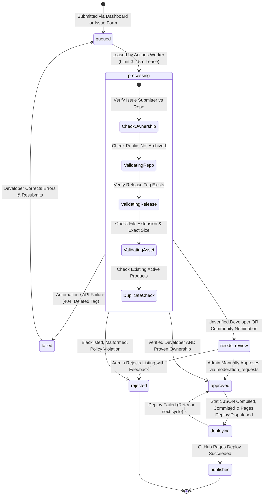
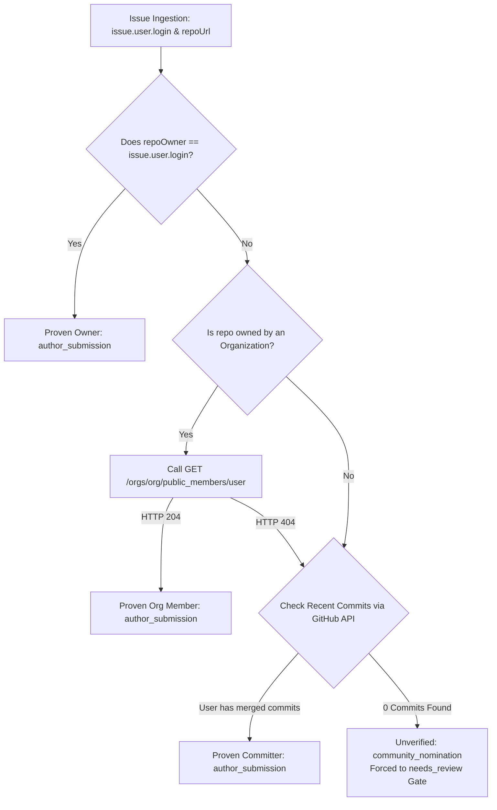

# GitStore — Submission Pipeline & Batch Processing Engine

**Document Version:** 1.1.0  
**Phase:** Phase 0.1 — Architecture Audit, Hardening & Final Validation  
**Status:** Approved Pipeline Architecture (Hardened)  
**Execution Engine:** GitHub Actions (`.github/workflows/batch-processor.yml`)

---

## 1. Overview & Core Invariants

The GitStore Submission Pipeline is the ingestion, verification, and static publishing engine of the platform. It bridges developer submissions with storefront delivery under strict security and zero-cost constraints.

### Guiding Pipeline Invariants
1. **Unified Logical Ingestion:** Submissions originating from either the **Developer Dashboard** (Firestore direct write) or **GitHub Issue Forms** (Markdown/YAML parsing) normalize into identical Firestore `submissions` documents.
2. **Atomic Leases & Concurrency Bounds:** Only one GitHub Actions worker job executes at any given moment (`concurrency: group: gitstore-worker`). Each run processes a maximum of **3 submissions** per execution using a 15-minute distributed lease.
3. **Automated Verification Without Code Execution:** The pipeline validates repository public status, release tags, and asset headers using GitHub’s official REST API. **Binaries are never downloaded or executed.**
4. **Verified Ownership or Gated Review:** Submissions from creators who prove repository ownership (direct owner, public org member, or committer) proceed along normal verification paths. Submissions without proven repository ownership are flagged as `community_nomination` and strictly gated to manual administrator review.
5. **Two-Phase Publication Consistency:** Submissions transition to `approved` first. Static catalogs are compiled, committed, and deployed to GitHub Pages. Only after Pages deployment succeeds does Firestore mark status `published`.
6. **Realistic Execution Expectations:** Cron executions on GitHub Actions are best-effort and subject to platform delays (5–30 minutes during peak hours). Exact 10-minute turnaround is neither assumed nor promised.

---

## 2. Hardened Submission State Machine



### Detailed Status Definitions
| Status | Meaning | Next Possible States |
|---|---|---|
| `queued` | Submission received and waiting in the priority queue. | `processing` |
| `processing` | Actively claimed by a GitHub Actions batch worker with an active lease. | `needs_review`, `approved`, `rejected`, `failed` |
| `needs_review` | Automated checks passed; awaiting manual admin approval (unverified developer or unverified repo ownership). | `approved`, `rejected` |
| `approved` | Qualified for publication; queued for catalog compilation and deployment. | `deploying` |
| `deploying` | Static catalog compiled and pushed; awaiting GitHub Pages deployment confirmation. | `published`, `approved` (retry) |
| `published` | Confirmed live on GitHub Pages storefront. | `delisted` (via moderation) |
| `rejected` | Explicitly rejected due to policy violations, spam, or broken metadata. | Final (or resubmitted) |
| `failed` | Technical validation error (e.g. GitHub repository made private, missing asset). | `queued` (upon developer edit) |

---

## 3. Ingestion Channels & Identity Audit

### Channel A: Developer Web Dashboard (Primary)
- **Path:** Developer authenticates on `submit.html` via GitHub OAuth or Magic Link.
- **Identity Proof:** Authenticated Firebase UID (`request.auth.uid`). When authenticated via GitHub OAuth, the linked GitHub username is cryptographically verified by Firebase Auth.
- **Submission Document:** Created directly in Firestore `/submissions` with `submissionSource: 'dashboard'` and `status: 'queued'`.

### Channel B: GitHub Issue Forms (Git-Native Alternative)
- **Template:** `.github/ISSUE_TEMPLATE/product-submission.yml`.
- **Author Identity:** Extracted from the GitHub webhook/issue payload: `context.payload.issue.user.login` and `context.payload.issue.user.id`.

#### 3.1 Repository Ownership Verification Framework
Because any GitHub user can open an issue submitting any public repository URL, the worker enforces concrete ownership checks:



1. **Direct Ownership:** `issue.user.login.toLowerCase() == repoOwner.toLowerCase()`. If true, the author is the direct repository owner.
2. **Organization Membership:** If the repository is owned by an organization, call `GET /orgs/{org}/public_members/{issue.user.login}`. If HTTP 204, the user is a public organization member.
3. **Repository Committer:** Call `GET /repos/{owner}/{repo}/commits?author={issue.user.login}`. If one or more merged commits are returned, the submitter has verified code contributor status.
4. **Community Nominations (Unproven Ownership):** If the submitter is neither owner, member, nor committer, the submission is categorized as `submissionType: 'community_nomination'`.
   - **Enforcement:** Community nominations **CAN NEVER auto-publish**, even if the developer is marked verified. They are permanently gated to `needs_review` for administrator inspection.

#### 3.2 Account Reconciliation for Issue Submissions
- When ingesting an issue, the worker checks if a user document exists with `githubUid == issue.user.id`.
- If found: Links `developerUid` to the existing user.
- If not found: Worker calls Firebase Admin SDK:
  ```javascript
  const userRecord = await admin.auth().createUser({
    uid: `gh_${issue.user.id}`,
    displayName: issue.user.login,
    photoURL: issue.user.avatar_url
  });
  ```
  Creates `/users/gh_{id}` with `isVerifiedDeveloper: false`. When the developer later signs into GitStore via GitHub OAuth, Firebase Auth matches the GitHub identity provider, seamlessly unifying their profile.

#### 3.3 Duplicate Issue Prevention & Issue Mutations
- **Deduplication:** The worker queries Firestore for `issueNumber == issue.number`. If found, ingestion is skipped.
- **Labels:** The worker immediately labels the issue `gitstore:processing`. Upon publication, it comments on the issue with a link to the live listing, applies `gitstore:published`, and closes the issue.
- **Issue Edits:** Once ingested into Firestore, Firestore is the authoritative record. Subsequent edits to the issue text are ignored unless an administrator adds the label `gitstore:re-evaluate`.
- **Issue Closures:** If the author closes the issue before publication, the worker updates the Firestore submission to `rejected` with `statusReason: 'ISSUE_CLOSED_BY_AUTHOR'`.

---

## 4. Batch Processor Workflow (`batch-processor.yml`)

The batch processor runs on GitHub Actions every 10 minutes (`cron: '*/10 * * * *'`) and supports on-demand `workflow_dispatch`.

```mermaid
flowchart TD
    A[Cron Trigger / Dispatch] --> B{Acquire Concurrency Lock}
    B -->|Lock Active| C[Queue or Terminate Gracefully]
    B -->|Lock Acquired| D[Step 1: Ingest Pending Issues & Ownership Proof]
    D --> E[Step 2: Process Pending Moderation Requests]
    E --> F[Step 3: Query Queued / Expired Leases Limit 3]
    F --> G{Submissions Found?}
    G -->|Yes| H[Step 4: Atomically Acquire 15m Leases in Firestore]
    H --> I[Step 5: Run Automated Verification Suite]
    I --> J{Validation Passed?}
    J -->|No| K[Mark status: failed or rejected]
    J -->|Yes| L{Verified Dev AND Proven Owner?}
    L -->|No| M[Mark status: needs_review]
    L -->|Yes| N[Mark status: approved]
    K --> O{Any Submissions in approved Status?}
    M --> O
    N --> O
    G -->|No| O
    O -->|Yes| P[Step 6: Phase 1 - Compile Static JSON Catalogs]
    P --> Q[Step 7: Git Rebase, Commit & Push [skip ci]]
    Q --> R[Step 8: Dispatch GitHub Pages Deployment]
    R --> S{Did Deployment Succeed?}
    S -->|Yes| T[Step 9: Phase 2 - Update Submissions to published]
    S -->|No| U[Leave in approved for Next Cycle Retry]
    T --> V[Release Leases, Log admin_logs & Exit]
    U --> V
    O -->|No| V
```

### 4.1 Verification Suite Details
For each leased submission, the worker checks:
1. `GET /repos/{owner}/{repo}`: Must return HTTP 200, `private === false`, `archived === false`, `disabled === false`.
2. `GET /repos/{owner}/{repo}/releases/tags/{tag}`: Must return HTTP 200, `draft === false`.
3. Asset inspection: Match `selectedAsset.name`, verify allowed extension (`.exe`, `.msi`, `.apk`, `.dmg`, `.zip`, `.tar.gz`), verify `state === "uploaded"`, verify `size > 1024`.
4. Deterministic Product Key Check: Look up `/products/gh_{repoOwner}_{repoName}`. If it exists, ensure the submitter is the authorized maintainer.

---

## 5. Two-Phase Catalog Compilation & Deployment Protocol

To guarantee that the static catalog served by GitHub Pages never desynchronizes from Cloud Firestore:

1. **Phase 1: Compilation & Staging:**
   - Worker queries all products with `status == 'active'` plus all submissions transitioning through `approved`.
   - Compiles deterministic files:
     - `data/catalog.json`: Minified catalog index.
     - `data/categories.json`: Up-to-date category counts.
     - `data/products/gh_{owner}_{repo}.json`: Full product details.
   - Executes Git commit and push:
     ```bash
     git config user.name "GitStore Bot"
     git config user.email "bot@gitstore.dev"
     git pull --rebase origin main
     git add data/
     git commit -m "chore(catalog): synchronize static snapshot [skip ci]" || echo "No changes"
     git push origin main
     ```
   - Triggers `actions/deploy-pages@v4`.

2. **Phase 2: Database State Finalization:**
   - The worker verifies that `actions/deploy-pages` returned a successful exit code (`steps.deploy.outcome == 'success'`).
   - Only upon confirmed deployment does the worker update the Firestore submission documents to `status: 'published'` and create/update the `/products/gh_{owner}_{repo}` document.
   - If deployment times out or fails, the submissions remain in `approved`. The subsequent batch worker execution detects unfinalized `approved` submissions and recompiles/redeploys them.
