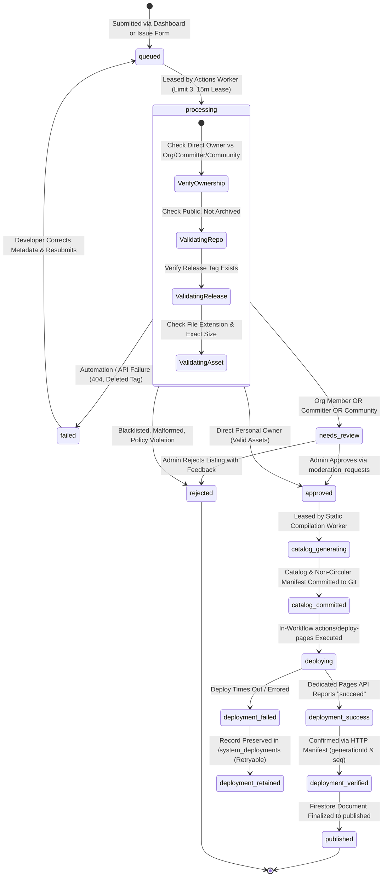
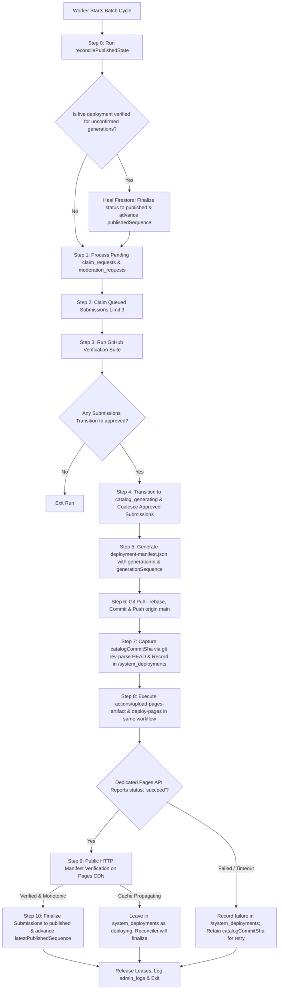

# GitStore — Submission Pipeline & Batch Processing Engine

**Document Version:** 1.5.0  
**Phase:** Phase 0.1.4 — Evidence Alignment, Deployment Recovery & Governance Consistency  
**Status:** Approved Pipeline Architecture (Hardened & Reconciled)  
**Execution Engine:** GitHub Actions (`.github/workflows/batch-processor.yml`)

---

## 1. Overview & Core Invariants

The GitStore Submission Pipeline is the ingestion, verification, and static publishing engine of the platform. It bridges developer submissions with storefront delivery under strict security, eventual consistency, and zero-cost constraints.

### Guiding Pipeline Invariants
1. **Globally Unique Entity Decoupling:** Multiple independent software products can originate from a single GitHub repository. Products are identified by `prod_{repoNumericId}_{productSlug}` and repositories by `gh_repo_{repoNumericId}`. Collisions across repositories with identical product slugs are mathematically impossible.
2. **Unified Ingestion Without Fake Accounts:** Submissions from the Developer Dashboard and GitHub Issue Forms feed the same queue. Issue form submitters do **not** receive placeholder Firebase accounts; their submissions are stored with `submitterGithubId` and `claimStatus: 'unclaimed'`, claimed securely via an asynchronous `/claim_requests` queue when they log in.
3. **Rigorous Ownership & Authority Tiers:** Only Direct Personal Repository Owners (`repo.owner.id == submitter.githubId`) possess inherent release authority to qualify for automated publication. Organization members, committers, and community nominators lack proven release authority and are strictly gated to manual administrator review (`needs_review`).
4. **Distinction of Verified Developer Status:** Personal repository ownership does **not** automatically award the platform "Verified Developer" badge. Auto-published products from unverified personal owners carry standard community attribution.
5. **Non-Circular, Recoverable Two-Tier Publication State Machine:** Consistency between GitHub Pages and Cloud Firestore is guaranteed via an eventually consistent state machine. The publication manifest (`data/deployment-manifest.json`) strictly omits commit SHAs. Verification requires both confirmation from the dedicated GitHub Pages deployments API (`GET /repos/{owner}/{repo}/pages/deployments/{id}` returning `"status": "succeed"`) and public HTTP manifest verification matching `generationId` and monotonic `generationSequence` before marking records `published`.
6. **Single-Workflow In-Run Deployment (Option A):** Because pushes executed with `GITHUB_TOKEN` do not trigger ordinary push workflows, catalog compilation, Git commit, Pages artifact upload (`actions/upload-pages-artifact@v3`), and Pages deployment (`actions/deploy-pages@v4`) execute sequentially within the **same trusted workflow run**.
7. **Realistic Cron Expectations:** Scheduled cron triggers on GitHub Actions are best-effort (5–30 minute delays during platform peak load). Exact 10-minute turnaround is neither promised nor required.

---

## 2. Recoverable Submission State Machine



---

## 3. Ingestion Channels & Identity Linking

### Channel A: Developer Web Dashboard
- Authenticated via GitHub OAuth (`auth.uid` + verified numeric GitHub ID in `providerData`).
- Document created directly in `/submissions/{submissionId}` with `claimStatus: 'claimed'` and `developerUid: auth.uid`.

### Channel B: GitHub Issue Forms
- Author identity: `issue.user.id` (numeric string) and `issue.user.login` from trusted GitHub webhook payload.
- **Zero Fake Accounts:** Worker registers submission with `developerUid: null`, `submitterGithubId: issue.user.id`, and `claimStatus: 'unclaimed'`.
- Document ID: `sub_issue_{repoNumericId}_{issueNumber}`.

### 3.1 Secure Asynchronous Claiming Flow (`/claim_requests`)
1. Developer authenticates on GitStore via GitHub OAuth (or Email Magic Link + GitHub Link).
2. Developer initiates claim on `dashboard.html`.
3. Client writes to `/claim_requests/{requestId}`:
   ```typescript
   {
     requestId: string;
     requesterUid: string;          // request.auth.uid
     targetSubmissionId: string;
     status: 'pending';
     createdAt: serverTimestamp();
   }
   ```
4. **Strict Client Whitelist & Security Rules Guardrails:**
   Clients must **never** be able to inject worker-managed or privileged fields. Security Rules enforce:
   ```javascript
   match /claim_requests/{requestId} {
     allow read: if request.auth != null && resource.data.requesterUid == request.auth.uid;
     allow create: if request.auth != null
       && request.resource.data.keys().hasOnly(['requestId', 'requesterUid', 'targetSubmissionId', 'status', 'createdAt'])
       && request.resource.data.requestId == requestId
       && request.resource.data.requesterUid == request.auth.uid
       && request.resource.data.targetSubmissionId is string
       && request.resource.data.targetSubmissionId.size() > 0
       && request.resource.data.status == 'pending'
       && request.resource.data.createdAt == request.time;
     allow update, delete: if false; // Privileged worker only
   }
   ```
   **Rejected Client Fields:** Any request attempting to inject `developerUid`, `verifiedGithubId`, `claimStatus`, `isAdmin`, `processedAt`, `reviewedAt`, `reviewedBy`, `resolution`, `rejectionReason`, `workerLease`, or `workerId` is immediately rejected.
5. Worker reads pending claim requests during batch run:
   - Queries Firebase Admin SDK: `admin.auth().getUser(req.requesterUid)`.
   - Finds `userRecord.providerData.find(p => p.providerId === 'github.com')`. Fail closed if absent.
   - Extracts `verifiedGithubId = provider.uid`.
   - Checks target submission: `submission.submitterGithubId === verifiedGithubId`.
   - Executes atomic Firestore transaction:
     - Checks `submission.developerUid == null` (prevents competing claims).
     - Sets `submission.developerUid = req.requesterUid`
     - Sets `submission.claimStatus = 'claimed'`
     - Sets `submission.claimedAt = serverTimestamp()`
     - Sets `claimReq.status = 'completed'`
     - Appends log to `/admin_logs`
   - Rejects with `rejected_mismatch` if IDs do not match, or `rejected_already_claimed` if claimed. Handles duplicates idempotently.

### 3.2 Ownership Verification Proof Matrix
1. **Tier 1 (Direct Personal Owner):** `repo.owner.id == submitter.githubId`. Possesses inherent release authority. Auto-publishes on valid asset checks.
2. **Tier 2 (Organization Member):** `GET /orgs/{org}/public_members/{login}` returns 204. Proves organization association, but not repo release authority. Forced to `needs_review`.
3. **Tier 3 (Committer):** `GET /repos/{owner}/{repo}/commits?author={login}` returns merged commits. Proves contribution, but not release authority. Forced to `needs_review`.
4. **Tier 4 (Community Nomination):** Submitter has no commits or ownership. Forced to `needs_review`. Never eligible for auto-publication.

---

## 4. Globally Unique Multi-Product Entity Hierarchy

To support repositories containing multiple distributable applications without cross-repository slug collisions:

```text
GitHub Repository: https://github.com/microsoft/sysinternals (Repo ID: 892341901)
  ├── Repository Doc ID: gh_repo_892341901
  ├── Product 1: Process Explorer
  │     ├── Product ID: prod_892341901_procexp
  │     ├── Slug: procexp
  │     └── Download Asset: ProcExp64.exe (Asset ID: 9812401)
  └── Product 2: Autoruns
        ├── Product ID: prod_892341901_autoruns
        ├── Slug: autoruns
        └── Download Asset: Autoruns64.exe (Asset ID: 9812402)
```

- **Cross-Repository Safety:** If repository `945112002` also creates a product with slug `viewer`, its product ID is `prod_945112002_viewer`, preventing any collision with `prod_892341901_viewer`.
- **Repository Rename & Transfer Resiliency:** Because GitHub's numeric repository ID never changes upon rename (`user/repo` -> `user/renamed-repo` or transfer to another owner), document keys remain permanently immutable. Upstream metadata (`repoOwner`, `repoName`) is updated dynamically.

---

## 5. Recoverable Publication Protocol & Verification



### 5.1 Deployment Verification, Concurrency & Monotonic Ordering Details

#### 1. Non-Circular Manifest Architecture & Generation Timestamping
The static catalog publication creates `data/deployment-manifest.json` containing:
```json
{
  "generationId": "gen_1730300400000_a1b2c3d4",
  "generationSequence": 104,
  "generatedAt": "2026-10-30T18:00:00.000Z",
  "productCount": 42,
  "schemaVersion": "1.5.0",
  "environment": "github-pages"
}
```
**Strict Invariant:** The manifest does **not** contain the SHA of the Git commit that contains it. Furthermore, it records `generatedAt` rather than `deployedAt` because the manifest is generated and committed *before* GitHub Pages deployment executes. The actual deployment timestamp is recorded post-deployment in Firestore (`verifiedAt`, `finalizedAt`, `lastPublishedAt`).
- The worker commits the manifest and static catalog files.
- The worker inspects `git rev-parse HEAD` to capture `catalogCommitSha`.
- The tuple `(generationId, generationSequence, catalogCommitSha)` is recorded in Firestore `/system_deployments/{generationId}` and `/system_config/deployment_state`.

#### 2. Dedicated GitHub Pages Deployment Endpoint Check
Deployments are verified via the dedicated GitHub Pages deployments API:
`GET https://api.github.com/repos/Rohitpvt/GitStore/pages/deployments/{pages_deployment_id}`
- Returns `{ "status": "succeed" }` upon verified completion. (Distinct from the generic Deployments API `state: "success"`).
- Other status states include `"in_progress"`, `"queued"`, and `"failed"`.

#### 3. Single-Workflow Execution (Option A)
To resolve GitHub's behavior where commits pushed using `GITHUB_TOKEN` do not trigger ordinary `push` event workflows:
- Catalog generation, Git commit/push, Pages artifact upload (`actions/upload-pages-artifact@v3`), Pages deployment (`actions/deploy-pages@v4`), and database finalization run sequentially inside `.github/workflows/batch-processor.yml`.
- Eliminates any dependency on push-triggered workflows or elevated personal access tokens.

#### 4. GitHub Actions Concurrency, Environment Boundaries & Durable Coalescing
- **Actions Runner Queue & Environment Concurrency Boundary:**
  - Standard GitHub Actions concurrency (`concurrency: group: gitstore-batch-worker, cancel-in-progress: false`) retains at most **one running run and one pending run**. Intermediate runs are discarded and replaced.
  - To prevent an older Actions runner from deploying an older artifact to GitHub Pages out-of-order, Pages deployment is bounded by GitHub Environment Concurrency:
    ```yaml
    environment:
      name: github-pages
      url: ${{ steps.deployment.outputs.page_url }}
    concurrency:
      group: 'github-pages'
      cancel-in-progress: false
    ```
- **Durable Coalescing (Work Preservation Guarantee):**
  - GitStore does not rely on runner-level queuing to preserve work. When the batch processor runs, it queries **all** submissions currently in `approved` status via Firestore:
    `db.collection('submissions').where('status', '==', 'approved').get()`
  - Even if intermediate runner jobs were discarded by GitHub Actions, all pending approved submissions are safely coalesced into the single active catalog compilation generation. Zero submissions are lost.
- **Four-Case Generation Ordering & Idempotency Matrix:**
  Every deployment generation is checked against `/system_config/deployment_state.latestPublishedSequence`:
  1. *Case 1: Stale Generation (`seq < latestPublishedSequence`):* Rejected immediately. Deployment and finalization aborted to prevent catalog rollback.
  2. *Case 2: Idempotent Retry (`seq === latestPublishedSequence && id === latestPublishedGenerationId`):* Verified and finalized without re-compiling or re-committing catalog.
  3. *Case 3: Duplicate Sequence Conflict (`seq === latestPublishedSequence && id !== latestPublishedGenerationId`):* Critical fail-closed condition. Two distinct generation IDs claiming the same sequence number. Deployment halted; high-severity audit alarm logged in `/admin_logs`; operator intervention required.
  4. *Case 4: Valid New Generation (`seq > latestPublishedSequence`):* Valid progression. Concurrency lease prevents overlap; proceeds to Pages deploy and sequence advance.

### 5.2 Comprehensive 11 Failure Scenarios & Idempotent Recovery Matrix

| # | Failure Scenario | Detection Mechanism | Idempotent Recovery & Consistency Resolution |
|---|---|---|---|
| **1** | **Catalog generation failure** | Node.js process throws syntax error or JSON compilation exception prior to commit. | Process aborts. Zero Git commits created. Submissions remain in `approved`. A failed generation record is logged with `stage: 'generation'`. Submissions are cleanly picked up on next batch cycle. |
| **2** | **Catalog commit failure** | Git push rejected due to concurrent push or branch protection conflict. | Process executes `git reset --hard origin/main`. Submissions remain in `approved`. Zero invalid generation records persisted. Re-compiled on next cycle with updated `origin/main`. |
| **3** | **Post-commit Firestore failure (Missing commit SHA)** | Git push to `origin/main` succeeds, but runner terminates or network fails *before* worker can persist `catalogCommitSha` in Firestore `/system_deployments/{generationId}`. | **Deterministic Git Log Recovery:** Reconciler queries `git log -n 10 --format="%H" origin/main -- data/deployment-manifest.json`, reads candidate blobs directly via `git show ${sha}:data/deployment-manifest.json`, parses JSON, and matches `generationId` and `generationSequence`. Disambiguates by selecting latest commit on `origin/main`. Atomically saves recovered SHA in `/system_deployments/{generationId}` and resumes Pages deployment. If no remote commit matches, marks `failed` (`failureReason: 'commit_not_found_on_remote'`) and coalesces submissions into next run. |
| **4** | **Deployment workflow not triggered** | Artifact upload step fails or runner runs out of disk space before Pages deployment starts. | `catalogCommitSha` already exists in Git and is recorded in `/system_deployments/{generationId}` with `status: 'deploying'`. Submissions remain in `catalog_committed` (NOT reverted to `approved`). Reconciler re-executes `actions/upload-pages-artifact` for that exact commit SHA. |
| **5** | **Deployment queued but never started** | GitHub Pages deployment infrastructure queued or suspended. | Worker 15-minute lease timer expires. Reconciler checks Pages deployment API. If deployment remains queued or unstarted beyond threshold (30m), reconciler cancels stale deployment and re-dispatches deployment for existing `catalogCommitSha`. |
| **6** | **Pages deployment failure** | Dedicated Pages API returns `{ "status": "failed" }` or deployment times out. | Failure record retained in `/system_deployments/{generationId}` with `status: 'failed'`, `lastObservedPagesStatus: 'failed'`, and `reconciliationStatus: 'pending_retry'`. Submissions are **NEVER reverted to `approved`** because the commit exists on `main`. Reconciler executes retry up to 3 times for the same commit SHA. |
| **7** | **Pages deploy success, public manifest not yet updated** | Dedicated Pages API reports `status: "succeed"`, but public HTTP fetch returns HTTP 404 or older manifest due to edge CDN propagation delay. | Worker polls public manifest with exponential backoff (5s, 10s, 20s, up to 5m). If still unpropagated, worker leaves generation in `/system_deployments` with `status: 'deploying'`. The startup reconciler in subsequent batch run verifies propagated manifest and finalizes Firestore. |
| **8** | **Manifest generation mismatch** | Public manifest returns `generationId` different from expected generation. | Evaluated against the 4-case matrix. If `generationSequence < latestPublishedSequence`, wait for CDN edge cache TTL. If `generationSequence > expectedSequence`, newer generation deployed; this generation marked `status: 'stale'`. If duplicate sequence conflict (`seq === latest && id !== latest`), fail closed. |
| **9** | **Firestore finalization failure** | Network drop or Firestore rate limit while updating submission documents to `status: 'published'`. | Pages is already live! Generation record exists in `/system_deployments` with `catalogCommitSha` and `expectedProductIds`. Startup reconciler verifies live manifest and finishes updating unfinalized submissions to `published`. Operation is fully idempotent. |
| **10** | **Worker interruption during finalization** | GitHub Actions runner preempted or terminated (SIGKILL) midway through batch writes. | 15-minute lease expires. Next batch run detects active generation with unfinalized submissions in `expectedProductIds`. Reconciler completes remaining updates and sets `/system_deployments/{generationId}.status = 'published'`. |
| **11** | **Newer generation appearing while older generation is deploying** | Mutex lease expired and second worker started, or manual dispatch triggered. | Concurrency lease prevents simultaneous runs. If an older run attempts finalization after a newer generation has already published (`generationSequence <= latestPublishedSequence`), monotonic check drops the older update, preventing regression. |

### 5.3 Consistency Guarantee
GitStore does not claim distributed ACID transactions across GitHub and Firebase. It provides **guaranteed eventual consistency**: if a deployment succeeds, Firestore will heal to match; if a deployment fails, Firestore will not prematurely expose the product on the storefront or create divergent Git-database states.
