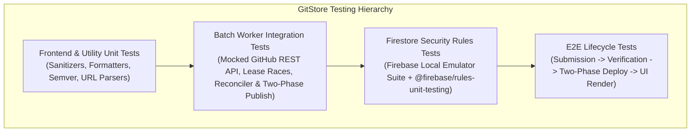

# GitStore — Comprehensive Testing Strategy

**Document Version:** 1.2.0  
**Phase:** Phase 0.1.1 — Critical Architecture Corrections & Hardening  
**Status:** Approved Quality Assurance & Testing Framework (Corrected)  

---

## 1. Testing Philosophy & Quality Invariants

GitStore adheres to a layered testing hierarchy designed to guarantee platform reliability, client security, and pipeline idempotency without incurring external testing costs.

### Testing Invariants
1. **Zero-Trust Security Verification:** All Firestore Security Rules must be proven secure using automated unit tests executed against the **Firebase Local Emulator Suite** before production deployment.
2. **Deterministic Batch Pipeline:** The GitHub Actions batch processor must be tested against simulated GitHub API failures, rate limits, corrupt assets, lease race conditions, and deployment aborts using mocked HTTP fixtures.
3. **Cross-Browser Vanilla Compliance:** Frontend modules and CSS components must operate natively across Chromium, Gecko, and WebKit rendering engines without requiring transpilers or polyfills.

---

## 2. Testing Pyramid & Layer Breakdown

---

## 3. Layer 1: Frontend & Utility Unit Testing

- **Runner:** Node.js native test runner (`node --test`).
- **Scope:**
  - `sanitizers.js`: Verify that malicious SVG tags, `<script>` tags, and `javascript:` URIs are completely stripped via DOMPurify.
  - `formatters.js`: Validate byte size formatting (`1024 B -> 1.0 KB`, `1048576 B -> 1.0 MB`), date formatting, and semver comparison.
  - `url-validator.js`: Confirm regex correctly matches valid GitHub repository URLs (`https://github.com/owner/repo`) and rejects phishing or spoofed domains.

---

## 4. Layer 2: Firestore Security Rules Testing (Local Emulator)

- **Tool:** `@firebase/rules-unit-testing` running against the official **Firebase Firestore Emulator**.
- **Execution:** Runs in local development and inside CI workflows prior to deployment.
- **Key Test Cases:**
  1. **Anonymous Read:** Anonymous client CAN read published active products and categories.
  2. **Anonymous Write:** Anonymous client CANNOT write to `submissions`, `moderation_requests`, or `users`.
  3. **Self-Escalation Attack:** Authenticated developer CANNOT update their user document to set `isAdmin: true` or `isVerifiedDeveloper: true`.
  4. **Submission Tampering:** Authenticated developer CANNOT update a submission that is already in `processing`, `approved`, or `published` status.
  5. **Unauthorized Publish:** Authenticated developer CANNOT create a document directly in the `products` collection.
  6. **Moderation Queue Security:** Authenticated user CAN create a `moderation_requests` doc with `status: 'pending'`, but CANNOT update or delete it.

---

## 5. Layer 3: Batch Worker Integration & Concurrency Testing

- **Scope:** Verify the GitHub Actions processing engine (`scripts/processor/index.js`).
- **Mock Framework:** Mock the GitHub REST API using `nock` or `msw`.
- **Key Test Scenarios:**
  1. **Canonical Admin Authorization:**
     - User lacking collaborator rights on `Rohitpvt/GitStore` -> Worker checks GitHub API -> returns permission: `read` or 404 -> worker rejects request with audit entry.
     - Authorized maintainer on `Rohitpvt/GitStore` -> Worker checks GitHub API -> returns permission: `admin` -> worker executes update.
  2. **Multi-Tier Ownership Proof:**
     - Personal repo owner (`owner.id == submitter.id`) -> Auto-approves if verified developer.
     - Org member / committer -> Forces status to `needs_review`.
     - Community nomination -> Forces status to `needs_review`.
  3. **Multi-Product Repositories:**
     - Submitting two distinct slugs from the same repo creates `prod_owner_slug1` and `prod_owner_slug2` without collisions.
  4. **Self-Healing Reconciliation (`reconcilePublishedState`):**
     - Simulate reverse failure: static catalog has product, but Firestore document is in `approved` or `deploying`. Reconciler automatically finalizes Firestore to `published`.
  5. **Atomic Lease Contention:** Two simulated workers attempt to claim the same queued submission; Firestore transaction ensures exactly one worker succeeds.
  6. **Issue Form Account Claiming:**
     - Submission created with `claimStatus: 'unclaimed'` and `submitterGithubId: '123'`.
     - User signs in with GitHub OAuth (provider UID `'123'`); verifies submission claims and binds `developerUid`.

---

## 6. Layer 4: Storefront Client Integration & Performance Testing

- **Testing Tools:** Playwright / Chromium headless.
- **Assertions:**
  1. **Catalog Rendering:** `index.html` loads and renders 50 product cards from `data/catalog.json` in under 300ms.
  2. **Filtering Performance:** Clicking category or platform filters updates the DOM in under 50ms without network round-trips.
  3. **Search Responsiveness:** Typing in the search input highlights matching applications instantaneously.
  4. **Accessibility Audit:** Automated axe-core scan confirms zero WCAG 2.1 AA violations.
  5. **Download Link Integrity:** Verifies that clicking "Download" directs user directly to the upstream GitHub Release asset URL.
