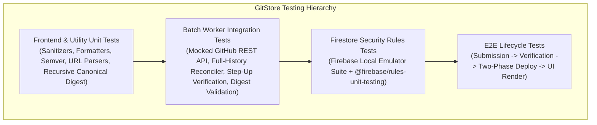

# GitStore — Comprehensive Testing Strategy

**Document Version:** 1.7.0  
**Phase:** Phase 0.1.6 — Step-Up Proof Integrity, Firestore Rules & Deployment Reconciliation  
**Status:** IN_REVIEW — Awaiting Explicit User Approval  

---

## 1. Testing Philosophy & Quality Invariants

GitStore adheres to a layered testing hierarchy designed to guarantee platform reliability, client security, and pipeline idempotency without incurring external testing costs.

### Testing Invariants
1. **Zero-Trust Security Verification:** All Firestore Security Rules must be proven secure using automated unit tests executed against the **Firebase Local Emulator Suite** before production deployment.
2. **Deterministic Batch Pipeline & Recovery:** The GitHub Actions batch processor must be tested against simulated GitHub API failures, rate limits, corrupt assets, lease race conditions, full-history commit recoveries, and deployment aborts using mocked HTTP fixtures.
3. **Cross-Browser Vanilla Compliance:** Frontend modules and CSS components must operate natively across Chromium, Gecko, and WebKit rendering engines without requiring transpilers or polyfills.

---

## 2. Testing Pyramid & Layer Breakdown



---

## 3. Layer 1: Frontend & Utility Unit Testing

- **Runner:** Node.js native test runner (`node --test`).
- **Scope:**
  - `sanitizers.js`: Verify that malicious SVG tags, `<script>` tags, and `javascript:` URIs are completely stripped via DOMPurify.
  - `formatters.js`: Validate byte size formatting (`1024 B -> 1.0 KB`, `1048576 B -> 1.0 MB`), date formatting, and semver comparison.
  - `url-validator.js`: Confirm regex correctly matches valid GitHub repository URLs (`https://github.com/owner/repo`) and rejects phishing or spoofed domains.
  - `catalog-digest.js`: Assert deterministic SHA-256 digest computation (`sha256:v1:...`) over canonicalized JSON files.

### 3.1 Recursive Canonical Digest Unit Tests (The 6 Invariant Properties)
```javascript
import { test, describe } from 'node:test';
import assert from 'node:assert';
import { canonicalizeJson, computeCatalogDigest } from './catalog-digest.js';

describe('Deterministic Recursive Canonical Digest Tests', () => {
  test('Property 1: Key Ordering Invariance', () => {
    const objA = { b: 1, a: { y: 2, x: 3 } };
    const objB = { a: { x: 3, y: 2 }, b: 1 };
    assert.strictEqual(canonicalizeJson(objA), '{"a":{"x":3,"y":2},"b":1}');
    assert.strictEqual(canonicalizeJson(objA), canonicalizeJson(objB));
  });

  test('Property 2: Array Element Order Sensitivity', () => {
    const arrA = [1, 2, 3];
    const arrB = [3, 2, 1];
    assert.notStrictEqual(canonicalizeJson(arrA), canonicalizeJson(arrB));
  });

  test('Property 3: Type Distinction', () => {
    const strObj = { v: "123" };
    const numObj = { v: 123 };
    assert.notStrictEqual(canonicalizeJson(strObj), canonicalizeJson(numObj));
  });

  test('Property 4: Unicode Normalization & UTF-8 Encoding Stability', () => {
    const obj = { name: "café", icon: "🚀" };
    const canonical = canonicalizeJson(obj);
    assert.strictEqual(canonical, '{"icon":"🚀","name":"café"}');
  });

  test('Property 5: Path Framing Collision Resistance', () => {
    // Unambiguous null-byte framing prevents concatenation ambiguity
    const frameA = Buffer.from('FILE\0a/b\01\0c', 'utf8');
    const frameB = Buffer.from('FILE\0a\03\0/bc', 'utf8');
    assert.notDeepStrictEqual(frameA, frameB);
  });

  test('Property 6: Manifest Exclusion Invariant', () => {
    // Proves data/deployment-manifest.json is never fed into digest calculation
    const files = ['data/catalog.json', 'data/categories.json', 'data/deployment-manifest.json'];
    const filtered = files.filter(f => !f.endsWith('deployment-manifest.json'));
    assert.strictEqual(filtered.length, 2);
    assert.ok(!filtered.includes('data/deployment-manifest.json'));
  });
});
```

---

## 4. Layer 2: Firestore Security Rules Testing (Local Emulator)

- **Tool:** `@firebase/rules-unit-testing` running against the official **Firebase Firestore Emulator**.
- **Execution:** Runs in local development and inside CI workflows prior to deployment.
- **Key Test Cases:**
  1. **Anonymous Read on Public Data:** Anonymous client CAN read published active products (`/products`), categories (`/categories`), and public developer profiles (`/public_profiles`).
  2. **Private User Document Lockout (`/users/{uid}`):**
     - Anonymous client CANNOT read `/users/{uid}`.
     - Authenticated developer CANNOT read another developer's `/users/{otherUid}` document.
     - Authenticated developer CAN read their own `/users/{uid}` document.
     - Update with `diff().affectedKeys()`: Owner CAN update `displayName`, `avatarUrl`, `bio`, `settings`. Attempting to modify `isAdmin`, `isVerifiedDeveloper`, `reputationScore`, `githubNumericId`, or `email` is rejected.
  3. **Public Profile Separation (`/public_profiles/{uid}`):**
     - Any user CAN read `/public_profiles/{uid}`.
     - Owner CAN update safe fields (`displayName`, `avatarUrl`, `bio`).
     - Owner CANNOT modify worker-managed badges (`isVerifiedDeveloper`, `publishedProductIds`).
  4. **Internal Collection Default-Deny:**
     - Client (anonymous or authenticated) CANNOT read or write `/system_deployments/{generationId}`.
     - Client CANNOT read or write `/system_config/deployment_state`.
     - Client CANNOT read or write `/system_config/catalog_state`.
     - Client CANNOT read or write `/admin_logs/{logId}`.
     - Client CAN read `/system_config/global_settings`, but CANNOT write.
  5. **Submission Tampering Protection:** Authenticated developer CANNOT update a submission that is already in `processing`, `approved`, or `published` status, and CANNOT alter ownership fields (`developerUid`, `claimStatus`, `ownershipProof`).
  6. **Claim Request Whitelist:** Authenticated user CAN create a `claim_requests` doc with their own `auth.uid` and `status: 'pending'`, but CANNOT inject privileged or worker fields (`developerUid`, `verifiedGithubId`, `claimStatus`, `isAdmin`, `workerLease`, `workerId`).
  7. **Moderation Queue Security & Action-Bound Step-Up Proof:**
     - Request write FAILS if token `auth_time` is older than 300 seconds (`(request.time - auth_time) >= 300`).
     - Request write FAILS if `sign_in_provider != 'github.com'`.
     - Request write FAILS if `stepUpProof` schema contains unapproved keys or missing fields.
     - Request write SUCCEEDS if `auth_time` is fresh (< 300s), fields match strict whitelist, and action-bound proof matches schema.
     - Client CANNOT update or delete moderation requests once written (`allow update, delete: if false;`).
  8. **Abuse Reports Protection:**
     - Unauthenticated client CANNOT create report.
     - Authenticated client CAN create report with `status == 'open'` and `details.size() <= 2000`.
     - Authenticated client CANNOT read, update, or delete existing reports.

---

## 5. Layer 3: Batch Worker Integration & Concurrency Testing

- **Scope:** Verify the GitHub Actions processing engine (`scripts/processor/index.js`).
- **Mock Framework:** Mock the GitHub REST API using `nock` or `msw`.
- **Key Test Scenarios:**

### 5.1 Root Administrator Bootstrap & Collaborator Permission Mapping
1. **Numeric ID Normalization Unit Tests (`normalizeGithubId`):**
   ```javascript
   assert.strictEqual(normalizeGithubId(12345678), "12345678");
   assert.strictEqual(normalizeGithubId("12345678"), "12345678");
   assert.strictEqual(normalizeGithubId("  12345678  "), "12345678");
   assert.strictEqual(normalizeGithubId(null), null);
   assert.strictEqual(normalizeGithubId(undefined), null);
   assert.strictEqual(normalizeGithubId(""), null);
   assert.strictEqual(normalizeGithubId("abc123"), null);
   assert.strictEqual(normalizeGithubId("12.34"), null);
   ```
2. **Root Administrator Bootstrap Test:**
   - Mock `GET /repos/Rohitpvt/GitStore` returning `{ owner: { id: 12345678, login: "Rohitpvt" } }`.
   - Mock Firebase Admin SDK `admin.auth().verifyIdToken()` returning `uid: "admin_uid"`.
   - Mock `admin.auth().getUser("admin_uid")` returning `providerData: [{ providerId: "github.com", uid: "12345678" }]`.
   - Assert: Caller is authenticated as ROOT ADMINISTRATOR directly without making collaborator endpoint queries.
3. **Collaborator Permission Mapping Test Fixtures (Delegated Maintainers):**
   ```javascript
   const fixtures = [
     { resp: { permission: 'admin', role_name: 'admin' }, expected: 'AUTHORIZED' },
     { resp: { permission: 'write', role_name: 'maintain' }, expected: 'AUTHORIZED' },
     { resp: { permission: 'write', role_name: 'write' }, expected: 'FORBIDDEN' },
     { resp: { permission: 'read', role_name: 'triage' }, expected: 'FORBIDDEN' },
     { resp: { permission: 'read', role_name: 'read' }, expected: 'FORBIDDEN' },
     { resp: { permission: 'write', role_name: 'custom_reviewer' }, expected: 'FORBIDDEN' },
     { resp: { permission: 'admin' }, expected: 'AUTHORIZED' },
     { resp: {}, expected: 'FORBIDDEN' },
   ];
   ```

### 5.2 Action-Bound Step-Up Reauthentication & Zero-Token Tests
- **Valid Step-Up Flow:**
  - Request contains action-bound proof `{ providerId: 'github.com', authTime, actionNonce, targetDocumentPath, actionHash }`.
  - Worker computes `expectedHash = sha256(`${action}:${targetDocumentPath}:${actionNonce}:${authTime}`)`.
  - Worker asserts hash matches, checks collaborator rights, and updates status to `processing`.
  - Assert: Zero raw OAuth access tokens existed in document.
- **Identity Mismatch Rejection:**
  - Caller linked GitHub ID does not match `githubUserId`.
  - Assert: Worker aborts with security alarm and marks request `rejected`.
- **Anti-Replay Protection Test:**
  - Attempting to re-execute a request already in `processing` or `completed`.
  - Assert: Worker fails closed and ignores replayed request.

### 5.3 Full-History Commit Discovery & Branch Ancestry Tests
- **Discovery Beyond 10-Commit Window:**
  - Simulate commit history where candidate manifest commit is at depth 15 (`origin/main~15`).
  - Worker runs unshallow `git log --format="%H" origin/main -- data/deployment-manifest.json`.
  - Assert: Worker recovers commit SHA at depth 15 where legacy `git log -n 10` failed.
- **Branch Ancestry Assertion (`git merge-base --is-ancestor`):**
  - Simulate candidate commit from an unmerged feature branch or fork.
  - Assert `git merge-base --is-ancestor ${candidateSha} origin/main` exits non-zero; reconciler rejects candidate commit.
- **Commits API Full Pagination Loop Test:**
  - Simulate multi-page response with `Link: <...page=2>; rel="next"`.
  - Assert: Worker iterates through pages to locate commit when local git log is unavailable.

### 5.4 Missing Pages Deployment ID Handling (Cases A, B, C, D)
- **Case A Test:** Pages deployment exists and `status === 'built'` on GitHub Pages API -> capture ID, verify CDN, finalize Firestore.
- **Case B Test:** GitHub Pages API returns 404 (no deployment for commit) -> worker restores git tree at `gen.catalogCommitSha`, validates digest against `gen.catalogDigest`, rebuilds artifact into `site/`, sets `deploy_needed = true`, and sets `reconciliationStatus = 'pages_dispatched'`.
- **Case C Test:** Remote Pages deployment failed (`errored`) -> retry same commit up to 3 times before preserving in `deployment_retained`.
- **Case D Test:** Remote deploy succeeded, DB finalization interrupted -> idempotent finalization without re-deploying.

### 5.5 Pre-Deployment Generation Ordering Guard Tests
- Test Case 1: `artifact.sequence < state.latestPublishedSequence` -> Abort deploy with exit code 1.
- Test Case 2: `artifact.sequence === state.latestPublishedSequence && artifact.id === state.latestPublishedGenerationId` -> Allow deploy.
- Test Case 3: `artifact.sequence === state.latestPublishedSequence && artifact.id !== state.latestPublishedGenerationId` -> Critical alarm; fail closed.
- Test Case 4: `artifact.sequence > state.latestPublishedSequence` -> Allow deploy.

### 5.6 Durable Catalog Revisions & Work Preservation Tests
- Increment `latestRequestedRevision` in `/system_config/catalog_state` while compilation worker is running.
- Post-deployment inside atomic transaction, assert worker detects `latestRequestedRevision > activeCapturedRevision` (`isDirty: true`) and triggers follow-up compilation.

---

## 6. Layer 4: Storefront Client Integration & Performance Testing

- **Testing Tools:** Playwright / Chromium headless.
- **Assertions:**
  1. **Catalog Rendering:** `index.html` loads and renders 50 product cards from `data/catalog.json` in under 300ms.
  2. **Filtering Performance:** Clicking category or platform filters updates the DOM in under 50ms without network round-trips.
  3. **Search Responsiveness:** Typing in the search input highlights matching applications instantaneously.
  4. **Accessibility Audit:** Automated axe-core scan confirms zero WCAG 2.1 AA violations.
  5. **Download Link Integrity:** Verifies that clicking "Download" directs user directly to the upstream GitHub Release asset URL.
