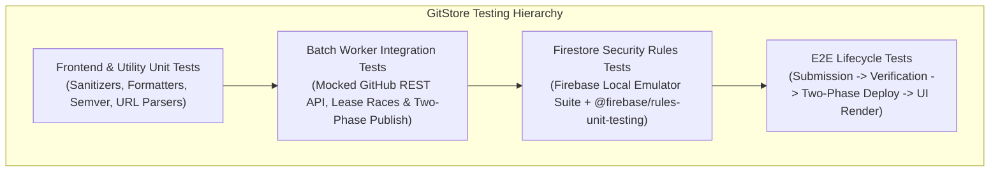

# GitStore — Comprehensive Testing Strategy

**Document Version:** 1.1.0  
**Phase:** Phase 0.1 — Architecture Audit, Hardening & Final Validation  
**Status:** Approved Quality Assurance & Testing Framework (Hardened)  

---

## 1. Testing Philosophy & Quality Invariants

GitStore adheres to a layered testing hierarchy designed to guarantee platform reliability, client security, and pipeline idempotency without incurring external testing costs.

### Testing Invariants
1. **Zero-Trust Security Verification:** All Firestore Security Rules must be proven secure using automated unit tests executed against the **Firebase Local Emulator Suite** before production deployment.
2. **Deterministic Batch Pipeline:** The GitHub Actions batch processor must be tested against simulated GitHub API failures, rate limits, corrupt assets, lease race conditions, and deployment aborts using mocked HTTP fixtures.
3. **Cross-Browser Vanilla Compliance:** Frontend modules and CSS components must operate natively across Chromium, Gecko, and WebKit rendering engines without requiring transpilers or polyfills.

---

## 2. Testing Pyramid & Layer Breakdown



---

## 3. Layer 1: Frontend & Utility Unit Testing

- **Runner:** Node.js native test runner (`node --test`).
- **Scope:**
  - `sanitizers.js`: Verify that malicious SVG tags, `<script>` tags, and `javascript:` URIs are completely stripped.
  - `formatters.js`: Validate byte size formatting (`1024 B -> 1.0 KB`, `1048576 B -> 1.0 MB`), date formatting, and semver comparison.
  - `url-validator.js`: Confirm regex correctly matches valid GitHub repository URLs (`https://github.com/owner/repo`) and rejects phishing or spoofed domains (`https://github.com.attacker.com`).

```javascript
// assets/js/utils/validators.test.js
import { test, describe } from 'node:test';
import assert from 'node:assert/strict';
import { isValidGithubRepoUrl, sanitizeString } from './validators.js';

describe('Validators & Sanitizers Suite', () => {
  test('validates correct GitHub repository URLs', () => {
    assert.equal(isValidGithubRepoUrl('https://github.com/torvalds/linux'), true);
    assert.equal(isValidGithubRepoUrl('https://github.com/facebook/react/'), true);
  });

  test('rejects malicious or spoofed URLs', () => {
    assert.equal(isValidGithubRepoUrl('https://evil-github.com/repo'), false);
    assert.equal(isValidGithubRepoUrl('javascript:alert(1)'), false);
    assert.equal(isValidGithubRepoUrl('https://github.com/'), false);
  });
});
```

---

## 4. Layer 2: Firestore Security Rules Testing (Local Emulator)

- **Tool:** `@firebase/rules-unit-testing` running against the official **Firebase Firestore Emulator**.
- **Execution:** Runs in local development and inside CI workflows prior to deployment.
- **Key Test Cases:**
  1. **Anonymous Read:** Anonymous client CAN read published active products and categories.
  2. **Anonymous Write:** Anonymous client CANNOT write to `submissions`, `moderation_requests`, or `users`.
  3. **Self-Escalation Attack:** Authenticated developer CANNOT update their user document to set `isAdmin: true` or `isVerifiedDeveloper: true`.
  4. **Submission Tampering:** Authenticated developer CANNOT update a submission that is already in `processing` or `published` status.
  5. **Unauthorized Publish:** Authenticated developer CANNOT create a document directly in the `products` collection.
  6. **Moderation Queue Security:** Authenticated user CAN create a `moderation_requests` doc with `status: 'pending'`, but CANNOT update or delete it.

```javascript
// test/security-rules.test.js
import { assertFails, assertSucceeds, initializeTestEnvironment } from "@firebase/rules-unit-testing";
import fs from "fs";

let testEnv;

beforeAll(async () => {
  testEnv = await initializeTestEnvironment({
    projectId: "gitstore-test",
    firestore: {
      rules: fs.readFileSync("firestore.rules", "utf8")
    }
  });
});

test("authenticated user cannot grant themselves verified developer status", async () => {
  const alice = testEnv.authenticatedContext("alice");
  const userRef = alice.firestore().doc("users/alice");
  
  await assertFails(userRef.update({
    isVerifiedDeveloper: true
  }));
});

test("authenticated user can enqueue a moderation request in pending status", async () => {
  const alice = testEnv.authenticatedContext("alice");
  const modRef = alice.firestore().doc("moderation_requests/req_01");

  await assertSucceeds(modRef.set({
    action: "APPROVE_SUBMISSION",
    targetId: "sub_123",
    requestedByUid: "alice",
    status: "pending"
  }));

  // Alice cannot update it once enqueued
  await assertFails(modRef.update({
    status: "completed"
  }));
});
```

---

## 5. Layer 3: Batch Worker Integration & Concurrency Testing

- **Scope:** Verify the GitHub Actions processing engine (`scripts/processor/index.js`).
- **Mock Framework:** Mock the GitHub REST API using `nock` or `msw`.
- **Test Scenarios:**
  1. **Happy Path (Verified Developer):** Worker claims submission -> verifies public repo and `.exe` asset -> auto-approves -> compiles `catalog.json` -> deploys -> marks `published`.
  2. **Issue Form Ingestion & Ownership:**
     - Direct repo owner -> `submissionType: 'author_submission'`.
     - Non-committer/non-owner -> `submissionType: 'community_nomination'` (held in `needs_review`).
  3. **Collaborator Permission Enforcement:**
     - Non-collaborator creates moderation request -> worker checks GitHub API -> returns permission: `read` -> worker rejects request with audit entry.
     - Authorized maintainer creates moderation request -> worker checks GitHub API -> returns permission: `admin` -> worker executes update.
  4. **Atomic Lease Contention:** Two simulated workers attempt to claim the same queued submission; Firestore transaction ensures exactly one worker succeeds.
  5. **Two-Phase Publication Fault Tolerance:** Simulated Pages deployment failure stops the worker before updating status to `published`. Next worker cycle re-attempts deployment.

---

## 6. Layer 4: Storefront Client Integration & Performance Testing

- **Testing Tools:** Playwright / Chromium headless.
- **Assertions:**
  1. **Catalog Rendering:** `index.html` loads and renders 50 product cards from `data/catalog.json` in under 300ms.
  2. **Filtering Performance:** Clicking the "Desktop Apps" category filter updates the DOM in under 50ms without network round-trips.
  3. **Search Responsiveness:** Typing in the search input highlights matching applications instantaneously.
  4. **Accessibility Audit:** Automated axe-core scan confirms zero WCAG 2.1 AA violations.
  5. **Download Link Integrity:** Verifies that clicking "Download" directs user directly to the upstream GitHub Release asset URL.
