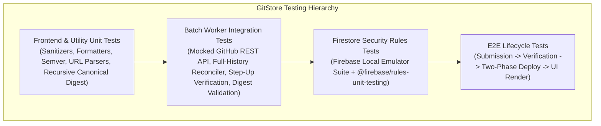

# GitStore — Comprehensive Testing Strategy

**Document Version:** 1.11.0  
**Phase:** Phase 0.1.11 — Fan-Out Generation Fencing, Idempotent Retry Accounting & Schema Truthfulness  
**Status:** IN_REVIEW — Awaiting Explicit User Approval  

---

## 1. Testing Philosophy & Quality Invariants

GitStore adheres to a layered testing hierarchy designed to guarantee platform reliability, client security, and pipeline idempotency without incurring external testing costs.

### Testing Invariants
1. **Zero-Trust Security Verification:** All Firestore Security Rules must be proven secure using automated unit tests executed against the **Firebase Local Emulator Suite** before production deployment.
2. **Deterministic Batch Pipeline & Provenance:** The GitHub Actions batch processor must be tested against simulated GitHub API failures, rate limits, corrupt assets, lease race conditions, complete pagination commit recoveries, and deployment aborts using mocked HTTP fixtures. Staging must prove exact source commit provenance with zero contamination.
3. **Cross-Browser Vanilla Compliance:** Frontend modules and CSS components must operate natively across Chromium, Gecko, and WebKit rendering engines without requiring transpilers or polyfills.

---

## 2. Testing Pyramid & Layer Breakdown



---

## 3. Layer 1: Frontend & Utility Unit Testing

- **Runner:** Node.js native test runner (`node --test`).
- **Scope:**
  - `sanitizers.js`: Verify that malicious SVG tags, `<script>` tags, and `javascript:` URIs are completely stripped via DOMPurify.
  - `formatters.js`: Validate byte size formatting (`1024 B -> 1.0 KB`, `1048576 B -> 1.0 MB`), date formatting, and semver comparison.
  - `url-validator.js`: Confirm regex correctly matches valid GitHub repository URLs (`https://github.com/owner/repo`) and rejects phishing or spoofed domains.
  - `catalog-digest.js`: Assert deterministic SHA-256 digest computation (`sha256:v1:...`) over canonicalized JSON files.
  - `output-bridge.js`: Assert `emitStepOutput` writes to `$GITHUB_OUTPUT` and rejects multi-line values to prevent command injection.

### 3.1 Recursive Canonical Digest Unit Tests
```javascript
import { test, describe } from 'node:test';
import assert from 'node:assert';
import { canonicalizeJson, computeCatalogDigest } from './catalog-digest.js';

describe('Deterministic Recursive Canonical Digest Tests', () => {
  test('Property 1: Key Ordering Invariance', () => {
    const objA = { b: 1, a: { y: 2, x: 3 } };
    const objB = { a: { x: 3, y: 2 }, b: 1 };
    assert.strictEqual(canonicalizeJson(objA), '{"a":{"x":3,"y":2},"b":1}');
    assert.strictEqual(canonicalizeJson(objA), canonicalizeJson(objB));
  });

  test('Property 2: Array Element Order Sensitivity', () => {
    const arrA = [1, 2, 3];
    const arrB = [3, 2, 1];
    assert.notStrictEqual(canonicalizeJson(arrA), canonicalizeJson(arrB));
  });

  test('Property 3: Type Distinction', () => {
    const strObj = { v: "123" };
    const numObj = { v: 123 };
    assert.notStrictEqual(canonicalizeJson(strObj), canonicalizeJson(numObj));
  });

  test('Property 4: Unicode Normalization & UTF-8 Encoding Stability', () => {
    const obj = { name: "café", icon: "🚀" };
    assert.strictEqual(canonicalizeJson(obj), '{"icon":"🚀","name":"café"}');
  });

  test('Property 5: Path Framing Collision Resistance', () => {
    const frameA = Buffer.from('FILE\0a/b\01\0c', 'utf8');
    const frameB = Buffer.from('FILE\0a\03\0/bc', 'utf8');
    assert.notDeepStrictEqual(frameA, frameB);
  });

  test('Property 6: Manifest Exclusion Invariant', () => {
    const files = ['data/catalog.json', 'data/categories.json', 'data/deployment-manifest.json'];
    const filtered = files.filter(f => !f.endsWith('deployment-manifest.json'));
    assert.strictEqual(filtered.length, 2);
    assert.ok(!filtered.includes('data/deployment-manifest.json'));
  });
});
```

---

## 4. Layer 2: Firestore Security Rules Testing (Local Emulator)

- **Tool:** `@firebase/rules-unit-testing` running against the official **Firebase Firestore Emulator**.
- **Execution:** Runs in local development and inside CI workflows prior to deployment.
- **Key Test Cases:**
  1. **Anonymous Read on Public Data:** Anonymous client CAN read published active products (`/products`), categories (`/categories`), and public developer profiles (`/public_profiles`).
  2. **Private User Document Lockout (`/users/{uid}`):**
     - Anonymous client CANNOT read `/users/{uid}`.
     - Authenticated developer CANNOT read another developer's `/users/{otherUid}` document.
     - Authenticated developer CAN read their own `/users/{uid}` document.
     - Update with `diff().affectedKeys()`: Owner CAN update `displayName`, `avatarUrl`, `bio`, `settings`. Attempting to modify `isAdmin`, `isVerifiedDeveloper`, `reputationScore`, `githubNumericId`, or `email` is rejected.
  3. **Submission Field Tampering & Nested `productData` Schema Enforcement:**
     - Client CAN create submission document with exact allowed client payload keys: `['id', 'developerUid', 'submissionSource', 'repoNumericId', 'repoId', 'targetProductId', 'productData', 'status', 'claimStatus', 'createdAt', 'updatedAt']`.
     - Client CANNOT create submission containing ANY worker-managed fields: `validationResults`, `ownershipProof`, `processingLease`, `adminNotes`, `reviewedBy`, `reviewedAt`, `publishedProductId`, `publishedGenerationId`, `publishedGenerationSequence`. Test asserts create operation is REJECTED with permission-denied.
     - **Nested `productData` Validation Tests:**
       - *Slug Canonicalization:* Valid slug `awesome-app-1` SUCCEEDS. Invalid slugs `Awesome-App`, `app_v1`, `-app`, `app-` are REJECTED.
       - *Repository URLs & Identity:* Valid `https://github.com/owner/repo` SUCCEEDS; non-GitHub URLs or URLs > 200 chars are REJECTED.
       - *Selected Asset Map:* Test with all 5 mandatory keys (`name`, `extension`, `sizeBytes`, `downloadUrl`, `assetId`). REJECT if any key is missing or extraneous keys exist. REJECT if `sizeBytes` <= 0 or > 524,288,000 (500 MiB). REJECT if `downloadUrl` does not match GitHub release format.
       - *Screenshots Array:* Array of 0-6 HTTPS URLs SUCCEEDS. Array with > 6 items or containing non-URL / non-string items is REJECTED.
       - *Supported Platforms Enum:* Array containing `['windows', 'linux']` SUCCEEDS. Array containing invalid platform (e.g. `'solaris'`, `'xbox'`) or empty array is REJECTED.
       - *Arbitrary Nested Keys:* Attempting to inject extra properties (e.g. `productData.isFeatured = true` or `productData.selectedAsset.checksum = 'abc'`) is REJECTED by `hasOnly()` checks.
       - *Update Schema Consistency:* Updating a queued or rejected submission enforces the exact same nested schema validation rules.
  4. **Action-Specific Moderation Payload Tests (`/moderation_requests`):**
     - `APPROVE_SUBMISSION`: SUCCEEDS with valid `reviewNotes` (<= 1000 chars) or empty payload. FAILS if unexpected keys are present.
     - `REJECT_SUBMISSION`: FAILS if `rejectionReason` is missing or < 10 chars. SUCCEEDS with valid reason (10–1000 chars).
     - `VERIFY_DEVELOPER`: FAILS if `verificationReason` is missing. SUCCEEDS with valid reason (10–500 chars).
     - `REVOKE_DEVELOPER`: FAILS if `revocationReason` is missing. SUCCEEDS with valid reason (10–500 chars).
     - `DELIST_PRODUCT`: FAILS if `delistReason` missing or `noticePeriodDays` outside 0–30.
     - `FEATURE_PRODUCT`: FAILS if `featuredRank` outside 1–100.
     - Target Path Binding: Rejects if `targetDocumentPath != 'submissions/' + targetId` for approve/reject, or `!= 'products/' + targetId` for delist/feature.
  5. **Internal Collection Default-Deny:**
     - Client CANNOT read or write `/consumed_stepup_nonces/{nonceHash}`.
     - Client CANNOT read or write `/system_deployments`, `/system_config/deployment_state`, `/system_config/catalog_state`, `/admin_logs`.

---

## 5. Layer 3: Batch Worker Integration & Concurrency Testing

- **Scope:** Verify the GitHub Actions processing engine (`scripts/processor/index.js`).
- **Mock Framework:** Mock the GitHub REST API using `nock` or `msw`.

### 5.1 Root Administrator Bootstrap & Collaborator Permission Mapping
- **Root Admin Match:** Mock `GET /repos/Rohitpvt/GitStore` returning `owner.id = 12345678`. Mock Firebase Auth user with `identities['github.com'] = ['12345678']`. Assert authorized directly without collaborator query.
- **Maintainer Role Match:** Mock `GET .../collaborators/{login}/permission` returning `role_name: 'maintain'`. Assert caller is authorized.

### 5.2 Action-Bound Step-Up Reauthentication & Atomic Nonce Ledger Tests
- **Valid Step-Up Flow & Single-Use Nonce Consumption:**
  - Request contains action-bound proof `{ providerId: 'github.com', authTime, actionNonce, targetDocumentPath, actionHash }`.
  - Worker computes `expectedHash = sha256(`${action}:${targetDocumentPath}:${actionNonce}:${authTime}`)`.
  - Assert: Worker confirms `actionHash === expectedHash` as client data-integrity checksum.
  - Worker atomically leases request AND inserts `/consumed_stepup_nonces/{nonceHash}` with `requestedByUid` in one transaction.
- **Nonce Replay Prevention Across Documents & Actions:**
  - Simulate submission of a second moderation request containing the same `actionNonce`.
  - Transaction reads `/consumed_stepup_nonces/{nonceHash}`. Document exists; transaction immediately aborts with `NONCE_ALREADY_CONSUMED`.
- **Failed Execution Nonce Burning:**
  - Simulate request failure during privileged processing. Nonce document remains written and burned.

### 5.3 Commit Recovery Granular Error Classification Tests
- **CANDIDATE_NO_MANIFEST (HTTP 404):** Mock commit lookup returning 404 for manifest blob. Assert worker continues to next candidate commit without error.
- **API_AUTH_ERROR (HTTP 401):** Mock commit lookup returning 401. Assert worker marks fatal error, sets `isSearchIncomplete = true`, halts search loop immediately, retains generation in `pending_retry`, and alerts administrator.
- **API_PERMISSION_OR_RATE_LIMIT (HTTP 403 / 429):** Mock secondary rate limit on commit lookup. Assert worker sets `isSearchIncomplete = true`, retains generation in `pending_retry`, and DOES NOT declare `EMPTY_SEARCH` or abandon the generation.
- **API_SERVER_ERROR (HTTP 5xx):** Mock upstream server error. Assert worker retains generation in `pending_retry`.
- **NETWORK_ERROR (Timeouts & Connection Resets):** Mock `ETIMEDOUT` or `ECONNRESET` during Contents API fetch. Assert worker sets `isSearchIncomplete = true`, retains generation in `pending_retry`, and does not treat network interruption as proof of absence.
- **CANDIDATE_CORRUPT_MANIFEST (Malformed JSON):** Mock invalid JSON in manifest blob. Assert worker records corruption (`hasCorruptCandidates = true`), logs warning, and continues. Assert search NEVER declares empty if corrupt candidates exist; routes to `manual_review` instead.
- **API_MALFORMED_RESPONSE (Missing Content):** Mock HTTP 200 response with null `content` field. Assert classified as malformed response, setting `isSearchIncomplete = true`.
- **EMPTY_SEARCH Assertion:** Mock all commit pages returning 0 matches with zero API errors and zero corrupt candidates. Assert worker marks generation `failed` with `commit_not_found_on_remote` and `reconciliationStatus = 'abandoned'`.

### 5.4 Single Authoritative Staging & Case B Provenance Tests
- **Case B Recovery Staging & SHA Preservation:**
  - Mock Pages returning 404. Worker extracts files from `gen.catalogCommitSha` directly into `site/`.
  - Recomputes `stagedDigest = computeCatalogDigest('site/data')`.
  - Assert: `stagedDigest === gen.catalogDigest`.
  - Output assertion: Worker exports `commit_needed = 'false'`, `deploy_needed = 'true'`, and exports the exact recovered `catalog_commit_sha` unchanged (never replaced by workspace `git rev-parse HEAD`).
- **Staged Digest Mismatch Abort:**
  - Corrupt a file in `site/data/catalog.json`.
  - Assert: Worker detects mismatch, deletes `site/`, and aborts deployment.
- **Zero Post-Staging Copies:** Assert workflow executes zero copy commands from workspace root into `site/` after staging completes.

### 5.5 Explicit `$GITHUB_OUTPUT` Bridge Tests
- **Output Export:** Execute `emitStepOutput('deploy_needed', 'true')` and `emitStepOutput('commit_needed', 'false')` with mock `GITHUB_OUTPUT` file. Read file; assert content matches expected lines.
- **Newline Injection Defense:** Call `emitStepOutput('key', 'val\nattack=true')`. Assert throws security error.

### 5.6 2-Tier Transactional Finalization, Bounded Subcollections & Global-Fenced Concurrency Tests
- **Tier 1 (Atomic Publication Anchor):**
  - Transaction reads `catalog_state`, `deployment_state`, and `system_deployments/{id}` before any writes.
  - Assert: Requires `freshGen.fanoutPreparationStatus === 'prepared'` before permitting publication; aborts with `PREPARATION_INCOMPLETE_ABORT` if missing.
  - Evaluates `evaluateGenerationOrdering` and revision monotonicity.
  - Assert: Exactly 3 writes committed in transaction; marks `status: 'published'`, `reconciliationStatus: 'fanout_pending'`, `submissionFanoutStatus: 'pending'`, `completedSubmissionCount: 0`, `completedFanoutBatches: 0`.
- **Stale Abort:** If candidate `capturedRevision < catalogState.latestPublishedRevision`, transaction throws immediately. Generation marked `stale_aborted`.
- **Bounded Storage & Quota-Aware Document Limit:**
  - Mock generation with 10,000 published submissions.
  - Assert: Submissions partitioned into 25 deterministic subcollection batches (`batch_00000` to `batch_00024`), each containing at most 400 IDs (conservative size: $400 \times 128\text{ B} \approx 55\text{ KB} \ll 1\text{ MiB}$ limit).
  - Assert: Parent generation document retains only $O(1)$ scalar counters (`expectedSubmissionCount: 10000`, `totalFanoutBatches: 25`, etc.), remaining strictly bounded and far below the 1 MiB limit (< 2 KB).
- **Pure Transaction Callback Tests:**
  - Inject contention into `db.runTransaction` causing 3 retries before final commit.
  - Assert: Outer counters (`batchCompleted`, `batchSkipped`) are NOT mutated during failed attempts; incremented strictly once upon final commit.
- **Global Fan-Out Generation Fence & Concurrency Tests (9 Scenarios):**
  1. *A and B fan-out simultaneously:* Test concurrent execution of Generation A (seq 10) and B (seq 11). Assert Generation B commits first; A retries, reads `/system_config/deployment_state`, observes $10 < 11$, and aborts with `STALE_GLOBAL_GENERATION_ABORT` with zero writes.
  2. *A resumes after B has completed:* Worker resumes fan-out for Generation A. A reads `/system_config/deployment_state` (seq 11), aborts fan-out immediately; B's publication state is 100% preserved.
  3. *A resumes after B published but before B completes fan-out:* Interleaved execution. A's mini-chunk transaction reads `/system_config/deployment_state` at the consistency boundary, observes global sequence 11 > 10, and aborts with `STALE_GLOBAL_GENERATION_ABORT` before modifying any unreached submissions. Older generation A is completely fenced off.
  4. *Admin rejects submission after A captured revision:* Mock admin setting `status: 'rejected'` while A deploys. Assert A's fan-out transaction detects ineligible status and skips document (`skipped_status_ineligible`), never resurrecting rejected submission to `published`.
  5. *Admin delists product during A's deployment:* Mock admin setting `/products/{productId}` status to `'delisted'`. Assert fan-out transaction skips document, keeping product delisted and never reactivating.
  6. *Post-capture reapproval fence:* Mock submission rejected and subsequently re-approved with `approvedCatalogRevision: 16` while deploying generation captured at revision 15. Assert fan-out transaction skips document (`skipped_post_capture_reapproval`), preventing publication of stale snapshot.
  7. *Equal-sequence conflicting ID:* Mock submission or global state with identical sequence but different generation ID. Assert transaction throws `HALT_CONFLICT` and fails closed.
  8. *Worker crashes after batch completion:* Child batch completion and parent counter increment commit in a single atomic transaction. Assert retry evaluates `already_completed` (no-op) with zero counter inflation.
  9. *Bounded cursor pagination test:* Query 50 batches using `.limit(10)` and `.startAfter()`. Assert 5 complete pages are retrieved and processed sequentially without unbounded memory usage.
- **Max Retries & Manual Review Fallback:** After 5 consecutive failed attempts on any batch or on fatal `HALT_CONFLICT`, atomically transitions child batch to `status: 'manual_review'` and parent to `manual_review`, and records alert in `/admin_logs`.

---

## 6. Layer 4: Storefront Client Integration & Performance Testing

- **Testing Tools:** Playwright / Chromium headless.
- **Assertions:**
  1. **Catalog Rendering:** `index.html` loads and renders product cards from `data/catalog.json` in under 300ms.
  2. **Filtering Performance:** Category and platform filters update DOM in under 50ms without network round-trips.
  3. **Download Link Integrity:** Verifies clicking "Download" directs user directly to upstream GitHub Release asset URL.
