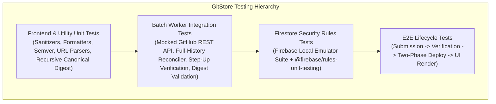

# GitStore — Comprehensive Testing Strategy

**Document Version:** 1.8.0  
**Phase:** Phase 0.1.7 — Replay Protection, Firestore Field Integrity & Deployment State Consistency  
**Status:** IN_REVIEW — Awaiting Explicit User Approval  

---

## 1. Testing Philosophy & Quality Invariants

GitStore adheres to a layered testing hierarchy designed to guarantee platform reliability, client security, and pipeline idempotency without incurring external testing costs.

### Testing Invariants
1. **Zero-Trust Security Verification:** All Firestore Security Rules must be proven secure using automated unit tests executed against the **Firebase Local Emulator Suite** before production deployment.
2. **Deterministic Batch Pipeline & Recovery:** The GitHub Actions batch processor must be tested against simulated GitHub API failures, rate limits, corrupt assets, lease race conditions, complete pagination commit recoveries, and deployment aborts using mocked HTTP fixtures.
3. **Cross-Browser Vanilla Compliance:** Frontend modules and CSS components must operate natively across Chromium, Gecko, and WebKit rendering engines without requiring transpilers or polyfills.

---

## 2. Testing Pyramid & Layer Breakdown



---

## 3. Layer 1: Frontend & Utility Unit Testing

- **Runner:** Node.js native test runner (`node --test`).
- **Scope:**
  - `sanitizers.js`: Verify that malicious SVG tags, `<script>` tags, and `javascript:` URIs are completely stripped via DOMPurify.
  - `formatters.js`: Validate byte size formatting (`1024 B -> 1.0 KB`, `1048576 B -> 1.0 MB`), date formatting, and semver comparison.
  - `url-validator.js`: Confirm regex correctly matches valid GitHub repository URLs (`https://github.com/owner/repo`) and rejects phishing or spoofed domains.
  - `catalog-digest.js`: Assert deterministic SHA-256 digest computation (`sha256:v1:...`) over canonicalized JSON files.

### 3.1 Recursive Canonical Digest Unit Tests (The 6 Invariant Properties)
```javascript
import { test, describe } from 'node:test';
import assert from 'node:assert';
import { canonicalizeJson, computeCatalogDigest } from './catalog-digest.js';

describe('Deterministic Recursive Canonical Digest Tests', () => {
  test('Property 1: Key Ordering Invariance', () => {
    const objA = { b: 1, a: { y: 2, x: 3 } };
    const objB = { a: { x: 3, y: 2 }, b: 1 };
    assert.strictEqual(canonicalizeJson(objA), '{"a":{"x":3,"y":2},"b":1}');
    assert.strictEqual(canonicalizeJson(objA), canonicalizeJson(objB));
  });

  test('Property 2: Array Element Order Sensitivity', () => {
    const arrA = [1, 2, 3];
    const arrB = [3, 2, 1];
    assert.notStrictEqual(canonicalizeJson(arrA), canonicalizeJson(arrB));
  });

  test('Property 3: Type Distinction', () => {
    const strObj = { v: "123" };
    const numObj = { v: 123 };
    assert.notStrictEqual(canonicalizeJson(strObj), canonicalizeJson(numObj));
  });

  test('Property 4: Unicode Normalization & UTF-8 Encoding Stability', () => {
    const obj = { name: "café", icon: "🚀" };
    const canonical = canonicalizeJson(obj);
    assert.strictEqual(canonical, '{"icon":"🚀","name":"café"}');
  });

  test('Property 5: Path Framing Collision Resistance', () => {
    // Unambiguous null-byte framing prevents concatenation ambiguity
    const frameA = Buffer.from('FILE\0a/b\01\0c', 'utf8');
    const frameB = Buffer.from('FILE\0a\03\0/bc', 'utf8');
    assert.notDeepStrictEqual(frameA, frameB);
  });

  test('Property 6: Manifest Exclusion Invariant', () => {
    // Proves data/deployment-manifest.json is never fed into digest calculation
    const files = ['data/catalog.json', 'data/categories.json', 'data/deployment-manifest.json'];
    const filtered = files.filter(f => !f.endsWith('deployment-manifest.json'));
    assert.strictEqual(filtered.length, 2);
    assert.ok(!filtered.includes('data/deployment-manifest.json'));
  });
});
```

---

## 4. Layer 2: Firestore Security Rules Testing (Local Emulator)

- **Tool:** `@firebase/rules-unit-testing` running against the official **Firebase Firestore Emulator**.
- **Execution:** Runs in local development and inside CI workflows prior to deployment.
- **Key Test Cases:**
  1. **Anonymous Read on Public Data:** Anonymous client CAN read published active products (`/products`), categories (`/categories`), and public developer profiles (`/public_profiles`).
  2. **Private User Document Lockout (`/users/{uid}`):**
     - Anonymous client CANNOT read `/users/{uid}`.
     - Authenticated developer CANNOT read another developer's `/users/{otherUid}` document.
     - Authenticated developer CAN read their own `/users/{uid}` document.
     - Update with `diff().affectedKeys()`: Owner CAN update `displayName`, `avatarUrl`, `bio`, `settings`. Attempting to modify `isAdmin`, `isVerifiedDeveloper`, `reputationScore`, `githubNumericId`, or `email` is rejected.
  3. **Public Profile Separation (`/public_profiles/{uid}`):**
     - Any user CAN read `/public_profiles/{uid}`.
     - Owner CAN update safe fields (`displayName`, `avatarUrl`, `bio`).
     - Owner CANNOT modify worker-managed badges (`isVerifiedDeveloper`, `publishedProductIds`).
  4. **Internal Collection Default-Deny:**
     - Client (anonymous or authenticated) CANNOT read or write `/system_deployments/{generationId}`.
     - Client CANNOT read or write `/system_config/deployment_state`.
     - Client CANNOT read or write `/system_config/catalog_state`.
     - Client CANNOT read or write `/consumed_stepup_nonces/{nonceHash}`.
     - Client CANNOT read or write `/admin_logs/{logId}`.
     - Client CAN read `/system_config/global_settings`, but CANNOT write.
  5. **Submission Field Tampering & Creation Allowlist Enforcement:**
     - Client CAN create submission document with exact allowed client payload keys: `['id', 'developerUid', 'submissionSource', 'repoNumericId', 'repoId', 'targetProductId', 'productData', 'status', 'claimStatus', 'createdAt', 'updatedAt']`.
     - Client CANNOT create submission containing ANY worker-managed fields: `validationResults`, `ownershipProof`, `processingLease`, `adminNotes`, `reviewedBy`, `reviewedAt`, `publishedProductId`. Test asserts create operation is REJECTED with permission-denied.
     - Client CANNOT create submission with `status != 'queued'` or `claimStatus != 'claimed'`.
     - Client CANNOT create submission with invalid `productData` (missing `name`, `category`, `shortDescription`, `selectedAsset`).
     - Authenticated developer CANNOT update a submission that is in `processing`, `approved`, or `published` status.
     - Authenticated developer CAN only update `productData`, `status`, `updatedAt` on existing submissions while status is `queued` or `needs_review`.
  6. **Claim Request Whitelist:** Authenticated user CAN create a `claim_requests` doc with their own `auth.uid` and `status: 'pending'`, but CANNOT inject privileged or worker fields (`developerUid`, `verifiedGithubId`, `claimStatus`, `isAdmin`, `workerLease`, `workerId`).
  7. **Moderation Queue Security & Action-Bound Step-Up Proof:**
     - Request write FAILS if token `auth_time` is older than 300 seconds (`(request.time - auth_time) >= 300`).
     - Request write FAILS if `sign_in_provider != 'github.com'`.
     - Request write FAILS if `stepUpProof` schema contains unapproved keys or missing fields.
     - Request write SUCCEEDS if `auth_time` is fresh (< 300s), fields match strict whitelist, and action-bound proof matches schema.
     - Client CANNOT update or delete moderation requests once written (`allow update, delete: if false;`).
  8. **Abuse Reports Protection:**
     - Unauthenticated client CANNOT create report.
     - Authenticated client CAN create report with `status == 'open'` and `details.size() <= 2000`.
     - Authenticated client CANNOT read, update, or delete existing reports.

---

## 5. Layer 3: Batch Worker Integration & Concurrency Testing

- **Scope:** Verify the GitHub Actions processing engine (`scripts/processor/index.js`).
- **Mock Framework:** Mock the GitHub REST API using `nock` or `msw`.
- **Key Test Scenarios:**

### 5.1 Root Administrator Bootstrap & Collaborator Permission Mapping
1. **Numeric ID Normalization Unit Tests (`normalizeGithubId`):**
   ```javascript
   assert.strictEqual(normalizeGithubId(12345678), "12345678");
   assert.strictEqual(normalizeGithubId("12345678"), "12345678");
   assert.strictEqual(normalizeGithubId("  12345678  "), "12345678");
   assert.strictEqual(normalizeGithubId(null), null);
   assert.strictEqual(normalizeGithubId(undefined), null);
   assert.strictEqual(normalizeGithubId(""), null);
   assert.strictEqual(normalizeGithubId("abc123"), null);
   assert.strictEqual(normalizeGithubId("12.34"), null);
   ```
2. **Root Administrator Bootstrap Test:**
   - Mock `GET /repos/Rohitpvt/GitStore` returning `{ owner: { id: 12345678, login: "Rohitpvt" } }`.
   - Mock Firebase Admin SDK `admin.auth().verifyIdToken()` returning `uid: "admin_uid"`.
   - Mock `admin.auth().getUser("admin_uid")` returning `providerData: [{ providerId: "github.com", uid: "12345678" }]`.
   - Assert: Caller is authenticated as ROOT ADMINISTRATOR directly without making collaborator endpoint queries.
3. **Collaborator Permission Mapping Test Fixtures (Delegated Maintainers):**
   ```javascript
   const fixtures = [
     { resp: { permission: 'admin', role_name: 'admin' }, expected: 'AUTHORIZED' },
     { resp: { permission: 'write', role_name: 'maintain' }, expected: 'AUTHORIZED' },
     { resp: { permission: 'write', role_name: 'write' }, expected: 'FORBIDDEN' },
     { resp: { permission: 'read', role_name: 'triage' }, expected: 'FORBIDDEN' },
     { resp: { permission: 'read', role_name: 'read' }, expected: 'FORBIDDEN' },
     { resp: { permission: 'write', role_name: 'custom_reviewer' }, expected: 'FORBIDDEN' },
     { resp: { permission: 'admin' }, expected: 'AUTHORIZED' },
     { resp: {}, expected: 'FORBIDDEN' },
   ];
   ```

### 5.2 Action-Bound Step-Up Reauthentication & Atomic Nonce Ledger Tests
- **Valid Step-Up Flow & Single-Use Nonce Consumption:**
  - Request contains action-bound proof `{ providerId: 'github.com', authTime, actionNonce, targetDocumentPath, actionHash }`.
  - Worker computes `expectedHash = sha256(`${action}:${targetDocumentPath}:${actionNonce}:${authTime}`)`.
  - Assert: Worker confirms `actionHash === expectedHash` as client data-integrity checksum.
  - Worker atomically leases request AND inserts `/consumed_stepup_nonces/{nonceHash}` in one transaction.
  - Assert: Zero raw OAuth access tokens existed in document.
- **Nonce Replay Prevention Across Documents & Actions:**
  - Simulate submission of a second moderation request containing the same `actionNonce` (targeting a different document or action).
  - Worker enters atomic transaction, attempts to read `/consumed_stepup_nonces/{nonceHash}`.
  - Document exists; transaction immediately aborts with `NONCE_ALREADY_CONSUMED`.
  - Assert: Moderation request status transitions to `failed`, lease is rejected, and second privileged action is blocked.
- **Failed Execution Nonce Burning:**
  - Simulate request failure during privileged processing (e.g., GitHub API outage during product delist).
  - Assert: Nonce document in `/consumed_stepup_nonces` remains written and burned. Recovery requires client to initiate fresh reauthentication producing a brand-new nonce.
- **Target Document Path Validation:**
  - Mock request with `action: 'APPROVE_SUBMISSION'` and `targetDocumentPath: 'system_config/catalog_state'`.
  - Worker asserts canonical target mapping: `APPROVE_SUBMISSION` requires path matching `^submissions/[a-zA-Z0-9_-]+$`.
  - Assert: Worker rejects request with `TARGET_DOCUMENT_INVALID` and raises security alarm.

### 5.3 Complete Commit Pagination & Error Classification Tests
- **Discovery Beyond 100 Commits via Link Header Pagination:**
  - Simulate commit history where candidate manifest commit is at depth 250 across 3 API pages.
  - Mock `GET /repos/Rohitpvt/GitStore/commits` returning page 1 with `Link: <...page=2>; rel="next"`, page 2 with `Link: <...page=3>; rel="next"`, and page 3 with matching commit.
  - Assert: Worker loop traverses all pages without hitting arbitrary 5-page depth limits and successfully discovers the commit.
- **Incomplete Search vs Empty Search Distinction:**
  - Simulate network timeout or HTTP 403 Secondary Rate Limit on page 2.
  - Assert: Worker classifies failure as `INCOMPLETE_SEARCH`, preserves generation in `pending_retry`, and DOES NOT classify search as `EMPTY_SEARCH` (which would erroneously abandon or fail closed).
- **Commit SHA Shell Injection Defense:**
  - Simulate candidate commit SHA containing shell metacharacters: `abc123; rm -rf /`.
  - Assert: Worker regex validation `/^[0-9a-f]{40}$/i` rejects the SHA before passing it to any git command.

### 5.4 GitHub Pages Status & Deployment Recovery Cases (A, B, C, D)
- **Status Endpoint Matrix Tests (`GET /repos/Rohitpvt/GitStore/pages/deployments/{pages_deployment_id}`):**
  - Response `{ status: "succeed" }` -> Assert worker accepts deployment as live and finalizes database status.
  - Response `{ status: "queued" }` or `{ status: "in_progress" }` -> Assert worker enters polling loop with exponential backoff.
  - Response `{ status: "errored" }` -> Assert worker retries deployment or flags for admin review.
  - Response `HTTP 404` -> Assert worker transitions to Case B recovery.
  - Response `HTTP 401` or `HTTP 403` -> Assert worker throws fatal permissions error and halts workflow.
  - Response `HTTP 5xx` -> Assert worker preserves generation state for subsequent retry.
  - Response `{ status: "built" }` or unknown string -> Assert worker REJECTS unrecognized status and halts execution.
- **Case B Recovery & Cross-Job Artifact Handoff Test:**
  - Simulate worker finding commit exists on remote `main`, but GitHub Pages API returns 404.
  - Assert: Worker checks out commit, computes canonical catalog digest, verifies matching digest, stages `site/`, returns `{ deployNeeded: true, generationId, generationSequence, catalogCommitSha, catalogDigest }`, and writes `deploy_needed=true` to `$GITHUB_OUTPUT`.
  - Assert: Job 1 uploads Pages artifact via `actions/upload-pages-artifact@v3`.
  - Assert: Job 2 (`deploy-to-pages`) executes conditionally when `needs.build-and-commit.outputs.deploy_needed == 'true'` and triggers `actions/deploy-pages@v4`.

### 5.5 Single Shared Generation Ordering Decision Function Tests
```javascript
import { test, describe } from 'node:test';
import assert from 'node:assert';
import { evaluateGenerationOrdering } from './generation-order.js';

describe('Unified Generation Ordering Decision Matrix', () => {
  test('Branch 1: Reject Stale Generation', () => {
    assert.strictEqual(evaluateGenerationOrdering(9, 'gen_old', 10, 'gen_active'), 'REJECT_STALE');
  });

  test('Branch 2: Allow Idempotent Re-execution', () => {
    assert.strictEqual(evaluateGenerationOrdering(10, 'gen_active', 10, 'gen_active'), 'ALLOW_IDEMPOTENT');
  });

  test('Branch 3: Halt Conflicting Sequence Collision', () => {
    assert.strictEqual(evaluateGenerationOrdering(10, 'gen_fork', 10, 'gen_active'), 'HALT_CONFLICT');
  });

  test('Branch 4: Allow Strictly Monotonic Generation', () => {
    assert.strictEqual(evaluateGenerationOrdering(11, 'gen_new', 10, 'gen_active'), 'ALLOW_NEW');
  });
});
```

### 5.6 Durable Catalog Revision Transaction & Stale Abort Tests
- **Stale Generation Abort Test:**
  - Mock `latestPublishedRevision: 5` in `/system_config/catalog_state`.
  - Worker attempts to finalize generation with `capturedRevision: 4`.
  - Transaction checks `capturedRevision < currentPublishedRevision`.
  - Assert: Transaction throws immediately, rolls back, aborts finalization, marks `/system_deployments/{generationId}` as `status: 'stale_aborted'`, and preserves published revision 5 unchanged.
- **Valid Revision Advancement Test:**
  - Mock `latestPublishedRevision: 5` and `latestRequestedRevision: 6`.
  - Worker finalizes generation with `capturedRevision: 6`.
  - Assert: Transaction updates `latestPublishedRevision` to 6, sets `isDirty: false`, marks generation `published`, and commits atomically.

---

## 6. Layer 4: Storefront Client Integration & Performance Testing

- **Testing Tools:** Playwright / Chromium headless.
- **Assertions:**
  1. **Catalog Rendering:** `index.html` loads and renders 50 product cards from `data/catalog.json` in under 300ms.
  2. **Filtering Performance:** Clicking category or platform filters updates the DOM in under 50ms without network round-trips.
  3. **Search Responsiveness:** Typing in the search input highlights matching applications instantaneously.
  4. **Accessibility Audit:** Automated axe-core scan confirms zero WCAG 2.1 AA violations.
  5. **Download Link Integrity:** Verifies that clicking "Download" directs user directly to the upstream GitHub Release asset URL.
