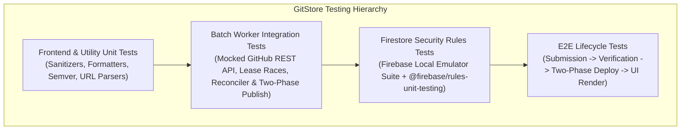

# GitStore — Comprehensive Testing Strategy

**Document Version:** 1.3.0  
**Phase:** Phase 0.1.2 — Final Security & Architecture Corrections  
**Status:** Approved Quality Assurance & Testing Framework (Hardened)  

---

## 1. Testing Philosophy & Quality Invariants

GitStore adheres to a layered testing hierarchy designed to guarantee platform reliability, client security, and pipeline idempotency without incurring external testing costs.

### Testing Invariants
1. **Zero-Trust Security Verification:** All Firestore Security Rules must be proven secure using automated unit tests executed against the **Firebase Local Emulator Suite** before production deployment.
2. **Deterministic Batch Pipeline:** The GitHub Actions batch processor must be tested against simulated GitHub API failures, rate limits, corrupt assets, lease race conditions, and deployment aborts using mocked HTTP fixtures.
3. **Cross-Browser Vanilla Compliance:** Frontend modules and CSS components must operate natively across Chromium, Gecko, and WebKit rendering engines without requiring transpilers or polyfills.

---

## 2. Testing Pyramid & Layer Breakdown



---

## 3. Layer 1: Frontend & Utility Unit Testing

- **Runner:** Node.js native test runner (`node --test`).
- **Scope:**
  - `sanitizers.js`: Verify that malicious SVG tags, `<script>` tags, and `javascript:` URIs are completely stripped via DOMPurify.
  - `formatters.js`: Validate byte size formatting (`1024 B -> 1.0 KB`, `1048576 B -> 1.0 MB`), date formatting, and semver comparison.
  - `url-validator.js`: Confirm regex correctly matches valid GitHub repository URLs (`https://github.com/owner/repo`) and rejects phishing or spoofed domains.

---

## 4. Layer 2: Firestore Security Rules Testing (Local Emulator)

- **Tool:** `@firebase/rules-unit-testing` running against the official **Firebase Firestore Emulator**.
- **Execution:** Runs in local development and inside CI workflows prior to deployment.
- **Key Test Cases:**
  1. **Anonymous Read:** Anonymous client CAN read published active products and categories.
  2. **Anonymous Write:** Anonymous client CANNOT write to `submissions`, `moderation_requests`, `claim_requests`, or `users`.
  3. **Self-Escalation Attack:** Authenticated developer CANNOT update their user document to set `isAdmin: true` or `isVerifiedDeveloper: true`.
  4. **Submission Tampering:** Authenticated developer CANNOT update a submission that is already in `processing`, `approved`, or `published` status, and CANNOT alter ownership fields (`developerUid`, `claimStatus`, `ownershipProof`).
  5. **Claim Request Protection:** Authenticated user CAN create a `claim_requests` doc with their own `auth.uid` and `status: 'pending'`, but CANNOT update, delete, or create a claim request with another user's UID.
  6. **Unauthorized Publish:** Authenticated developer CANNOT create a document directly in the `products` collection.
  7. **Moderation Queue Security:** Authenticated user CAN create a `moderation_requests` doc with `status: 'pending'`, but CANNOT update or delete it.

---

## 5. Layer 3: Batch Worker Integration & Concurrency Testing

- **Scope:** Verify the GitHub Actions processing engine (`scripts/processor/index.js`).
- **Mock Framework:** Mock the GitHub REST API using `nock` or `msw`.
- **Key Test Scenarios:**

### 5.1 Collaborator Permission Mapping Test Fixtures
Test the worker authorization logic against official response fixtures for `GET /repos/Rohitpvt/GitStore/collaborators/{username}/permission`:
```javascript
const fixtures = [
  { resp: { permission: 'admin', role_name: 'admin' }, expected: 'AUTHORIZED' },
  { resp: { permission: 'write', role_name: 'maintain' }, expected: 'AUTHORIZED' },
  { resp: { permission: 'write', role_name: 'write' }, expected: 'FORBIDDEN' },
  { resp: { permission: 'read', role_name: 'triage' }, expected: 'FORBIDDEN' },
  { resp: { permission: 'read', role_name: 'read' }, expected: 'FORBIDDEN' },
  { resp: { permission: 'write', role_name: 'custom_reviewer' }, expected: 'FORBIDDEN' },
  { resp: { permission: 'admin' }, expected: 'AUTHORIZED' }, // Legacy admin without role_name
  { resp: {}, expected: 'FORBIDDEN' },                      // Empty response
];
```

### 5.2 Token Permission Classification
- *Verification Status:* **Pending Integration Verification**.
- Assert that if the worker receives `403 Resource not accessible by integration` using `secrets.GITHUB_TOKEN`, it automatically falls back to `secrets.ADMIN_VERIFY_TOKEN` (fine-grained PAT / GitHub App token) and successfully authenticates.

### 5.3 Globally Unique Entity ID Collision Tests
- **Cross-Repository Same-Slug Collision:**
  - Repo 1 (Numeric ID: `892341901`) with product slug `viewer` -> IDs generated: `prod_892341901_viewer`.
  - Repo 2 (Numeric ID: `945112002`) with product slug `viewer` -> IDs generated: `prod_945112002_viewer`.
  - Assert both products coexist in Firestore without overwriting or key collisions.
- **Issue Submission Collision:**
  - Repo 1 issue #42 -> `sub_issue_892341901_42`.
  - Repo 2 issue #42 -> `sub_issue_945112002_42`.
  - Assert submission keys are globally unique.

### 5.4 Publication State Machine & Two-Tier Verification Tests
- **Commit on `main` without Pages Deployment Success:**
  - Worker commits `data/catalog.json`, but mocked Deployments API returns `state: "failure"`.
  - Assert submissions are marked `deployment_failed` and reset to `approved`.
  - Assert Firestore document status is **NOT** marked `published`.
- **Public HTTP Manifest Check:**
  - Mock Deployments API returning `success` for SHA `abc123`.
  - Mock public HTTP fetch to `data/deployment-manifest.json` returning `{ commitSha: 'abc123', generationId: 'gen_1' }`.
  - Assert submissions are finalized to `published`.
- **Reconciliation Self-Healing:**
  - Simulate reverse failure: deployment succeeded, but Firestore update timed out.
  - Reconciler runs on next batch startup, verifies public manifest, and heals unconfirmed submissions to `published`.

### 5.5 Secure Submission Claiming (`/claim_requests`)
- **Valid Claim:** User with verified `github.com` provider ID `'583231'` claims submission with `submitterGithubId: '583231'`. Assert `developerUid` is set and status is `claimed`.
- **Identity Mismatch:** User with provider ID `'999999'` attempts to claim submission `'583231'`. Assert claim request is marked `rejected_mismatch`, submission remains `unclaimed`.
- **Duplicate Claim:** Assert claiming an already-claimed submission is rejected with `rejected_already_claimed`.

---

## 6. Layer 4: Storefront Client Integration & Performance Testing

- **Testing Tools:** Playwright / Chromium headless.
- **Assertions:**
  1. **Catalog Rendering:** `index.html` loads and renders 50 product cards from `data/catalog.json` in under 300ms.
  2. **Filtering Performance:** Clicking category or platform filters updates the DOM in under 50ms without network round-trips.
  3. **Search Responsiveness:** Typing in the search input highlights matching applications instantaneously.
  4. **Accessibility Audit:** Automated axe-core scan confirms zero WCAG 2.1 AA violations.
  5. **Download Link Integrity:** Verifies that clicking "Download" directs user directly to the upstream GitHub Release asset URL.
