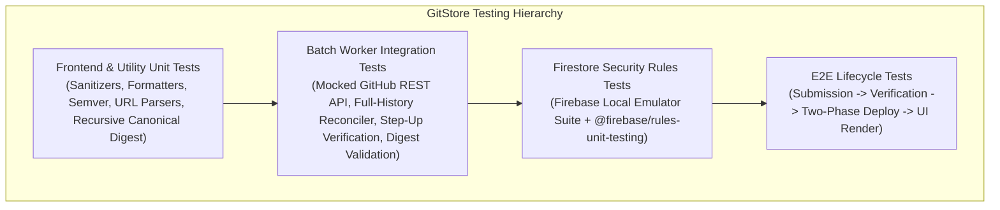

# GitStore — Comprehensive Testing Strategy

**Document Version:** 1.9.0  
**Phase:** Phase 0.1.8 — Node 24 Workflow Compatibility, Artifact Provenance & Transactional Deployment Integrity  
**Status:** IN_REVIEW — Awaiting Explicit User Approval  

---

## 1. Testing Philosophy & Quality Invariants

GitStore adheres to a layered testing hierarchy designed to guarantee platform reliability, client security, and pipeline idempotency without incurring external testing costs.

### Testing Invariants
1. **Zero-Trust Security Verification:** All Firestore Security Rules must be proven secure using automated unit tests executed against the **Firebase Local Emulator Suite** before production deployment.
2. **Deterministic Batch Pipeline & Provenance:** The GitHub Actions batch processor must be tested against simulated GitHub API failures, rate limits, corrupt assets, lease race conditions, complete pagination commit recoveries, and deployment aborts using mocked HTTP fixtures. Staging must prove exact source commit provenance with zero contamination.
3. **Cross-Browser Vanilla Compliance:** Frontend modules and CSS components must operate natively across Chromium, Gecko, and WebKit rendering engines without requiring transpilers or polyfills.

---

## 2. Testing Pyramid & Layer Breakdown



---

## 3. Layer 1: Frontend & Utility Unit Testing

- **Runner:** Node.js native test runner (`node --test`).
- **Scope:**
  - `sanitizers.js`: Verify that malicious SVG tags, `<script>` tags, and `javascript:` URIs are completely stripped via DOMPurify.
  - `formatters.js`: Validate byte size formatting (`1024 B -> 1.0 KB`, `1048576 B -> 1.0 MB`), date formatting, and semver comparison.
  - `url-validator.js`: Confirm regex correctly matches valid GitHub repository URLs (`https://github.com/owner/repo`) and rejects phishing or spoofed domains.
  - `catalog-digest.js`: Assert deterministic SHA-256 digest computation (`sha256:v1:...`) over canonicalized JSON files.
  - `output-bridge.js`: Assert `emitStepOutput` writes to `$GITHUB_OUTPUT` and rejects multi-line values to prevent command injection.

### 3.1 Recursive Canonical Digest Unit Tests
```javascript
import { test, describe } from 'node:test';
import assert from 'node:assert';
import { canonicalizeJson, computeCatalogDigest } from './catalog-digest.js';

describe('Deterministic Recursive Canonical Digest Tests', () => {
  test('Property 1: Key Ordering Invariance', () => {
    const objA = { b: 1, a: { y: 2, x: 3 } };
    const objB = { a: { x: 3, y: 2 }, b: 1 };
    assert.strictEqual(canonicalizeJson(objA), '{"a":{"x":3,"y":2},"b":1}');
    assert.strictEqual(canonicalizeJson(objA), canonicalizeJson(objB));
  });

  test('Property 2: Array Element Order Sensitivity', () => {
    const arrA = [1, 2, 3];
    const arrB = [3, 2, 1];
    assert.notStrictEqual(canonicalizeJson(arrA), canonicalizeJson(arrB));
  });

  test('Property 3: Type Distinction', () => {
    const strObj = { v: "123" };
    const numObj = { v: 123 };
    assert.notStrictEqual(canonicalizeJson(strObj), canonicalizeJson(numObj));
  });

  test('Property 4: Unicode Normalization & UTF-8 Encoding Stability', () => {
    const obj = { name: "café", icon: "🚀" };
    assert.strictEqual(canonicalizeJson(obj), '{"icon":"🚀","name":"café"}');
  });

  test('Property 5: Path Framing Collision Resistance', () => {
    const frameA = Buffer.from('FILE\0a/b\01\0c', 'utf8');
    const frameB = Buffer.from('FILE\0a\03\0/bc', 'utf8');
    assert.notDeepStrictEqual(frameA, frameB);
  });

  test('Property 6: Manifest Exclusion Invariant', () => {
    const files = ['data/catalog.json', 'data/categories.json', 'data/deployment-manifest.json'];
    const filtered = files.filter(f => !f.endsWith('deployment-manifest.json'));
    assert.strictEqual(filtered.length, 2);
    assert.ok(!filtered.includes('data/deployment-manifest.json'));
  });
});
```

---

## 4. Layer 2: Firestore Security Rules Testing (Local Emulator)

- **Tool:** `@firebase/rules-unit-testing` running against the official **Firebase Firestore Emulator**.
- **Execution:** Runs in local development and inside CI workflows prior to deployment.
- **Key Test Cases:**
  1. **Anonymous Read on Public Data:** Anonymous client CAN read published active products (`/products`), categories (`/categories`), and public developer profiles (`/public_profiles`).
  2. **Private User Document Lockout (`/users/{uid}`):**
     - Anonymous client CANNOT read `/users/{uid}`.
     - Authenticated developer CANNOT read another developer's `/users/{otherUid}` document.
     - Authenticated developer CAN read their own `/users/{uid}` document.
     - Update with `diff().affectedKeys()`: Owner CAN update `displayName`, `avatarUrl`, `bio`, `settings`. Attempting to modify `isAdmin`, `isVerifiedDeveloper`, `reputationScore`, `githubNumericId`, or `email` is rejected.
  3. **Submission Field Tampering & Creation Allowlist Enforcement:**
     - Client CAN create submission document with exact allowed client payload keys: `['id', 'developerUid', 'submissionSource', 'repoNumericId', 'repoId', 'targetProductId', 'productData', 'status', 'claimStatus', 'createdAt', 'updatedAt']`.
     - Client CANNOT create submission containing ANY worker-managed fields: `validationResults`, `ownershipProof`, `processingLease`, `adminNotes`, `reviewedBy`, `reviewedAt`, `publishedProductId`. Test asserts create operation is REJECTED with permission-denied.
  4. **Action-Specific Moderation Payload Tests (`/moderation_requests`):**
     - `APPROVE_SUBMISSION`: SUCCEEDS with valid `reviewNotes` (<= 1000 chars) or empty payload. FAILS if unexpected keys are present.
     - `REJECT_SUBMISSION`: FAILS if `rejectionReason` is missing or < 10 chars. SUCCEEDS with valid reason (10–1000 chars).
     - `VERIFY_DEVELOPER`: FAILS if `verificationReason` is missing. SUCCEEDS with valid reason (10–500 chars).
     - `REVOKE_DEVELOPER`: FAILS if `revocationReason` is missing. SUCCEEDS with valid reason (10–500 chars).
     - `DELIST_PRODUCT`: FAILS if `delistReason` missing or `noticePeriodDays` outside 0–30.
     - `FEATURE_PRODUCT`: FAILS if `featuredRank` outside 1–100.
     - Target Path Binding: Rejects if `targetDocumentPath != 'submissions/' + targetId` for approve/reject, or `!= 'products/' + targetId` for delist/feature.
  5. **Internal Collection Default-Deny:**
     - Client CANNOT read or write `/consumed_stepup_nonces/{nonceHash}`.
     - Client CANNOT read or write `/system_deployments`, `/system_config/deployment_state`, `/system_config/catalog_state`, `/admin_logs`.

---

## 5. Layer 3: Batch Worker Integration & Concurrency Testing

- **Scope:** Verify the GitHub Actions processing engine (`scripts/processor/index.js`).
- **Mock Framework:** Mock the GitHub REST API using `nock` or `msw`.

### 5.1 Root Administrator Bootstrap & Collaborator Permission Mapping
- **Root Admin Match:** Mock `GET /repos/Rohitpvt/GitStore` returning `owner.id = 12345678`. Mock Firebase Auth user with `identities['github.com'] = ['12345678']`. Assert authorized directly without collaborator query.
- **Maintainer Role Match:** Mock `GET .../collaborators/{login}/permission` returning `role_name: 'maintain'`. Assert caller is authorized.

### 5.2 Action-Bound Step-Up Reauthentication & Atomic Nonce Ledger Tests
- **Valid Step-Up Flow & Single-Use Nonce Consumption:**
  - Request contains action-bound proof `{ providerId: 'github.com', authTime, actionNonce, targetDocumentPath, actionHash }`.
  - Worker computes `expectedHash = sha256(`${action}:${targetDocumentPath}:${actionNonce}:${authTime}`)`.
  - Assert: Worker confirms `actionHash === expectedHash` as client data-integrity checksum.
  - Worker atomically leases request AND inserts `/consumed_stepup_nonces/{nonceHash}` with `requestedByUid` in one transaction.
- **Nonce Replay Prevention Across Documents & Actions:**
  - Simulate submission of a second moderation request containing the same `actionNonce`.
  - Transaction reads `/consumed_stepup_nonces/{nonceHash}`. Document exists; transaction immediately aborts with `NONCE_ALREADY_CONSUMED`.
- **Failed Execution Nonce Burning:**
  - Simulate request failure during privileged processing. Nonce document remains written and burned.

### 5.3 Commit Recovery Granular Error Classification Tests
- **CANDIDATE_NO_MANIFEST (HTTP 404):** Mock commit lookup returning 404 for manifest blob. Assert worker continues to next candidate commit without error.
- **CANDIDATE_MANIFEST_CORRUPT:** Mock invalid JSON in manifest blob. Assert worker logs warning and continues to next candidate.
- **API_RATE_LIMIT (HTTP 403 / 429):** Mock secondary rate limit on commit lookup. Assert worker sets `isSearchIncomplete = true`, retains generation in `pending_retry`, and DOES NOT declare `EMPTY_SEARCH` or abandon the generation.
- **API_SERVER_ERROR (HTTP 5xx):** Mock upstream server error. Assert worker retains generation in `pending_retry`.
- **EMPTY_SEARCH Assertion:** Mock all commit pages returning 0 matches with zero API errors. Assert worker marks generation `failed` with `commit_not_found_on_remote`.

### 5.4 Single Authoritative Staging & Case B Provenance Tests
- **Case B Recovery Staging:**
  - Mock Pages returning 404. Worker extracts files from `gen.catalogCommitSha` directly into `site/`.
  - Recomputes `stagedDigest = computeCatalogDigest('site')`.
  - Assert: `stagedDigest === gen.catalogDigest`.
- **Staged Digest Mismatch Abort:**
  - Corrupt a file in `site/data/catalog.json`.
  - Assert: Worker detects mismatch, deletes `site/`, and aborts deployment.
- **Zero Post-Staging Copies:** Assert workflow executes zero copy commands from workspace root into `site/` after staging completes.

### 5.5 Explicit `$GITHUB_OUTPUT` Bridge Tests
- **Output Export:** Execute `emitStepOutput('deploy_needed', 'true')` with mock `GITHUB_OUTPUT` file. Read file; assert content equals `deploy_needed=true\n`.
- **Newline Injection Defense:** Call `emitStepOutput('key', 'val\nattack=true')`. Assert throws security error.

### 5.6 2-Tier Transactional Finalization & Write Limit Tests
- **Tier 1 (Atomic Anchor):**
  - Transaction reads `catalog_state`, `deployment_state`, and `system_deployments/{id}` before any writes.
  - Evaluates `evaluateGenerationOrdering`.
  - Assert: Exactly 3 writes committed in transaction.
- **Stale Abort:** If candidate `capturedRevision < catalogState.latestPublishedRevision`, transaction throws immediately. Generation marked `stale_aborted`.
- **Tier 2 (Batched Status Fan-Out):**
  - Mock generation with 550 expected products.
  - Assert: Worker splits updates into 2 batches (batch 1: 400 docs, batch 2: 150 docs), strictly respecting the Firestore 500-write limit.
  - Idempotent Retry: Re-running status fan-out for already published submissions completes without re-advancing published sequence.

---

## 6. Layer 4: Storefront Client Integration & Performance Testing

- **Testing Tools:** Playwright / Chromium headless.
- **Assertions:**
  1. **Catalog Rendering:** `index.html` loads and renders product cards from `data/catalog.json` in under 300ms.
  2. **Filtering Performance:** Category and platform filters update DOM in under 50ms without network round-trips.
  3. **Download Link Integrity:** Verifies clicking "Download" directs user directly to upstream GitHub Release asset URL.
